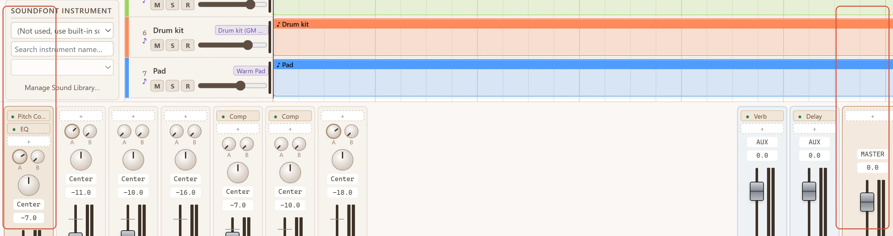

# Lesson 18: The Mixer and Sends: Faders, Buses and Parallel Processing

## Every column of the mixer

| Position | Contents |
|---|---|
| Top | Insert effects (up to 6) |
| Upper middle | Send A/B (how much goes to the bus) |
| Middle | Panning (left and right) |
| Bottom | Fader (volume), level meter, M/S/R |

The two columns on the far right are **Bus A reverb** and **Bus B delay**, and to their right is **Master**. A bus can have its own effects and its own fader; Master is the last stage.

## How it works: dB on the fader

- **+6 dB ≈ twice the amplitude**, **−6 dB ≈ half**.
- A vocal usually sits at **−6 to −3 dB peak**; drums and bass can go closer to 0, because they are the rhythm and the foundation.
- The most important rule: **balance with your ears, not your eyes**. Every track reading −6 dB does not mean the balance sounds right.

## How it works: pre-fader and post-fader sends

A send can be wired two ways:

- **In this software the send is always post-fader**: pull the fader down and the reverb it sends shrinks with it. That matches intuition — push the sound further away and its reverb moves further away too.
- **Pre-fader sends are an option that exists in other DAWs**: however you move the fader, the reverb it sends stays constant, which suits the case where "the reverb amount has to stay the same no matter how the volume is automated". There is no such switch here.

## Parallel processing

Send an **extra** copy of the same track to a bus, compress or saturate it hard on the bus, then pull the bus fader down and blend it back into the main output. This keeps the original transients and the "squashed" thickness at the same time — the standard move for rock and pop drum kits.

## Try it now

In the mixer, open the lead vocal's Send A to −14 dB, then change the reverb space on Bus A to "Plate" and compare it with "Hall".
