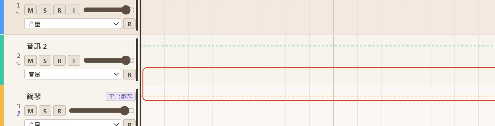

# Lesson 19: Automation: Letting Volume and Pan Breathe

## What automation is

Automation means "**a parameter that changes over time**". The most common one is volume: a little quieter in the verse, louder in the chorus, slowly pulling back at the end of a phrase.

Press **A** to open Automation, and every track gains a curve:

- **Click the curve** to add a control point, **drag** to move it, **double-click or right-click** to delete it.
- Hold Shift while dragging to ignore the grid.
- In automation mode every track gets a **second row**, and the **R** in that row is the "read automation" switch (with it off, the fader's fixed value is used). Do not confuse it with the R in the track header, which is record arm.

The parameters you can automate: volume, pan, Send A, Send B.

## How it works: automation vs compression

Both make the volume change, but in opposite directions:

- **Compression** is **automatic and reactive**: when the sound gets too loud it is pushed down, and you draw nothing.
- **Automation** is **manual and decided in advance**: you state exactly how loud bar 3 should be.

So:

| You want | Use |
|---|---|
| Smoothing out a vocal that keeps jumping in level | Compression |
| Verse → chorus 3 dB louder overall | Automation |
| One line that has to be very quiet (spoken word, breathy) | Automation |

## How it works: why a crescendo is drawn as a curve, not two points

Two points make a straight line, which sounds like "it suddenly starts getting louder". The ear hears volume on a logarithmic scale, so a crescendo is usually drawn as an S shape (slow at first, fast in the middle, slow at the end) to sound natural.

## Try it now

On the lead vocal's volume, draw a crescendo from −3 dB to 0 dB across the first bar of the verse, then draw it back down to −4 dB at the end of the chorus. Play it twice, once with read on and once with read off, and compare.
