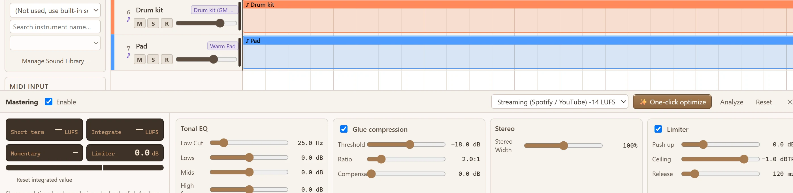

# Lesson 20: Mastering, Album Batches and Export

## What mastering solves

Once the mix is finished, every song has a different loudness. Streaming platforms turn the loud ones down and the quiet ones up — so **the dynamics you made get changed by the platform**. The job of mastering is this: before the song goes to the platform, bring its loudness and its peaks into the range the platform expects.

Two numbers:

- **LUFS (integrated loudness)**: how loud the whole song sounds. The common streaming target is **−14 LUFS**.
- **True Peak (dBTP)**: the actual peak. Anything above 0 dBTP distorts when the file is converted, so **−1 dBTP** or lower is usually recommended.

The master status row along the top shows **LUFS and GR** (the compressor's gain reduction) live; **True Peak only appears in the report after you press "Analyze"** in the master window.

## One-click optimize

Press "✨ One-click optimize" in the master window: the software first analyzes the loudness and spectrum of the whole song, then sets EQ, glue compression and the Limiter, aiming at the platform you chose. When it finishes it shows "before → after"; if you don't like it, Ctrl+Z.

**It is a starting point, not a finish line.** The automatic decisions can make some songs sound flatter, and are worth a little fine-tuning by hand.

## Album batches

"Album" processes **a batch of audio files that are already mixed**: match the loudness, add fades, trim the silence at the head and tail, and export in the original format. There are two modes:

- **Album mode**: the loudest song is brought to the target and the others keep their original size differences (the ballad still comes out quieter) — the way physical albums are made.
- **Each track to target**: every track is pushed to the same loudness, which suits streaming playlists.

## Export formats

| Format | Use |
|---|---|
| WAV 24-bit | Sending to mastering, archiving, the safest option |
| FLAC | Lossless compression, for archiving |
| MP3 | Finished copies, sending to other people (bitrate chosen separately) |

Before you export, remember: **keep one uncompressed master file**.

## Try it now

Run "One-click optimize" once on the demo project and watch the LUFS in the master status row go from whatever it was to −14; then press "Analyze" to see whether True Peak goes past −1.
