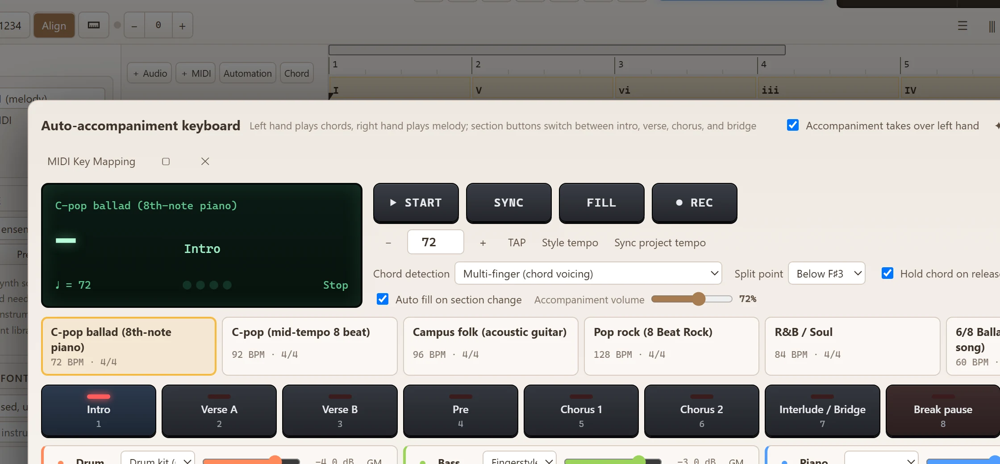

# Lesson 21: The Arranger II: Styles, Sections and Fills

## Why you need to understand "sections" first

The Arranger does not "keep playing the same set of chords". Within one song the verse usually has only piano and bass, and only the chorus pulls in drums, strings and guitar — **the same chord wants a different accompaniment in a different section**. The arranger writes this into the "style": every style has nine sections — Intro / Verse A / Verse B / Pre-chorus / Chorus 1 / Chorus 2 / Bridge / Break / Ending — each specifying the chord movement, which parts play and which fill it uses; **only the intro and the ending have a fixed bar count**, while verses and choruses keep looping until you press the next section.

Take the built-in "Mandopop Ballad (8th-note Piano)" as an example:

| Section | Length | Who is playing |
|---|---|---|
| Verse A | Unlimited (loops until you switch) | Eighth-note piano arpeggios, whole-note bass (no drums, no strings) |
| Verse B | Unlimited | Adds soft drums and touches of guitar |
| Pre-chorus | Unlimited | Piano switches to half notes, strings swell, the arpeggio climbs |
| Chorus 1 | Unlimited | Drums fully open, strings as a bed, guitar strumming |
| Chorus 2 | Unlimited | Bigger drums, octave strings and 16th-note arpeggios |

## What the four buttons do

- **START**: starts running from the current section; press it again to stop.
- **SYNC**: once it is on, the arranger **does not start on its own** — it waits until your left hand presses the first chord on the keyboard, then comes in lined up with the bar line. Pressing START instead begins immediately.
- **FILL**: plays a fill right away (a drum transition), usually landing on the last bar of a section.
- **REC**: records what the arranger is playing as MIDI — **one clip per part** (Accomp-drums, Accomp-bass …), which you can then edit, quantize and add effects to.

## How it works: why fills always sit "one bar before the section changes"

The point of a fill is to **announce** — to tell the ear "the next section is coming". So it almost never appears in the middle of a section; it lands in the last beat or two of a section, and the first beat of the new section answers with a crash cymbal. That is also why, when you build your own accompaniment, dropping a short drum transition at a section boundary suddenly makes the whole song "feel arranged".

There is one more rule when you change sections: **the new section takes effect on the first beat of the next bar**, not the instant you press it. That way a bar never gets cut in half.

## Common mistakes

- **You picked a section but nothing plays**: every part in that section is off (Verse A has no drums, for example). That is by design, not a fault.
- **Fills too often**: one every two bars is noisy; once every 4 or 8 bars is usually enough.
- **No chord, no sound**: the arranger **only follows the chord your left hand plays, and has nothing to do with the chord track**. With no chord held it defaults to a C major triad.

## Try it now

Start a new project and choose "Mandopop Ballad". Hold C with the mouse on the keyboard at the left of the panel (or on a MIDI keyboard) and press START to get it running; then change through Am → F → G, two bars each. Then switch to Chorus 1 and notice the drums and strings arriving at that moment — the least work an arrangement ever takes.

(To turn a chord track into a whole song in one click, see lesson 23, Smart Arrangement.)
