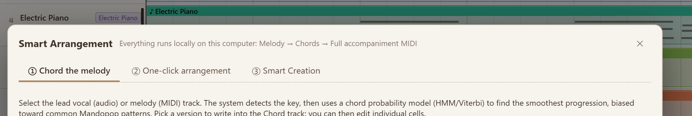
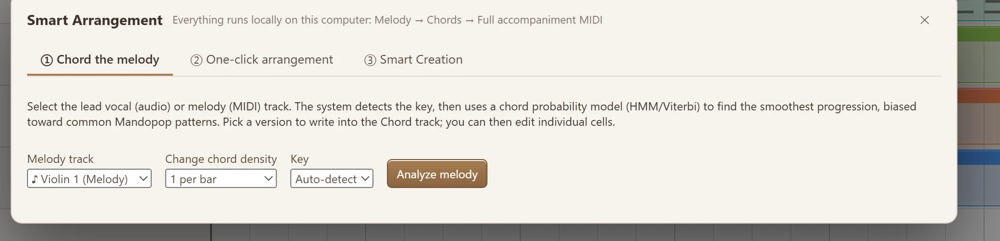
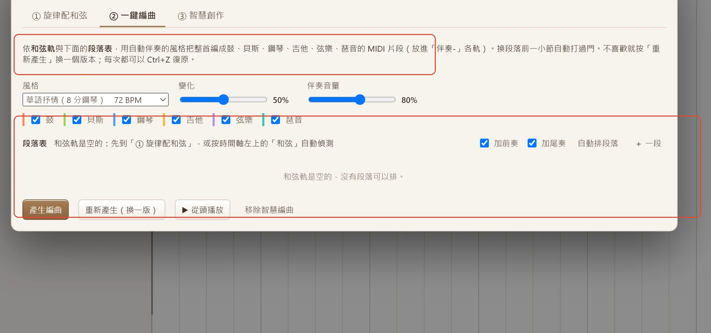

# Lesson 23: Smart Arrangement: One Click Turns Chords into a Full Accompaniment

## The three tabs on the panel

Press **✦ Smart Arrangement** in the top row and a panel opens with three steps, which you can use separately:

1. **Chord the melody**: give it a melody (audio or MIDI) and it works out what chords to put under it.
2. **One-Click Arrangement**: with a chord track already there, arrange it into a whole accompaniment (drums, bass, piano … all written as MIDI).
3. **Smart Creation**: generate the chords and the melody from nothing (next lesson).

All three run **on your computer**, with no server involved.

## ① Chord the melody

Choose a melody track, decide the chord density (one per bar, or denser), leave the key on "auto", and press analyze.

The method is a **hidden Markov model (HMM) plus Viterbi**: each bar's "possible chords" are treated as states, and two factors score them — how well the chord fits the bar's melody notes (more chord tones, higher score), and how smoothly it follows the chord before and after it (common Mandopop moves score higher). Viterbi's job is to find, among all the combinations, the path with **the highest total score across the whole song**, so you never get "each bar looks most likely on its own, but the joins sound strange".

The result is written into the chord track, and you can still edit it by hand.

## ② One-Click Arrangement

First check that the chord track is complete, then lay out a **section list** in the panel: one row = one section, where you set the bar count, which section it is (verse / chorus …) and the intensity. Choose a style and press generate.

It **shares the same style data as the arranger**, so it sounds like the arranger playing — only **written out as the whole song in one pass**:

- The bar before a section change gets a fill automatically, and the first beat of the new section gets a crash cymbal
- Press "Variation" for a different seed with the same settings and it changes the fills, the passing notes, the chord voicings and the dynamic shape
- The seed is stored on the clip, so you can reproduce the same version later

The generation writes into the "Accomp-drums / Accomp-bass …" tracks; the old smart-arrangement clips are replaced, and the whole action can be undone with **Ctrl+Z**.

## How it works: why "arrange to MIDI" instead of just playing it

Once it is MIDI, every single note can be changed: delete one fill, turn a bass beat into a passing note, change a piano voicing. The arranger is **live playing** (nothing happens until you press), while Smart Arrangement is **write it first, fix it after** — different workflows, and which one you use depends on whether you want to play and sing along, or to make a finished track.

## Try it now

Using the chord track you made in lesson 12, lay out a section list of "verse 8 bars → chorus 8 bars → ending 4 bars" and press play after generating. Then press "Variation" and generate again; keep both versions and listen to the difference — you will find almost all of it is in the fills and the dynamics, while the harmony is identical.
