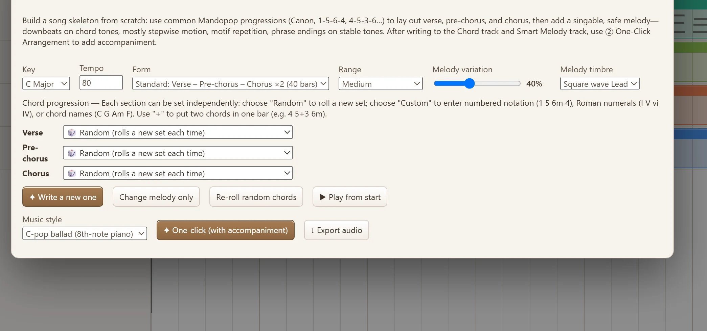
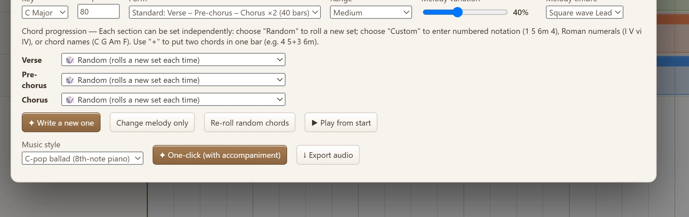

# Lesson 24: Smart Creation: Chords and Melody from Scratch

## What it generates

Press **✦ Smart Arrangement → ③ Smart Creation**, choose the key, the style and the length, and it gives you:

- a **chord track** (one progression each for verse / pre-chorus / chorus / bridge, forming the form of a song)
- a **lead melody MIDI** (which you can edit straight away, add lyrics to, or use for the arrangement)

For now it **only supports 4/4** — if the time signature is not 4/4 it tells you outright.

## Where the chords come from

This is not random: the progressions are picked from a list of **common Mandopop progressions**, for example:

| Name | Degrees |
|---|---|
| Canon progression | I–V–vi–iii–IV–I–IV–V |
| 1-5-6-4 | I–V–vi–IV |
| 1-6-4-5 | I–vi–IV–V |
| 1-3-4-5 | I–iii–IV–V |
| 6-4-1-5 | vi–IV–I–V |

Songs in a minor key are written in terms of their **relative major** (the tonic chord is vi), so one set of rules covers both. On the form side: **the same kind of section repeats with the same chords** (Chorus 1 and Chorus 2 match), and the last chorus ends on the tonic.

## Why the melody "sounds like a song"

The melody takes the "safe route", and the rules are written out plainly:

- **Downbeats and long notes always land on chord tones**; weak beats may use passing notes, but they have to approach them by step
- It stays mostly in the **pentatonic scale** (the 4th and 7th degrees are used sparingly), so it never suddenly sounds "Western"
- **Mostly steps, few leaps**; after a leap it steps back in the opposite direction
- The rhythm uses **a one-bar motif repeated** (a b a c), and the second phrase repeats the first or sequences it from the root — easy to remember
- Each phrase is an **arch**; the verse sits low and the chorus goes 3 to 5 degrees higher
- Phrase endings land on stable tones, and the whole song ends on the tonic

## How it works: why "easy to sing" is harder than "complicated"

Writing a melody with some variation in it is not hard; the hard part is **making it stick after one listen and easy to sing the moment you open your mouth**. Those rules are really **limits** — limits on the pitch choices, on the rhythm pattern, on the range — narrowing the available material to what the ear already knows. This is exactly what composition classes call "motif development": hand over a short motif, then use repetition and sequence to let the listener get hold of it.

## Seeds, and changing only half

Generation uses a seeded random number: pressing again with the same settings gives a different version, and the status row shows the version number (for example #537). **At the moment you cannot type in a seed to reproduce a particular version** — if you want to keep the one you like, save it as a project or copy it to a new track. And you do not have to start over when you want to adjust it: you can change only the melody and keep the chords, or change only the chords and keep the melody, which is especially useful when "the chords sound good but the melody does not flow".

## Try it now

Generate a 16-bar song, and after listening through, press **change melody only** three times and compare which version is easiest to sing. Save the version you like best, then use lesson 23's "One-Click Arrangement" to turn the chords into a full accompaniment — that is the whole route this tool offers, from nothing to a finished track.
