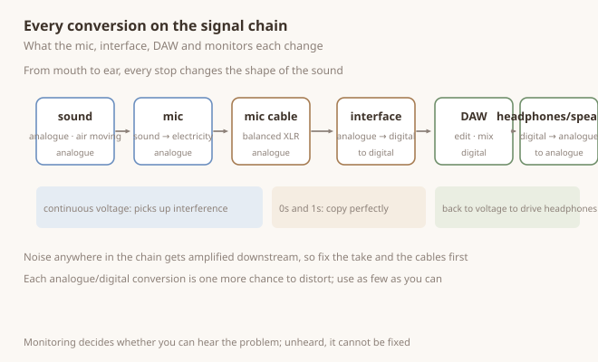
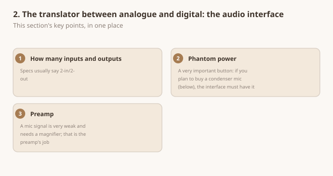
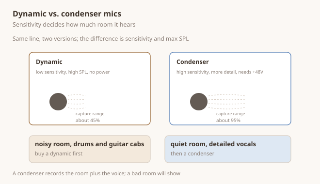
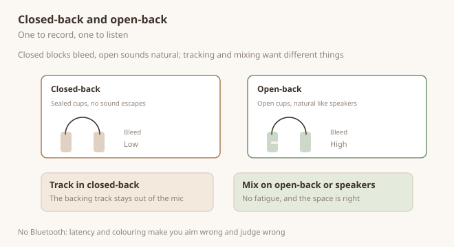
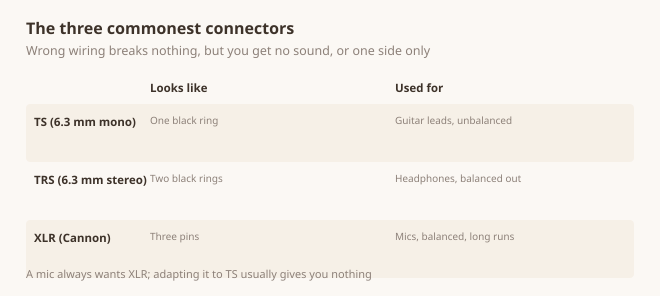
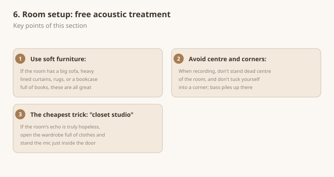
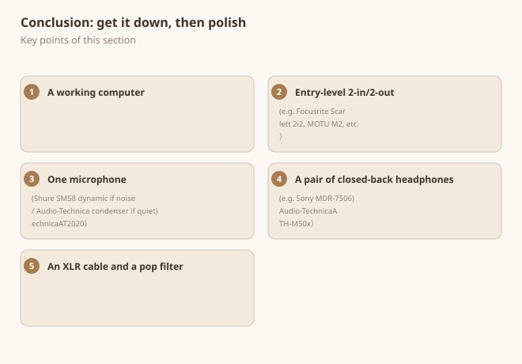

# Lesson 1: Building a Personal Studio: Hardware and Room Setup

When most people hear the word "studio", what comes to mind is a wall-sized mixing console, a perfectly isolated anechoic chamber, and equipment costing millions. But digital technology has come a long way. Plenty of Grammy-winning albums were made by musicians in their own bedrooms, or on a laptop in a hotel room.

The goal of this lesson is to break the myth that more expensive gear is always better. We'll use the plainest, most everyday language to walk you through the core hardware that makes up a home studio. Ready to turn your room into a base for making music? Let's start.

## 1. The studio's brain: the computer (Computer)

To make music today, the computer is the core of everything. It doesn't have to be a super machine, but it has to handle audio data reliably. Think of the computer as a kitchen: this is where you cook the ingredients (recordings) into a dish (music).

### 1. The kitchen counter: memory (RAM)

Memory is like the counter in the kitchen. The bigger the counter, the more ingredients and pots you can spread out at once. When you record you'll have many tracks open and many plug-ins loaded (reverb, EQ and so on). If memory is too small, the computer stutters, or crashes.

- **Recommended spec:** 16GB minimum. If you plan to use a lot of large virtual instruments later, 32GB gives you room to spare.

### 2. How fast the cook works: the processor (CPU)

The CPU is the head chef: it sets the speed at which data gets processed. The faster the chef, the more tasks can run at once without things falling apart.

- **Recommended spec:** on a Mac, the M-series chips of recent years (M1, M2, M3) do very well at music production; handling audio, you almost never hear the fans spin up. On Windows, an Intel Core i5 or AMD Ryzen 5 and above usually covers everything from basic to advanced work.

### 3. The pantry: storage

Storage is your fridge and pantry. Music files, especially uncompressed recordings (WAV files), are big.

- **Recommended spec:** strongly recommend an SSD, not a traditional HDD. SSDs read and write fast enough that opening a project doesn't take forever. For capacity, 512GB or 1TB built in; when files pile up later, buy an external drive for the old projects.

## 2. The interpreter between analogue and digital: the audio interface (Audio Interface)

Many people ask: "Can't I just plug the mic into the computer's headphone jack and record?" The answer: you can, but the sound will be a disaster, and there will be serious latency.

That's when you need an **audio interface**.

The interface works like a super-interpreter. The sound we make in the real world (singing, playing guitar) is an "analogue signal"; the computer only understands "digital signal", 0s and 1s. The interface's job is to turn your voice into a digital file the computer can read, and at the same time turn the music inside the computer into sound you can hear in your headphones.

### Three keys when choosing an audio interface

1. **Number of inputs and outputs (I/O):** the spec usually says 2-in/2-out. That means you can plug in two microphones at once (or one mic plus an electric guitar) and send out a pair of signals to speakers. For a beginner's home recording, 2-in/2-out is the golden configuration: the best value for money.
2. **Phantom power (48V):** this is a very important button. If you plan to buy a condenser microphone (covered below), the interface must have a button marked "+48V" that supplies extra power to the mic; without it the mic makes no sound at all.
3. **Preamplifier (preamp):** the signal a mic captures is very weak and needs a magnifying glass to bring it up. That's the preamp's job. A good interface has a clean, noise-free preamp built in, so what you record is clear and full.

## 3. The ears that capture sound: the microphone (Microphone)

The microphone is the first gate your soul and your emotion pass through on the way into the computer. There are thousands of mics on the market, but for a home-recording beginner we only need to understand two schools: dynamic and condenser.

### 1. Dynamic mic

- **Character:** sturdy, needs no extra power (no 48V), lower sensitivity.
- **Everyday analogy:** like a very focused listener who is a bit hard of hearing. They only hear sound that comes very close and loud.
- **Strengths and where it fits:** this is a blessing for home recording. Because sensitivity is low, if your room has no treatment, a motorcycle roars past the window, the TV is on in the living room, or a child is asleep next door, a dynamic mic usually filters out that unwanted background. It suits a rock lead vocal, a shouted performance, or sitting in front of a guitar amp.

### 2. Condenser mic

- **Character:** extremely sensitive, wide frequency response, strong at capturing detail; it must have +48V phantom power from the interface to work.
- **Everyday analogy:** like a secret agent with super hearing. Not only your soft breath and the friction between lips and teeth — it picks up your stomach rumbling, or the garbage truck's music far outside the window, just as clearly.
- **Strengths and where it fits:** if you want a pop female vocal, a soft acoustic guitar strum, or that ASMR quality of someone speaking right by your ear, a condenser is the first choice. The drawback: it demands a lot of the room. If your room has a lot of reverb, the take sounds like singing in a bathroom.

**Beginner tip:** if your room has no acoustic treatment and is on the noisy side, buy a better dynamic mic first. If your room is fairly quiet and you have a wardrobe or curtains to help absorb sound, a condenser mic will give you a more delicate, more affecting sound.

## 4. The mouth that checks the sound: monitoring (Monitoring)

After recording we need to hear what we recorded, and that takes monitor headphones or monitor speakers. Note the word "monitor": it is very different from the gear we use to listen to music.

The Bluetooth earbuds we buy (AirPods, say) or a home stereo are tuned by the manufacturer to make music sound more "fun": bass boosted, treble brightened. That's called colouration. Mixing on coloured headphones is like painting while wearing pink sunglasses: you think the red is dark enough, then you take the glasses off and find the whole thing is a mess.

The only job of monitoring gear is to be **honest**. It doesn't beautify the sound: good is good, bad is bad. Only then can you judge a mix correctly.

### 1. Monitor headphones

For home recordists, headphones are the first thing to invest in. There are two designs:

- **Closed-back:** the earcups are fully sealed. The advantage is no leakage, which makes them right for recording. When you sing along with a backing track, the track in the headphones doesn't leak out and get captured by the mic. The drawback is that your ears get hot after a while, and the sound feels more enclosed.
- **Open-back:** the back of the earcup has openings. The advantage is a very natural, wide sound, like listening to speakers in a room; good for long mixing sessions. The drawback is serious leakage: anyone nearby hears exactly what you're listening to, so they're not for wearing in front of a mic.

### 2. Can I record with Bluetooth headphones?

**Absolutely not.** Bluetooth unavoidably has latency. Picture it: you sing "hello" into the mic, and 0.3 seconds later "hello" arrives in the headphones. Your brain is thrown off and you cannot sing in time. Use a wired headphone plugged into the interface.

## 5. The studio's veins and skeleton: cables and accessories

Many people spend a fortune on a mic and an interface, then ignore the small, unglamorous accessories — which are often the source of the noise.

### 1. Microphone cable (XLR cable)

We usually call it a "Cannon" cable; the connector has three pins inside. One end is female (into the mic), one end male (into the interface). The design is called a "balanced signal", and it resists electromagnetic interference from the room. Buy a stable, good-quality XLR cable. You don't need an audiophile cable at an absurd price, but never buy a cheap cable of unknown origin.

### 2. Mic stand

The most common for home recording is the boom stand (clamped to the desk edge, swinging around like a desk lamp) or a plain upright floor stand. A boom saves desk space and suits recording while you sit at the computer; a floor stand suits singing standing up, or miking a guitar.

### 3. Pop filter

If you bought a condenser mic, this is essential. It's usually a round mesh clipped in front of the mic. When we make consonants with "P", "B", "T" (apple, dad), the mouth shoots out a strong puff of air. If that puff hits the mic's diaphragm head-on, it produces a boom like an explosion (called a plosive, or popping). A pop filter breaks up the puff and keeps the take from being ruined.

**Home-recording storage tip:** as your gear grows you'll accumulate a pile of adapters (3.5mm to 6.3mm), short USB cables, guitar picks and so on. Buy a **16-compartment parts box** from the hardware shop, the kind used for sorting screws, sort the small parts into it and label them. Your desk stays tidy, and when inspiration strikes you won't give up in frustration because you can't find an adapter.

## 6. Room setup: acoustic treatment that costs nothing

With the hardware in place, let's talk about the space you record in. The room sometimes affects the sound more than the microphone does.

You don't need to spend a fortune on professional acoustic foam and cover the whole room at the start. Begin with a simple clap test: stand in the middle of the room and clap hard once. If you hear an obvious metallic "clap—ting—" reverb (like an empty underground car park, or a fully tiled bathroom), that's sound bouncing back and forth between two parallel hard walls. We call it flutter echo.

### Home acoustic improvements

1. **Use soft furniture:** a big sofa, heavy double-layer curtains, a rug, or open bookshelves full of books are excellent natural absorbers and diffusers. They dry the room out.
2. **Avoid the dead centre and the corners:** when you record, don't stand in the exact middle of the room and don't curl up in a corner; those places collect low frequencies (boom).
3. **The cheapest trick, the "wardrobe studio":** if the room's reverb is beyond saving, open the wardrobe full of clothes, put the mic at the wardrobe door, and sing facing the clothes. Clothes are a near-perfect absorber, and this gets you a very clean, reverb-free "studio quality" vocal.

## Conclusion: the first step is the hard one — get something first, make it good later

| Order | What to buy | Recommendation | Why it comes first |
|---|---|---|---|
| 1 | Audio interface | 2-in/2-out, with +48V | Without it there is no low-latency input |
| 2 | Microphone | Dynamic if the room is noisy, condenser if it is quiet | Solve "can I capture it" first |
| 3 | Closed-back headphones | Wired, as uncoloured as possible | No leakage while recording |
| 4 | XLR cable and pop filter | Ordinary quality is enough | The most common sources of noise and plosives |
| 5 | Acoustic treatment | Heavy curtains, wardrobe, rug | Affects the sound more than changing mics |

After this long gear guide you may feel a little dizzy. So here, to finish, is the best shopping formula for a beginner:

- **A normal computer**
- **An entry-level two-channel audio interface** (Focusrite Scarlett 2i2, MOTU M2 and the like)
- **One microphone** (choose the dynamic Shure SM58 if noise is a worry / the condenser Audio-Technica AT2020 if the room is quiet)
- **One pair of closed-back monitor headphones** (Sony MDR-7506, Audio-Technica ATH-M50x)
- **One XLR cable and one pop filter**

Put together, this set usually costs under NT$10,000–20,000, and it covers more than 90% of what music production asks for. Remember: gear is only a tool. What gives music its soul is your ideas and your feeling. Set the gear up, connect the cables, open the software and record your first sound. See you in the next lesson.

