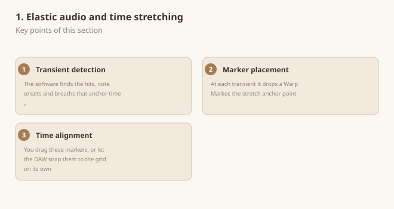
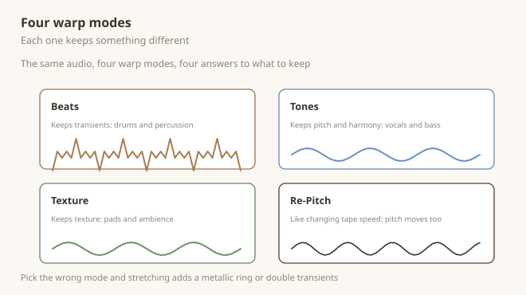
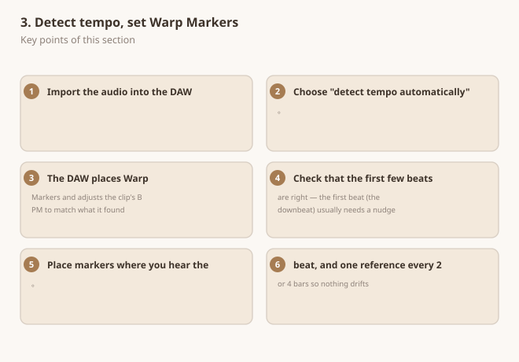
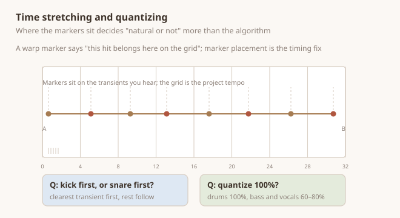
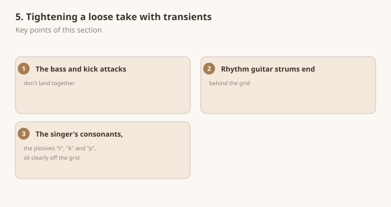
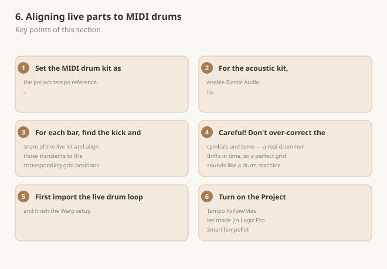
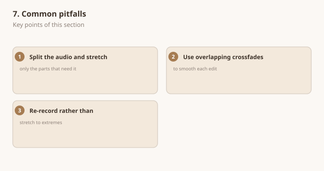
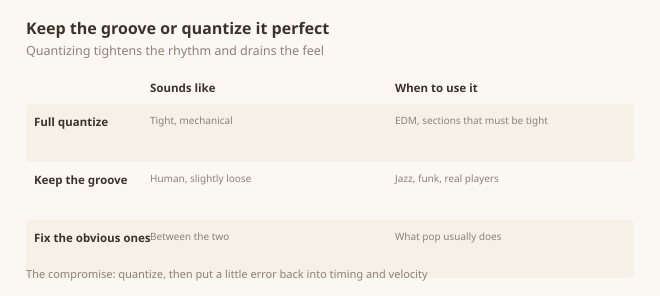
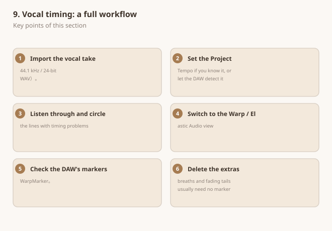
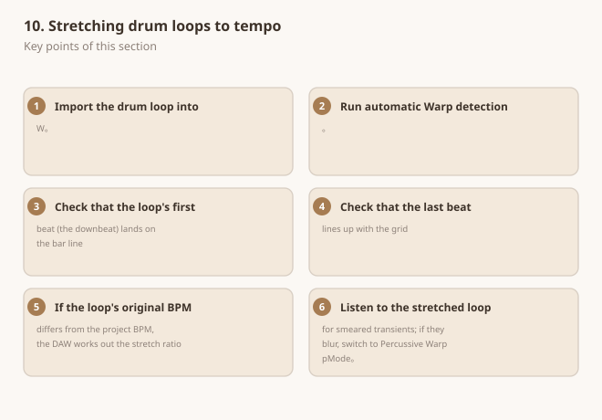

# Lesson 10: Timing Correction: Using Elastic Audio and Warp

## 1. What is elastic audio, or time stretching?

In a digital audio workstation (DAW), **elastic audio**, also called **warp**, is a technique that changes the playback speed and the position of an audio clip in time while **keeping the original pitch as far as possible**. What was new about it: it broke the physical limit of the tape era, where faster meant higher and slower meant lower. A producer could now move recorded notes around as freely as MIDI notes.

### How it works

Elastic audio is essentially **a non-linear scaling of the timeline**. The DAW first finds the zero crossings or transients in the waveform and treats the region between them as an independent block. When part of the audio has to go faster or slower, the DAW briefly **resamples** the samples inside the block and applies **overlap-add** windowing, so the ear does not hear the pitch change.

In practice the process has three steps:

1. **Transient detection.** The software finds the clear time anchors in the waveform: drum hits, the onset of consonants, breaths.
2. **Marker creation.** It places a warp marker at each transient.
3. **Time alignment.** You drag those markers, or let the DAW snap them to the grid.

---

## 2. Choosing the algorithm

Not every kind of audio suits the same stretching algorithm. DAWs (Ableton Live, Logic Pro, Pro Tools, Cubase) usually offer several **warp modes** or elastic audio algorithms, each optimised for a different kind of material.

### Polyphonic / complex

For audio where several frequencies sound at once: **chord progressions, piano, strummed guitar, a string ensemble**. This mode uses a **phase vocoder** or frequency-domain stretching. It preserves the harmonic structure, but it costs more processing, and extreme stretching (more than 1.5 times, or below 0.5 times) readily produces **metallic artifacts** or a comb-filtered sound.

### Monophonic / tones

For audio with a single pitch: **a lead vocal, a single-note bass line, a saxophone solo**. This mode is built on **time-domain overlap-add (TD-OLA)**. It tracks a single frequency more accurately, and the artificial quality after stretching is milder than in polyphonic mode. Stretch a dry vocal from 120 BPM to 100 BPM and monophonic mode usually keeps more of the natural vibrato detail.

### Percussive / beat

Designed for **drum kits, percussion and rhythm loops**. This mode protects transients best: after stretching, the drums keep their attack and impact. Use polyphonic mode on a hi-hat loop by mistake and you often hear a smeared attack or a sound like tearing paper.

### Rhythmic / texture

Between polyphonic and percussive, for sustained sounds with rhythmic content: **synth arpeggios, muted rhythm guitar chunks, fast tremolo on a guzheng**. This mode splits the audio into smaller grains, keeping some of the attack and some of the harmony when the time is stretched.

### Re-pitch

This is the only mode that changes pitch; it imitates tape speed. In some situations, when you deliberately want a chipmunk effect or dark vocals, re-pitch is the right choice.

---

## 3. Detecting the tempo and placing warp markers

Before you correct timing, the DAW has to know the **original tempo** of the recording.

### Automatic detection

Ableton Live's **Warp From Here** and **Warp as 1/2 Beat Loop / 4 Beat Loop** detect the tempo and place the markers in one go. Logic Pro's **Smart Tempo** analyses the recording and aligns the whole project tempo to it. Pro Tools' **Elastic Audio** offers **Tempo Detection** in the clip properties panel.

The workflow:

1. Import the audio into the DAW.
2. Choose "detect tempo automatically".
3. The DAW places warp markers and adjusts the clip's BPM to match.
4. Check that the first few beats are in the right place. The first downbeat usually needs a small manual adjustment.

### Placing markers by hand

When automatic detection is inaccurate (a rubato performance, a live band whose tempo drifts), you place the warp markers yourself:

- **Put the first marker on the audible downbeat.** On a solo instrument with no drummer, use the strongest attack of the first beat.
- **Put a reference marker every 2 or 4 bars** so the overall timing does not drift.
- **Put extra markers where the playing clearly rushes or drags**, and pull those spots locally.

### The fixed point: warp from here

In Ableton Live, once you set a warp marker and choose "Warp from Here", everything to the left of the marker stays as it is and everything to the right is recalculated from the stretch ratio. This matters: the marker position is fixed, and the audio to its right is redistributed in time according to the stretch.

---

## 4. Quantising audio to the grid

Quantising is the central function of timing correction. The workflow:

1. Confirm the DAW has placed the warp markers correctly and the project tempo is set.
2. Select the audio clip you want to work on.
3. Run the Quantize command (Ableton: Cmd+U (Mac) / Ctrl+U (Win); Logic: Cmd+Q, or Edit ▸ Quantize; Pro Tools: Edit ▸ Quantize, or Cmd/Ctrl+Shift+0).
4. Set the parameters:
   - **Grid size.** The smallest quantise unit: 1/4 note, 1/8, 1/16, triplets. For a pop vocal, 1/16 is usually enough; for a drum loop, try 1/32 or even 1/64.
   - **Strength.** 0–100%. 100% snaps everything to the grid. Set it between 70% and 90% to keep some of the natural groove.
   - **Timing randomization.** You can add a small random offset (1–5 ms) to imitate the microscopic timing variation of a real player.
5. Play it back and check. The **hi-hat and snare** are where an artificial feel shows up first.

---

## 5. Tightening a loose performance: adjusting transient markers

In a live recording, small timing differences between players are unavoidable. Warp markers give you a **non-destructive** way to correct them.

### Step one: find the problem

Zoom in on the waveform and look for:

- The attack of the bass and the attack of the kick not lining up
- The end of a rhythm guitar strum landing after the grid
- The consonants of the lead vocal (the plosives on "t", "k", "p") clearly out of place against the grid

### Step two: align the problem points

Double-click a warp marker and drag it to the right grid position. On a multitrack recording, use the **kick and snare** as the timing reference, because those two shape the groove most.

### Step three: bridge the gap between markers

If moving one transient makes the audio around it jump or tear, add another warp marker nearby and stretch the whole span gently, so the time change is smoother.

---

## 6. Aligning acoustic instruments with MIDI and drum machines

Modern pop production often mixes **recorded acoustic instruments** (real drums, guitar, piano) with **MIDI drum kits or drum machines** (808, LinnDrum and so on). If their sense of time is not coordinated, it sounds like the band fighting the click.

### Strategy one: the drum machine leads, the acoustic instruments stretch

If the MIDI kit is the skeleton of the arrangement, the real instruments should move toward the machine.

1. Make the MIDI kit the basis of the project tempo.
2. Turn on elastic audio for the acoustic instruments (the real drum kit, for example).
3. For every bar, align the transient of the acoustic kick and snare to the matching grid position of the MIDI kit.
4. Careful: don't over-correct the hi-hats and toms. A real drummer has natural timing variation there, and aligning them completely makes the kit sound like a machine.

### Strategy two: the acoustic drums lead, the MIDI follows

Some producers prefer to keep the human feel of the real kit and let the MIDI follow:

1. Import the real drum loop into the DAW and warp it.
2. Turn on the project tempo's follow or master mode (Logic Pro's Smart Tempo Follow, Ableton's Set as Master).
3. Set the MIDI kit's playback mode to "Follow Project Tempo"; the DAW then changes the playback speed to match the real drums.

---

## 7. Common traps

### Artifacts

Extreme stretching (over 200% or under 50%) produces obvious digital artifacts: wobble, a metallic edge, a tearing sound. Fixes:

- Split the audio and stretch only the sections that need correcting
- Use crossfades to smooth the transition
- Consider recording it again rather than stretching it that far

### Losing the feel

Over-quantising puts every beat at 0 ms, which usually makes the music sound machine-played. This is quantisation death. The ear is very sensitive to timing offsets of a few milliseconds (roughly 5–25 ms), and a perfectly even rhythm produces a zombie feel instead.

### Breaths

A vocal breath usually should not be aligned to the grid. If you accidentally snap a breath marker onto the beat, it sounds as if the singer is breathing once per beat, which is very strange.

### Phase

On a multi-microphone recording (the overheads, room and close microphones on a real kit), applying elastic audio to individual tracks separately can break the **phase coherence** of the original recording. Group all the drum tracks and warp them together, or use the DAW's multitrack warp function.

---

## 8. Keeping the groove vs perfect quantisation

This is where timing correction needs the most artistic judgement. Some practical advice:

| Style | Suggested quantise strength | Note |
|---------|-----------|------|
| EDM, pop | 80–100% | Needs a tight rhythm |
| Funk, soul | 50–70% | Keeps the shuffle in the groove |
| Jazz trio | 0–30% | Keeps the swing and the interaction |
| Classical solo | No quantising | Fix only the clearly wrong notes by hand |
| Hip-hop vocal | 60–80% | The vocal can sit slightly behind the grid (laid-back) |
| Metal double kick | 90–100% | Double kick needs very precise values |

The secret to keeping the **groove**: don't use 100% strength, and let each note sit 5–15 ms off the grid. Deliberately keep **certain instruments a little behind the grid** (laid-back) or **a little ahead** (pushing), to create musical tension and release.

---

## 9. In practice: a vocal timing correction workflow

Here is a complete vocal timing correction session.

### Step 1: Prepare

1. Import the vocal recording (usually a 44.1 kHz / 24-bit WAV).
2. Set the project tempo if you know it, or let the DAW detect it.
3. Listen right through and mark the lines with obvious timing problems.

### Step 2: Inspect the transient markers

1. Switch to the warp or elastic audio view.
2. Look at the warp markers the DAW placed automatically.
3. Delete the unnecessary ones: breaths and fading note endings usually need no marker.
4. Make sure every word's onset consonant has a marker.

### Step 3: Correct section by section

1. Start from the first line and play through line by line.
2. If a word clearly drags, drag its warp marker to the nearest 1/16 grid line.
3. If a word rushes, pull the previous marker to the right, or pull that marker to the right.
4. After each adjustment, listen to the two bars either side of the join.

### Step 4: Listen to the flow of the whole

1. Turn the warp marker display off and listen in normal playback.
2. Watch for an unnatural jump or a sense of time being squeezed.
3. If a passage feels over-compressed, lower the quantise strength around it or undo.

### Step 5: Align with the backing rhythm

1. Play the vocal together with the backing rhythm track (kick + snare + hi-hat).
2. Check especially whether the vocal's **stressed syllables** land with the kick or the snare.
3. For a laid-back singer, allow some syllables to sit 10–20 ms behind the grid.

---

## 10. Stretching a drum loop to the project tempo

Drum loops are one of the most common uses of elastic audio.

### The workflow

1. Import the drum loop into the DAW.
2. Run automatic warp detection.
3. Confirm the loop's first downbeat is aligned to the start of the bar.
4. Check that the last beat matches the grid. If the whole loop is at the right BPM, it usually lines up by itself.
5. If the loop's original BPM differs from the project BPM, the DAW calculates the stretch ratio.
6. Check whether the stretched loop has a **smeared transient**. If it does, switch to percussive warp mode.

### Making half-time and double-time effects

- **Half-time.** Set the warp mode to percussive and the clip BPM to twice the project BPM; a 4-bar loop stretches to 8 bars.
- **Double-time.** Set the clip BPM to half the project BPM and the loop shrinks to 2 bars.
- Both are widely used in trap, dubstep and lo-fi.

### Mixing loops at different BPMs

To bring drum loops at different BPMs into one project, warp each loop separately. The DAW reads each clip's original BPM and works out the stretch automatically, so every loop stays in sync with the project tempo. This is standard practice in modern electronic production.

---

## Closing

Warp and elastic audio are among the most powerful tools in modern production. They give you timing control nobody had before, and at the same time they ask more of your musical judgement. Learning **when to warp and when not to**, and **how much quantising is just right**, is what separates a professional producer from an amateur.

Remember: the goal of warping is not to put every millisecond on the grid. It is to make the music sound **natural, moving and alive**. The tool is only the means; the musicianship is the point. Next lesson we look at combining this technique with more advanced arrangement ideas to build sound with more depth.
