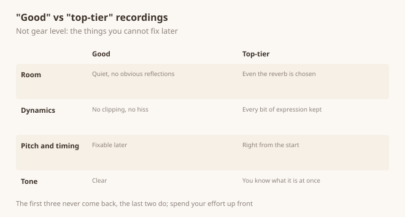
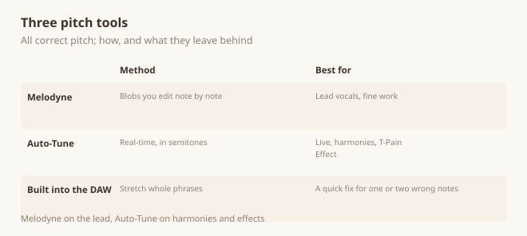
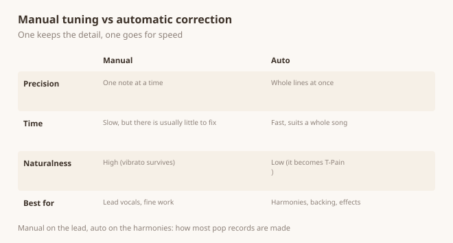
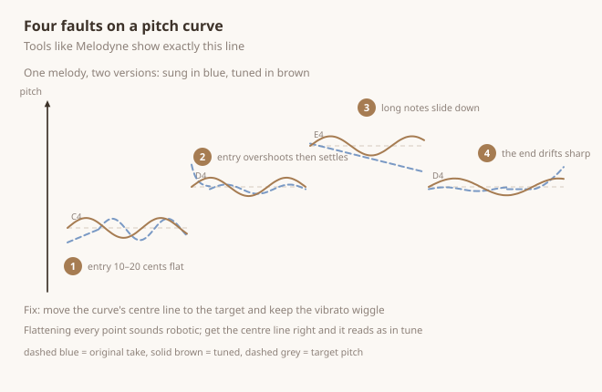
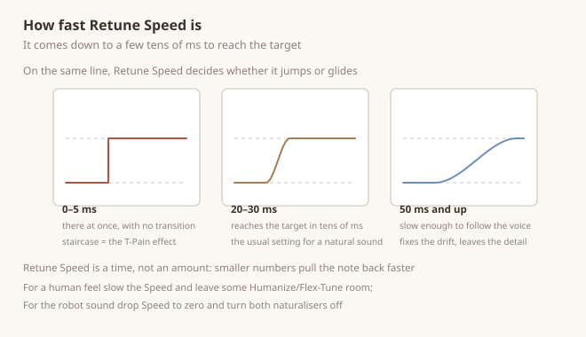
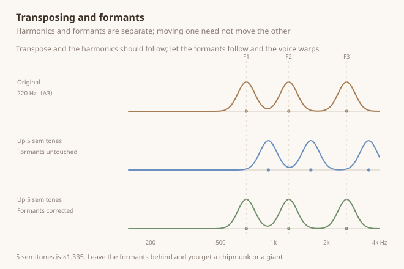
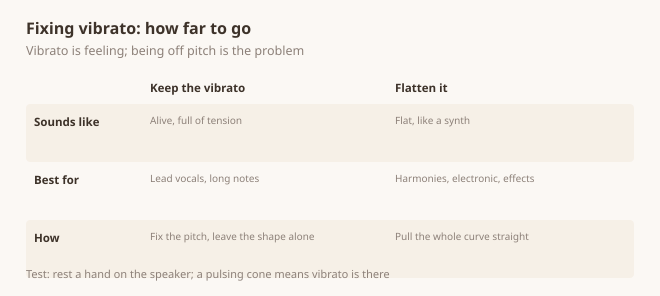
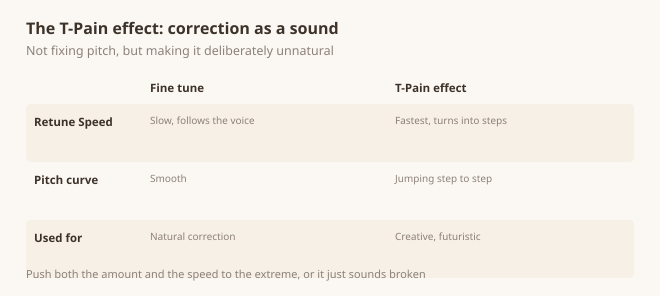
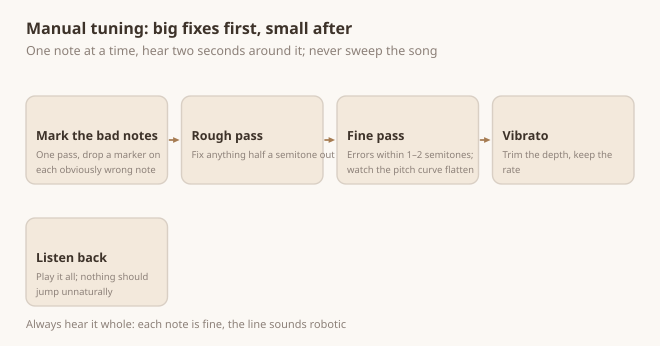
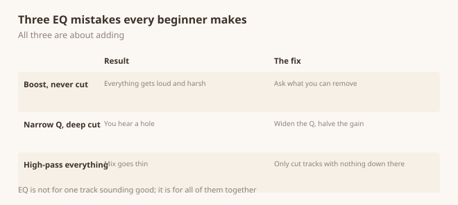

# Lesson 11: Vocal Correction: Pitch Detection and the Basics of Pitch Correction

Vocal correction has become a core skill in modern production. Whether you record pop songs, covers or a podcast, learning to detect pitch problems accurately and correct them effectively takes your work from "not bad" amateur level up to professional quality. This lesson starts from the acoustics and goes all the way to a working workflow, so you can see the whole technical system and how to use it.

## Why vocal correction: the gap between a good take and a great one

Almost every beginner asks the same natural question: "I'm already singing in tune, so why correct it? Isn't the original voice the truest and best sounding?" The answer is the first step to understanding vocal correction. A perfect vocal recording is not simply "hitting the right notes". Look at where the difference between a good vocal and a great one actually lies.

A good take has these features: the pitch is roughly right, you can tell what the melody is, there is no obvious wrong note or vocal break; the timing is steady, with no clear rushing or dragging; the emotion comes through naturally, without a strange mechanical or electronic edge. Overall it is an acceptable recording, already quite good to an ordinary listener.

A great take goes further: every note sits precisely where it should, not approximately but almost exactly; the transitions between notes are smooth, with no abrupt break or jump; the vibrato is steady and controlled, not speeding up and slowing down or changing width; the breath and dynamics are finely graded, so the small emotional turns in the words come through; and the whole sound is clean, focused and penetrating, able to stand out clearly in the final mix instead of being covered by the instruments.

One idea matters more than the rest, so hold on to it: vocal correction is not about turning a singer into a robot. It is about helping an already good take reach the next level. Even the biggest singers in the world, Adele, Bruno Mars, Taylor Swift or Ed Sheeran, have their recordings tuned to some degree before mixing. The question was never whether to correct. It is how much and in what way. Correct too little and the quality does not improve; correct too much and you damage the sincerity and the human warmth of the performance. An experienced mixer knows how to balance the two so that the listener never senses the correction, and only thinks "that sounds great".

## Understanding pitch: notes, cents and equal temperament

To correct pitch you first have to understand how pitch is measured, described and quantified. Pitch is not a vague subjective idea; it is an objective quantity with an exact mathematical and physical basis.

### Notes

In twelve-tone equal temperament, an octave is divided into 12 exactly equal semitones. This system is the most widely used tuning system in the world: piano and guitar, pop song and symphony, almost all modern music is built on it. With A4 = 440 Hz as the international reference pitch, moving up or down one semitone multiplies or divides the frequency by the twelfth root of 2. Every 12 semitones the frequency exactly doubles or halves, completing an octave cycle. The usual range of note names runs from C0 to B8, and Middle C, or C4, is about 261.63 Hz. The white key in the middle of a piano is C4, and it is also the reference point for most vocal ranges.

### What a cent means

The cent is the basic unit of fine pitch adjustment, and it is the unit you see most often in vocal correction tools. One semitone is 100 cents, so half a semitone is 50 cents, a quarter of a semitone is 25 cents, and an eighth is 12.5 cents. One cent is an extremely small pitch change, one that only a well-trained ear can hear. Think of the cent as a fine ruler for pitch, letting you put a number on how far off a note is.

More concretely: under normal conditions the human ear can tell a difference of about 5 to 10 cents. An ordinary listener cannot hear a deviation under 5 cents at all, but at 10 to 15 cents they start to sense that something is slightly off. A professional singer with long listening training can hear a deviation of 2 to 3 cents. Vocal correction tools usually show how many cents the current pitch is away from the target note, which lets you adjust with great precision.

### Tolerable deviation

In real production, a vocal does not need to be exactly at 0 cents. That actually sounds very unnatural, and it can make a listener uncomfortable. These are the usual reference points:

Within ±5 cents, the ear can hardly notice, and it is completely acceptable. No correction needed.

At ±10 to 15 cents, the deviation is not obvious in a full mix, but if you solo the vocal you can feel the small offset. Whether to fix it depends on the style and on what you want.

At ±20 to 30 cents, the note is clearly out of tune. An ordinary listener hears it without any training, and it should be corrected.

Beyond 30 cents is badly out of tune. It sounds uncomfortable and has to be corrected.

Note that different styles ask for very different precision. Pop usually demands the most, because listeners know pop melodies well and any deviation gets magnified. Blues and rock tolerate more deviation, because the appeal of those styles comes from imperfect emotional delivery and the "dirty" quality of blue notes.

## The tools: Melodyne, Auto-Tune and the DAW's own correction

| Tool type | How you work it | Good for | Watch out for |
|---|---|---|---|
| Note-by-note editing (Melodyne) | Drag one note at a time | Keeping a natural feel | Formants have to be corrected too |
| Real-time correction (Auto-Tune) | Detects the pitch automatically | Speed, effect sounds | Fully automatic settings sound mechanical |
| Built into the DAW | Note by note, or the whole take | Small fixes | Algorithms differ a lot between DAWs |

There are three main kinds of pitch correction tool, each with its own strengths, weaknesses and uses. Knowing how they differ helps you choose the one that suits your needs and your budget.

### Melodyne and its graphical editing

Melodyne is widely regarded as the most delicate and most capable vocal correction software, made by the German company Celemony. It runs standalone or as an Audio Units, VST or AAX plugin inside your DAW. It is expensive, but for a professional producer it is a good investment.

Its main features: first, it shows the audio graphically, so you can see the shape of every note, what the industry calls a blob display. Each blob is one note, and you can see its pitch curve, its dynamics and its length. Second, you can drag the pitch curve with the mouse for extremely fine correction, down to the pitch movement inside a single note. Third, it handles polyphony: its DNA technology analyses each note inside a chord, which no other tool can do. Fourth, one window lets you adjust pitch, intonation, vibrato, breath noise and even the level envelope separately, which gives you great control.

Melodyne suits styles that need detailed correction while keeping a strong natural feel: pop ballads, folk, jazz, classical. If the realism and the emotion of the voice matter most in your music, Melodyne is the best choice.

### Auto-Tune: automatic correction and the classic effect

Auto-Tune was the first pitch correction tool, made by Antares. From Cher's "Believe" in 1998 to T-Pain's rise through the 2000s, Auto-Tune became more than a fix: it defined the sound and the pop culture of a whole generation.

Auto-Tune has two main modes. The first is automatic mode, also called real-time mode: it pulls the incoming pitch to the nearest target note as you sing. That suits live performance or fast work. Once you set the key and the scale of the song, Auto-Tune puts the voice on the right notes almost without any manual work. The second is graphical mode, similar to Melodyne's note-by-note editing, which gives finer control over each note's detail.

The most important parameter is Retune Speed, how fast the correction moves. A smaller value means faster correction, a more obvious effect and a stronger mechanical sound. Set it to 0 and the voice jumps instantly to the target note with no transition at all. A larger value means slower correction, more natural but less noticeable. In practice, a natural correction uses a Retune Speed of 20 to 50 ms, while a creative effect uses the very fast 0 to 10 ms.

Auto-Tune suits pop, R&B, hip-hop and any music that wants the creative Auto-Tune effect. If that is the music you make, Auto-Tune is close to indispensable.

### What the DAW's own tools can do

Almost every modern DAW has pitch correction built in. For a beginner on a budget these tools are already quite enough, and they cost nothing extra.

Logic Pro has Flex Pitch, which lets you adjust pitch directly in the track editor and is tightly integrated with the rest of Logic. Ableton Live has no strong pitch correction of its own but works with Max for Live devices or third-party plugins. Studio One includes Melodyne Essential, so you get Melodyne's core functions inside Studio One, which is a real advantage. FL Studio offers Newtone and Pitcher: the first is a graphical manual tool, the second a real-time automatic one, and they complement each other. Cubase's VariAudio is quite complete, with precise editing of pitch and time. Reaper's ReaTune looks plain but does most of what you need, and it is included free.

These built-in tools are not as capable as dedicated Melodyne or Auto-Tune, but for the great majority of everyday pitch work they are enough. Their advantage is that they cost nothing and integrate best with the DAW, so you are not switching between programs.

## Manual tuning vs automatic correction: when to use which

Understanding how the two methods differ, and where each one belongs, is a key step in learning vocal correction. Use the wrong one and you lose time and still get a poor result.

### Automatic correction: strengths, weaknesses and uses

Automatic correction is simple: the tool detects the incoming pitch and pulls it to the nearest target note. You set the key and the scale, and the software does the rest.

Its strengths: it is very fast and works in real time, which suits quick rough mixes, demo recordings and live performance; it is easy to use, with a low technical barrier, so a beginner can get going quickly; and it can produce the specific Auto-Tune effect, that distinctive mechanical, electronic tone.

Its weaknesses are clear too: it cannot tell an ornament from a genuine wrong note, so a passing note or a blue note the singer chose deliberately can get corrected away; it may correct a deliberate slide as well, spoiling the musical intention and the style; and its control is coarse, so you cannot adjust inside a single note or shape a complex vibrato.

### Manual tuning: strengths, weaknesses and uses

Manual tuning means adjusting notes one at a time in a graphical interface. You can control exactly where a note starts, how it moves and where it ends, which gives you fully customised correction.

Its strengths: very fine control, note by note, without touching notes that do not need it; it preserves the singer's own timbre and style, because only what really needs changing is changed; and it handles complex vibrato and slides, without damaging ornaments and expression marks.

Its weaknesses are just as clear: it is extremely slow, and a three-minute song can take hours of detailed work, which tests your patience; and it asks for a trained ear and musical understanding to know which direction and how much correction is right. If you are a beginner, don't aim for perfect manual tuning from the start. Begin with automatic correction plus a little manual adjustment.

The best practical advice is a two-stage strategy: run automatic correction over the whole take to deal with the clearest problems, then fix the detail by hand. That combines the speed of automatic with the precision of manual work, and it is the most common and most efficient approach in the industry.

## Recognising pitch problems in a vocal

Before you start correcting, you have to learn to recognise which pitch problems are worth fixing and how to fix them. Here are the five most common types and what to do about each. When you practise, check them one at a time in this order; that builds the skill of recognising them.

### One: the whole take sits low or high

This is the most common problem and the easiest to overlook. The singer's whole melody may sit 10 to 20 cents low, which sounds lazy, weak or short of breath. It usually happens when the singer is tired, not warmed up, or monitoring too quietly. The opposite case is a singer who habitually sits high, sounding tense and forced, usually from nerves or monitoring too loud. Both are global problems, and the best fix is the overall offset function: move the whole vocal up or down once, rather than correcting note by note.

### Two: long notes that drift

Some singers drift on a long note, starting on pitch and slowly sliding down or creeping up. This happens most on the big final note, on high passages, or anywhere a pitch has to be held for a long time. The fix is to select the note in Melodyne and use the Pitch Drift tool to flatten the pitch curve, so the whole note stays at a steady pitch.

### Three: vibrato problems

Vibrato is one of the most important expressive elements in a natural voice, and it is also where most problems appear. Normal vibrato sits between about ±20 and 50 cents, with a rate of about 5 to 7 Hz. Common problems: vibrato that is too fast, which sounds like a tremble and is very unnatural; vibrato that is too slow, which sounds like an unsteady wobble; vibrato that is too wide, so the pitch wanders audibly and control is lost; and vibrato that starts too early, shaking in a passage that should be steady.

### Four: distorted slides

When a singer moves from one note to the next, an unnecessary slide can appear, or the width and speed of the slide can be wrong. This shows up most in fast passages that should be clean. A slide that lasts too long blurs the melodic line and loses the rhythm and clarity it should have. The opposite, an emotional passage with no slide at all, makes the melody sound stiff.

### Five: attacks and endings

The pitch at the start of a note sometimes needs a small adjustment. A singer's first note may be low or high, corrected in a hurry once they hear it, which leaves a bump or a dip at the front of the pitch curve. Endings can slide down or float up in the same way, so the sound is not clean. These entry mistakes are obvious in the waveform and easy to hear in the finished record.

## Gentle vs aggressive correction: keeping the performance natural

The hardest part of vocal correction was never making it accurate. It is making it sound natural. An over-corrected vocal, even with every note exactly in place, sounds like a machine singing and loses the emotion and the humanity the music needs.

### The principles of gentle correction

Gentle correction suits songs that want a natural feel: folk, jazz, classical, pop ballads, and any style where the singer's own expression matters.

The core principles: correct only problems beyond 10 to 15 cents, and let small deviations stay, rather than sacrificing realism for perfection; leave the natural movement of vibrato entirely alone, keeping the life and the dynamics of the voice; do not correct the slides and ornaments the singer chose, because they are part of the expression; use a slower Retune Speed, usually 30 to 50 ms, so corrected pitch moves more smoothly; and keep the singer's characteristic nasality, breath, lip and teeth sounds, the marks that make the voice theirs.

### The principles of aggressive correction

Aggressive correction suits electronic music, pop dance, hip-hop, trap, or any work that deliberately wants the Auto-Tune effect. In those styles, a perfect mechanical sound is itself an aesthetic choice.

The principles are the exact opposite: pull almost every note to exactly 0 cents, leaving no grey area, in pursuit of precision; use a very fast Retune Speed, usually 0 to 10 ms, so every note lands instantly; suppress vibrato deliberately to produce a perfectly flat texture; and adjust the formants to create a special electronic timbre, which strengthens the non-human atmosphere.

The most important habit in practice: while you correct, keep asking whether this correction will make a listener think someone is singing, or think they are hearing a machine. If the answer is the machine, and that is not the effect you want, step back, allow more tolerance, and let the voice be human again.

## Formant correction: keeping the voice natural

Formants are the frequency regions that decide vocal timbre. Every person has a unique formant pattern, which is why we can tell two voices apart even when they sing exactly the same pitch.

When you correct a vocal's pitch by a large amount, the formants shift with it. Move the voice up and the formants move up too, so it sounds like a pixie or a chipmunk: the famous chipmunk effect. Move it down and the voice takes on the deep, heavy quality of a giant or a monster.

Formant correction exists to change the pitch while keeping the original formant structure, so the voice still sounds like the same person, only at a different pitch.

In practice, always turn formant correction on when transposing up, so the voice does not become thin and piercing. Turn it on when transposing down too, so the voice does not become heavy and blurred. Melodyne, Waves Tune, Auto-Tune Pro and similar tools handle formant correction automatically, but you still have to check by ear that the result sounds natural. If the transposed voice sounds wrong, adjust the formant setting by hand until you find the balance.

An advanced technique: turning formant correction off deliberately creates some very unusual effects. Raise a male voice an octave and it becomes a cartoon character; lower a female voice an octave and you get the deep voice of a film villain. In almost every case this is a creative use rather than a corrective one, and in ordinary vocal correction you should leave it on.

## Correcting vibrato without killing the emotion

Vibrato is one of the most expressive elements in a natural voice. The right amount of vibrato fills a long note with life and reaches the listener, letting them feel where the singer is emotionally. Over-correcting the vibrato easily makes the voice sound stiff and loses its soul and warmth. This is the part of vocal correction that asks for the finest judgement, and the part that tests a mixer's experience most.

### Practical ways to keep the vibrato

These five approaches are proven in practice. They let you correct the pitch and keep the natural expression of the vibrato.

First, correct only the centre line of the vibrato. The vibrato swings above and below the target pitch like a pendulum. Your aim is to make sure the centre line of that swing points at the target pitch, not to suppress the swing or flatten the waveform into a straight line. As long as the centre line is right, the vibrato sounds in tune, and the movement keeps its natural dynamics and life.

Second, reduce vibrato that is too wide. Normal vibrato sits between about ±20 and 50 cents. If the singer's vibrato is wider than ±50 cents it sounds like a wobble and is uncomfortable. Narrow it to ±20 to 30 cents and it becomes steadier and more controlled.

Third, adjust when the vibrato starts. Some singers start shaking from the first instant of a long note, which sounds unstable. The fix is to smooth out the first 100 to 200 ms of the note, so the pitch settles first and then moves naturally into the vibrato. That sounds steady and adds a layer of expression.

Fourth, keep the vibrato at the end. The long note at the end of a song is usually the most emotional and most moving moment. Over-correcting it costs the song its biggest emotional peak, which is a bad trade.

Fifth, use the blend control. Advanced tools such as Melodyne let you mix the corrected pitch with the original. You can correct only 50% to 70% and keep some of the original vibrato movement. That is a good compromise, and it suits the passages where you are not sure you want full correction.

## Pitch correction as a creative effect: the T-Pain effect

Pitch correction is also used to create unusual sounds. The best known is the T-Pain effect, also called hard Auto-Tune. Every note jumps instantly to the exact target pitch, with no slide and no transition, producing a distinctive mechanical, electronic quality that has become an essential part of modern pop.

### The standard T-Pain settings

To get the standard T-Pain effect, set it up like this: in Auto-Tune or a similar tool, choose automatic mode rather than graphical mode. Set Retune Speed as fast as it goes, 0 to 5 ms, so the voice jumps to the target pitch with no transition. Set the key and the scale of the song correctly, so the tool knows where the target notes are. Turn Humanize to its lowest setting and switch off anything that tries to make the correction sound natural. Finally, set Flex-Tune as low as it goes, so every note is forced to the nearest target no matter how far off it is, with no natural deviation allowed.

The result is that every note jumps straight to the exact pitch, producing the signature stepped pitch movement. Picture a note sliding toward its target and being cut off mid-slide and forced to the end point: every note sounds like a clean jump with no blurred transition. The effect is very common in hip-hop, trap, pop and EDM, and it has become one of the signature sounds of contemporary pop.

### Advanced creative uses

Beyond the standard T-Pain effect, some other ideas are worth trying. Use a different scale, for example setting the voice to a pentatonic or blues scale, and you get a completely different melodic feel. Another good trick is to set the wrong key on purpose, so the voice lands on notes that do not belong, which produces a dissonant effect that works well in avant-garde or experimental music. You can also transpose the whole vocal to create harmony layers, turning a single voice into a choir. Finally, combining Auto-Tune with a vocoder produces the classic electronic vocal sound, a secret weapon for many electronic producers.

## A working workflow: from the raw recording to perfect pitch

Here is the full correction workflow, using Melodyne as the example. The details differ between tools, but the core ideas and steps are shared.

### Step 1: prepare the recording

Before correcting anything, do the groundwork. Import the raw vocal into the DAW. Make sure it is clean, with no excessive background noise, hum or room reflections. If the recording is badly noisy, remove the noise before correcting pitch. Name the track clearly so you can keep track of it. Finally, normalise the level so the vocal sits in a sensible range, not too quiet and not clipping.

### Step 2: transfer the audio into Melodyne

Insert the Melodyne plugin on the track. Press Transfer, then play the section you want to correct. Melodyne analyses the pitch information and turns each sound into an editable blob. When the analysis finishes, check the result carefully and confirm each sound was detected as a note, with no false detections and nothing missed.

### Step 3: scan for an overall offset

Don't correct anything yet. Look at how the whole vocal sits in Melodyne. Check whether it tends to sit low: if nearly every note is below the centre line of its target pitch, that is an overall offset. Use the Overall Pitch function in the Macros to shift the whole thing, usually by ±5 to 15 cents. Sometimes 5 cents is enough to make the whole vocal sound completely different.

### Step 4: fix the obvious wrong notes

Listen right through the vocal and mark every note that is clearly out of tune. Use the Correct Pitch function in the Macros for a first automatic pass. Set Tolerance to 30 cents, so only problems beyond 30 cents are corrected and small deviations stay for the sake of a natural feel. If some notes are still clearly off, use the Note Assignment Tool to pull them to the target pitch by hand.

### Step 5: go through note by note

Zoom in on each note that looks suspect. Check the attack: sometimes the singer enters slightly low and pulls back up, which leaves a visible bend at the front of the pitch curve. Check the release: long notes often slide down or float up at the end. Use Melodyne's Pitch Modulation Tool to smooth irregular vibrato or pitch movement.

### Step 6: work on the vibrato

Open Melodyne's Vibrato editing. Set Rate to the natural range of 5 to 6 Hz. Set Amount between ±20 and 30 cents. Note that different notes may need different settings: high notes usually want a faster rate, low notes can be slightly slower. Most importantly, adjust each note separately rather than applying one setting to the whole vocal.

### Step 7: fix the transitions

Look carefully at the joins between notes. Use the Transition Detection tool on slides that are too long or too short. In passages that should switch cleanly, such as fast rap or a strongly rhythmic phrase, shorten the slide to almost nothing. In passages that need an emotional connection, such as the long joins in a ballad, keep or even lengthen the slide so the notes flow more smoothly.

### Step 8: check and compare

This may be the most important step. A/B the corrected version against the original, in Melodyne or in the DAW. Use the Bypass button to switch quickly and listen carefully to the difference each time. Ask yourself: did the correction lose the original expression? Is there an unnatural stepped pitch movement? Has the vibrato been flattened out of existence? Has the timbre changed in a strange way? If any answer is yes, go back and rethink the earlier steps.

### Step 9: confirm and export

When you are happy with every correction, press Apply to write the result into the audio file. Keep the original track; do not delete it. Export the corrected result to a new track named Vox_Tuned, which makes the mix easier later. Keeping the original as a backup means that if you need to redo the correction or try something else in future, you still have the material and don't have to record again. It looks like a small habit, and it saves you a lot of trouble and regret.

## Common mistakes and how to avoid them

Here are the five mistakes beginners make most often, with a concrete example and a fix for each. Almost everyone goes through them when they start, so there is no need to be discouraged. The point is to learn to avoid them.

Mistake one: over-correcting. This is the most common mistake and almost every beginner makes it. When you see the notes that sit off target in Melodyne, there is a strong urge to drag every one of them to exactly 0 cents. The result is a voice that sounds like a robot singing, with no human warmth or emotion left. The fix: allow a deliberate tolerance of ±5 to 15 cents, so the voice keeps its natural imperfection. Remember, a listener wants a voice with blood in it, not a perfect frequency curve.

Mistake two: correcting the vibrato too hard. Flatten all the vibrato and the voice sounds stiff and lifeless, with no emotion at all. The fix: correct only the centre line of the vibrato and keep the natural movement of the swing. Don't trade the emotion for precision.

Mistake three: ignoring timing problems. Many people focus only on pitch and ignore timing completely. In fact, timing problems damage the listening experience more than pitch problems, because we are more sensitive to timing deviations than to pitch deviations. The fix: deal with the timing before you correct the pitch, and move the notes that rush or drag into place.

Mistake four: correcting passages that should not be corrected. Some effects a singer uses deliberately, such as a vocal break, unsteady breath, a particular rasp or a sob, are part of the expression and should not be corrected away. The fix: work out carefully which are mistakes and which are deliberate choices. When you are unsure, leave it alone and decide after you have heard the whole song.

Mistake five: trusting the eyes and not the ears. Many people lean on the visual without noticing: they stare at the Melodyne waveform, see a small deviation and want to fix it, and forget that the final judge should be the ear. The fix: close your eyes and listen, and let your ears decide. If you cannot hear a problem with your eyes closed, it does not need correcting.

## Closing

Vocal correction is the art of taking things away. A really good mixer does not do a lot to the sound; they make only the most necessary, most precise adjustments, so the original performance can show itself without anything in the way. Once you can detect pitch and correct it with skill, your work moves up from "you can hear what they are singing" to "it sounds like a record".

The most important attitude in all of this: every time you open Melodyne or Auto-Tune to correct a vocal, remind yourself that your job is not to turn the singer's voice into what you want. It is to help that voice show the best version of what it already is. Correction is support; the performance is the point.

Remember, the tool is always only support. What matters in the end is your ears and your taste. Every correction is ear training, and every adjustment deepens your understanding of music. With experience and technique, you will find your own balance between precision and naturalness. Don't be afraid of mistakes: every correction you are not happy with makes the next one better.

Next lesson we continue with advanced vocal correction: how to fit a corrected vocal into a mix, how to handle the correction of harmony and doubled vocals, how to use pitch correction as part of the arrangement, and further vocal production techniques. Keep at it, keep practising, and you will keep improving.
