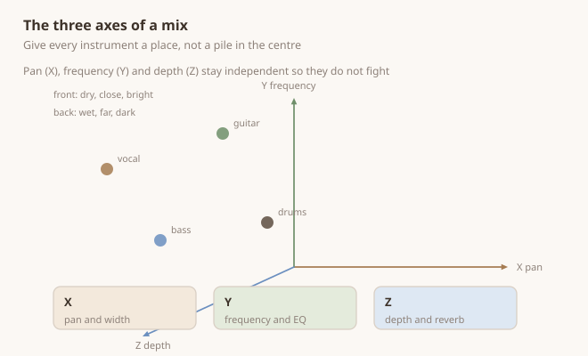
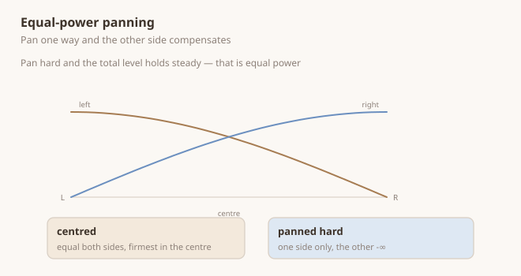
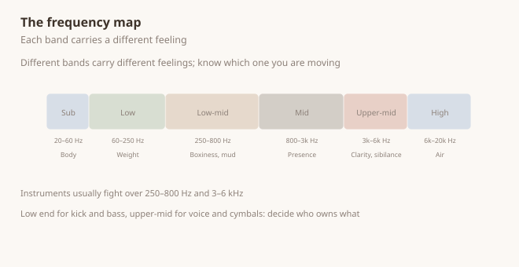
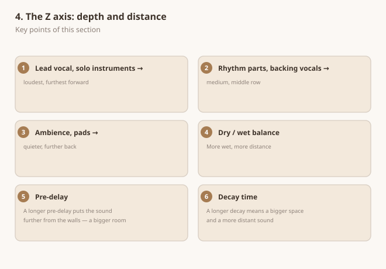
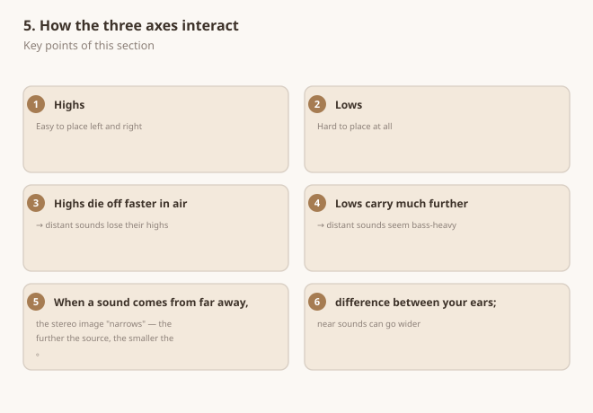
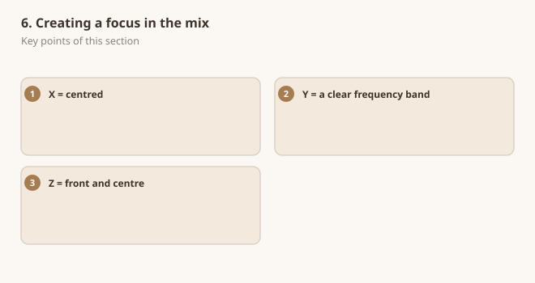
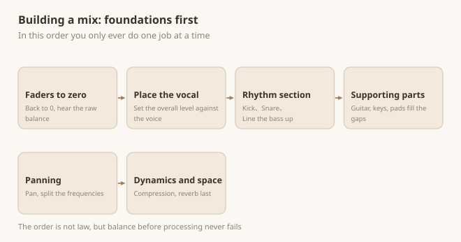
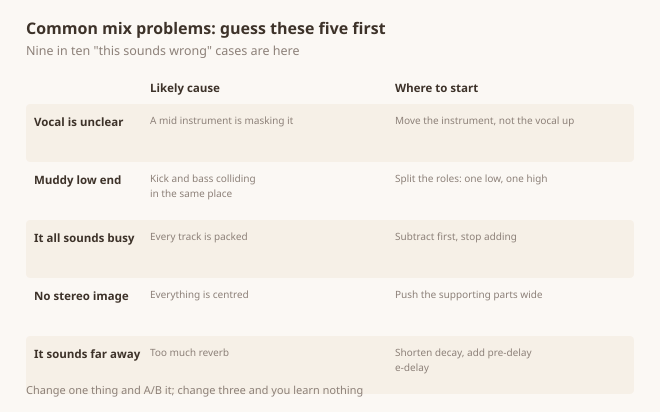
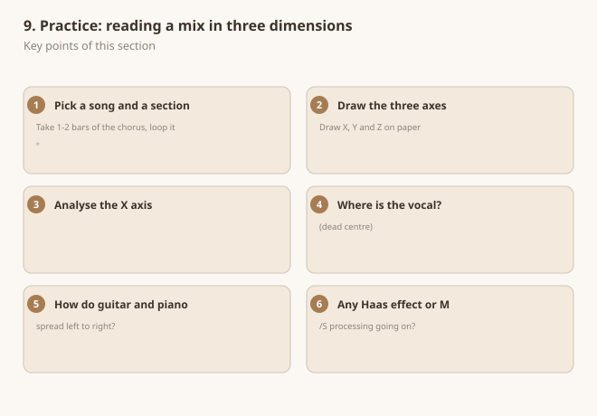
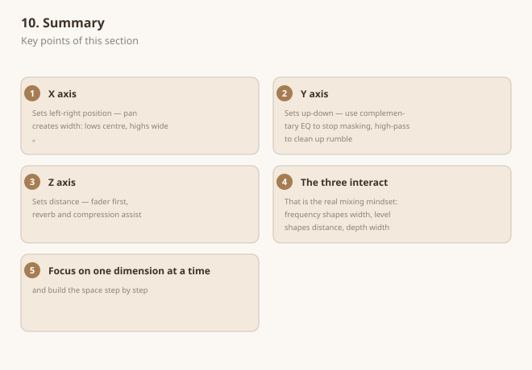

# Lesson 12: Mix Space: The Three-Dimensional Frame of Level, Pan and Frequency

## The goal of this lesson: understanding the three-dimensional model of a mix

When you make a piece of music, no track exists on its own. They all live together in a three-dimensional space, built from three dimensions: **level**, **pan** and **frequency**. (Phase is a separate matter, whether the waveforms line up, and lesson 8 covered it.) A good mix, put plainly, is **every sound placed where it belongs in that three-dimensional space**.

This lesson builds a complete way of thinking about the three-dimensional mix. You will learn to take a mix apart, and put one together, using three axes (X: pan, Y: frequency, Z: depth).

---

## 1. The three-dimensional mix model: an overview

Picture a coordinate system:

| Axis | Dimension | Parameter | Description |
|---|---|---|---|
| **X axis** | Horizontal (left and right) | Pan | Where the sound sits left to right in the stereo field |
| **Y axis** | Vertical (high and low) | Frequency (EQ) | The spectral distribution of the sound |
| **Z axis** | Depth (front and back) | Level, reverb, delay, compression | How near or far the sound seems |

**The central idea:** if two or more instruments collide on all three axes, X, Y and Z, the result sounds blurred, muddy, even like a fight. Put each part in its own place on the three axes and the mix becomes clear, wide and layered.

---

## 2. The X axis: pan and stereo width

The X axis is about left and right placement. It is the most obvious dimension in a mix, and the easiest one to overuse.

### 2.1 Basic panning principles

- **Keep low-frequency instruments centred.** Kick and bass usually sit dead centre (pan = 0). Low frequencies are not very directional, and the ear treats the low end as a stable foundation.
- **Mid and high instruments can go left or right.** Rhythm guitar, piano and synth pads can be spread left and right to create width.
- **Keep the lead vocal centred.** Vocals, especially the lead, almost always sit in the middle, because that is where the listener's attention goes.
- **Small percussion can go far left or far right.** Shaker, tambourine, conga and similar can be panned boldly to 60%–100%, which adds a sense of space.

### 2.2 Ways to create stereo width

- **Double tracking.** Record the same phrase twice and pan the two takes left and right. The width is natural.
- **The Haas effect (precedence effect).** Copy a track, delay the copy by 10–30 ms and pan the delayed copy to the opposite side. The ear thinks the sound comes from the side that arrives first, and the overall width still increases.
- **M/S (mid/side) processing.** Split a stereo signal into the middle (mono) and the sides (side) and process them separately. Boosting the high end of the side signal, for example, makes the stereo image feel airier.

### 2.3 Common X-axis mistakes

- **Everything centred.** The mix turns into a mono mush with no sense of space.
- **Extreme panning with no compensation.** If the left side is clearly louder than the right, the stereo balance tips.
- **An unstable stereo image.** An instrument sits on the left but its reverb sits on the right, which confuses the ear.

---

## 3. The Y axis: frequency distribution and EQ management

The Y axis is high and low: the frequency range each instrument occupies. 70% of the clarity problems in a mix come from poor management of the Y axis.

### 3.1 Spectral regions and where instruments sit

The audible range is about 20 Hz–20 kHz. It divides into key regions:

| Region | Range | Character | Typical conflict |
|---|---|---|---|
| Sub | 20–60 Hz | Felt more than heard, felt in the body | Kick and bass fight hardest here |
| Bass | 60–250 Hz | The thickness and power of the music | Bass, kick, low piano, bass voice |
| Low-mid | 250–500 Hz | Warmth, but too much makes it muddy | Guitar, strings, pads, chest resonance in the voice |
| Mid | 500 Hz–2 kHz | The body of the instrument, and clarity | Vocals, guitar, piano, brass |
| High-mid | 2–6 kHz | Attack, presence, sibilance | Vocal sibilance, hi-hat, crash |
| High | 6–20 kHz | Air, gloss, detail | Hi-hat, shaker, string harmonics |

### 3.2 The core EQ strategy: complementary EQ

When two instruments collide on the Y axis, don't have both of them grabbing the same frequency. The solution:

1. **Decide which one owns that band.**
2. **Give the owner a small boost.**
3. **Cut the other one slightly.**

**Example:** kick and bass fighting at 60–80 Hz.

- The move: let the kick own 60 Hz (a small boost) and the bass own 80 Hz (a small boost), then cut the bass by -2 dB at 60 Hz.

**Another classic case:** a vocal and a piano masking each other at 2–4 kHz.

- The move: +2 dB at 3 kHz on the vocal, -2 dB at 3 kHz on the piano. The vocal comes forward at once, and the piano sounds almost unchanged.

### 3.3 The high-pass filter is your friend

A lot of the low-frequency content in many instruments is noise you don't need. On tracks that don't need low end (hi-hat, shaker, vocal, most guitars), use the high-pass filter freely and cut everything below 80–150 Hz.

**The principle:** if the instrument has no important musical content in that band, clear it out and leave the low end to the instruments that need it.

### 3.4 Common Y-axis mistakes

- **Too much stacked in the low-mid (250–500 Hz).** This is the most common cause of mud. Several instruments fight there, and the whole thing sounds blurred and loses its punch.
- **Boosting the high end too much.** Chasing clarity with more and more treble gives you a sharp, tiring sound.
- **Ignoring the analyser.** Using only your ears and never a spectrum analyser makes it easy to miss the bands the ear tires of.

---

## 4. The Z axis: depth and distance

The Z axis is front and back: how far away a sound seems. This is the dimension people overlook most, and the one that most turns a flat mix into a three-dimensional one.

### 4.1 The four key tools for the Z axis

#### (a) Level (the fader)

The simplest and most direct control of depth. **A louder sound seems closer.**

- Lead vocal, solo instrument → loudest, at the front
- Rhythm instruments, harmony → medium level, in the middle
- Ambient effects, pads → quieter, at the back

Level alone is not enough, though. It only gives one of the cues for distance.

#### (b) Reverb

Reverb is the king of depth. Its settings tell the ear how far away a sound is:

- **Dry/wet ratio.** The more wet signal, the further away the sound seems.
- **Pre-delay.** A longer pre-delay makes the sound seem further from the reflecting surface, so the space feels bigger.
- **Decay time.** A longer decay means a bigger space, and a sound that seems further away.

**A practical trick:** when you want an instrument to move back, raise its reverb wet level and lengthen the pre-delay a little.

#### (c) Delay

Delay can create depth, and it can create rhythm:

- **Short delay (slapback, about 30–120 ms).** The classic 1950s rock effect: the sound seems to bounce once off a wall.
- **Long delay (quarter note, dotted eighth).** Delay synced to the tempo gives the sound depth, as if it rings out in open space.
- **Ping-pong delay.** Delay that alternates left and right, creating width on the X axis and depth on the Z axis at the same time.

#### (d) Compression

On the Z axis, compression pushes a sound forward.

- **A faster attack.** It catches the transient and emphasises the tail and the sustain, so the sound is smoother and seems to move back.
- **A slower attack.** It keeps the punch of the transient, so the sound is more forward and stands out, and seems closer.
- **More gain reduction.** It flattens the dynamics, so the sound varies less in distance and moves forward overall.

### 4.2 An example of Z-axis layers

A typical pop-rock mix laid out on the Z axis, from furthest to nearest:

1. **Furthest (ambient).** Room mics, ambient reverb, reverse cymbals, the reverb tail of pads
2. **Background.** Rhythm guitars (left and right), the reverb layer of the harmony vocals, string beds
3. **Midground.** Kick, bass, the main body of the rhythm guitars, the main harmony part
4. **Foreground.** Lead vocal, solo instrument, fill effects
5. **Spotlight.** A single instrument in a breakdown, a specially emphasised effect

### 4.3 Common Z-axis mistakes

- **The same amount of reverb on everything.** It all sounds like one flat plane, with no depth.
- **Reverb fighting the dry signal.** If the reverb's frequency content overlaps the dry sound too much, the mud doubles.
- **So much compression that nothing is near or far.** Everything is pushed to the front, and listening becomes tiring.

---

## 5. How the axes interact

Once you understand X, Y and Z separately, the real skill is **understanding how they work on each other**.

### 5.1 X + Y: frequency affects the sense of stereo

The ear's sensitivity to stereo position differs with frequency:

- **High frequencies (above 1 kHz).** Strong direction, clear left-right placement.
- **Low frequencies (below 200 Hz).** Weak direction, almost impossible to place.

So if you want width, separating high-frequency content (hi-hat, shaker, cymbals) left and right is the most effective move. And low-frequency instruments (kick, bass) can stay centred without the mix feeling narrow.

### 5.2 Y + Z: frequency affects the sense of distance

- **High frequencies die away faster in air,** so a distant sound has less high end.
- **Low frequencies carry further,** so a distant sound has proportionally more low end.

That means: if you want an instrument to sound far away, you can cut its high end (a low-pass filter) as well as adding reverb. This is the trick called **distance EQ**.

### 5.3 X + Z: balancing depth and width

- When a sound comes from far away, its stereo width gets narrower, because from a distance the difference between what the two ears receive is smaller.
- A nearer sound, by contrast, can be made wider.

In a mix this becomes a rule: **foreground instruments can be given wider stereo treatment, and background instruments should be narrower or centred**, unless you want a specific effect.

---

## 6. Creating the focus of a mix

In any song, the listener can only pay attention to a few things at a time. Your job is to tell them where to listen now.

### 6.1 One focus at a time

In each section (verse, chorus, bridge), only **one or two** main elements should sit at the meeting point of the three axes:

- **X = centred**
- **Y = an unobstructed band**
- **Z = at the very front**

Every other element should step aside on purpose.

### 6.2 Example: designing the focus of a chorus

Say the main focus of the chorus is the lead vocal and a lead synth:

| Element | X axis (pan) | Y axis (EQ) | Z axis (depth) |
|---|---|---|---|
| Lead vocal | Centred | Boost at 2–4 kHz | Loudest, medium compression |
| Lead synth | Centred | Boost at 1–2 kHz (complements the vocal) | Second loudest, a little more wet reverb |
| Rhythm guitar (left) | L 70% | Cut at 300 Hz, leave it to the vocal | Medium level, medium reverb |
| Rhythm guitar (right) | R 70% | As above | As above |
| Bass | Centred | Owns 80 Hz | Medium level, steady compression |
| Kick | Centred | Owns 60 Hz | Medium level, clear attack |
| Hi-hat | L 80% | High-passed around 800 Hz | Quiet, long reverb |
| Reverb return | L/R 100% | Low end cut | Quietest, furthest away |

---

## 7. Building a mix, step by step

Here is a mix built on three-dimensional thinking:

### Step 1: balance the levels (build the Z-axis frame first)

- Pull every fader all the way down
- Bring up the kick, then the bass: build the low-frequency foundation
- Add the lead vocal: this is the level reference
- Add the other instruments one at a time, using level to place them near or far

### Step 2: set the pan (build the X axis)

- Low-frequency instruments centred
- Rhythm instruments spread left and right
- Check the stereo balance (left and right at equal level)

### Step 3: sort out the EQ (build the Y axis)

- High-pass the tracks that don't need low end
- Find the frequency conflicts and use complementary EQ
- Check the overall spectrum on a spectrum analyser

### Step 4: add space (strengthen the X and Z axes)

- Choose a suitable reverb type for each instrument (plate, hall, room, spring)
- Use sends and returns rather than inserting reverb directly, so you can control it all together
- Add delay or modulation for a sense of space

### Step 5: compression and dynamics (fine-tune the Z axis)

- Compress the rhythm section (kick, bass) harder to hold its Z-axis position steady
- Compress the vocal moderately (3–6 dB gain reduction) to keep it at the front
- Compress the ambient tracks lightly, or not at all, to keep their natural depth

### Step 6: check the whole and refine

- Listen with your eyes closed: can you say where each instrument sits on X, Y and Z?
- Cross-check on monitor headphones, on speakers and on a phone speaker
- Compare against commercial mixes in a similar style, and compare the three-dimensional layout

---

## 8. A quick diagnosis table

| Symptom | Dimension at fault | What to do |
|---|---|---|
| Sounds narrow and flat | Not enough X axis | Spread the panning wider, use stereo effects |
| Sounds blurred and muddy | Y axis (low-mid) | Cut 250–500 Hz, use a high-pass filter |
| Sounds harsh and tiring | Y axis (high) | Cut 3–6 kHz or above 8 kHz, boost less high end |
| No sense of near or far, everything stuck together | Not enough Z axis | Widen the level difference between front and back instruments, vary the reverb more |
| An instrument cannot be heard | Y-axis conflict | Check whether it overlaps another instrument's frequencies, use complementary EQ |
| The low end booms | Y axis (sub) | Raise the high-pass to 30–40 Hz, reduce the sub boost |
| The stereo is unbalanced (left heavy, right light) | X axis | Check each track's pan setting, confirm on a stereo L/R meter |
| The vocal is drowned by the instruments | Y + Z axes | Push the vocal band, make the instruments step aside, bring the vocal forward |

---

## 9. An exercise: analyse a commercial mix with the three-dimensional model

**The goal:** choose a song you like that is well mixed (pop, rock or electronic is a good place to start) and analyse it with the three-dimensional model.

### The steps

1. **Choose the song and mark the sections.** Take one or two bars of the chorus and listen to it repeatedly.

2. **Draw the three axes.** Draw X, Y and Z on paper. Try to place every instrument you hear.

3. **Analyse the X axis.**
   - Where is the lead vocal? (It should be dead centre.)
   - How are the guitars or the piano spread left and right?
   - Is there any sign of the Haas effect or M/S processing?

4. **Analyse the Y axis.**
   - How do the kick and the bass divide the low end?
   - Where is the vocal's strongest band?
   - Is any instrument clearly high-passed?

5. **Analyse the Z axis.**
   - Work out the order from near to far using level
   - Which instrument has the most reverb? Which has the least?
   - How compressed does the vocal feel? How is it kept at the very front?

6. **Write down what you notice.** What three-dimensional decisions did the mix engineer make? Would you make different ones?

### A worked example: a pop-rock chorus

Picture a typical pop-rock chorus and record your observations like this:

- **Kick:** X = centre, Y = owns 60 Hz, Z = midground (steady compression, fast attack)
- **Snare:** X = slightly left (about 20%), Y = 200 Hz (body) + 5 kHz (the smack), Z = midground (slightly longer reverb, room sound)
- **Bass:** X = centre, Y = owns 80 Hz, Z = midground (steady compression)
- **Lead vocal:** X = centre, Y = boost at 3 kHz, Z = front (loudest, compressed 4:1)
- **Rhythm guitar (left):** X = L 80%, Y = boost at 1 kHz (high-mid), Z = background (more reverb, lower level)
- **Rhythm guitar (right):** X = R 80%, Y = as above but slightly different to complement it, Z = as above
- **Pad / strings:** X = dry signal narrow, reverb layer wide, Y = low-mid bed (high-passed at 200 Hz), Z = furthest (long reverb decay)

---

## 10. Summary

Mixing is not magic. It is **the art of managing space**. Every time you move a fader, turn a pan pot or adjust an EQ, you are moving a sound to a different place in a three-dimensional coordinate system.

**What this lesson covered:**

1. **The X axis (pan)** decides where a sound sits left to right. Use panning to create width: low frequencies centred, high frequencies spread.
2. **The Y axis (frequency)** decides where a sound sits high and low. Use complementary EQ so frequencies don't fight, and use the high-pass filter to clear out noise.
3. **The Z axis (depth)** decides how near or far a sound is. Level is the main tool; reverb and compression help set the distance.
4. **How the three axes interact** is the strongest way to think about a mix: frequency affects the sense of stereo, frequency affects the sense of distance, and depth affects width.
5. **Focus on one dimension at a time** and build the space up step by step.

Once you can look at every mix in terms of X, Y and Z, you are no longer just turning parameters. You are building a world for sound to live in.

Next lesson we go to the last part of mixing: **automation and the dynamic story of a mix**, and how to make your mix breathe and change as the song moves.

