# Lesson 13: Static Mix: Balance and Hierarchy

Mixing is the art of blending many tracks into one unified, convincing stereo picture. Before you enter the world of compressors, EQ, reverb and the rest of the dynamic processing and effects, there is one thing you have to get right first: the **static mix**. This step decides the skeleton of the whole song, and it is the key step beginners skip most often. This lesson looks at how to build a solid foundation for your mix with nothing but faders and pan knobs, with no automation and no dynamic processing at all.

---

## What is a static mix?

A static mix means building the balance purely by adjusting the level and pan of each track, **with no automation curves running and no dynamic processors (compressors, limiters) inserted**. That sounds simple, but in practice you will find that making every instrument sound harmonious, with lead and support clearly ranked and no dynamic help at all, is far harder than you imagined.

The core goals of a static mix are:

- **Build balance**: every frequency band and every instrument has the presence it should have, without covering the others up.
- **Establish hierarchy**: the listener's ear should know at any moment who the lead is (the vocal, say, or the solo instrument) and who is support.
- **Find the sweet spot**: every fader sits at a threshold where it can go no higher and no lower.

The mixing engineer Andrew Scheps (who has mixed Adele and Red Hot Chili Peppers) once said: "If a mix sounds right when it is static, then adding dynamics will only make it better." That points at the fundamental importance of the static mix. If the basic balance is wrong, every later process is only patching up a wrong starting point.

---

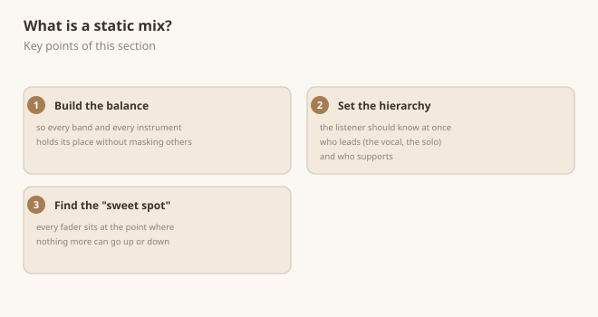

## Why start with the faders at zero?

Many beginners' first reaction on getting the multitrack is: "The vocal has to come through, so push the vocal fader up first." That looks reasonable, but in practice it scatters the fader positions and loses the overall view. A professional workflow usually goes:

1. **Set every fader to zero (unity gain, that is 0 dB)**.
2. **Play everything and listen to the whole**: at this point you will usually find one instrument too loud or too quiet.
3. **Set the rhythm section (drums, bass) to a balanced base first**.
4. **Then push the vocal up from muted, slowly, until it "floats" above the backing**.

The advantage of starting from unity is that you can hear precisely, in dB steps, how much louder one instrument is than another. If you start from random positions, you have nothing to go on when you come back to it later. Besides that, most DAW mixer windows have a one-click reset-to-zero shortcut (Pro Tools Alt+Click, Logic Option+Click, Ableton double-click). That is not a coincidence: it is the core operation static mixing is built on.

---

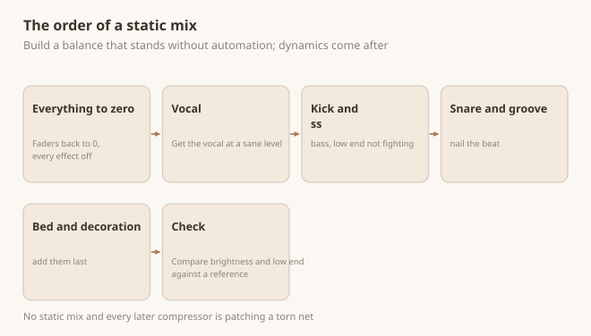

## Building a reference point: the vocal is the most important lighthouse

In a typical pop or rock song, or any music with a vocal, **the lead vocal is always the absolute reference point of the mix**. Listeners unconsciously judge whether the other instruments are too loud or too quiet relative to the voice. So the standard static-mix workflow is:

1. **Set the rhythm section (kick, snare, bass) to a solid basic balance first** (details in the next section).
2. **Set the vocal fader to unity, then play the most intense part of the song (usually the chorus)**.
3. **Judge whether the vocal is drowning in the backing**: if you have to strain to make out the words, the backing is too loud.
4. **Adjust the level of the whole instrument bus** so the vocal surfaces naturally, instead of pushing the vocal fader up to "beat" the backing.

This is the key shift in thinking. Don't ask "how loud does the vocal need to be"; ask "how quiet does the backing need to be for the vocal to come through on its own". The second question usually leads to a cleaner, more open mix. The ideal place for the vocal is around -12 dB to -6 dB average RMS loudness in the overall mix, but that depends on the song's dynamics, and more importantly you judge with your ears: when you can follow the vocal with no effort at all, that is the right spot.

---

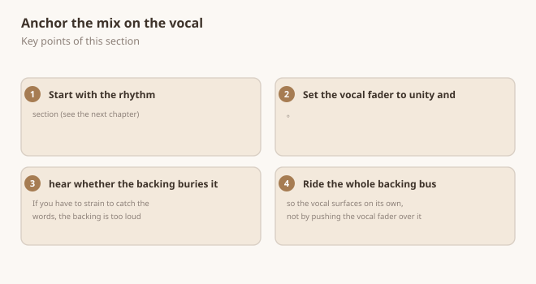

## The balance of the rhythm section: kick, snare and bass as one

The rhythm section (drums and bass) is the engine of the song. If the rhythm section is not balanced, the whole song has no sense of gravity. Here are the practical steps for the rhythm section in a static mix:

### Kick drum

The kick is the anchor of the low end. It does not have to be very loud, but it needs enough presence that you feel the impact. A good starting point is a kick peak around -10 dB to -6 dB (depending on how dense the arrangement is). Kick and bass should have a clear division of labour: the kick handles the attack and the impact, the bass handles the sustained tone and the harmonic foundation.

### Snare drum

The snare is the skeleton of the rhythm. It carries the off-beat and the dynamics of the fills. In a static mix the snare peak is usually set slightly higher than the kick, or about the same (-8 dB to -4 dB), because the snare's transient energy is spread out and it is easily masked by other mid-range instruments, so its peak often has to sit a little above the kick to stand firm. Once the snare sits right, the groove of the whole song settles.

### Bass

The overlap between bass and kick (roughly 60-100 Hz) is the range where the mix most easily goes blurry. In a static mix, listen to kick and bass on their own first, switching solo back and forth. Only when you hear kick and bass each clearly and complementing each other do you bring in the other instruments. Set the bass level so the kick's attack can "cut through" the bass's long notes. If the bass level overwhelms the kick, the rhythm goes loose.

---

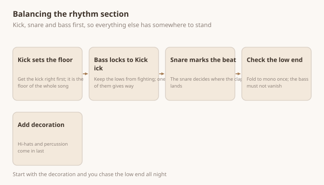

## Adding the support instruments: rhythm guitar, keys and pads

Once the balance between the rhythm section and the vocal is set, the next step is the support instruments (rhythm guitar, keyboard, pad and so on). Their role is to fill the mid-range space, and they **must not steal the vocal's show**.

Practical tips:

1. **Start the rhythm guitar about 3-6 dB below the vocal**.
2. **Listen to the vocal sections**: if the rhythm guitar distracts you or adds pressure when the vocal comes in, drop the guitar fader another 1-2 dB.
3. **Check the gaps in the phrase**: in a static mix you can judge the rhythm guitar level by asking whether the guitar sounds full when the vocal is not singing. That is, allow the guitar to be slightly covered during vocal sections; that is natural dynamics.

Keyboards and pad-type instruments work the same way, but they usually occupy a steadier upper mid-range, so it is worth soloing them first to confirm they do not fight the vocal's 2-4 kHz range. If you need to, fix it with level in the static stage and deal with the frequency conflict later with EQ.

---

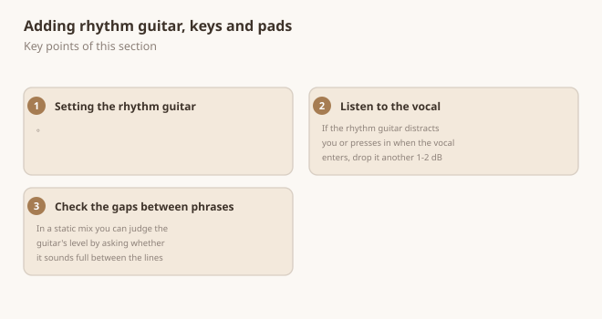

## Panning: building the static stereo base

A static mix is not only about level. Pan is a parameter you have to decide at this stage too. Many mixers decide pan right after setting the faders, because pan in turn changes how you hear the level: the same instrument sounds louder in the centre than hard left or hard right.

Basic panning principles:

### Centre

All the backbone instruments belong in the centre: lead vocal, kick, snare, bass. These are the pillars of the song, and keeping them centred makes sure they do not disappear on any playback system, including a mono phone speaker.

### Left and right

Rhythm guitars, keyboards, pads, backing vocals and percussion can spread to the sides. One classic approach: pan two rhythm guitars to L 40 and R 40 to build a wide rhythm wall. Backing vocals can sit at L 20 and R 20 behind the lead vocal, giving a sense of envelopment without hurting the vocal's clarity.

### Watch mono compatibility

Although you work mostly in stereo during the static stage, it matters to switch to mono now and then. If an instrument almost disappears in mono, you need to change its pan or its phase. As a rule, kick, snare, bass and lead vocal have to stay clear in mono.

---

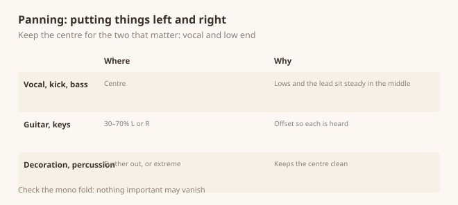

## Level hierarchy: who is loud, who is quiet?

| Role | Relative to the vocal | Notes |
|---|---|---|
| Lead vocal | 0 dB (reference) | The baseline for the whole mix |
| Drums and bass | −3 to −6 dB | Hold up the rhythm and the low end |
| Rhythm instruments | −9 to −15 dB | The bed, without stealing from the vocal |
| Backing vocals and ornaments | −15 to −21 dB | Appear only where they are needed |

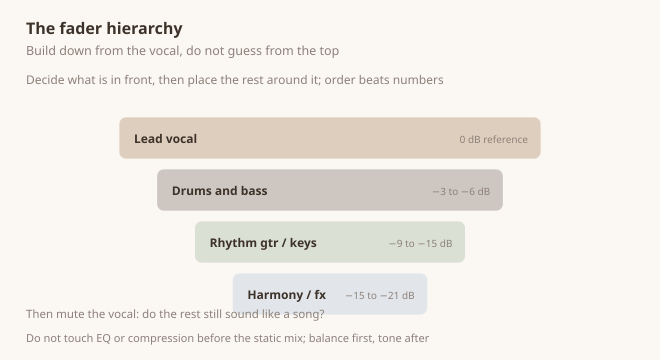

A static mix is essentially the act of defining hierarchy. Below is a typical level pyramid, from loudest to quietest, that works as a general reference:

1. **Lead vocal**: the absolute focus, it has to float on the top layer.
2. **Snare**: the rhythm anchor of the mid-range, it needs enough cut.
3. **Kick and bass**: the low-end engine, balanced against each other but not over-prominent.
4. **Rhythm instruments (guitar / keys)**: support the vocal without stealing the scene.
5. **Effects, background pads, fine percussion**: build atmosphere and detail; the listener should not notice them on purpose.

This is not an absolute rule (jazz or classical hierarchy can be completely different), but in pop, rock and electronic music the pyramid above is a framework tested by countless hit records. Beginners can use it as the baseline for a static mix and then adjust to the style of the song.

---

## Checking the static balance against a reference track

The commonest problem in the static stage is losing your objectivity from hearing the same loop over and over, so the bass creeps up and the vocal creeps down. That is when you need a reference track to recalibrate your ears.

How to do it:

1. **Pick a commercially released song with a style and arrangement similar to yours** (ideally a finished, mastered one).
2. **Import the reference into the DAW and match its level to your mix** (a LUFS meter or your ears will do).
3. **Switch back and forth between the reference and your mix with solo and mute**, comparing the following:
   - Is the vocal proportion similar?
   - Do kick and bass feel balanced the same way?
   - Is the overall pressure, or sense of energy, at the same level?

4. **Don't aim for an exact match**: different songs have different dynamic ranges. The reference is there to give you a listening baseline, so you do not drift too far from industry practice.

One advanced trick: put an EQ on the reference's stereo track and use a low-pass or high-pass filter to hear only a specific band. Low-pass down to 150 Hz, for example, to hear only kick and bass, and compare whether the proportion of low end in your mix is close.

---

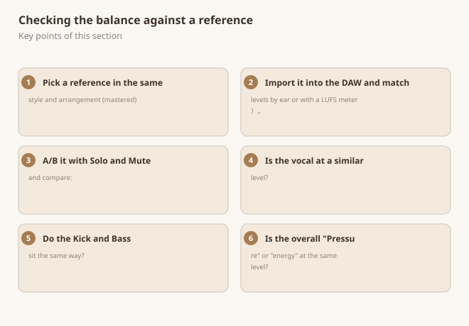

## Fader riding: finding the sweet spot for each element

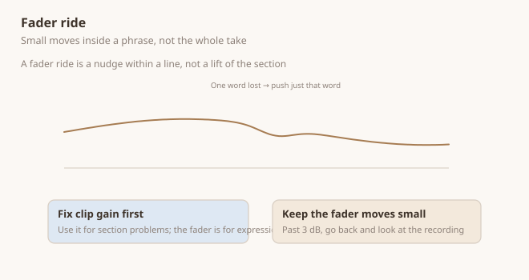

The term "fader ride" comes from the days of analogue consoles, when the engineer moved faders by hand to find the best static position for each instrument. In a digital DAW the technique matters just as much.

### How to do a fader ride

1. **Start with the rhythm section**: pull the kick, snare and bass faders all the way to -∞, then bring them up one at a time. Bring the kick up to where it has impact but is not too heavy, then add the snare and adjust, then add the bass.
2. **Compare with solo back and forth**: listen to one instrument solo, then to the full mix, alternating. If an instrument sounds good solo but you cannot hear it in the full mix, its level is too low or it is being masked. The other way round, if it sounds reasonable solo but too prominent in the full mix, its level is too high.
3. **Close your eyes and listen**: this is not mysticism. Sight influences your judgement of hearing. Listen to a chorus with your eyes closed, then open them and look at the fader positions, and ask yourself: "Does this fader position reflect the balance I heard?"
4. **Big moves first, small trims after**: make broad adjustments in steps of 3-5 dB, find the boundary between too loud and too quiet, then trim to the best spot at 0.5-1 dB resolution.

The goal of a fader ride is this: every fader sits exactly where 1 dB more is too much and 1 dB less is not enough. It takes a lot of practice to build that sensitivity.

---

## When do you move from the static mix to dynamic processing?

Once the static mix is finished you should be happy with the overall balance. The signal is now like this:

- The level proportions of all the instruments are roughly right.
- Hierarchy is clear; the listener knows where to listen without thinking.
- The panning gives a wide and stable stereo picture.
- No instrument suddenly disappears or jumps out in a particular section.

Once all of the above is true, **then** start inserting compressors and EQ to solve what is left:

- **Compressor**: to control dynamic range, so the bass line is more even and the vocal's tail notes don't jump up and down.
- **EQ**: to solve frequency conflicts, such as kick and bass fighting in the low end, or vocal and guitar overlapping in the upper mids.
- **Reverb / delay**: to build a sense of space and depth.

A very useful test: if in the static stage you feel "this bass is just right in the verse but too loud in the chorus", that is a problem for dynamic processing. You probably need a compressor to shrink the bass's dynamic range, or automation in the chorus. **Do not squash the bass in the static stage to pre-solve the chorus problem, or the verse will end up thin and weak.**

---

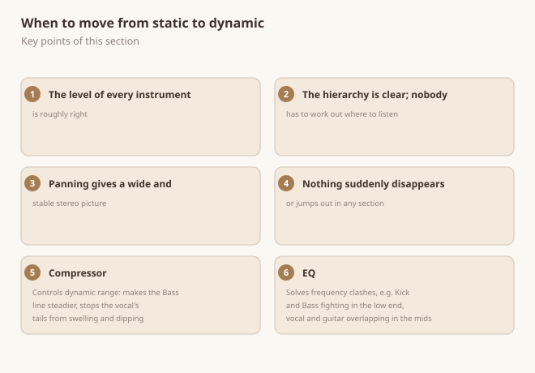

## Common static mix mistakes

- **Reaching for the compressor too early**: inserting a compressor before the static balance is settled distorts the feedback you get from moving faders, so you make decisions on a wrong foundation.
- **Every instrument wanting to be in front**: a mix is not a contest for loudest. If every instrument is fighting for the listener's attention, the listener gets tired. Learning to let some instruments step back in some sections is the mark of a professional mix.
- **Ignoring the head and tail sections**: many people focus only on the most exciting part (the chorus) and ignore the verses and the bridge. A good static mix keeps the right proportions in every section of the song.
- **Judging with the solo button**: solo is a diagnostic tool, not a decision tool. The final decision has to be made in the full mix, because a level that sounds perfect solo is very likely wrong in the full mix.
- **Skipping the mono check**: if you are unsure, export a mono version from the DAW and listen on your phone. If the kick disappears or the vocal is covered, the panning is wrong or there is a phase problem.

---

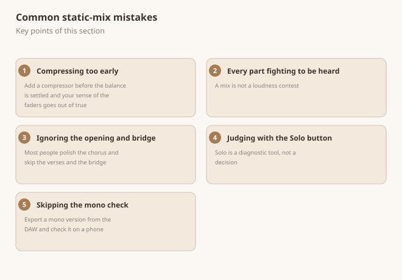

## Closing

A static mix is a craft that looks simple and runs deep. It forces you to focus on the essence of the music (level and position) instead of being distracted by fancy plug-ins. When you can make a mix sound complete, balanced and musical with nothing but faders and pan, you already have the core mixing skill. The dynamic processing and effects that follow only add polish on top of that. Starting today, give yourself 30 minutes of static mix time at the start of every mix: turn off every plug-in and use only faders and pan. You will be surprised how fast you improve.

Next lesson we look at the secret weapon of dynamic processing: how the compressor works and when to use it.
