# Lesson 14: EQ: Using Filters and Sweeping Out Problem Frequencies

The equalizer (EQ) is one of the most central and most used tools in mixing. It adjusts the level of specific frequencies in the audio, and by doing so changes the texture, the clarity and the sense of space of a sound. Learning to use it properly is the step from hearing what is going on to shaping it.

## What is EQ? The core idea

EQ is essentially a scalpel for frequencies. It lets you boost or cut one frequency or one range of frequencies. In a digital audio workstation (DAW) the EQ usually comes as a plug-in. The common types are:

- **Parametric EQ**: frequency, gain and Q (bandwidth) can all be set freely. The most flexible, good for fine work.
- **Graphic EQ**: fixed bands with sliders, common in live sound or for quick adjustments.
- **Dynamic EQ**: borrows the compressor idea and only moves when a specific frequency goes over a threshold.

Whatever the type, you need to understand three basic parameters:

- **Frequency**: where in the sound you are working, in Hz or kHz.
- **Gain**: how much level you add or remove, in dB.
- **Q**: how wide the affected range is. The higher the Q, the narrower and more precise the range; the lower the Q, the wider and smoother the range.

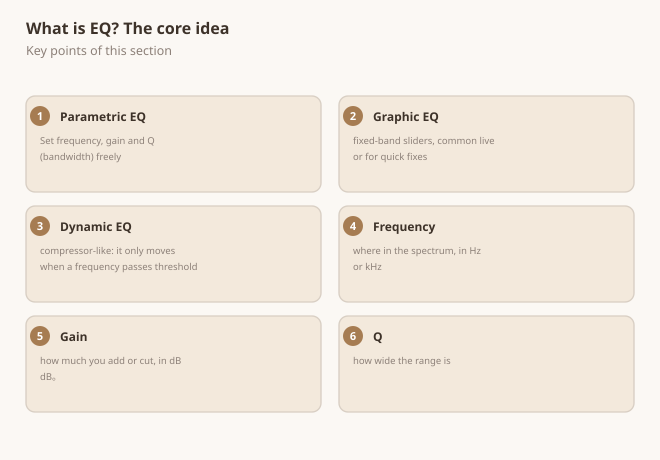

## The five basic filter types

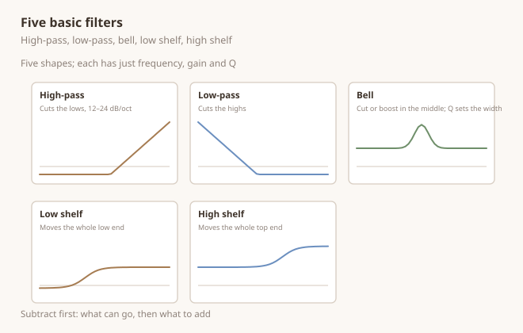

The filters in an EQ decide how you affect the sound. These are the five most used types:

### High-pass filter (HPF)

Also called low-cut. It lets signal above a certain frequency through and attenuates what is below. It is one of the most used filters, because it removes unwanted low-frequency noise effectively. A vocal mic, for example, may pick up the low rumble of an air conditioner; an HPF set at 80–100 Hz clears it.

### Low-pass filter (LPF)

Also called high-cut. It lets signal below a certain frequency through and attenuates what is above. It is often used to reduce sibilance or to make a sound warmer and more distant. A background harmony with an LPF at 8–10 kHz, for example, drops back behind the lead vocal.

### Band-pass filter (BPF)

Only one band of frequencies passes; everything below and above it is attenuated. It sounds like a telephone (about 300 Hz–3.4 kHz). Used for special effects or for imitating an old radio or a phone voice.

### Notch filter

A very narrow band-stop filter that cuts deeply at one precise frequency. When an instrument has a fixed buzz (50 Hz or 60 Hz mains hum, say), a notch filter cuts it out without touching the neighbouring frequencies. Q is usually set between 10 and 30.

### Shelving filter

Comes as high shelf and low shelf. It affects everything above a frequency point (high shelf) or everything below it (low shelf), and the gain curve looks like a shelf. It is used for adjusting the overall brightness or weight of a sound rather than for fixing one problem frequency.

## Frequency ranges at a glance

To use EQ you have to know what each range sounds like. These are the divisions used in music production:

| Band | Range | What you hear |
|------|------|----------|
| Sub | 20–60 Hz | The shake you feel in your body; sub bass in electronic music, the bottom layer of the kick |
| Bass | 60–250 Hz | The foundation of the rhythm section; bass guitar, the body of the kick |
| Low mids | 250–500 Hz | The weight of a sound; too much makes it blurry and muddy |
| Mids | 500 Hz–2 kHz | The main overtone region of instruments; the core of vocal clarity |
| Upper mids | 2–4 kHz | The bite and aggression of a sound; too much is harsh |
| Presence | 4–6 kHz | The immediacy and clarity of an instrument; lip and teeth noise in a voice |
| Brilliance | 6–20 kHz | Air and detail; the extension of cymbals and hi-hat |

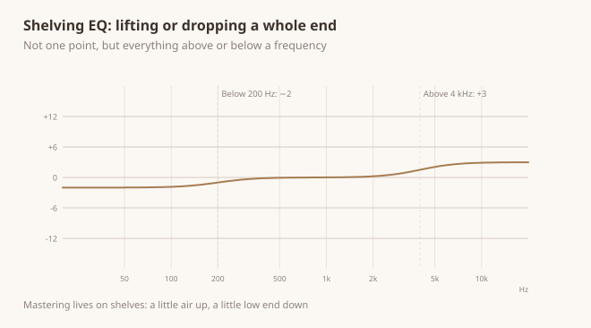

## The high-pass filter: clearing low-frequency rumble

The high-pass filter is your first line of defence. Almost every non-bass instrument should use one. These are common starting points:

- **Lead vocal**: 80–120 Hz (removes mic handling and low-frequency plosives)
- **Acoustic guitar, piano**: 80–150 Hz (removes stage rumble and low buzz)
- **Electric guitar (rhythm)**: 100–200 Hz (keeps it out of the bass's way)
- **Overheads and hi-hat**: 200–300 Hz (removes the low resonance of the cymbals)
- **Snare**: 100–150 Hz (keeps the punch, removes low-frequency noise)

The general rule: raise the HPF frequency slowly until the instrument starts to sound thin and lose weight, then come back down a little. That is the ideal HPF setting.

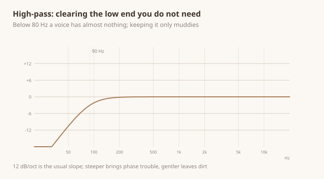

## Sweeping: how to find a problem frequency

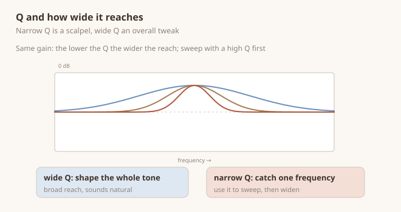

Sweeping is one of the most practical techniques in EQ work, and especially good for hunting down interfering frequencies.

**The steps are:**

1. Choose a peak filter on a parametric EQ.
2. Set the gain high (+8 to +12 dB). This step is only to make the problem easy to hear.
3. Set Q fairly narrow (about 1–3) so the effect is concentrated.
4. Play the track and slide the frequency slowly from low to high.
5. When you hear a frequency that sounds harsh, boomy or uncomfortable, that is the problem frequency.
6. Once you have it, change the gain from a boost to a cut (-3 to -6 dB) and widen Q a little so the change sounds natural.

Sweeping is especially effective for:

- Nasal resonance in a voice (usually around 500 Hz–1 kHz)
- Cabinet resonance in an electric guitar (usually 100–300 Hz)
- Low-frequency boom from room standing waves (usually 50–150 Hz)

## Cut vs. boost: why subtractive EQ is safer

The commonest beginner mistake is to reach for a boost the moment they touch an EQ. In fact the professional rule is: **cut first, then consider a boost**. That is subtractive EQ.

**The advantages of subtractive EQ:**

- **It keeps headroom**: a cut does not add overall level, so there is less risk of clipping.
- **It sounds more natural**: a sound with the problem frequency cut usually sounds cleaner than one with a good frequency boosted.
- **It causes fewer phase problems**: a large boost shifts phase, especially with a narrow Q.
- **It forces you to think**: a cut makes you work out what is surplus instead of adding blindly.

**When should you boost?**

- When an instrument is genuinely short of its natural frequencies and a cut cannot fix it.
- When an instrument needs to stand out in the mix and moving the fader would break the balance.
- For creative use, such as filling out the low end of a synth bass.

A boost is usually capped at +3 to +6 dB. If you need more than +6 dB, you probably picked the wrong sound or there is a problem in the recording.

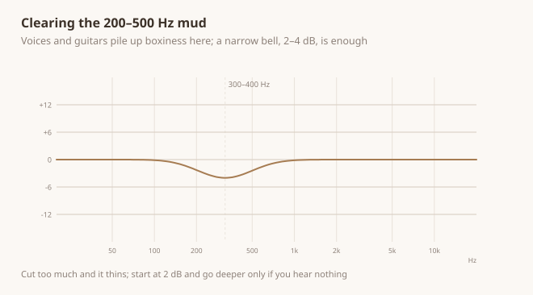

## Clearing the 200–500 Hz mud

200–500 Hz is the range that goes blurry and muddy most easily in any mix. It is where the fundamentals and overtones of many instruments overlap, and where muddiness shows up first.

**Typical symptoms:**

- The whole mix sounds dull, sounds dirty
- You cannot tell the instruments apart
- The low end has no clear outline

**Cleaning strategy:**

1. **Bass and kick**: a narrow cut at 200–300 Hz (-2 to -4 dB) to reduce the blur.
2. **Rhythm guitar and piano**: a wider cut at 300–500 Hz (-2 to -3 dB) to clean up the mids.
3. **Vocal**: a small cut at 250–400 Hz (-1 to -2 dB) to reduce nasality.
4. **The whole mix**: use sweeping to find the muddiest point, then cut it narrowly.

Be careful not to cut too much, or the sound loses warmth and weight. After every cut, A/B it (EQ off against EQ on) to confirm there is a real improvement.

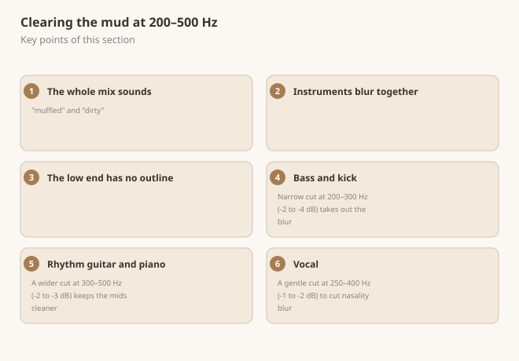

## Reducing harshness at 2–4 kHz

2–4 kHz is the range the ear is most sensitive to, and the main source of listening fatigue. Too much 2–4 kHz makes a sound harsh and irritating.

**Typical symptoms:**

- The vocal sounds sharp, grating
- An electric guitar solo makes your ears hurt after a while
- The whole mix is hard to listen to for long

**What to do:**

1. **Lead vocal**: a cut of -1 to -3 dB at 2.5–3.5 kHz with a wider Q, to round the sound off.
2. **Electric guitar**: a cut of -2 to -4 dB at 2–4 kHz, especially in long solo sections.
3. **Violin, brass**: a narrow cut at 3–4 kHz to reduce the sharpness.
4. **The whole bus**: a wide cut of -1 to -2 dB near 2.5 kHz, which makes the mix easier to listen to for a long time.

But be careful not to cut too much either, or the sound loses its bite and its cut. A good test: listen to the mix quietly (on a phone speaker, say). If it is still harsh, the EQ needs work; if it is harsh only when loud, that is a matter of level.

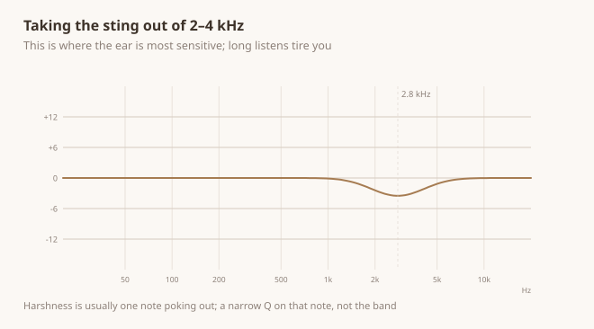

## Using a high shelf to add air and presence

High-frequency work is the part most easily neglected and the part that lifts the quality of a mix most. A high shelf set at 8–12 kHz adds air to a sound.

**Where to use it:**

1. **Lead vocal**: high shelf at 8–12 kHz, +2 to +4 dB, for more cut and openness.
2. **Acoustic guitar, piano**: high shelf at 8–10 kHz, +2 to +3 dB, for crispness.
3. **Overhead cymbals**: high shelf at 10–12 kHz, +1 to +3 dB, to make hi-hat and crash shine.
4. **The whole mix bus**: high shelf at 10 kHz, +1 to +2 dB, to give the mix a more finished, high-end feel.

**Watch out:**

- Too much high boost brings in sibilance and noise. If the original recording is poor, boosting the top end amplifies the flaws.
- Boosts above 8 kHz are sensitive to the system's sample rate and DAC quality: what sounds right on headphones may be too bright on speakers. Test on several systems.
- If the sibilance is bad, deal with it with a de-esser first, then use the high shelf.

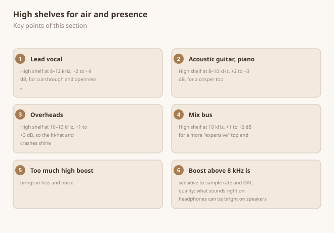

## Practical EQ chains for each instrument

### Vocal

1. **HPF**: 80–120 Hz, to clear low-frequency noise.
2. **Low-mid clean-up**: a small cut at 250–400 Hz (-1 to -2 dB) to reduce nasality.
3. **Mid clarity**: if the voice sounds too distant, a small boost at 1–2 kHz (+1 to +2 dB).
4. **The harsh spot**: sweep 2–4 kHz, find the problem and cut it (-2 to -4 dB).
5. **Presence**: a small boost at 4–6 kHz for immediacy.
6. **Air**: high shelf at 8–12 kHz, +2 to +4 dB.

### Electric guitar

1. **HPF**: 100–150 Hz, so it stays out of the bass's range.
2. **Muddiness clean-up**: a wide cut at 200–400 Hz (-2 to -4 dB) for clarity.
3. **Attack**: a small boost at 1–3 kHz (+1 to +3 dB) for the bite of a distorted guitar.
4. **Harshness**: a small cut at 2–4 kHz as needed.
5. **Sparkle**: a small high-shelf boost at 8–10 kHz.

### Kick drum

1. **Sub impact**: a small boost at 50–60 Hz (+2 to +4 dB), or a low shelf.
2. **Muddiness**: a cut at 200–400 Hz (-2 to -4 dB) to clean up the punch.
3. **Attack**: a small boost at 3–5 kHz (+2 to +4 dB) to make the click of the kick clearer.
4. **HPF**: 30–40 Hz on any track other than a sub kick mic.

### Snare drum

1. **Body**: a small boost at 200–250 Hz (+2 to +3 dB).
2. **Muddiness**: a small cut at 400–600 Hz (-1 to -2 dB).
3. **Crack**: a small boost at 1–3 kHz (+2 to +4 dB).
4. **Air**: a small high-shelf boost at 8–10 kHz.

### Bass guitar

1. **Sub impact**: low shelf at 50–80 Hz, +2 to +4 dB (if needed).
2. **Fret noise**: a narrow cut at 1–3 kHz (-2 to -4 dB) to remove the sound of fingers sliding.
3. **Attack clarity**: a small boost at 700 Hz–1 kHz (+1 to +2 dB) so the bass has presence in the mids.
4. **HPF**: 30–40 Hz, to remove useless very low vibration.

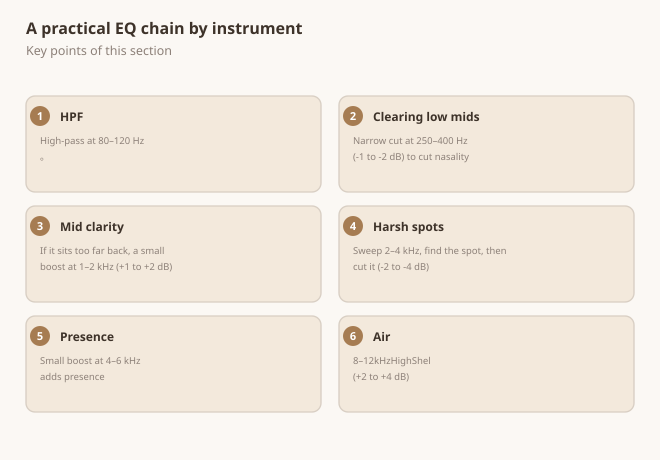

## The commonest EQ mistakes

### Mistake one: too much boost

Beginners fall easily into the more-is-better myth and boost +6 dB or more at some frequency. The result is not a better sound but a stranger, more unnatural one. Remember: EQ is a fine-adjustment tool, not a fader. A boost over +6 dB is usually a warning that the original sound has a bigger problem.

### Mistake two: not checking phase

When you use several EQs in the same signal chain, especially with large boosts and a narrow Q, you can easily shift phase. That makes the sound feel hollow or thin. A linear phase EQ reduces the problem, but it adds latency.

### Mistake three: ears only, no spectrum analyser

The ear is the final judge, but a spectrum analyser gives you objective visual support. It helps you find abnormal frequency build-up quickly, especially in the low end, where the human ear is less sensitive.

### Mistake four: no A/B after an EQ move

Always switch back and forth between EQ on and EQ off. If the sound is better with the EQ off, your EQ move is wrong. A/B comparison is how you judge objectively whether each move really did anything.

### Mistake five: EQing in solo, wrong in the full mix

An EQ setting made in solo may be completely wrong once every instrument plays, because in solo you cannot hear the other instruments' overlapping frequencies. Listen in the full mix after every adjustment and confirm the instrument's place in the mix is right.

### Mistake six: ignoring gain staging

A boost on the EQ raises the overall level. That can make a compressor or limiter later in the chain trigger too early, or even clip. After a boost, trim the track's output level so gain staging stays consistent.

### Mistake seven: the same EQ settings on every track

Every recording, every song and every instrument is different. Do not copy and paste EQ settings. Spend the time to hear what your material actually needs instead of applying a template.

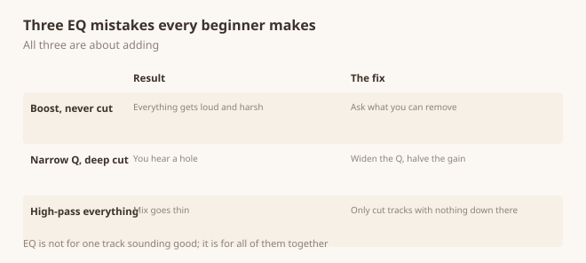

## Closing

The equalizer is one of the most powerful tools in mixing work, but its power comes from restraint and precision. The real EQ expert is not the one who boosts a gorgeous sound; it is the mixer who knows what to cut and what to keep. Starting today, practise subtractive thinking with EQ: cut the problem first, then consider a boost.

Next lesson we go deep into how the compressor controls dynamics, and how to keep the dynamic range of a sound in check, so the mix sounds more professional and more cohesive.
