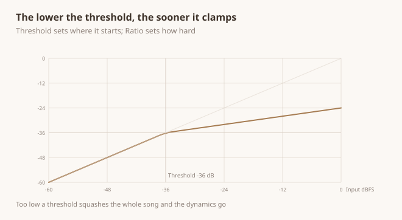
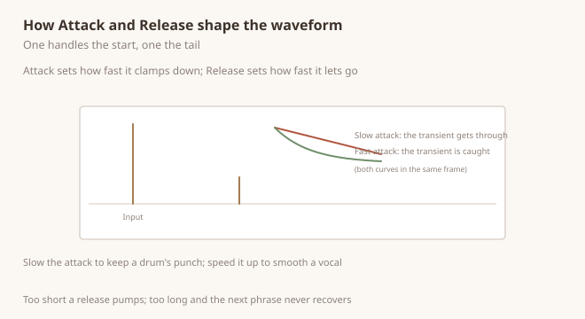
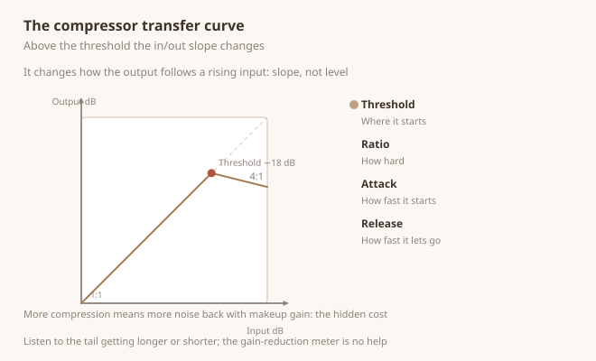
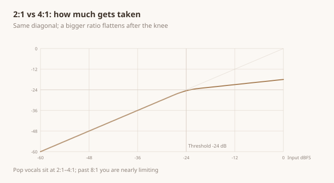
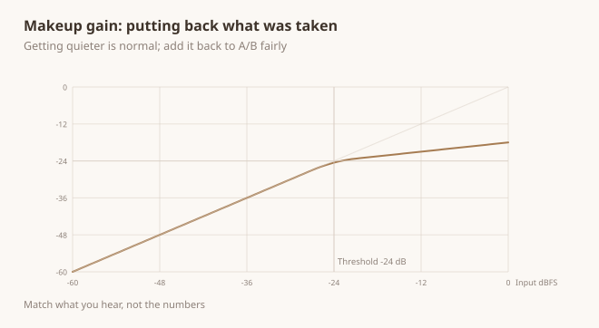
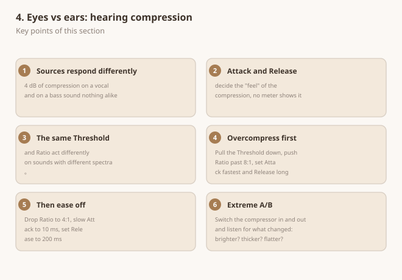
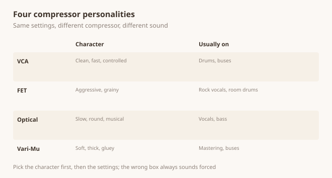
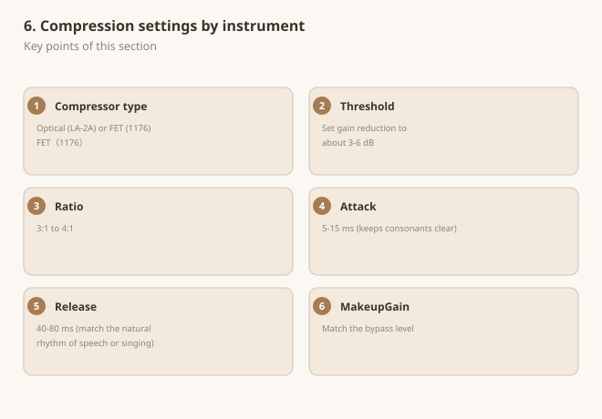
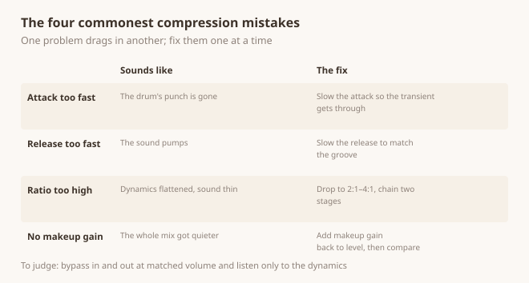
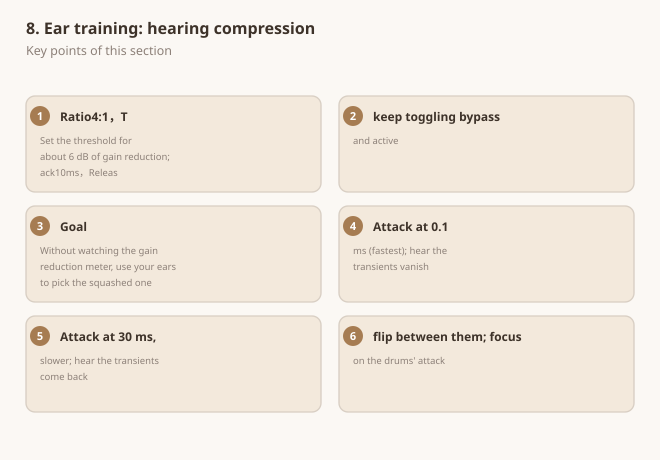

# Lesson 15: The Compressor: Dynamics Control and Ear Training

## 1. What is compression? The art of controlling dynamic range

The compressor is one of the most important dynamic processing tools in music production. Its core job is to **shrink the dynamic range of a signal**, that is, to make the gap between the loudest and the quietest part smaller. Why bother? Because the human hearing system and the recording medium both have physical limits: too quiet a sound is buried in noise, too loud a sound distorts. A compressor holds a sound on a line that is just right.

Picture a singer in the studio: in the chorus the level jumps, in the verse it is a thread. Import that recording into a mix and you face a dilemma. Turn it up and the chorus is harsh and broken; turn it down and the verse is inaudible. The compressor exists to solve that. It detects the loud sections automatically and brings them down so the overall dynamic is steadier, and then make-up gain brings the whole level back to where you want it.

In modern music the compressor is everywhere: the solid, close feeling of a pop vocal, the sustained low end of an electric bass, the balance of hit and ring in a drum kit, even the glue of a whole mix. And yet it is also the most misused of tools. Too much compression drains the life out of the music and produces what is called pumping and breathing. This lesson goes from the principle to the practice so you really own this essential mixing tool.

---

## 2. The four core parameters: threshold, ratio, attack, release

| Parameter | What it does | Common starting point |
|---|---|---|
| Threshold | Where compression starts | 3–6 dB below the peak |
| Ratio | How much it compresses | Vocal 3:1–4:1, drums 4:1–8:1 |
| Attack | How fast it starts | 10–30 ms (keeps the transient) |
| Release | How fast it lets go | 80–200 ms (follows the rhythm) |

Every compressor, hardware or software, works around the same four basic parameters. Understand these four and you have the whole logic of the compressor.

### 2.1 Threshold: the gate where compression starts

Threshold decides when the compressor starts working. Its unit is dB, and it sets a level: when the input signal goes **above** the threshold, the compressor acts; below the threshold the signal stays as it is.

- **A very low threshold (say -40 dB)**: almost every signal gets compressed, and the effect is very obvious.
- **A very high threshold (say -10 dB)**: only the biggest peaks trigger compression, and quiet material is untouched.
- **Practical advice**: pull the threshold all the way down first (most sensitive) so the compression is obvious, then raise it slowly until compression happens only in the loud sections you want to control. Watch the gain reduction meter; the ideal amount of compression usually sits between 3 and 6 dB.

### 2.2 Ratio: how hard it compresses

Ratio defines how much of the signal above the threshold gets compressed. It is written X:1, meaning "for every X dB the input goes above the threshold, the output rises 1 dB".

- **2:1** (light compression): input 10 dB over the threshold → output rises 5 dB. Good for voices, acoustic guitars and other sources that need gentle dynamic control.
- **4:1** (medium compression): input 10 dB over the threshold → output rises 2.5 dB. A common setting for electric bass, electric guitar and backing vocals.
- **8:1** (heavy compression): input 10 dB over the threshold → output rises 1.25 dB. Drum kits, brass, sources that need firm control.
- **10:1 and above** (limiting): at this point the compressor is effectively a limiter and hardly lets the signal past the threshold at all. Common in mastering.

Ratio and threshold work together. Lowering the threshold brings more signal under compression; raising the ratio compresses it harder. You need both to get the dynamic control you want.

### 2.3 Attack: the sharpness of the transient

Attack decides how quickly the compressor starts compressing after it detects a signal above the threshold. The unit is milliseconds (ms) or microseconds (µs).

- **Fast attack (0.1 - 1 ms)**: the compressor reacts almost instantly and flattens the transient along with everything else. The sound becomes smoother and more inward, but percussion can lose its impact. Good for controlling harsh peaks, or on a bass to even out the sustain.
- **Slow attack (10 - 30 ms)**: the compressor lets the transient through before it starts, so the original attack and force survive. Very good on drums: you do not want to flatten the snare's hit, only control the ring that follows.
- **Practical tip**: while you adjust the attack, listen to whether the start of the sound changes. If the snare sounds dull, the attack is too fast; if a vocal's breath or first consonant sticks out, the attack is too slow.

### 2.4 Release: shaping the tail of a sound

Release decides how quickly the compressor stops compressing after the signal falls below the threshold. The unit is milliseconds or seconds.

- **Fast release (20 - 100 ms)**: the compressor recovers quickly and lets the tail flow out naturally. But if the release is too fast, a signal that moves quickly produces obvious pumping: the level rises and falls as if it were breathing.
- **Slow release (200 ms to several seconds)**: the compressor keeps working and evens out every part of the sound, but quiet sections can end up feeling sucked in.
- **Sync it to the groove**: the release time can be set to follow the song's tempo. At 120 BPM one beat is about 500 ms; set the release between 200 and 400 ms so the compressor's recovery moves with the music.
- **Practical advice**: listen for an unnatural gasp as the compressor releases. The ideal release finishes its work without your noticing.

---

## 3. Make-up gain: the art of compensation

The compressor lowers the loud sections, so the whole thing naturally gets quieter. Make-up gain (often labelled output gain or makeup) brings the overall level back to where it was after compression, or even higher.

**The key habit**: use make-up gain to do an A/B comparison. Flip the compressor's bypass on and off and use make-up gain to compensate, so that both sides sound the same loudness. Only then can you judge fairly whether the compressor really improved the sound, rather than it just sounding better because it got louder.

A common beginner mistake: the compressor goes on and the sound seems better, but only because the make-up gain made it louder. **Always do a level-matched A/B comparison.**

---

## 4. Eyes vs. ears: learn to hear compression

This may be the most important lesson of all: **the compressor is heard, not seen.** Many beginners stare at the gain reduction needle and think 6 dB of reduction means they got it right. In fact the visual indication is only a reference; your ears are the final judge.

**Why you cannot go by the meter alone:**

- Different sources respond differently to compression: 4 dB of compression on a voice and 4 dB on a bass sound nothing alike.
- The attack and release settings decide the *texture* of the compression, and no meter shows that.
- The same threshold and ratio on sounds with different frequency content give completely different results.

**How to start ear training:**

1. **Over-compress on purpose**: pull the threshold down, the ratio up to 8:1 or more, the attack as fast as it goes and the release as fast as it goes. Listen carefully to that suffocated sound and remember it. That is what too much compression sounds like.
2. **Then relax it slowly**: bring the ratio down to 4:1, the attack to 10 ms and the release to 200 ms. Feel how the sound goes from being held by the throat to flowing naturally.
3. **Extreme A/B**: switch between compressor on and compressor off and listen to *which parts of the sound changed*. Is it brighter? Thicker? Flatter? Does it hit harder?
4. **Listen to specifics**: does the tail of the sound change (a reverb tail or the natural decay), is the background noise lifted or pushed down, does the clarity of the consonants and the breath change?

The professional's trick: **close your eyes and listen.** Visual distraction (the waveform display, the jumping needle) misleads your judgement. Turn off the screen or cover the compressor's display area and decide with your ears alone.

---

## 5. Compressor types: VCA, FET, optical, vari-mu

Not all compressors sound alike. Different circuit designs and different ways of controlling gain with light or voltage give each type its own character.

### 5.1 VCA (voltage controlled amplifier)

- **Classic models**: SSL G-Bus Compressor, API 2500
- **Character**: precise, transparent, very fast
- **Strengths**: strong control, accurate settings, very low distortion
- **Where it fits**: drum bus, stereo mix bus, anything that needs clean dynamic control
- **How it sounds**: it does not change the timbre much; it is there for dynamic control

### 5.2 FET (field effect transistor)

- **Classic models**: UREI 1176 (the classic of classics)
- **Character**: fast, full, full of personality
- **Strengths**: the attack can be extremely fast, and it adds grit and punch to a sound
- **Where it fits**: electric bass (the classic 1176 bass sound), vocals (parallel compression), snare
- **How it sounds**: even at a modest ratio, an FET compressor adds a sense of energy being pushed into the sound

### 5.3 Optical

- **Classic models**: LA-2A, LA-3A
- **Character**: smooth, warm, very musical
- **Strengths**: attack and release are set automatically by the internal light-sensing element (usually slow), and operation is minimal (usually just gain and peak reduction)
- **Where it fits**: vocals (more or less a studio standard), acoustic guitar, bass
- **How it sounds**: the compression is so smooth you barely notice it working, yet the sound becomes fuller and solider. The LA-2A has automatic release: the more it compresses, the slower the release, which suits a voice with wide dynamic swings

### 5.4 Vari-mu (variable mu / valve compressor)

- **Classic models**: Fairchild 670, Manley Variable Mu
- **Character**: warm, gluey, strongly musical
- **Strengths**: glues a whole mix together and adds analogue warmth
- **Where it fits**: mix bus, stereo bus, piano, strings
- **How it sounds**: the compression is progressive. The stronger the signal, the more compression, but the transition is extremely natural. It makes several instruments sound like one whole.

**Choosing**: if you are starting out, learn the basic parameters on a VCA or optical plug-in first. Once threshold, ratio, attack and release are familiar, try the other types and hear their personalities.

---

## 6. Practical compression settings by instrument

Below are starting points for each instrument. Remember: **these are starting points only**; you have to adjust them to the actual recording and the style.

### 6.1 Lead vocal

- **Type**: optical (LA-2A) or FET (1176)
- **Threshold**: set for about 3-6 dB of gain reduction
- **Ratio**: 3:1 to 4:1
- **Attack**: 5-15 ms (keeps the consonants clear)
- **Release**: 40-80 ms (follows the natural rhythm of speech or singing)
- **Make-up gain**: compensate to match the bypassed level
- **Advanced**: use serial compression. First the 1176 for fast peak control (ratio 4:1, fast attack), then the LA-2A to smooth the overall dynamic (about 2-3 dB of gain reduction)

### 6.2 Kick drum

- **Type**: VCA or FET
- **Threshold**: about 4-8 dB of gain reduction
- **Ratio**: 4:1 to 6:1
- **Attack**: 3-10 ms (keeps the impact; too slow and you cannot hear the compression, too fast and you lose the punch)
- **Release**: 50-100 ms (recovers before the next hit)
- **Advanced**: slow attack (20-30 ms) plus fast release (20-40 ms) lets the initial hit through and holds the ring down, for a kick that is punchy and still controlled

### 6.3 Snare drum

- **Type**: FET (1176) or VCA
- **Threshold**: about 5-10 dB of gain reduction
- **Ratio**: 4:1 to 8:1
- **Attack**: 1-5 ms (keeps the hit; too fast and you risk losing the force)
- **Release**: 100-300 ms
- **Advanced**: to give the snare more presence, use a slow attack (10-20 ms) and a moderate make-up gain, so the compressor lifts the snare's natural ring

### 6.4 Electric bass

- **Type**: FET (1176) or optical (LA-2A)
- **Threshold**: about 4-6 dB of gain reduction
- **Ratio**: 3:1 to 4:1
- **Attack**: 10-30 ms (keeps the attack of the fingers or the pick)
- **Release**: 200-400 ms (smooths the sustain)
- **Advanced**: the goal of bass compression is an even level from note to note. While you set the release, listen for level differences between the lowest and the highest notes. Good compression makes the whole bass line even and flowing

### 6.5 Electric guitar

- **Type**: VCA or optical
- **Threshold**: about 3-5 dB of gain reduction
- **Ratio**: 3:1 to 5:1
- **Attack**: 5-15 ms
- **Release**: 200-500 ms
- **Note**: if the guitar already runs through distortion or overdrive, the distortion is compressing on its own, so you may need less compression

### 6.6 Stereo bus / master bus

- **Type**: VCA (SSL G-Bus style) or vari-mu
- **Threshold**: very light: gain reduction of only 1-3 dB
- **Ratio**: 1.5:1 to 2:1 (very gentle)
- **Attack**: 10-30 ms (keeps the transient)
- **Release**: auto, or 100-500 ms (following the song's groove)
- **The golden rule**: bus compression is not there to control dynamics, it is there to glue the mix. If the gain reduction goes past 3 dB, your mix is not finished and you should go back and fix the dynamics of the individual tracks

---

## 7. Common problems and fixes

### 7.1 Over-compression

- **Symptoms**: the sound is flat, dull, all the dynamics gone. The mix feels suffocated, with no room to breathe.
- **Cause**: threshold too low, ratio too high, so the compressor is working almost all the time.
- **Fix**: halve the compression first. If the gain reduction reads 10 dB, try about 5 dB. Check whether the make-up gain is too high: sometimes it sounds better only because it got louder.

### 7.2 Pumping

- **Symptoms**: the level rises and falls like breathing or pumping, especially when a rhythmic instrument (a kick) triggers the compressor and the background instruments or the reverb move with it.
- **Cause**: the release time is too short, so the compressor springs back every time the signal drops below the threshold and you hear the level move.
- **Fix**: slow the release, or use a lower ratio. If pumping happens on the mix bus, try a sidechain high-pass filter (though this course leaves sidechain aside at this stage).

### 7.3 Breathing

- **Symptoms**: background noise or reverb is sucked up each time the compressor releases, so the sound seems to breathe.
- **Cause**: similar to pumping, but usually a moderate release with too low a threshold: the background noise of the quiet sections gets lifted when the compressor lets go.
- **Fix**: raise the threshold and compress less. Or use a noise gate first to deal with unwanted background noise.

### 7.4 A too-fast attack kills the transient

- **Symptoms**: percussion sounds dull, with no hit; a vocal loses its consonants and you cannot make out the first consonant of a word.
- **Cause**: the attack time is too fast, so the compressor flattens the transient at the instant it happens.
- **Fix**: slow the attack (raise the number) so more of the transient passes through. Start around 10-20 ms.

### 7.5 A too-slow release leaves the sound stuck

- **Symptoms**: the sound seems to be compressed all the time, with no dynamic movement. Quiet sections cannot breathe.
- **Cause**: the release is too long; the compressor cannot recover in time.
- **Fix**: speed the release up, but not so far that you cause pumping. Find the sweet spot between the two.

---

## 8. Ear training: hearing the traces of compression

The hardest part is not learning to turn the knobs, it is learning to hear what the compressor does. Here are some specific listening exercises.

### Exercise 1: tell compressed from uncompressed

Find a recording with a wide dynamic range (a live recording of a voice and one acoustic guitar, say, or a drum solo). Insert a compressor in the DAW with these settings:

- Ratio 4:1, threshold for about 6 dB of gain reduction, attack 10 ms, release 100 ms
- Switch between bypass and active over and over
- **The goal**: without looking at the gain reduction meter, tell by ear which is compressed and which is not. Close your eyes and have a friend hit bypass while you guess.

### Exercise 2: hear the attack time change

On the same source (a snare or percussion is best), fix the threshold and the ratio and change only the attack:

1. Attack at 0.1 ms (fastest), listen to the transient disappear
2. Attack at 30 ms (slower), listen to the transient survive
3. Switch between the two and listen to the change in the hit

- **The goal**: to tell attack times apart by ear, and to be able to say "this attack is too fast" or "this attack could be slower".

### Exercise 3: hear the pumping from the release

Take a section with a sustained background instrument (a pad or piano chords) and add a drum with an obvious rhythm.
Set a compressor on a bus containing the pad and the kick, with a low threshold and a high ratio (8:1, say), then:

1. Release at 20 ms (fastest); listen to the pumping as the background pad rises and falls with the kick
2. Release at 500 ms (slower); listen to how the pumping reduces

- **The goal**: to recognise pumping clearly and understand how the release time affects it.

### Exercise 4: gain reduction ear training

Find a recording with a wide dynamic range (a solo piano or orchestral music works well).

1. Set gentle compression (ratio 2:1, about 2 dB of gain reduction)
2. Listen, then increase the compression (ratio 6:1, about 8 dB of gain reduction)
3. Increase it to the limit (ratio 20:1, about 15 dB of gain reduction)
4. Listen to the dynamic change at each stage. When does the sound start to feel squashed?

- **The goal**: to build an aural memory of the line between enough compression and too much.

### Exercise 5: blind test of compressor types

Get three plug-ins of different types (a VCA, an optical, an FET) and set them to about the same amount of gain reduction (about 4 dB) on the same source. Don't look at the names; keep switching and listening:

- Which one sounds cleanest?
- Which one sounds most coloured?
- Which one sounds most natural on the source?
- **The goal**: to build the ability to hear the difference in character between compressor types.

---

## 9. Closing: the compressor is your sound sculptor

The compressor is one of the most powerful tools in sound engineering and one of the most easily misused. The right mindset is: **the least compression that gets the best result.** Too much compression does not make your mix sound more professional; it drains the life and the dynamics out of it.

One last golden rule: **turn off the screen and open your ears.** When you stop leaning on the needle and the waveform and really listen to what the compressor does to the sound, you stop being an operator and become a sound engineer.

Next lesson we look at the limiter and the basics of mastering. Stay tuned.
