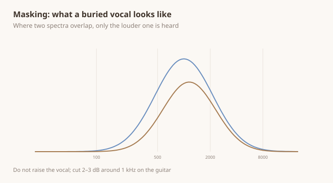
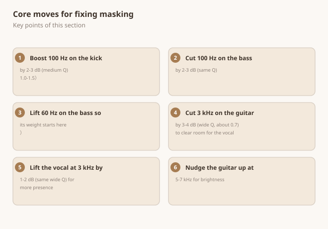
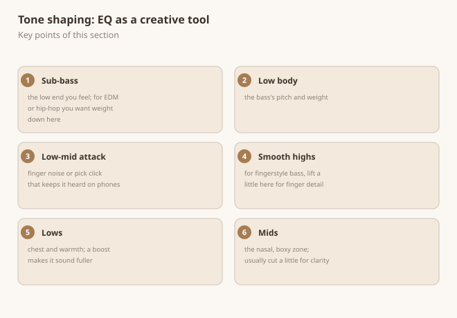
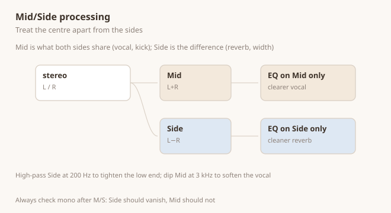
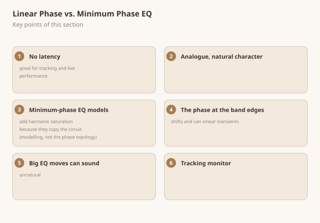
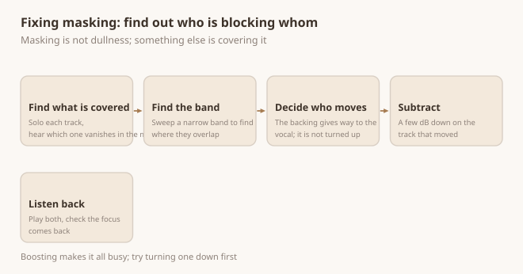
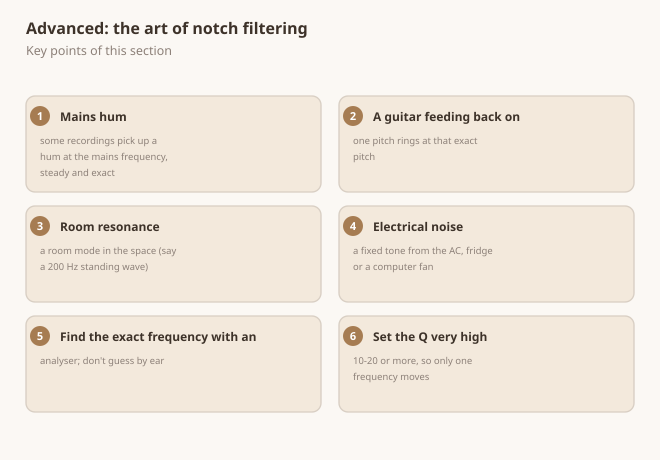
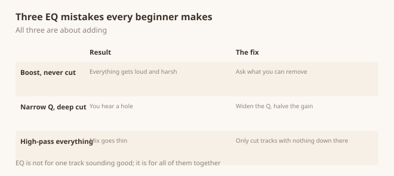
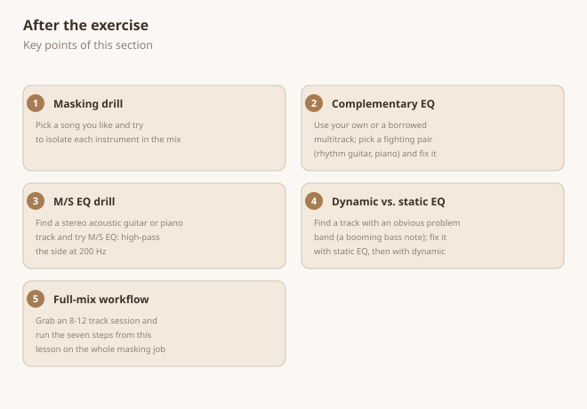

# Lesson 16: Advanced EQ: Fixing Frequency Masking and Tone Shaping

In the lessons so far we have learned the basics of EQ: cutting, boosting, sweeping to find problem frequencies. But when your arrangement grows from three or five instruments to fifteen or twenty tracks, you find that no matter how you EQ each instrument, the mix still sounds unclear. Your EQ technique is not the problem. You have run into the commonest and most stubborn enemy in mixing: **frequency masking**. This lesson looks at where masking comes from, how to identify it, and how to solve it with advanced EQ. It also turns EQ from a repair tool into a real tone-shaping instrument.

---

## What is frequency masking?

Here is a simple way to picture frequency masking: imagine a room where ten people are talking at once. If they are all at about the same volume, it is hard to follow any one of them. If one of them suddenly speaks up, you can follow that one and the rest become background noise. A mix is the same. When several instruments all have energy in the same frequency range, they mask each other, and none of them comes through clearly.

Acoustically, masking comes in two kinds:

**Simultaneous masking**: two sounds happen at once, and the one at the nearby frequency masks the other. The kick's fundamental (around 60-100 Hz), for instance, can mask the low end of the bass if it has too much energy there.

**Temporal masking**: after a loud sound, the ear's sensitivity at nearby frequencies drops for a short time (about 5-200 milliseconds). That is why two instruments with similar timbres, played close together in time, sound mushed together.

### Typical masking situations

In a real mix these combinations mask most often:

- **Kick vs. bass**: both fight for room in the low end (40-250 Hz)
- **Electric guitar vs. rhythm guitar**: both mid-range instruments, often fighting at 200-800 Hz
- **Piano vs. guitar**: both harmonically rich instruments with heavily overlapping ranges
- **Vocal vs. synth pad**: the vocal's clarity is easily covered by a mid-range pad
- **Cymbals vs. synth top end**: air and high-frequency detail (8-12 kHz) competing with each other

---

## How to identify masking

Before you can fix the problem you have to learn to hear the masking. Here are some practical ways:

### Solo comparison

This is the most direct method. Solo one instrument and hear its timbre clearly, then drop the solo and hear the same instrument in the full mix. If it clearly goes blurry or disappears in the mix, it is being masked by another instrument.

### With a spectrum analyser

Use a spectrum analyser (SPAN, or the spectrum display in FabFilter Pro-Q) to look at each instrument's frequency distribution. When two or more instruments show a clear energy peak in the same band, masking is very likely. Watch the dips in the spectrum too: if an instrument has obvious energy in a band but you cannot hear it in the mix, it is masked.

### The high-pass test

On each non-bass instrument, raise the high-pass filter's frequency step by step (from 20 Hz upwards) while you listen to the mix. When the mix suddenly becomes clear at some point, you have found where the masking happens. This method also tells you that the energy below that frequency was useless low-frequency noise, taking up valuable headroom.

### Dynamic spectrum analysis

Some masking is intermittent: it only happens when an instrument plays a particular note. Use the spectrum display's peak-hold function to find those occasional but severe frequency collisions.

---

## The core techniques for solving masking

### Complementary EQ

Complementary EQ is the classic and the most effective cure for masking. The idea: **in the same band, when one instrument goes up, the other goes down, and the other way round.**

For example, if the kick and the bass are fighting at 100 Hz:

1. Boost the kick at 100 Hz by 2-3 dB (medium Q, about 1.0-1.5)
2. Cut the bass at 100 Hz by 2-3 dB (the same Q)
3. Boost the bass at 60 Hz (so the body of the bass comes from there)

That way the kick and the bass are staggered across the spectrum. The kick owns the impact at 100 Hz, the bass owns the weight at 60 Hz, and they no longer mask each other.

**A practical example: guitar and vocal**

Say your electric guitar power chords and the lead vocal are fighting at 2-4 kHz (the key range for vocal clarity):

- Cut the electric guitar at 3 kHz by 3-4 dB (wide Q, about 0.7) to make room for the voice
- Boost the vocal at 3 kHz by 1-2 dB (same wide Q) for presence
- A small boost on the guitar at 5-7 kHz to make up the brightness

Result: the vocal is clearer and the guitar does not sound obviously darker, because the voice and the guitar are no longer playing in the same frequency at the same time.

### Sidechain EQ

Sidechain EQ is more advanced dynamic processing. It is not a fixed cut or boost; it is "when one instrument appears, the EQ of another instrument changes automatically". It needs sidechain routing in your DAW: feed one instrument's signal into another instrument's EQ plug-in as a control signal.

**Typical use: a broadcast host's voice over music**

This is the commonest use of sidechain EQ. While the host is speaking, the mid-range of the background music drops automatically; when the host stops, the music comes back to normal level. This is not plain sidechain compression (volume ducking). Only the bands of the music that clash with the voice are lowered, and the low and high end of the music is kept.

**How to do it:**

1. Insert a dynamic EQ that supports sidechain on the background music track (TDR Nova, FabFilter Pro-Q 3)
2. Route the vocal track to that EQ's sidechain input
3. Set a dynamic node at 2-4 kHz that cuts 3-6 dB when the sidechain signal (the voice) appears
4. Set attack around 5-10 ms (it has to react fast enough) and release around 100-200 ms

The result is more natural than plain sidechain compression, because the music's frequency content is not sliced off in one piece; only the part that overlaps the voice is pushed down.

### Dynamic EQ

A dynamic EQ is best understood as an EQ and a compressor in one. A traditional EQ is static: once you set the amount of cut it stays put, however the instrument changes. A dynamic EQ adjusts its own gain according to the level of the input signal.

**When do you need a dynamic EQ?**

- When the problem only appears on certain notes or in certain sections. A bass, say, produces an annoying boxy tone up the neck (around 300-500 Hz) but is completely normal lower down. A static cut at 400 Hz thins out the low notes too; a dynamic EQ only cuts when the energy at 400 Hz is too high.
- Sibilance in a voice: a dynamic EQ can cut dynamically at 6-8 kHz, acting only on "S" and "Sh" sounds, which is more precise than a traditional de-esser.
- Resonances in an electric guitar: some guitars produce unwanted overtone resonances at particular pitches, and a dynamic EQ can hold them down only while those notes sound.

**Suggested settings:**

- Threshold: above the average energy of the problem band, so that normal playing does not trigger it
- Attack: 5-10 ms (fast enough to catch the front of the problem note)
- Release: 50-150 ms (depending on how long the problem lasts)
- Range: 2-6 dB (not too much, or you get pumping)

---

## Tone shaping: using EQ as a creative tool

Everything so far has mostly been repair: solving problems, removing conflicts. The real power of EQ is that you can use it to sculpt each instrument's tonal character and give your mix a sound of its own.

### Building a frequency signature

Every instrument in the mix should have a clear frequency job. In other words, you decide which region of the spectrum this instrument is responsible for.

**Take the bass; a complete frequency signature might look like this:**

- **Sub (30-60 Hz)**: the physical weight of the sub-bass. If you are going for an EDM or hip-hop sound, you want full energy here
- **Body (60-120 Hz)**: the main pitch and weight of the bass
- **Low-mid attack (500-800 Hz)**: the feel of the fingers or the sound of the pick, so the bass is audible on small speakers
- **Top smoothness (2-4 kHz)**: for a fingerstyle bass, a small boost here adds the detail of the strings

**Take the vocal:**

- **Low (80-200 Hz)**: chest resonance, warmth (a boost makes it sound fuller)
- **Mid (200-500 Hz)**: the nasal, boxy region (usually needs a modest cut to avoid mud)
- **Upper mid (1-4 kHz)**: clarity and presence (a boost here floats the voice above the mix)
- **High (8-12 kHz)**: air and brightness (a gentle shelving boost)

### Stylised EQ

Different styles ask completely different things of EQ:

**Rock / metal:**

- Kick: boost 3-5 kHz for the hit, cut 300-500 Hz to reduce boxiness
- Electric guitar: heavy use of dips and bumps through the mids (800 Hz - 3 kHz) to create the howl
- Bass: usually has to lock in tightly with the kick's low end, often with large complementary EQ moves

**EDM:**

- Kick: a large boost at 50-60 Hz (sub-bass impact), and click added at 2-4 kHz
- Bass: often sidechain compressed against the kick, with a scoop at 100-200 Hz to leave room for the kick's tail
- Synth lead: heavy use of filter sweeps as an arrangement element

**Jazz / acoustic:**

- EQ moves are usually tiny (1-2 dB at most); the point is to preserve the natural timbre
- Use high-quality analogue-modelling EQ (Pultec style) to add harmonic warmth
- More cutting than boosting, so the instruments blend naturally

### The classic tone-shaping frequency table

Here is the practical guide used in real sessions (with cuts or boosts of 2-4 dB as the basis):

| Band | Move | Effect |
|------|---------|------|
| 50-60 Hz | boost | Adds physical weight and impact to the low end |
| 80-100 Hz | cut | Reduces low-end muddiness |
| 200-300 Hz | cut | Reduces boxiness and low-end congestion |
| 400-600 Hz | cut | Adds clarity, reduces the cardboard-box sound |
| 800 Hz - 1 kHz | cut | Reduces the telephone or horn-like sound (honkiness) |
| 2-4 kHz | boost | Adds presence and attack |
| 5-7 kHz | boost | Adds brightness and clarity |
| 8-12 kHz | boost | Adds air and high-frequency detail |
| 10-12 kHz | cut | Reduces excessive sibilance or hiss |

---

## Mid-side EQ: working on the frequency content of a stereo signal

Mid-side EQ (M/S EQ for short) is a more precise way of EQing. It lets you treat the centre (mid) and the sides of a stereo signal independently.

- **Mid**: what the left and right channels share, usually the vocal, kick, bass and lead instruments
- **Side**: what differs between left and right, usually the sense of space, the room reverb, stereo instruments

### Where M/S EQ helps

**1. Making centre room for the vocal**

Cut 2-3 dB at 200-500 Hz in the side channel. The effect is that the vocal in the centre becomes clearer when you listen to the full stereo mix, but the stereo instruments at the sides do not sound obviously thinner, because the ear is more sensitive to changes in the centre.

**2. Controlling the low end of the stereo image**

High-pass the side channel below 200 Hz. The reason is that the low end should normally be centred and mono-compatible; too much stereo low end causes phase problems, especially when played on vinyl or on a Bluetooth speaker.

**3. Adding air to the stereo image**

A shelving boost of 2-4 dB at 10-15 kHz on the side channel. That adds high-frequency detail and a sense of space to the stereo image while keeping the centre (usually the vocal) stable and clear.

### How to use M/S EQ

Most professional EQ plug-ins support an M/S mode (FabFilter Pro-Q 3, iZotope Neutron, Waves API 2500 and so on). With M/S mode on, each EQ node can be set to work on the mid, on the side, or on both (stereo).

**A full practical example:**

Say you have a stereo acoustic guitar track that is beautifully recorded but fights the vocal:

- Cut 3 dB at 2-4 kHz in the mid channel (make room for the voice)
- Boost 1-2 dB at 2-4 kHz in the side channel (keep the guitar's stereo space)
- High-pass the side channel below 200 Hz (remove unwanted stereo low end)
- A 2 dB shelving boost at 10 kHz in the side channel (add air)

Result: the vocal is clearer, the guitar is still rich and wide, and the low end is cleaner.

---

## Linear phase vs. minimum phase EQ

This is a topic that is often skipped and matters a lot. Different EQ types affect transients and phase differently.

### Minimum phase EQ

This is the commonest EQ type; almost every analogue-modelling EQ and every built-in DAW EQ is minimum phase.

**Advantages:**

- Zero latency, so it suits recording monitoring and live performance
- A natural, analogue character
- Analogue-modelled minimum phase EQs carry harmonic saturation from the modelled circuit (that is a modelling effect, not something the phase topology itself produces)

**Drawbacks:**

- It changes the phase relationship at the edges of the bands, which can blur transients
- Large EQ moves can make a sound feel unnatural

**When it fits:**

- Monitoring while tracking
- Ordinary mixing work (most of the time)
- Tone shaping where you want analogue warmth
- Situations where latency matters (live performance, streaming)

### Linear phase EQ

A linear phase EQ uses FIR (finite impulse response) filtering, so every frequency leaves the EQ with the same phase delay and the waveform shape is unchanged.

**Advantages:**

- It does not change the phase relationship of transients, so struck and percussion instruments sound more precise
- Very good for the small moves of the mastering stage
- Even large EQ moves cause no phase distortion

**Drawbacks:**

- Higher latency, so it is unsuitable for recording monitoring
- It can produce pre-ringing: a faint oscillation before the transient
- It uses more CPU

**When to use linear phase**

1. **Mastering**: for small EQ moves on the final stereo bus, where you do not want any phase change touching the mix as a whole
2. **Low-end work**: for large EQ moves on kick and bass, where the low-frequency phase shift of a minimum phase EQ can make the low end feel soft
3. **Group processing**: when you EQ a group (a drum bus, say) rather than a single instrument
4. **Stereo width work**: linear phase on the side channel of an M/S EQ avoids shifting the stereo image

**When not to use linear phase**

- A single percussion instrument (hi-hat, snare): the pre-ringing can appear before the transient and sound like a faint pre-echo
- Recording monitoring: the latency is too high to use

### How to choose in practice

A simple rule: **use minimum phase when you are repairing a sound, use linear phase when you want a precise move that does not change the nature of the sound.**

If you can only have one, take minimum phase. It works well in almost every situation, and a phase shift is harder to hear than pre-ringing. Many professional mixers use nothing but minimum phase EQ on a whole song.

---

## A complete workflow for solving masking

Here is a systematic workflow you can apply to any mix.

### Step one: build a frequency map (10 minutes)

Before you start mixing, look at the frequency distribution of every track on a spectrum analyser. Note the main frequency range of each instrument. Mark the bands where several instruments overlap, in a table or a sketch: those are the potential masking hotspots.

### Step two: high-pass sweep (10 minutes)

Set a high-pass filter on every non-bass instrument (vocal, guitar, piano, hi-hat, strings). The aim is to remove all unnecessary low-frequency energy. Common high-pass points:

- Vocal: 80-120 Hz
- Electric guitar: 80-100 Hz
- Acoustic guitar: 80-120 Hz
- Piano: 60-100 Hz
- Hi-hat: 200-400 Hz
- Strings: 100-200 Hz

Raise the high-pass on each track until the instrument clearly thins out, then come back a little to where it still sounds natural.

### Step three: find the main masking pairs (15 minutes)

Solo two instruments at a time (kick and bass, bass and guitar, guitar and vocal, vocal and pad) and listen closely to how they sound together. You should be able to hear which frequencies are fighting. Confirm with the EQ's spectrum display.

### Step four: complementary EQ (20 minutes)

For each masking pair, decide which instrument is the lead (its full range is kept) and which is the support (it has to make room). Cut the support by 2-4 dB with a wide Q in the conflicting band, and give the lead a small boost if it needs one.

**Priority order (most important first):**

1. Vocal (always the top priority)
2. Lead instrument (lead guitar, lead synth and so on)
3. The rhythm section core (kick, snare, bass)
4. Harmony and fills (pad, rhythm guitar, piano)
5. Effects and detail (FX, percussion, ambience)

### Step five: dynamic processing (15 minutes)

If static EQ cannot solve it (the guitar still fights when the vocal and the guitar play together, say), switch to a dynamic EQ or a sidechain EQ. Set the dynamic cut to act only when the conflict happens.

### Step six: mid-side check (10 minutes)

Turn on M/S EQ on the stereo bus. Check whether the side channel has too much low end (below 200 Hz) and high-pass it if it does. Also check whether the centre mid-range is too crowded.

### Step seven: compare against a reference (always)

Find a reference track in a similar style to the one you are aiming for, with a good mix. Compare the overall frequency distribution of your mix and the reference on a spectrum analyser. Does your mix have similar energy in each band? If one band clearly goes beyond the reference, that may be the source of the masking.

---

## Advanced technique: the art of notch filtering

A notch filter is an extremely narrow EQ cut (a very high Q), used to remove a single-frequency problem.

### When to use a notch filter

- **Mains hum (50/60 Hz)**: some recordings carry hum at the mains frequency, which is very precise and constant
- **A specific feedback pitch on a guitar**: when an electric guitar feeds back at one pitch
- **Room resonance**: a resonance at a specific frequency in the recording room (a 200 Hz standing wave, say)
- **Electrical interference**: the fixed-frequency noise of an air conditioner, a fridge, a computer fan

### How to set a notch filter

1. **Confirm the frequency with a spectrum analyser first**: do not guess
2. **Set Q very high**: 10-20 at least, so only that one frequency is affected
3. **Cut 6-12 dB**: as much as the problem needs; too much leaves an obvious hole
4. **Use linear phase**: a high-Q minimum phase EQ shifts phase noticeably around that frequency

### Creative notch filtering

Some producers use notch filters on purpose for a tonal effect. A small notch every few hundred Hz on a synth lead, for example, gives a filter-bank-like sweep. Or a fast-moving notch on a vocal for a telephone or radio effect.

---

## Common mistakes and things to watch

**Mistake one: too much EQ**

This is the commonest mistake. Every instrument gets large EQ moves, and together they sound worse. Remember the golden rule: cut more than you boost. If you need more than five EQ nodes on one instrument, it may be worth going back to the source: is the instrument's timbre or the recording the problem?

**Mistake two: ignoring the listening room**

In a room with no acoustic treatment the frequency response you hear can be badly inaccurate. Use reference headphones (Sennheiser HD600, Beyerdynamic DT 900 Pro X) and reference speakers, and compare against reference tracks often.

**Mistake three: soloing for too long**

An EQ setting that sounds perfect in solo often does not work in the full mix. **Always judge by the full mix.** When you check an EQ move, set the rough parameters in solo and then fine-tune in the full mix.

**Mistake four: forgetting that dynamic EQ exists**

Many mixers still use static EQ to force out a problem frequency that only appears in certain sections. The result is a hole in that band everywhere else. Dynamic EQ is the best tool for this kind of problem.

**Mistake five: not checking for phase problems**

Large amounts of EQ (especially multiband minimum phase EQ) can cause phase problems without your noticing. Check mono compatibility regularly: switch the monitoring to mono and confirm every instrument still sounds complete.

---

## After the lesson: exercises

1. **Masking ear training**: take a song you like and try to isolate each instrument in the mix. Can you hear the bass in the full mix? Where is the hi-hat? Which band does the vocal's clarity come from?

2. **Complementary EQ practice**: using a multitrack of your own or someone else's, pick a pair of instruments that fight (rhythm guitar and piano, say) and practise solving the masking with complementary EQ. Compare before and after.

3. **M/S EQ practice**: take a stereo acoustic guitar or piano track and try M/S EQ: high-pass the side at 200 Hz, cut 2-3 kHz in the mid, boost 10 kHz in the side. Listen to what it does to the sound.

4. **Dynamic EQ vs. static EQ**: find a file with an obvious problem band (a boxy note on a bass, say) and fix it with static EQ first, then with dynamic EQ. Compare the two methods, and which sounds more natural?

5. **The full mix workflow**: take an 8-12 track session and run the whole seven-step masking workflow from this lesson. Note how the sound changes before and after each step.

---

## Conclusion

Advanced EQ is not just about moving frequencies up and down; it is the art of allocating space. In a limited spectrum, your job is to give every instrument its own frequency space, so they do not interfere, while each one still plays its role in the mix.

Frequency masking is one of the biggest challenges in mixing, but once you have complementary EQ, dynamic EQ and M/S EQ, you can turn a tangle of sound into a professional mix with clear layers and plenty of detail. Tone shaping is the step that takes a mix from "I can hear everything" to "this has character": you are no longer only removing problems, you are actively giving each instrument a sound of its own.

Next lesson we look at advanced compression, from basic dynamic control to parallel compression, multiband compression and sidechain compression. By then you will have the two core tools of mixing: EQ and the compressor.
