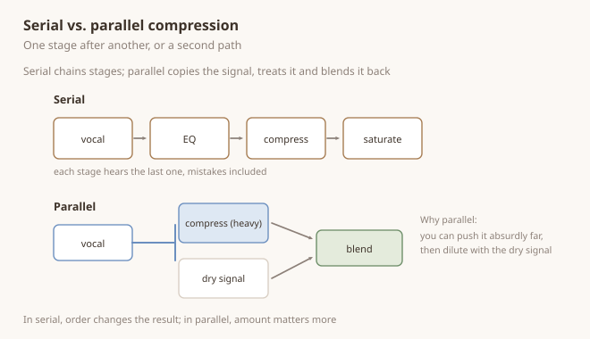
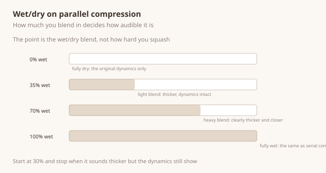
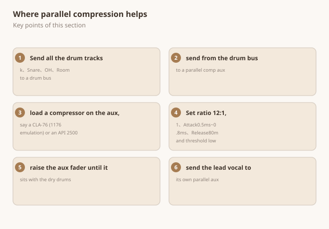
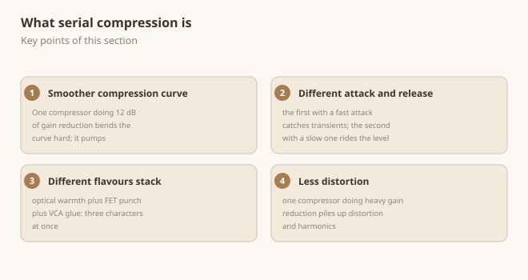
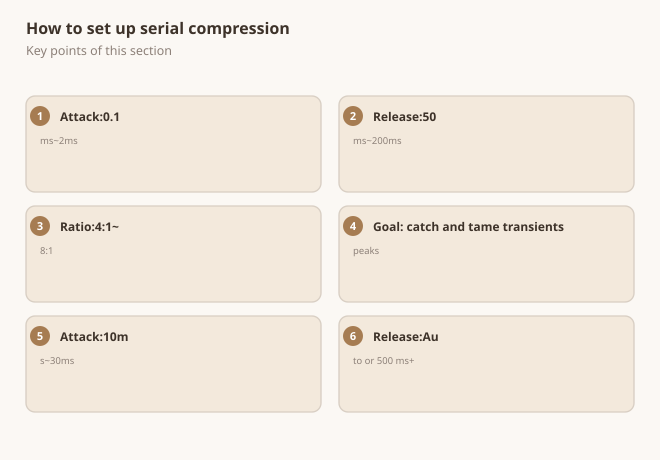
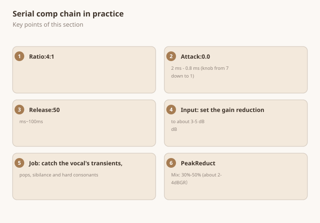
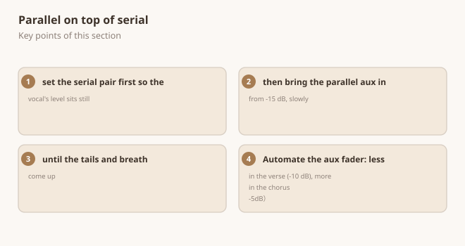
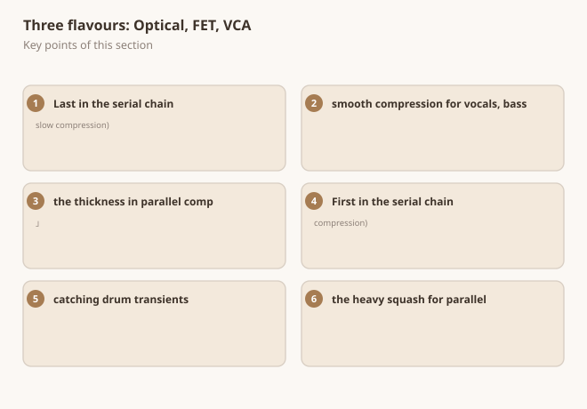
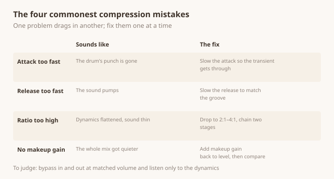
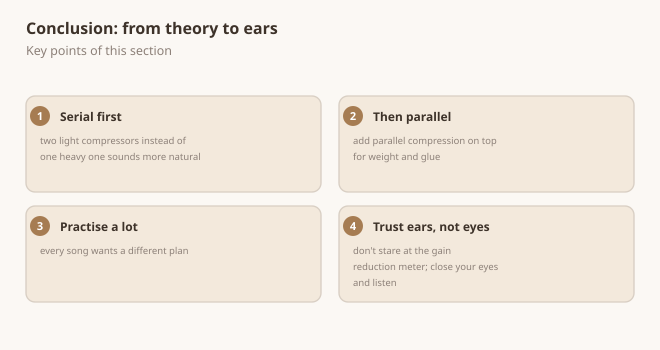

# Lesson 17: Advanced Compression: Parallel and Serial Compression

In the basic compression lesson we learned to control dynamic range with a single compressor. Professional mix engineers rarely solve everything with one compressor, though. They use two advanced techniques, **parallel compression** and **serial compression**, to build a sound that is full and powerful and still keeps its natural dynamics. This lesson takes both apart: how they work, how to set them up, and how they are used in practice.

## What is parallel compression?



Parallel compression, also called **New York compression**, has a very simple principle and a very strong effect: **mix the original, uncompressed dry signal with a heavily compressed wet signal**. It sounds like a contradiction, doesn't it, keeping the dynamics on one side while flattening the signal on the other. That combination is exactly what produces the effect.

Why do it? With traditional serial compression (a compressor inserted directly on the track), the moment you raise the ratio or lower the threshold you inevitably lose transient and dynamic detail. The drums' attack goes blunt, the vocal's tail notes are swallowed: those are the classic signs of too much compression.

Parallel compression solves that neatly: **the heavily compressed version gives you sustain and weight, the original keeps the transient and the dynamics**. Add them together and you have a sound with both impact and continuation.

### How parallel compression sounds

- **Drums**: the snare becomes fuller and heavier, the kick's tail lengthens, and the attack is still crisp
- **Vocal**: breath and tail detail are lifted, and it sounds closer, more emotional
- **Bass**: fret noise and sustain are both there, and the notes move into each other more smoothly
- **The whole mix**: the perceived level is bigger and fuller, without losing clarity

## How to set up parallel compression



There are two mainstream ways to do it, each with advantages and drawbacks.

### Method one: send and return (recommended)

This is what professional studios do most often:

1. **Set up an aux send**: send from the original track to an empty aux track
2. **Insert a compressor on the aux**: set it for heavy compression
3. **Blend dry and wet**: use the aux fader to control how much compressed signal is added

**Advantages**:

- The original track is untouched, and the blend can be changed at any time
- Several tracks can share one parallel compression aux (a whole drum kit into one parallel track, say)
- An EQ can sit before the compressor, so you shape the sound before compressing it

### Method two: duplicate the track

1. **Duplicate the original track**: you get two identical tracks
2. **Leave the original alone**, or compress it only a little
3. **Compress the duplicate heavily**
4. **Balance the level of the two**

**Advantages**:

- No aux needed; quicker to set up in the DAW
- Plug-ins can be added to the duplicate for more freedom (distortion, say)
- Good for a single instrument

**Drawbacks**:

- Phase problems can appear between the original and the duplicate (especially with any EQ other than linear phase)
- It uses more CPU
- The session gets messier

### Starting settings

The heart of parallel compression is to compress hard. These are field-tested starting points:

| Parameter | Suggested | Notes |
|------|--------|------|
| Ratio | 8:1 ~ 20:1 | Very high; close to limiting |
| Threshold | -30 dB ~ -20 dB | So the compressor is working almost all the time |
| Attack | 1 ms ~ 5 ms | Lets part of the transient through before it clamps down |
| Release | 50 ms ~ 100 ms | Medium fast, to keep the groove |
| Dry/wet | 20% ~ 50% wet | Start small and add until it is clear but not obvious |

**The golden rule**: pull the wet fader all the way down (muted), then bring it up slowly until you *feel* the sound get thicker, then back off a little. That point is the best balance.

## Where parallel compression is used

### Drum parallel compression (drum bus)

This is the classic use. Almost every modern pop, rock and hip-hop drum sound uses it.

**Steps**:

1. Send all the drum tracks (kick, snare, OH, room) to a drum bus
2. Send from the drum bus to a parallel compression aux
3. Insert a compressor on the aux, such as **CLA-76 (an 1176 model)** or **API 2500**
4. Set ratio 12:1, attack 0.5 ms ~ 0.8 ms, release 80 ms, and bring the threshold down to 10~15 dB of gain reduction
5. Bring the aux fader up slowly until it blends with the original drums

**What you are aiming for**: the drum's tail (room sound and sustain) becomes obvious while the attack stays clean. The whole kit sounds bigger and more powerful.

### Vocal parallel compression

Vocal parallel compression gives the lead voice more presence and intimacy.

**Steps**:

1. Send the lead vocal track to a vocal parallel aux
2. Use an **LA-2A (optical compressor model)**, ratio fixed (the LA-2A's curve is roughly 3:1 to 6:1), peak reduction 7~10 dB
3. Or use an 1176 with ratio 8:1, attack 0.5 ms ~ 0.8 ms, release 200 ms
4. Set the aux fader at -10 dB to -5 dB relative to the original vocal

**A tip**: put a high-pass filter (around 200 Hz) before the parallel compression aux, so low-frequency rumble does not trigger the compressor and the compression stays cleaner.

### Bass parallel compression

In modern music the bass needs both fingernail attack and low-end sustain. Those are contradictory by nature, and parallel compression gets you both.

- Original track: keep the natural dynamics, bring out the attack
- Parallel track: ratio 10:1, slow attack (10~20 ms), fast release (40 ms), so the compressor starts after the attack and holds the sustain
- Blend about 60% original and 40% compressed

### Mix bus parallel compression

Sending the whole mix through a parallel compressor gives the song glue and makes all the instruments feel like one.

**Suggestions**:

- Use a VCA-style bus compressor (SSL G-Bus Compressor)
- Ratio 2:1 ~ 4:1, very gentle compression
- Mix knob at 10% ~ 30% (if the plug-in has a dry/wet control)
- Or control it with an aux fader at -12 dB ~ -6 dB




## What is serial compression?

Serial compression means **chaining several compressors one after another on the same signal path**. Each compressor does only a little, and together they reach the total amount of compression you want.

It is the exact opposite of parallel compression: parallel is dry plus heavily compressed, side by side; serial is light compression plus light compression plus more, in a chain.

### Why two light compressors beat one heavy one

This is one of the most repeated pieces of mixing wisdom, and it has solid acoustic reasons behind it:

1. **A smoother curve**: one compressor doing 12 dB of gain reduction has a very steep curve and easily produces pumping and breathing. Two compressors doing 6 dB each also total 12 dB, but the curve is smoother and more natural.

2. **Attack and release that complement each other**: the first catches transients with a fast attack, the second controls the overall dynamic with a slow attack. One compressor cannot do both at once.

3. **Different characters added together**: the warmth of optical, the punch of FET, the glue of VCA, all at the same time.

4. **Less distortion**: one compressor doing a lot of gain reduction accumulates distortion and harmonic distortion. Spread over several compressors, each does less work and the distortion is lower.




## The rules for setting serial compression

### Rule one: fast, then slow

Usually the first compressor is fast, to catch transients, and the second is slow, to control the overall dynamic.

**The fast compressor** (FET or VCA):

- Attack: 0.1 ms ~ 2 ms
- Release: 50 ms ~ 200 ms
- Ratio: 4:1 ~ 8:1
- Aim: catch and tame the transient peaks

**The slow compressor** (optical or vari-mu):

- Attack: 10 ms ~ 30 ms
- Release: auto, or 500 ms and up
- Ratio: 2:1 ~ 4:1
- Aim: smooth the overall level and add sustain

### Rule two: light, then lighter

Each compressor does only 2~6 dB of gain reduction. Two in series total 4~12 dB, but it sounds far more natural than a single compressor doing 12 dB.

### Rule three: decreasing amounts

The first can compress more (3~5 dB GR), the second less (1~3 dB GR). The first has already dealt with most of the dynamics, so the second only trims.




## Serial chains in practice

### Vocal chain: 1176 → LA-2A

This is the classic vocal compression pairing in recording history, known as "1176 into LA-2A".

**Step one: 1176 (FET compressor)**

- Ratio: 4:1
- Attack: 0.02 ms ~ 0.8 ms (the knob from 7 round to 1)
- Release: 50 ms ~ 100 ms
- Input: set for about 3~5 dB of gain reduction
- What it does: catches the vocal's transient pops, lip and teeth noise and hard consonants

**Step two: LA-2A (optical compressor)**

- Peak reduction: 30% ~ 50% (about 2~4 dB GR)
- Gain: to compensate the output level
- Attack/release: automatic (the nature of an opto compressor is that attack and release follow the input signal)
- What it does: smooths the overall dynamic and adds a warm analogue texture

**The total result**: the vocal keeps crisp consonants (from the 1176's fast attack) and gets a smooth overall level curve (from the LA-2A's optical smoothing). That is why this pairing appears on countless classic records.

### Vocal chain in reverse: LA-2A → 1176

If you want a more aggressive, more forward vocal, try it the other way round:

- LA-2A first, doing 4~6 dB of smooth compression
- 1176 second, doing another 3~5 dB, ratio 8:1 or 12:1
- The final vocal sits further forward and closer, good for rock or for pop verses

### Drum bus chain: API 2500 → SSL G-Bus

- **API 2500 (VCA compressor)**: ratio 4:1, attack 1 ms, release 100 ms, 3~4 dB GR
- **SSL G-Bus Compressor (VCA compressor)**: ratio 2:1, attack 10 ms, release auto, 1~2 dB GR
- Result: the kit sounds tight, powerful and together

### Bass chain: dbx 160 → LA-2A

- **dbx 160 (VCA compressor)**: ratio 8:1, attack program-dependent, release on fast, 4~6 dB GR
- **LA-2A**: peak reduction 20~30%, 2~3 dB GR
- Result: clear attack, solid sustain, stable low end




## Combining parallel and serial compression

Professional mixers often use parallel and serial compression at the same time for the finest control. Here is a complete compression strategy:

### Example: a full lead vocal compression chain

```
source → EQ (high-cut, low-cut) → serial compression (1176 → LA-2A) → aux send → parallel aux (1176 heavy, 12:1)
```

**The serial part**: controls the dynamic and shapes the body of the sound
**The parallel part**: adds weight and presence

**Blending steps**:

1. Set the serial compression first, so the vocal's basic dynamics are steady
2. Bring in the parallel aux from -15 dB, slowly up
3. Until the vocal's tail notes and breath become obvious
4. Use automation on the parallel aux fader: less in the verse (-10 dB), more in the chorus (-5 dB)

### Example: a full drum compression chain

```
drum bus → serial API 2500 → parallel aux (1176 heavy 12:1, or Distressor heavy 15:1)
           └→ room mic heavy aux (extreme compression, to create a sense of space)
```




## The three compressor characters: optical, FET, VCA

When you choose compressors, knowing how the three main types behave in serial and parallel work matters.

### Optical compressor

**Classic models**: Teletronix LA-2A, LA-3A
**Character**: attack and release follow the input signal automatically, and the curve is smooth and natural
**Best uses**:

- The last compressor in a serial chain (the slow one)
- Smooth compression on vocals and bass
- The source of weight in parallel compression

### FET compression (field effect transistor)

**Classic models**: UREI 1176, Distressor
**Character**: extremely fast attack (down to 20 µs), rich harmonic distortion
**Best uses**:

- The first compressor in a serial chain (the fast one)
- Catching drum transients
- The heavy compressor in parallel work

### VCA compression (voltage controlled amplifier)

**Classic models**: SSL G-Series Bus Compressor, API 2500, dbx 160
**Character**: precise, transparent, strong glue
**Best uses**:

- Glue compression on the mix bus
- The middle stage of a serial chain
- Dynamic control on drums and bass

### A practical pairing matrix

| Goal | Serial pairing | Parallel compressor |
|------|----------|-----------|
| Warm vocal | 1176 → LA-2A | LA-2A (8:1 equivalent) |
| Aggressive vocal | LA-2A → 1176 (high ratio) | 1176 (20:1) |
| Tight drums | API 2500 → SSL Bus | Distressor (10:1) |
| Heavy drums | Distressor → LA-2A | 1176 (12:1) |
| Smooth bass | dbx 160 → LA-2A | LA-2A |
| Mix bus | SSL Bus (2:1) → vari-mu | - |




## Common mistakes and fixes

### Mistake one: too much parallel compression

**Symptom**: the sound goes dirty and blurry, and the transients disappear
**Fix**: start very small (aux fader below -15 dB) and add 1~2 dB at a time. The best parallel compression is usually the kind you would not notice unless you looked for it.

### Mistake two: too much serial compression

**Symptom**: the sound is lifeless and the dynamics are suffocating
**Fix**: keep total gain reduction under 10~12 dB. Remember, the point of compression is to control dynamics, not to remove them.

### Mistake three: the same chain on every track

**Symptom**: the mix sounds monotonous, with no layers
**Fix**: use different strategies for different instruments. The lead vocal gets 1176→LA-2A, a backing vocal gets a single LA-2A, a piano gets no serial compression and only light VCA compression.

### Mistake four: ignoring phase

**Symptom**: the sound gets thinner or hollower when parallel compression comes in
**Fix**: check for phase cancellation between the original and the parallel track. If there is any, use a linear phase EQ on the parallel aux, or nudge the parallel compression plug-in's delay setting.

### Mistake five: attack and release that do not work together

**Wrong chain**: both fast attack and fast release → a torn sound
**Wrong chain**: both slow attack and slow release → the transients are completely out of control
**Fix**: one fast, one slow, so they complement each other




## Conclusion: from theory to ear

Compression is an art, and it is ear training. Parallel and serial compression are two core techniques a professional mix engineer has to have; they can take a mix from good to genuinely strong.

**Final advice**:

1. **Learn serial first**: replace one heavy compressor with two light ones and you will hear the sound become more natural straight away
2. **Then play with parallel**: add parallel compression on top of the serial chain for weight and cohesion
3. **Practise a lot**: every song needs a different compression strategy. The same settings that sound good in rock may be completely wrong in jazz
4. **Trust your ears, not your eyes**: do not just watch the gain reduction meter; close your eyes and hear how the sound changes

Next lesson we go further into dynamic processing: **multiband compression** and **sidechain compression**. Stay tuned.


