# Lesson 18: Multiband Compression: Repairing Dynamics in Detail

## What is multiband compression?

The multiband compressor is one of the most capable tools in dynamics processing. The big difference from an ordinary compressor: an ordinary compressor applies one dynamic treatment to the whole spectrum, while a multiband compressor first splits the audio into several bands with crossover filters (usually 2 to 4 bands), then **compresses each band separately**, and finally sums the processed bands back into one signal.

An analogy: an ordinary compressor is like a conductor shouting "quieter" at the whole orchestra at once. A multiband compressor can tell the violins "louder", the kick drum "quieter" and the brass "hold that accent", managing each section on its own without touching the others.

The technique first appeared in the analogue hardware era, in broadcast and mastering; TC Electronic's Finalizer was the best-known hardware multiband processor. Modern digital multiband compressors (iZotope Ozone Dynamics, FabFilter Pro-MB, Waves C4/C6, Brainworx bx_masterdesk and so on) have taken it a long way, and some let you draw the compression zones freehand on the spectrum.

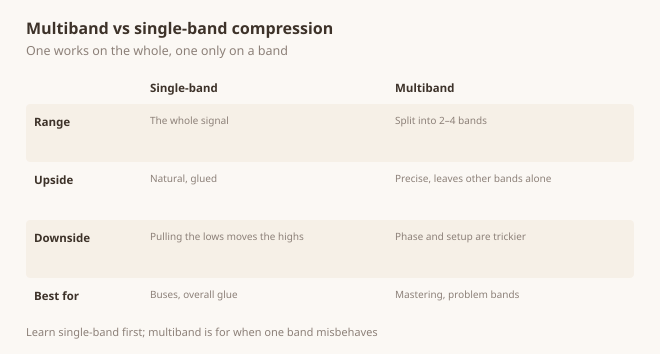

## Multiband vs. ordinary compression: which one when?

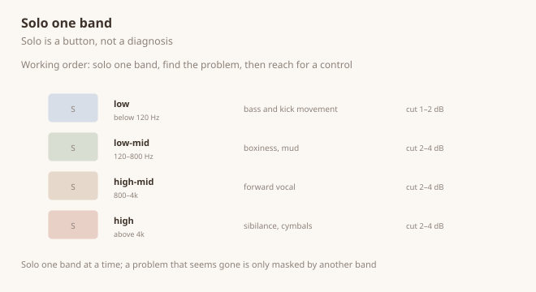

This is the most asked question. Here is a simple rule:

**Use an ordinary compressor first, and only reach for multiband when that is not enough.**

| Situation | What to use |
|------|-------------|
| Overall dynamic control, making a sound steadier | An ordinary compressor is enough |
| Adding sustain, making a sound fuller | An ordinary compressor (even an analogue-modelled VCA or opto compressor) |
| Only one frequency range peaks or is unstable | Multiband compression |
| The low end (bass/kick) jumps around, but the mids and top are fine | Multiband compression (on the low band only) |
| A vocal is too harsh at some sibilant frequency, but the overall dynamic is fine | Multiband compression or a de-esser |
| The master bus needs finer dynamic control without squashing the low end | Multiband compression |

**In practice**: on a single track, try an ordinary compressor first. It is simpler to set, sounds more natural and causes fewer phase problems. Bring in multiband compression when you find that an ordinary compressor cannot solve a dynamic problem in one band.

## Crossover points: how to place them

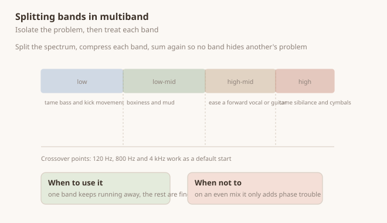

The crossover point is the most critical parameter in multiband compression. Place them badly and at best the effect is weak, at worst you get audible phase distortion and dips in the spectrum.

### Common three-band layouts

**Three-band setting (the most common):**

| Band | Range | What it is for |
|------|---------|---------|
| Low | 20 Hz - 200/250 Hz | Low-end energy control (bass, kick) |
| Mid | 200/250 Hz - 4k/5k Hz | Mid-range dynamics and boxiness |
| High | 4k/5k Hz - 20k Hz | High-frequency brightness and sibilance |

**Four-band setting (common on the master bus):**

| Band | Range | What it is for |
|------|---------|---------|
| Sub | 20 - 80/100 Hz | Sub control, avoiding low-end blur |
| Low | 80/100 - 250 Hz | Low-end impact and weight |
| Mid | 250 Hz - 4k Hz | The dynamics of the main musical content |
| High | 4k - 20k Hz | Air and sibilance control |

In practice the crossover points should follow the **material**, not the numbers in a textbook. On a song built around acoustic guitar, for instance, the mid crossover may need to cover a wider range.

### Golden rules for crossover points

1. **Keep them off the fundamentals of the main instruments**: do not put a crossover exactly on the fundamental of the vocal or the lead instrument, or the compressor will react unnaturally at that frequency.
2. **Use the listen or solo function**: most multiband compressors can solo a single band. Use it to hear what is in each band and confirm the crossovers are in the right place.
3. **Keep the crossover overlap smooth**: good multiband compressors use Linkwitz-Riley crossovers (usually LR4 or LR8), which keep the frequency response flat around the crossover point.

## Taming harsh sibilance in the high band

Over-compressing the high band is the commonest beginner mistake. The top end of a voice (roughly 5k - 10k Hz) contains sibilance (the "S", "T" and "Sh" sounds), and those sounds often carry much more energy than the sound around them.

### Steps: dealing with sibilance with multiband compression

1. Set the high-band crossover around **5k - 6k Hz**
2. Lower the threshold until, in solo, only the sibilance triggers compression
3. Set the ratio between **2:1 and 4:1**
4. Set the attack time at **1 - 5 ms** (fast enough to catch the sibilance, not so fast that it affects the normal sound)
5. Set the release at **20 - 50 ms** (a quick recovery, so it does not eat the syllable that follows)
6. Keep gain reduction at **3 - 6 dB**

**How it differs from a dedicated de-esser**: a dedicated de-esser usually cuts only a specific band, and its attack and release times are tuned for sibilance. The advantage of multiband compression is that it handles sibilance and other high-frequency dynamic problems at the same time, but it takes more care to set.

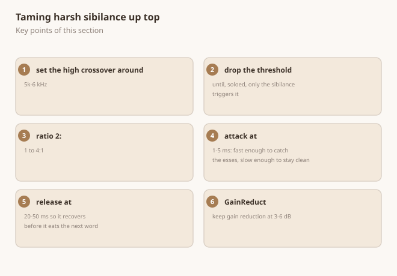

## Controlling inconsistency in the low band

The low end of the bass and kick is one of the hardest things to mix. The reason is that low-frequency energy changes with pitch: a bass playing lower notes has more energy, and higher notes have relatively less. That produces a pumping feel in the low end across the song.

### Steps: compressing the low band

1. Set the low-band crossover at **100 - 250 Hz** (adjust to the instrument)
2. Use a low ratio: **2:1 or 3:1**
3. Set the attack at **20 - 50 ms** (let the transients through and compress only the sustain)
4. Set the release at **50 - 100 ms** (follow the groove)
5. Adjust the threshold for about **2 - 4 dB** of gain reduction
6. If you want a tighter low end, add **soft knee**

This setting works especially well on the electric bass and on 808-style synth bass. It makes the low line steadier while keeping the dynamic expression of the playing.

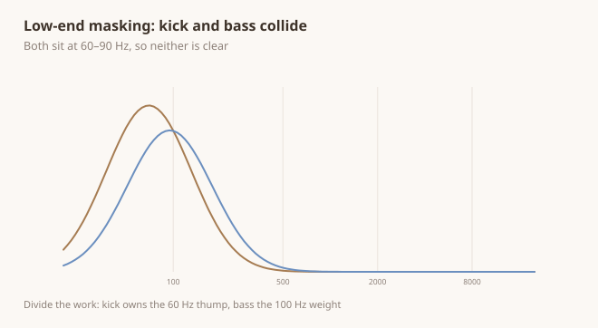

## Reducing boxiness and dullness in the mid band

Boxiness is when a sound seems shut inside a box; it usually sits between **200 and 500 Hz**. Acoustic guitar, cajon and even a voice can sound boxy. The traditional fix is to scoop that band out with EQ, but that changes the timbre permanently. Multiband compression offers a more musical solution: hold the boxiness down only when it is excessive.

### Steps: holding down boxiness

1. Set the crossovers at **200 Hz** (low-mid) and **500 Hz - 1k Hz** (mid)
2. Solo the band and confirm that the boxiness really is concentrated there
3. Set the ratio **3:1 to 5:1**
4. Set the attack time at **10 - 20 ms** (let the normal pick attack through)
5. Set the release at **40 - 80 ms**
6. Set the threshold so that gain reduction reaches **3 - 5 dB** when the boxiness appears

The advantage of this approach: while the instrument plays normally the compressor hardly acts and the timbre stays natural; when the boxiness appears the compressor steps in and holds it down. That is far more dynamic than a static EQ cut, and it keeps the original timbre better.

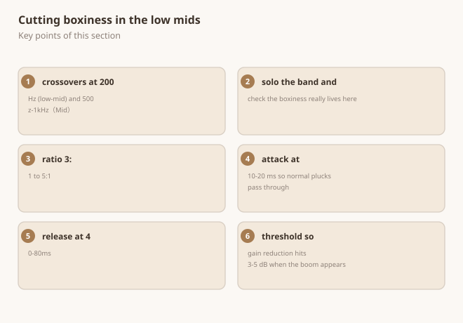

## Multiband de-essing compared with a dedicated de-esser

| What you compare | Multiband de-essing | Dedicated de-esser |
|---------|----------------------|---------------|
| Band flexibility | Crossover points and band widths are up to you | Usually a fixed frequency range |
| Attack/release control | Fully controllable | Usually automatic, or with fewer options |
| Handling several problems at once | The same compressor can work on the top band and on other bands | Sibilance only |
| Setup complexity | More complex, needs more adjustment | Simple and quick, one control does it |
| Naturalness | Can sound unnatural if set badly | Tuned for sibilance, usually more natural |

**In practice**: if all you need is sibilance control, a dedicated de-esser is quicker and more natural. If you also have other high-frequency dynamics to deal with (an unstable top end overall, say), multiband compression is the better choice.

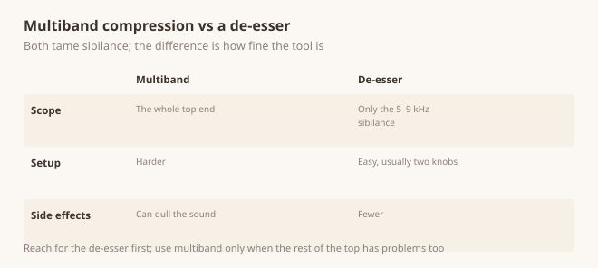

## Multiband compression on the master bus: glue and fine repair

The master bus is the last gate the whole song goes through. Using multiband compression here takes great care: too much breaks the balance of the mix, while the right amount makes the whole song tighter and more cohesive.

### Principles for master-bus multiband compression

1. **Use very little**: total gain reduction under **1 - 3 dB**, and no more than **1 - 2 dB** per band
2. **Very low ratio**: **1.25:1 to 1.5:1** is enough; this is more like dynamic trimming than compression
3. **Wide crossovers**: on the master bus, wider crossovers are better (LR4 is common, LR8 when you need a steeper slope), to reduce phase problems around the crossover
4. **Slow attack, medium release**: attack at **30 - 50 ms**, release around **50 - 100 ms**

### Reference settings for the master bus

| Band | Crossover | Ratio | Attack | Release | GR target |
|------|-------|-------|--------|---------|---------|
| Low | 20 - 120 Hz | 1.5:1 | 30 ms | 80 ms | 1 - 2 dB |
| Low-mid | 120 - 800 Hz | 1.3:1 | 40 ms | 60 ms | 0.5 - 1 dB |
| Upper mid | 800 Hz - 5k Hz | 1.25:1 | 30 ms | 50 ms | 0.5 - 1 dB |
| High | 5k - 20k Hz | 1.5:1 | 20 ms | 40 ms | 1 - 2 dB |

Note: these are starting points only. Different styles need completely different settings. EDM may need more assertive low-end control; classical music may need no multiband compression at all.

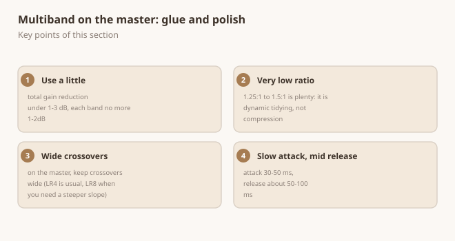

## Common traps

### Trap one: over-processing

This is the most damaging problem with multiband compression. Because every band can be compressed separately, people compress each band by 3 - 5 dB without noticing, and the whole song's dynamics disappear.

**Fix**: regularly bypass all the bands and A/B. If the sound feels more natural and more alive with the compression off, you have overdone it.

### Trap two: phase problems at the crossovers

The crossover filters in a multiband compressor introduce phase shift. Linkwitz-Riley filters keep phase consistent at the crossover point (the summed frequency response is flat), but when the bands are compressed by different amounts, the phase relationship around the crossover changes, which is audible as a change in timbre.

**Fix**:

- Use a high-quality multiband compressor (FabFilter Pro-MB, iZotope Ozone)
- Avoid having important instruments sitting near a crossover
- Use linear phase mode (bearing in mind the latency and pre-ringing)

### Trap three: bands interacting

When you compress the low band, the compressor lowers the level of the low end, but the ear's equal-loudness curves (Fletcher-Munson) make the mids sound relatively louder. That means multiband compression changes not only the band you compressed but also the overall spectral balance indirectly.

**Fix**: after each adjustment, check the overall spectral balance by ear and use make-up gain if you need to.

### Trap four: attack and release set wrongly

Different bands have completely different sound characteristics and need completely different attack and release times. The low band needs a longer attack to let transients through; the high band needs a very fast attack to catch sibilance.

**Fix**: set the attack and release of each band separately; do not take the shortcut of one setting for all of them.

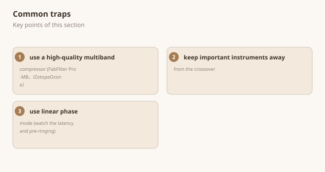

## A quick reference for each kind of material

### Vocal

| Band | Settings | Goal |
|------|------|------|
| Low (20 - 200 Hz) | Ratio 2:1, A 10 ms, R 50 ms, GR 2-3 dB | Control low-frequency plosives and the proximity effect |
| High (6k - 20k Hz) | Ratio 3:1, A 1 ms, R 20 ms, GR 3-5 dB | Sibilance and high-frequency dynamics |

### Bass

| Band | Settings | Goal |
|------|------|------|
| Sub (20 - 80 Hz) | Ratio 4:1, A 30 ms, R 100 ms, GR 3-6 dB | Steady the sub, avoid blur |
| Mid (80 - 500 Hz) | Ratio 2:1, A 20 ms, R 60 ms, GR 2-3 dB | Control low-mid boxiness and dynamics |

### Kick

| Band | Settings | Goal |
|------|------|------|
| Sub (20 - 60 Hz) | Ratio 3:1, A 20 ms, R 80 ms, GR 2-4 dB | Control the low-end extension |
| High (3k - 10k Hz) | Ratio 4:1, A 0.5 ms, R 10 ms, GR 3-5 dB | Control the harsh top end of the beater hitting the head |

### Full mix / master bus

| Band | Settings | Goal |
|------|------|------|
| Low (20 - 150 Hz) | Ratio 1.5:1, A 30 ms, R 80 ms, GR 1-2 dB | Steady the low-end energy |
| Low-Mid (150 - 800 Hz) | Ratio 1.3:1, A 40 ms, R 60 ms, GR 0.5-1 dB | Reduce low-mid build-up |
| High (5k - 20k Hz) | Ratio 1.5:1, A 10 ms, R 40 ms, GR 1-2 dB | Control high-frequency irregularity |

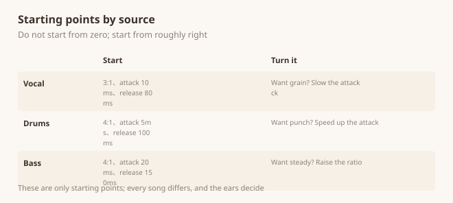

## Closing: the right mindset for multiband compression

Multiband compression is one of the most easily misused tools. It solves a lot of problems and creates a fair number too. These are the core habits:

1. **Ask why first**: before reaching for multiband compression, ask yourself whether the problem can be solved with an ordinary compressor or with EQ. If the answer is yes, use the simpler tool.
2. **As little as possible**: the point of multiband compression is to solve dynamic problems in one band, not to change the timbre. If you find yourself doing what an EQ would do, you should probably use an EQ.
3. **Ears first**: do not just read the gain reduction numbers. Close your eyes and judge by ear whether the sound got better.
4. **Compare**: run a bypass/active A/B comparison often. If you cannot clearly hear a difference, or there is one but you are not sure which is better, leave it as it is.

Multiband compression is a precision instrument in a professional's toolbox, not a Swiss army knife. Learning when not to use it matters as much as learning how to use it. When you really need it (steady low end, clean top end, transparent dynamic control), it will be your strongest ally.

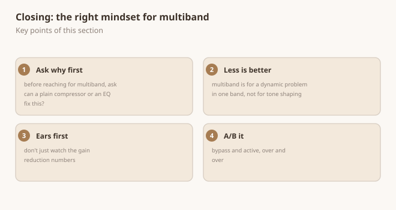
