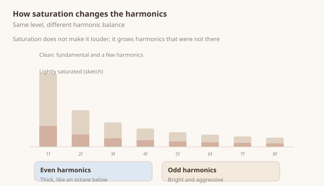
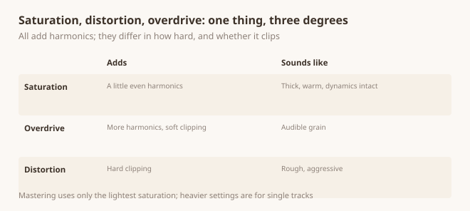
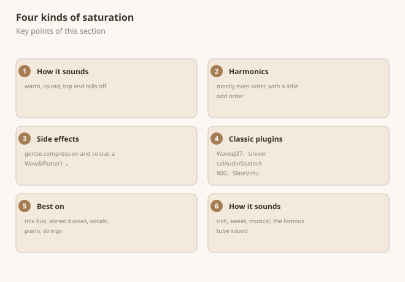
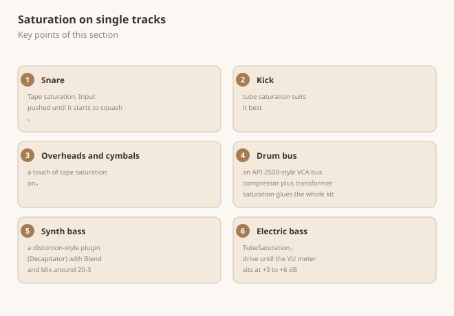
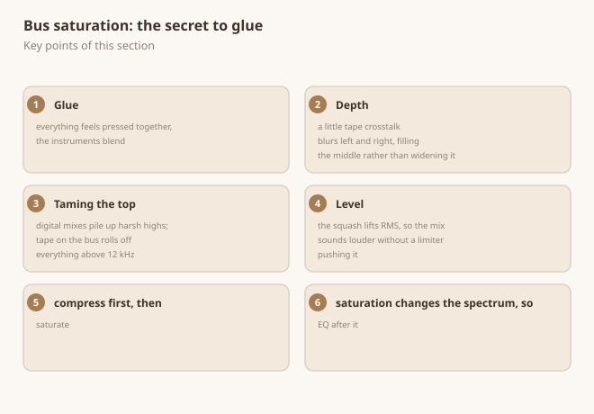
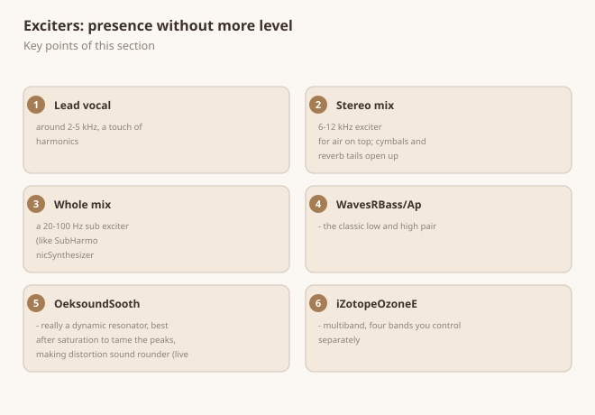
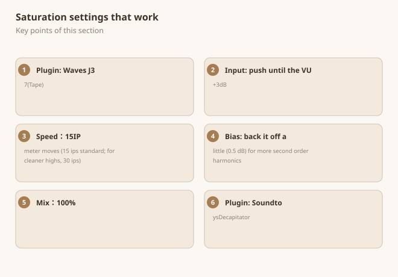
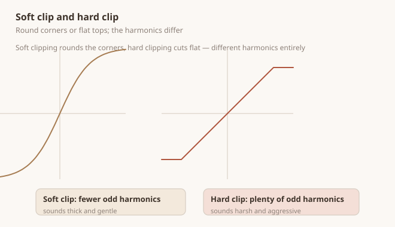
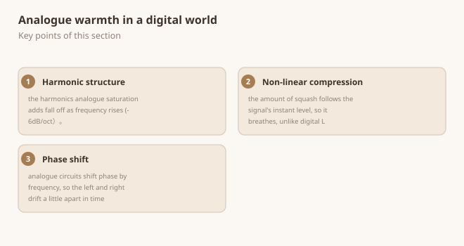

# Lesson 19: Saturation and Distortion: Injecting Analog Harmonics

## What this lesson covers: getting to know distortion, that good friend

In the world of digital music production we spend our whole lives chasing "clean": clean recordings, a clean signal chain, a clean mix. And yet what really makes music sound "like a record" is often not clean. It is that layer of exactly the right amount of **dirt**. In this lesson the topic is **saturation**, and its relatives: distortion and overdrive. You will learn how to use saturation to inject analog harmonics into your sound, add presence, give it a warm texture, and bring the mix closer to the "record sound" listeners are used to, without sacrificing dynamic range.

---

## What is saturation? Adding overtones to a sound

The word saturation comes from analog circuits. When a signal passes through an electronic component (a vacuum tube, a transistor, a transformer) and its strength goes past that component's linear operating range, the waveform starts to be compressed and flattened, and produces **harmonics** that were not there before. That process is called saturation.

### What saturation actually does

- **Nonlinear distortion**: input and output are no longer proportional, and the waveform is gently compressed.
- **Harmonic generation**: the new harmonics make the spectrum richer, and to the ear thicker and warmer.
- **Dynamic compression**: saturation is itself a kind of soft compression. Peaks are tamed, RMS rises, and it sounds louder.

Here is an example. A dry digital piano can sound sharp and stiff. Run it through a little tape saturation, though, and the highs soften, the low mids gain a layer of warm overtones, and the piano suddenly has physical presence. That is the magic of saturation.

### Why does digital sound need saturation?

Digital audio is "perfect": no noise floor, no harmonic distortion, no ripples in the frequency response. But precisely because it is too perfect, it lacks flesh and blood. Saturation supplies the layer of musical imperfection that listeners' brains got used to in the analog era, so the sound comes out natural, three-dimensional and warm.

---

## Saturation, distortion, overdrive: the three brothers

These three words get used interchangeably, but technically and to the ear there are clear levels between them.

### Saturation

- The mildest degree of distortion (usually < 1-5% THD).
- The goal is to beautify, not to break.
- The harmonics produced are mostly even-order, which the ear likes.
- Where it is used: any track that needs warmth and thickness, and the mix bus.

### Distortion

- Medium to strong (5-50% THD).
- The goal is to change the character of the tone, and sometimes deliberately to make breakup.
- Odd and even harmonics together; to the ear it is sharper, more electric.
- Where it is used: distorted electric guitar, synth sound design in electronic music.

### Overdrive

- Like distortion, but it usually models a guitar amp's preamp pushed past its limit.
- The dynamics respond more: play softly, it stays clean; play hard and it breaks up.
- Where it is used: rock guitar, blues, any distorted tone that needs dynamic expression.

In mixing, saturation is the tool you reach for most. You can think of it as a volume fader with colour: you push the signal up and it lays down a coat of harmonics at the same time.

---

## The four main types of saturation

Different analog components saturate in different ways. These are the four you meet most.

### Tape saturation

Models the behaviour of a reel-to-reel tape machine (Studer A827, Ampex 102).

- **Sound**: warm, rounded, the highs rolling off naturally.
- **Harmonics**: mostly even-order, with a little odd-order alongside.
- **Also adds**: light compression and colouration, a touch of wow & flutter.
- **Classic plugins**: Waves J37, Universal Audio Studer A800, Slate Virtual Tape Machines.
- **Best on**: the mix bus, stereo submixes, vocals, piano, strings.

### Tube saturation

Models the dynamic nonlinearity of tube amplifiers (12AX7, 6L6).

- **Sound**: rich, sweet, musical. People call it tube flavour.
- **Harmonics**: mostly even-order, the second harmonic especially, which the ear finds very pleasant.
- **Also adds**: strong dynamic compression; the louder the signal, the more it compresses.
- **Classic plugins**: Black Box HG-2, Soundtoys Radiator, Softube Saturation Knob. (The WA76 and the CL 1B are compressors; their tube circuits do saturate, but adding saturation is not their main job.)
- **Best on**: lead vocal, bass, acoustic guitar, piano. Any source that needs to sound expensive.

### Transistor saturation

Models the harder saturation of transistor circuits.

- **Sound**: sharp, aggressive, dirtier than tubes.
- **Harmonics**: more odd-order, which sounds harsher and more attacking.
- **Classic plugins**: Soundtoys Decapitator, Softube Harmonics, Trash 2.
- **Best on**: rock drums, electric guitar, synth bass. When you want that sandpaper edge.

### Transformer saturation

Models the iron-core saturation of the input and output transformers on an analog console (Neve, API).

- **Sound**: thicker low end, highs slightly darkened, more cohesion overall.
- **Harmonics**: mostly second-order, but tighter and lower than tubes.
- **Also adds**: phase shift, a low-end bump in the frequency response.
- **Classic plugins**: Neve 1073 Channel Strip, API 2500 Bus Compressor, Brainworx bx_console.
- **Best on**: drum bus, mix bus, bass instruments.

---

## Using saturation on individual tracks

The most direct use of saturation is on individual tracks, shaping the tone of each instrument.

### Drums

Drums are where saturation is most obvious.

- **Snare**: tape saturation, with Input pushed to the point where compression starts. The snare's transients get tamed, the tail gets thicker, and the hit still reads. Saturation plugins have no Attack knob; if you want to keep the transient snap, use a transient shaper to soften the attack first and then send it into the saturation.
- **Kick**: tube saturation suits it best. The low end fills out with more meat and the bounce increases. Rather than boosting 60 Hz with EQ until it gives, use saturation to raise the density of low-end harmonics. It sounds more natural.
- **Overheads / cymbals**: a tiny amount of tape saturation. That is all it takes (Input pushed to the saturation point around -2 to -3 dB) to make the cymbals' harsh highs silky.
- **Drum bus**: a VCA bus compressor in the API 2500 style plus transformer saturation, and the whole kit glues together and sounds like one finished record.

### Bass

Bass is the instrument where saturation does its "you can't hear it but you feel it" work best.

- **Synth bass**: a distortion-style plugin (Decapitator) with Blend / Mix at 20-30%, so only a little distortion is added. The low end stays clean, the top gets a grainy layer, and the bass can be heard on small speakers.
- **Electric bass (fingerstyle)**: tube saturation, with Drive set so the VU meter reads +3 to +6 dB. The bass's dynamics are tamed, the level evens out from note to note, and the tone gets fatter.
- **Upright bass**: tape saturation suits it best. It keeps the natural woody character and rounds out the midrange.

### Vocals

Vocal saturation is one of the dividing lines between a professional mix and an amateur one.

- **Lead vocal**: the classic tube-saturation use (Black Box HG-2). Not much drive, input gain around +2 to +3 dB (about 2-3 on the Triode scale). The vocal gains presence, like the texture you get from a studio-grade mic preamp.
- **Background harmonies**: tape saturation, pushed a little harder (input gain around +4 to +6 dB). The harmonies fuse instead of competing, and the group sounds like one set of microphones in one room.
- **Rap / spoken vocal**: transistor saturation, Mix at 10-15%. It adds a torn edge and attack in the mids and pushes the voice to the front of the mix.

### Guitars

- **Acoustic guitar**: a little tube saturation. The acoustic's transients are sharp; after saturation the mids are sweeter and the highs silkier, like it went through a top-end preamp.
- **Electric guitar (clean)**: tape saturation, to make the clean tone thicker and more three-dimensional.
- **Electric guitar (distorted)**: stacking tape saturation on a signal that is already distorted tames the excess harsh highs and makes the distortion sound bigger.

---

## Mix bus saturation: the secret weapon for glue

Saturation on the mix bus (the 2-bus) is the last mile of an analog-flavoured mix.

### How to do it

At the very end of all your tracks, before the limiter, put a tape saturation plugin (J37, Studer A800). Raise the Input Gain until the bus VU meter sits around +2 to +4 dB on average (about 1-2 dB of gain reduction).

### What it does

- **Cohesion**: all the tracks seem pressed together, and the instruments' frequencies blend into each other.
- **Dimension**: tape's slight crosstalk lets the left and right channels bleed together a little, so the image sounds fuller rather than wider.
- **Tamed highs**: digital mixes pile up harsh highs easily; tape saturation on the bus rolls off the very top above 12 kHz on its own.
- **Competitive level**: the dynamic compression from saturation raises RMS, so the mix sounds louder without pushing the limiter hard afterwards.

### Suggested order

Compressor → saturation → EQ → limiter

- The compressor handles dynamics first, so the saturation behaves more consistently.
- Saturation changes the spectrum, so fine-tune with EQ after it.
- The limiter at the end only does a very small amount of final limiting.

---

## Harmonic exciters: presence without volume

A harmonic exciter is a branch of saturation: it generates harmonics only in a chosen band and leaves the rest clean.

### How it works

Conventional saturation applies distortion to the whole spectrum (or to one whole band). An exciter uses a crossover or multiband processing to inject harmonics only in the high mids or the top. The ear hears more detail and better air, but the level has not actually gone up.

### Where to use it

- **Lead vocal**: centred on 2-5 kHz, a small amount of harmonics. No EQ boost, and the vocal's natural brightness comes up.
- **Stereo mix**: an exciter at 6-12 kHz brings out air on the top of the mix; the cymbals' air and the room reverb's tail become more audible.
- **Overall image**: a low-frequency exciter at 20-100 Hz (like a sub-harmonic synthesiser) adds a second harmonic to the low end, so the bass can be perceived on small speakers too.

### Recommended plugins

- **Waves RBass / Aphex Vintage Exciter** — classic low-end and high-end excitation.
- **Oeksound Soothe2** — essentially a dynamic resonance suppressor; good after saturation for shaving off harsh harmonic peaks and making the distortion sound rounder (the live version is a separate product, soothe live).
- **iZotope Ozone Exciter** — multiband excitation with four bands you can control separately.

---

## Saturation settings that work in practice

These are starting points that have held up in real sessions. Adjust them to the material in front of you.

### Snare saturation

- Plugin: Waves J37 (Tape)
- Input: push to VU +3 dB
- Speed: 15 IPS (standard tape speed; switch to 30 IPS for cleaner high-end extension)
- Bias: slightly low (−0.5 dB), for more second harmonic and more saturation
- Mix: 100%

### Bass (synth) saturation

- Plugin: Soundtoys Decapitator
- Style: N (Neve) or P (Pentode); press Punish if you need it meaner
- Drive: 3.5
- Filter: low-pass around 8 kHz (so only the low mids saturate)
- Mix: 30% (dry and wet together, keeping the low end intact)

### Stereo bus saturation

- Plugin: Slate VTM (Virtual Tape Machines)
- Calibration: +6 dB / 185 nWb/m (a high amount of saturation)
- Tape Type: GP9 (modern tape, cleaner)
- Speed: 15 IPS
- Trim the Output so the bus level stays around -6 dBFS (leave room for the limiter)

### Vocal tube saturation

- Plugin: Black Box HG-2
- Triode Drive: 3.5
- Pentode Drive: 0 (triode only, to keep the even-harmonic character)
- Low Cut: on (so low-frequency noise is not amplified by the saturation)
- Mix: 100%

---

## Soft clipping vs hard clipping: how far can you push?

The final threshold of saturation is clipping: the waveform being cut off flat.

### Soft clipping

- The waveform is gently bent as it approaches 0 dBFS.
- It still sounds smooth, with no harsh digital artifacts.
- Good for: peak control on the mix bus, transient shaping on drums.

### Hard clipping

- The waveform is chopped off at 0 dBFS into a flat-topped square wave.
- Generates a lot of odd harmonics; it sounds harsh and strongly digital.
- Good for: synth sound design in electronic music, deliberate lo-fi effects.
- Not good for: vocals, acoustic instruments, the mix bus (unless you want that grit on purpose).

### How to judge it in practice

If the saturation starts to sound sandy, like radio static, you have pushed it too far. The right move is to push to the point where you just hear it get thicker but not yet hear it break, then back off 1-2 dB.

---

## The philosophy of analog warmth in digital production

"Analog warmth" is a phrase that has been talked to death in the digital era. What does it actually mean?

### The science of warmth

1. **Harmonic structure**: the harmonics analog saturation adds fall away naturally as frequency rises (-6 dB/oct). That is how sound decays in a real acoustic space, so the ear and the brain decide that it sounds natural.
2. **Nonlinear compression**: how much an analog component compresses depends on the instantaneous strength of the input. That compression is alive over time; it does not stop mechanically at a fixed point the way a digital limiter does.
3. **Phase shift**: analog circuits produce frequency-dependent phase shift, which puts a tiny time difference between the left and right channels of a stereo signal. The image sounds wider and deeper.

### How to recreate it digitally

Today's digital saturation plugins (FabFilter Saturn 2, iZotope Trash 2, Kazrog True Iron) can model analog circuit behaviour very precisely. The point is not whether you use analog hardware. The point is to understand how analog saturation works, and then to use the right tool.

---

## Recap

| Concept | One-line reminder |
|------|-----------|
| Saturation | Adds beautiful overtones and makes the sound thicker |
| Distortion | A weapon for changing the timbre, for novelty |
| Overdrive | An expressive tool that follows how you play |
| Tape | Warm and round; good on the bus |
| Tube | Sweet and expensive-sounding; good on vocals |
| Transistor | Sharp and sandpapery; good on rhythm instruments |
| Transformer | Thicker low end; good on drums and bass |
| Harmonic exciter | Presence without volume |
| Soft clipping | Gentle peak shaving, usable in a mix |
| Hard clipping | Violent peak shaving, for sound design |

Saturation is the most underrated mixing tool: it is a **dynamics processor**, a **frequency shaper**, a **harmonic generator** and a **stereo widener** all at once. Learn to use it and your mixes move on from a digital template to a finished piece with analog texture.

Next lesson we look at advanced compressor work, from parallel compression to multiband, so your control over dynamics goes up another level.
