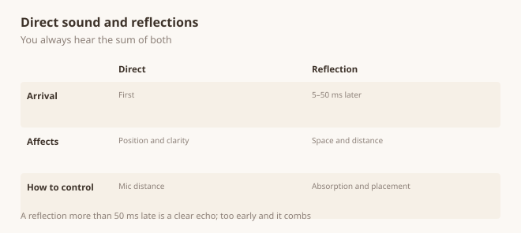
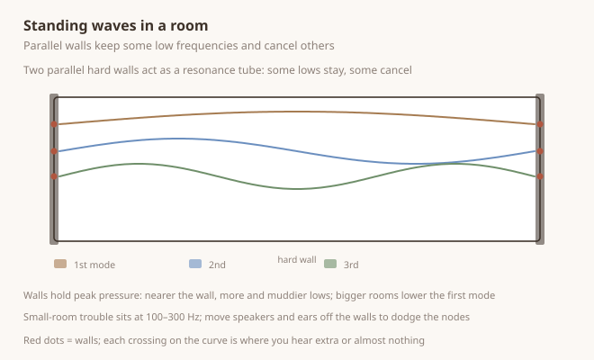
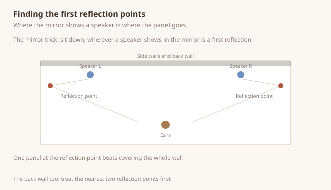
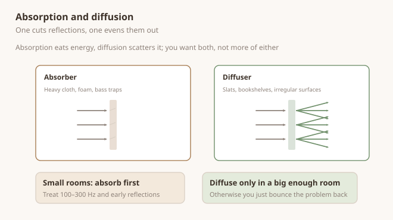
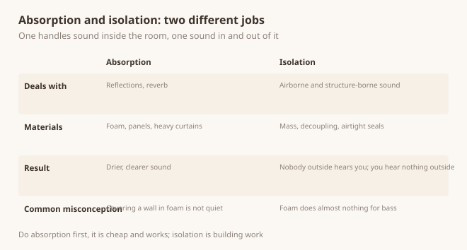

# Lesson 2: Acoustic Foundations: Standing Waves, Comb Filtering and Room Treatment

Welcome to lesson two. In the last lesson we went through the hardware a studio needs, from the computer and the audio interface to choosing a microphone. You may already have bought it all, plugged it in and be ready to go. But many beginners hit a wall right here: "Why is it that I bought the same expensive microphone as the stars, and the recording still sounds dull, with that cheap singing-in-a-bathroom quality?"

The answer is simple: we ignored the biggest and most critical piece of "equipment" in the recording process — **your room**.

This lesson skips the stiff physics formulas. Instead it puts on "X-ray glasses for sound" and looks at what actually happens in the air when you make a sound in a room. We'll meet two sound killers hiding in the room — standing waves and comb filtering — and learn how to turn your bedroom into a passable recording space in the most everyday, least expensive way.

## 1. The game of billiards sound plays: direct and reflected sound

To understand how a room affects sound, we first have to picture how sound travels through air.

Imagine you're holding a handful of super-bouncy balls. The moment you sing into the mic, or hit a guitar chord, is the moment you throw that handful hard in every direction. A few balls hit the microphone on a straight line: that is **direct sound**. It's the purest sound, the one we want most, not "polluted" by the room.

But where did the other few hundred balls go? They hit the ceiling, the wooden floor, the wardrobe door, the glass window, then bounced, bounced again, and only then found their way into the mic. Sound that is captured only after bouncing off a wall is **reflected sound**.

The microphone is completely honest: it records direct sound and thousands of reflections mixed together. If the walls are bare hard material, there are a great many reflections, and the recording has a hollow, muddy reverb. That's why speech echoes so much in an empty underground car park, or in a newly decorated flat before the furniture has moved in.

## 2. The low-frequency monster in the room: standing waves (Standing Wave)

The most troublesome of all reflection problems is the standing wave. It's like an invisible low-frequency monster in the room, and it will wreck your mix.

### 1. What is a standing wave?

Sound is a wave, and different frequencies have different wavelengths. A high note has a short wavelength, maybe a few centimetres, like a small mouse that any cushion can stop. A low note has a very long wavelength: 50Hz is about 6.9 metres, and 60Hz is 5.7 metres. That is an elephant.

Most bedrooms and home studios are three to five metres in each dimension. When this low-frequency elephant bounces back and forth between two parallel walls (your left and right walls, or the floor and ceiling), and the distance between them happens to be half a wavelength, or a whole multiple of one, a strange (and frightening) physical thing happens: **the reflected wave adds to the original wave and forms a wave that sits still in space, going neither forward nor back — that is a standing wave.**

### 2. The wave experiment in the bathtub

If that's too abstract, imagine taking a bath. Rock your body back and forth in the tub and the water hits both ends and bounces back. If your rocking matches the length of the tub, the waves build higher and higher and water splashes out at both ends (the antinodes), while the water level in the exact middle barely moves (the node).

Your room is the bathtub. Sound is the water.

### 3. What standing waves do to a mix

When a room has standing waves, some places are "low frequency extremely loud" and others are "low frequency completely gone".

This produces a classic beginner disaster. You mix in your room and the bass and the kick sound huge, exciting, punchy. Then you export an MP3, play it in the car, or play it to a friend on a phone, and find: "My god, the bass is so big the whole song is one mush." The reason is that your chair sits at a node — a place where the bass disappears. Because you can't hear the low end in the room, you unconsciously push the bass up in the software. Move to a normal space and all that over-boosted bass shows itself.

## 3. The twin ghost of sound: comb filtering (Comb Filtering)

If the standing wave is the monster of the low end, comb filtering is the twin ghost of the mids and highs. And it usually happens somewhere you'd never expect: your desk.

### 1. How does it happen?

Imagine sitting at your desk, talking into a mic on the desk. The sound takes two paths:

- **Path A:** straight from your mouth into the mic (direct sound).
- **Path B:** down from your mouth, off the hard desktop, and into the mic (reflected sound).

Because path B travels an extra few tens of centimetres, it reaches the mic about one to two milliseconds (thousandths of a second) later than path A.

### 2. The tragedy of phase cancellation

When a sound adds to its own twin, delayed by a very short time, serious phase cancellation happens. Some frequencies reinforce each other; others cancel each other out and disappear entirely.

Look at it on a spectrum analyser (a tool that draws sound frequencies as a graph) and the smooth curve gets deep notches cut into it, like the teeth of a comb. That is why the effect is called comb filtering.

### 3. What does it sound like?

Comb filtering gives your voice a metallic, empty-can quality, or the sound of a sci-fi phaser. The sound goes flat and unnatural and loses its warmth and body. This is also why so many streamers and podcasts, with expensive microphones, still sound cheap: the mic sits too close to the desk.

## 4. The big room makeover: acoustic treatment without spending much

Now we know the enemy, it's time to build the defences. Many people think "acoustic treatment" means buying a pile of cheap egg-crate foam online and covering the room. Don't. That only dries up the highs and leaves the low-frequency monster with nowhere to go, so the room sounds duller.

A healthy recording space needs a balance between absorption and diffusion.

### 1. Finding the first reflection point: the mirror trick

Before you stick up any absorbing material, find the hot spots where sound bounces — the first reflection points. Take a small mirror and have a friend hold it against your left wall, moving slowly forward and back. You sit in your usual mixing position and watch the mirror on the wall. **The moment you see your monitor in the mirror, that spot is the first reflection point on the left wall.**

Find the right wall and the ceiling the same way. Once you have the hot spots, hang absorber panels at those specific places and you kill the worst comb filtering for the least money.

### 2. Natural absorbers already in the room

If you don't want to buy mineral-wool panels yet, use the soft furniture you already have:

- **Heavy double-layer curtains:** very good high-frequency absorbers.
- **Sofa and cushions:** at the back of the room, they soak up excess mid-range reverb.
- **Don't leave the desktop bare:** when you record, lay a thick towel or a large felt pad on the desk. It immediately reduces the comb filtering caused by the desk.

### 3. Trapping the low-frequency monster: bass traps

Low frequencies have long wavelengths; thin foam does nothing to them. Low frequencies love to hide in the corners of a room, where two walls meet at 90 degrees. The professional approach is thick bass traps in the four corners (usually high-density mineral wool or fibreglass columns). On a limited budget, roll up a heavy winter duvet and stuff it into the corner, or put a packed wardrobe in the corner; that absorbs some low end as well.

### 4. Letting sound scatter naturally: diffusion

If a room is covered in absorber panels the sound goes dead and feels oppressive. We need to keep some natural space, and that is what diffusion is for. A diffuser has an uneven surface: sound hitting it doesn't bounce back like it does off a mirror, but breaks up like a splash and spreads evenly into every corner, making the room sound bigger and more natural.

**Everyday diffusion tip:** do you know what the best natural diffuser in a home is? A storage shelf or bookcase packed with things. If you happen to have a modular storage system like the ones in hardware shops — say a big 16-compartment rack filled with sorted Lego boxes, stationery boxes, or small instruments of different shapes and sizes — then that rack, with its uneven depths and very irregular surface, is a near-perfect natural diffuser, if it sits on the wall behind your chair. Sound hitting the gaps between those Lego boxes and instruments scatters into a soft diffuse field. That is more natural and more sustainable than buying expensive wooden diffusers.

## 5. Breaking the myth of the century: absorption is not soundproofing

| | Absorption | Soundproofing |
|---|---|---|
| Purpose | Make the sound inside the room clean | Stop sound going in or out of the room |
| Method | Heavy fabric, foam, bass traps | Mass, double walls, airtightness |
| What it affects | Reverb time, comb filtering | Neighbours and outside noise |
| Common misconception | Cover the room in foam and it goes quiet | Acoustic foam blocks low frequencies |

At the end of the lesson we have to clear up the idea most people confuse: acoustic treatment and soundproofing are two completely different things.

### 1. Absorption is about sounding good

Everything discussed above — standing waves, comb filtering, absorber panels, diffusers — belongs to acoustic treatment. Its purpose is to improve the quality of the sound *inside* the room, so what you record is clean and the frequencies you hear while mixing are accurate. **But it does nothing to stop sound leaving the room.**

### 2. Soundproofing is about blocking sound

Soundproofing is about not disturbing other people, or other people not disturbing you. Picture a real scene from daily life: you have finally got the child to sleep, you creep into the studio, and at last you have time to sit down and mix a song, or record an acoustic guitar. The last thing you want is the low end from your monitors going through the wall and waking the child, or the neighbour's dog barking and the garbage truck's music getting into the mic.

That is when you need soundproofing. To block sound, the only physics is **mass** and **airtightness**.

- **Airtightness:** sound is like water — it gets through any gap. Gaps under doors and around windows are the main leaks. Fit acoustic seals, install airtight windows, block the gap under the door: that is step one of soundproofing.
- **Mass:** to block low frequencies you need thick, heavy material, such as poured concrete walls, multiple layers of plasterboard, or acoustic blankets.

In short: **foam absorbs sound, it does not block it.** Cover the door in egg-crate foam, sing loudly inside, and the child asleep in the next room still hears every word. The only difference is that the backing track you hear has a little less reverb.

## Conclusion: make peace with your room

After this lesson you may look at your room and sigh, thinking there is far too much to fix. Don't worry. Even the best studio in the world, costing millions, has no "perfect space"; they just keep the flaws inside the range the human ear accepts.

As a home recordist, your great advantage is flexibility. Try moving the desk to get out of the low-frequency dead zone at the centre of the room; pull the mic away from the desktop when recording to reduce comb filtering; or, for vocals, move the mic in front of an open wardrobe and let the clothes absorb.

When you can hear the boom of a standing wave, and tell apart the metallic thinness of comb filtering, you already have a mixing engineer's ears. Next lesson we open the software and formally enter the world of the digital audio workstation (DAW): how to set up a project correctly and lay the firmest foundation for your first piece. See you then.
