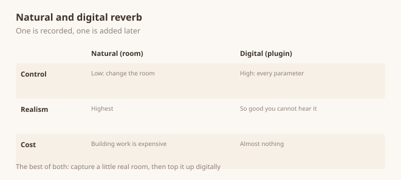
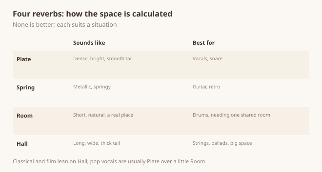
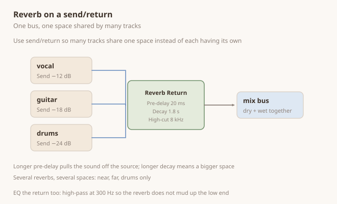
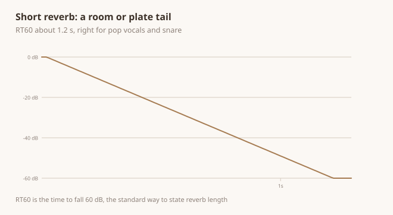
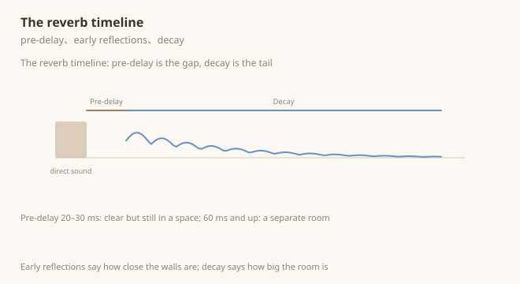
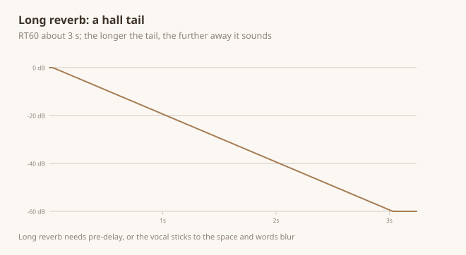
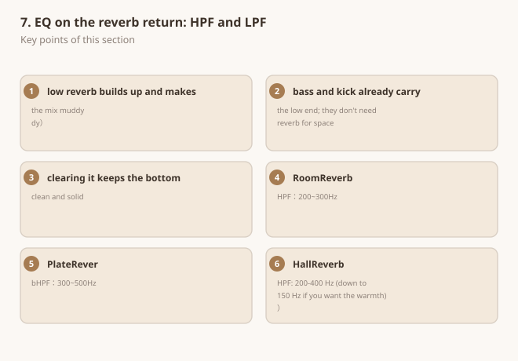
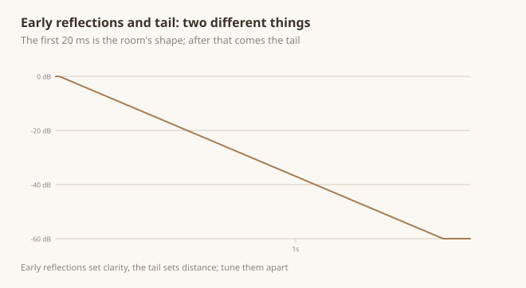
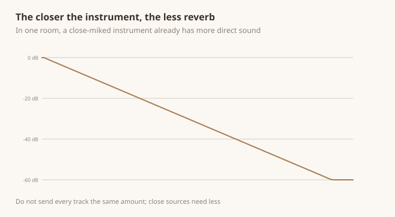
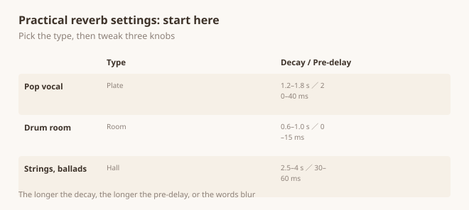

# Lesson 20: Building Space with Reverb: Send/Return Architecture and a Sense of Depth

## 1. What is reverb? Natural acoustics vs digital reverb

Reverberation, reverb for short, is the way a sound keeps decaying after it has reflected and spread through a space. Once the source makes a sound, the wave hits walls, floor and ceiling and reflects off them countless times. Those reflections reach the listener's ears one after another with tiny time differences and form a long tail. That is reverb.

### Reverb in natural acoustics

Every space has its own reverb signature. A small bathroom reflects highs densely and gives a short, bright reverb; a cathedral's reverb can run past five seconds. How long the reverb lasts depends on the size and shape of the space, the materials it is built from and how much is in it. Natural reverb is how our brains work out, unconsciously, what kind of space we are in.

### Digital reverb

Digital reverb is plugins or hardware that use DSP to model natural room acoustics, giving a dry, cold recording a sense of space and depth. The common approaches are algorithmic reverb (a mathematical model, flexible parameters, low CPU load) and convolution reverb (sampling a real space's impulse response; very accurate but not very adjustable).

## 2. Types of reverb

Each type of reverb has its own tone and its own place.

**Room reverb**: models the natural reflections of a small room, decay 0.3~1.0 s, more highs retained. Good for drums and percussion.

**Hall reverb**: models the wide space of a concert hall, decay 1.5~4.0 s or more, with a full, generous tail. Good for strings, piano, choir and film scores.

**Plate reverb**: makes reverb with a metal plate vibrating mechanically; a classic tool from the 1950s to the 1970s. The tone is smooth and dense with no obvious early reflections, decay 1.0~3.0 s. Classically used on vocals and snare.

**Spring reverb**: made by a spring twisting and vibrating, common in guitar amps. It has a distinctive boing to it. Widely used in surf rock, dub and reggae.

**Chamber reverb**: a speaker plays in a real echo chamber and microphones record the reverb of the room. Abbey Road and Motown's classic studios used this. The tone is warm and organic.

**Convolution reverb**: calculated from a sampled impulse response of a real space, so it is very accurate. The drawbacks are little flexibility in the parameters and high CPU cost.

## 3. Send/return (aux bus) routing: why it beats an insert

In a DAW there are two main ways to put reverb on a track: insert and send/return.

### The problem with inserts

An insert puts the reverb plugin directly in one track's signal chain. It is simple to set up, but it has these drawbacks:

- **Heavy CPU cost**: one reverb plugin per track; ten tracks means ten reverbs, and the compute is wasted
- **No consistency**: each track's reverb settings are independent, so it is hard to make all the instruments sound like they are in the same space
- **No shared reverb**: each track's reverb is isolated from the others, and the natural sense of one shared space is lost
- **Awkward mix changes**: to change the reverb amount on all tracks you have to go track by track by hand

### Send/return architecture

Send/return (also called an aux bus, or bus architecture) is the core technique of professional mixing:

1. Create an auxiliary track (aux track / return track)
2. Put one reverb plugin on it and set Dry/Wet to 100% wet, so it outputs only the reverb signal
3. Route tracks to that auxiliary track with a send
4. Each track's send level sets how much goes into the reverb, which is that track's wetness

**The advantages, summed up:**

- **CPU efficient**: one reverb plugin shared by many tracks
- **One space**: every instrument's reverb comes from the same simulated space, so it blends naturally
- **Independent control**: each track's send level is adjustable on its own, so balancing how deep each instrument sits is easy
- **Flexible reverb treatment**: on the return track you can EQ or compress the reverb signal without touching the dry signal
- **Global pre-delay and mix control**: adjusting pre-delay, decay and so on affects every track sharing the reverb at once

## 4. Setting up multiple reverb returns: room, plate, hall

A professional mix usually uses 2~4 different reverbs at once rather than just one, each handling a different layer of space. The common setup is a three-layer reverb system:

### Layer 1: room reverb (close space)

- Send/return number: Bus 1
- Decay time: 0.4~0.8 s
- Purpose: gives the sound a space to exist in without making it sound distant
- Good for: drums, percussion, rhythm guitar

### Layer 2: plate reverb (tone blending)

- Send/return number: Bus 2
- Decay time: 1.5~2.5 s
- Purpose: adds fullness and a classic texture; it emphasises tone rather than room size
- Good for: lead vocal, snare, piano

### Layer 3: hall reverb (depth and atmosphere)

- Send/return number: Bus 3
- Decay time: 2.0~4.0 s
- Purpose: creates a deep space and atmosphere, giving instruments a near-to-far layering
- Good for: strings, pads, background vocals, solo instruments

### How to set it up (in any DAW)

1. Create three stereo aux tracks (or return tracks) and name them "Room Verb", "Plate Verb" and "Hall Verb"
2. Insert the matching reverb on each aux track and set Mix/Dry-Wet to 100% wet
3. On every track that needs reverb, open the matching send (usually the DAW's sends panel) and route it to those three aux tracks
4. Set each track's send level. Usually the rhythm section (drums, bass) goes more to the room and less to the hall; the lead vocal goes more to the plate and the hall

## 5. Pre-delay: depth without losing clarity

Pre-delay is the gap between the dry signal and the moment the reverb starts. It is the most overlooked parameter in building a sense of space, and one of the most important.

### Using pre-delay in a mix

- **Short pre-delay (0~20 ms)**: the sound is wrapped in reverb immediately; good for close but full of space, and often used to simulate drum room mics
- **Medium pre-delay (20~60 ms)**: there is a clear gap between the dry sound and the reverb, so a vocal sounds clear and open while still having plenty of depth. This is the range lead vocals mostly use
- **Long pre-delay (60~120 ms)**: dry and reverb are almost separated, which makes a dramatic echo. Good for solo instruments and special sections

**The key point**: pre-delay lets a lead vocal stay clear inside a lot of reverb, because the ear gets the dry signal before the reverb arrives. In vocal mixing, 40~60 ms of pre-delay into a plate or a hall is the classic move.

## 6. Decay time: matching the reverb's length to the genre and the tempo

Decay time (also called RT60) is how long the reverb takes to fall by 60 dB, and it is the main parameter that sets the size of the space.

### How to set decay time

| Genre / situation | Suggested decay time | Notes |
|---|---|---|
| Fast pop, funk, metal | 0.5~1.2 s | Too long a reverb smears the rhythm |
| Ballads, slow R&B | 1.5~2.5 s | Enough tail to hold the emotion up |
| Film scores, ambient | 2.5~5.0+ s | Builds a vast sense of space |
| Small-group jazz | 1.0~2.0 s | Keeps the playing detail and the realism |
| EDM, electronic music | 0.3~1.5 s (can be sidechained to duck) | Clarity of rhythm comes first |

### Calculating decay time from BPM

One advanced trick is to line the decay time up with the song's tempo, so the tail lands on a beat instead of blurring away. The arithmetic:

- 1 beat = 60000 / BPM (ms)
- Aim for a decay time of 1~4 beats

For example, at BPM = 120:

- 1 beat = 500 ms, so set the decay to 1.5~2.0 s (3~4 beats long)

That way the tail dies away on a beat of the phrase and the rhythm stays tidy.

## 7. EQ on the reverb return: high-pass and low-pass

This is one of the biggest differences between a professional mix and an amateur one: EQ applied to the reverb signal itself.

### High-passing the reverb

Put an HPF (high-pass filter) on the reverb return, usually at 200~500 Hz. Why:

- Low-frequency reverb piles up easily and makes the mix muddy
- Bass and kick already carry strong low-end energy; they do not need reverb to add space
- Clearing low-frequency reverb makes the low end of the mix cleaner and stronger

**Suggested settings:**

- Room reverb HPF: 200~300 Hz
- Plate reverb HPF: 300~500 Hz
- Hall reverb HPF: 200~400 Hz (drop to 150 Hz to keep some warmth if the song wants it)

### Low-passing the reverb

Put an LPF (low-pass filter) on the reverb return, usually at 8~15 kHz. Why:

- High-frequency reverb turns harsh easily, especially when there are a lot of cymbals and hi-hats
- It models the natural high-frequency decay of a real space: air absorbs highs
- It makes the reverb softer and more analog

**Suggested settings:**

- Room reverb LPF: 12~16 kHz
- Plate reverb LPF: 10~14 kHz
- Hall reverb LPF: 8~12 kHz (a long reverb suits a softer tail)

### Touching up the mids

Sometimes the reverb booms or boxes around 1~4 kHz. A bell EQ with a small cut (-1~3 dB) makes the reverb cleaner and more transparent.

## 8. Early reflections vs tail: controlling the sense of space

A reverb's structure in time splits into early reflections and the tail.

Early reflections are the first few bounces off the walls after the sound leaves the source, arriving within 10~80 ms. There are few of them and their direction is clear; they are the main clue the brain uses to judge the size of a space and the distance. The tail is the smooth decay built from the dense reflections that follow, and it sets the atmosphere of the reverb.

Changing the balance between early reflections and tail changes the sense of space. More early reflections and a shorter tail make the source sound close and the space specific; fewer early reflections and a longer tail make the source sound far away and the space vague. If you want a lead vocal in front, with a wide space behind it, use fewer early reflections and a longer tail. If you want drums that feel like a small, specific room, add early reflections and shorten the decay time.

## 9. Creating depth: the closer the instrument, the less reverb

Depth in a mix is the illusion of three dimensions; it lets the listener hear where each instrument sits front to back in the virtual stage. Reverb is one of the core tools for making depth.

### The basic rule of layering depth

Picture a virtual stage. Line the instruments up front, middle and back by how much reverb they get, from least to most:

| Layer | Reverb | Typical instruments |
|---|---|---|
| Foreground (close) | A little room | Lead vocal, bass, kick |
| Middle ground (mid) | Moderate plate | Guitar, piano, snare |
| Background (far) | A lot of hall | Strings, pads, harmonies |

### Using reverb amount to set distance

Psychoacoustics tells us that the further you are from a source, the weaker the direct sound and the higher the ratio of reverb. Raising an instrument's send level pushes it back in the listener's mind. In practice, zero every send level first, then add only a little reverb to the foreground instruments, a bit more to the middle ground, and a lot to the background. The front-to-back layering then forms on its own.

**Lead vocal in front**: a low send level, only a little room or plate (pre-delay 40~60 ms), to keep it clear and present. **Rhythm guitar in the middle**: a moderate amount of plate, decay around 1.5~2.0 s. **Background harmonies**: a bigger hall send, decay 2.0~3.0 s. **Pads**: a lot of hall or convolution, decay 3.0 s or more.

## 10. Practical reverb settings

These are starting points for classic instruments. Adjust them to what the song needs.

### Lead vocal

Plate or hall, decay 1.8~2.5 s, pre-delay 40~60 ms, HPF 300~400 Hz, LPF 10~12 kHz, early reflections around 50%. You can add a short room as well for closeness.

### Snare

Plate or room, decay 0.8~1.5 s (up to 2.0 s for a ballad), pre-delay 0~20 ms, HPF 200~300 Hz, LPF 12~15 kHz. A gated reverb cuts the reverb off quickly after the hit and gives you that classic 1980s drum sound.

### Kick drum

Very little reverb. If you need some space, use a short room, decay 0.3~0.6 s, HPF 50~80 Hz, LPF 3~5 kHz. Better still, put the reverb on the kick's room mic signal rather than the close mic.

### Electric guitar

Rhythm guitar: room, decay 0.6~1.0 s. Solo guitar: plate or hall, decay 1.5~2.0 s, pre-delay 20~40 ms. Clean guitar: spring reverb (the classic Fender amp sound), decay 1.0~1.5 s.

### Piano

Classical piano: hall, decay 2.0~3.0 s, pre-delay 30~50 ms, HPF 150~200 Hz. Pop piano: plate, decay 1.5~2.0 s. Do not let the reverb cover the piano's attack transient.

### Background vocals

Hall, decay 2.0~3.0 s, pre-delay 20~40 ms (shorter than the lead vocal's, so they sit behind it), send level 3~6 dB above the lead vocal's, HPF 400~500 Hz.

## Closing

Reverb is the core tool for building a three-dimensional image in a mix. With send/return architecture we can use several reverbs efficiently and flexibly, and control the width, depth and height of the image separately. Get on top of pre-delay, decay time, EQ, and the relationship between early reflections and the tail, and you can design the listening space of each song precisely.

Remember: good reverb is reverb you cannot hear. It should not be noticed; it should make the whole mix feel more natural, more three-dimensional and more emotional. Spend the time tuning every send level, and you will find that the key to taking a mix from a flat 2D picture to 3D is these invisible details of space.
