# Lesson 21: Using Delay: Stereo Width and Stacking a Wall of Sound

## 1. What is delay? Basic concepts and types

Delay (the delay effect) copies the input signal and plays it back after a time you set. It is one of the core and most flexible effects in music production; everything from a slight sense of space to a huge stacked wall depends on using delay well.

### 1.1 Basic parameters

Every delay has a few core parameters in common:

- **Delay Time**: the gap between the original signal and the delayed one, in milliseconds (ms) or in note values synced to the song's tempo.
- **Feedback**: sends the delayed signal back into the delay's input, producing repeats. The higher the feedback, the more repeats, and eventually self-oscillation.
- **Mix / Wet-Dry Blend**: the balance between the original (dry) and the effect (wet).
- **Filter**: many delays have high- and low-pass filters built in, to shape the frequency content of the echoes.

### 1.2 The three basic delay types

| Type | Characteristics | Typical use |
|------|------|----------|
| **Simple delay** | One delay line; the sound repeats after a fixed time | Vocal slapback, thickening a guitar solo |
| **Ping-pong delay** | The delayed signal alternates between left and right | Widening the stereo image, rhythmic passages |
| **Multi-tap delay** | Several delay lines at once, each tap with its own time and pan | Complex rhythmic patterns, stacking a wall of sound |

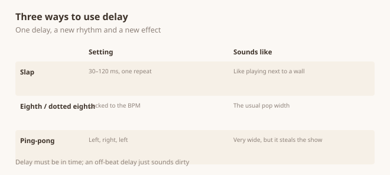

## 2. Delay time and tempo sync

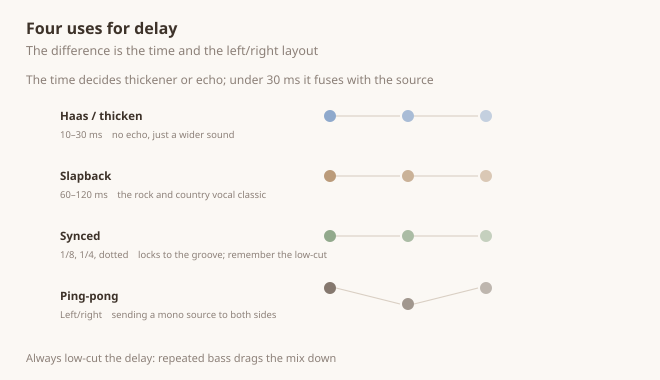

Lining the delay time up with the song's BPM (beats per minute) is the key to keeping the delay from falling off the beat. Almost every modern DAW has tempo sync built in, but it is still worth knowing the arithmetic underneath.

### 2.1 Delay time for common note values

```
Delay Time (ms) = (60,000 / BPM) x note value
```

For example, at BPM = 120:

- **Quarter note**: (60,000 / 120) x 1 = **500 ms**
- **Eighth note**: (60,000 / 120) x 0.5 = **250 ms**
- **Sixteenth note**: (60,000 / 120) x 0.25 = **125 ms**
- **Dotted eighth**: (60,000 / 120) x 0.75 = **375 ms**
- **Eighth triplet**: (60,000 / 120) x 0.333 = **~167 ms**

### 2.2 The magic of the dotted eighth

When the dotted eighth is paired with a triplet groove (shuffle / swing feel), the delay's echoes land in the gaps of the rhythm and create a very fluid rhythmic interplay. It is everywhere in U2's guitar tones and in EDM vocal processing.

> In practice: set a dotted-eighth delay on the long notes at the end of a vocal line and switch on ping-pong, and you have professional-grade stereo depth right away.

## 3. The Haas effect: stereo width from a short delay

The Haas effect is an important phenomenon in psychoacoustics: when two identical sounds reach the ear with a time difference of **1 ms to 40 ms**, the brain perceives them as coming from the same direction but having width, not as two separate sounds.

### 3.1 How to do it

1. Copy the original track (or send it to an aux track).
2. Pan the copy hard left (L100) and the original hard right (R100).
3. Put a delay on the copy set to **5 ms to 20 ms** (no feedback, Feedback = 0%).
4. Set Mix to 100% wet, so you only hear the delayed signal.

Result: the sound opens out from the centre, as if the whole stereo field were filled.

### 3.2 Things to watch

- **Time limit**: past 40 ms it becomes a recognisable echo and the Haas effect is gone.
- **Mono compatibility**: in mono the Haas effect produces comb filtering, which makes the sound hollow. Always check mono compatibility while you mix.
- **Best uses**: background harmonies, pads, doubled guitars. Use it cautiously on a lead vocal, because mono compatibility problems can hurt the lead's clarity.

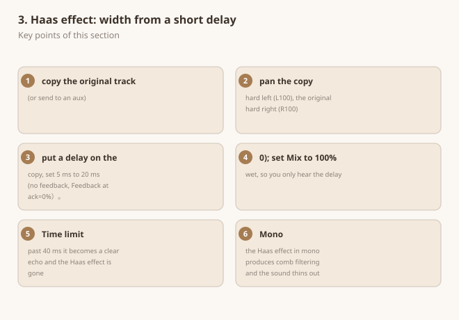

## 4. Ping-pong delay: rhythm and space together

Ping-pong delay alternates the delayed signal between left and right. For example, the input sits in the centre, the first echo is in the left channel, the second in the right, the third in the left again, and so on.

### 4.1 A setting example (BPM = 120)

| Parameter | Setting | Effect |
|------|--------|------|
| Delay Time | 250 ms (8th note) | Clear left-right alternation |
| Feedback | 20-30% | Decays naturally after 3-5 echoes |
| Pan | L100 / R100 | Maximum stereo width |
| Mix | 30-50% | Balanced against the dry signal |

### 4.2 Where to use it

- **The transition from verse to chorus**: put a ping-pong delay on the last line of the verse and the space opens out before the chorus.
- **Guitar arpeggios**: arpeggios with a ping-pong delay sound like two guitars talking to each other.
- **Synth leads**: a simple single-note line becomes rich the moment it goes through a ping-pong delay.

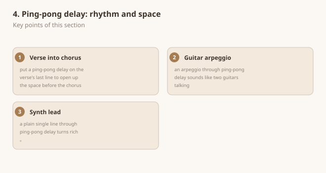

## 5. Slapback delay: the classic rock sound

Slapback is one of the oldest and most classic uses of delay; it comes from analog tape delay in the 1950s. Its features:

- **Short delay time**: 70 ms to 120 ms
- **A single repeat**: feedback very low (0-10%), so you usually hear one echo
- **Tape warmth**: you can add a little saturation or a low-pass filter

### 5.1 Classic uses

- **Rockabilly guitar**: Elvis Presley and the Stray Cats used slapback heavily on guitar. Set 80-100 ms, one echo, guitar in the centre and the echo in the centre or slightly right.
- **Vocal polish**: 70-100 ms of slapback thickens a vocal while keeping it clear. It is the signature sound of early rock 'n' roll vocals.
- **Harmonica and horns**: slapback gives a single-note wind instrument the illusion of a second voice, and it sounds stronger.

> A small trick: put a low-pass filter (below 6-8 kHz) on the slapback's echo path to model tape delay's high-frequency loss and make the sound more vintage.

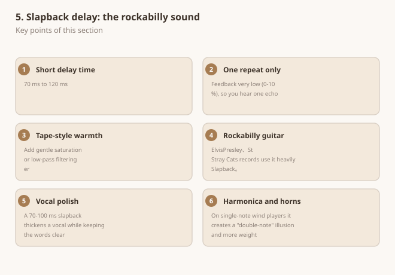

## 6. Delay vs reverb: which one, and when

Both delay and reverb are tools for creating space, but they sound and behave very differently.

| Aspect | Delay | Reverb |
|------|-------|--------|
| **Time structure** | Clear, countable echoes | A blurred, continuous tail |
| **Rhythm** | Can sync to the BPM and create rhythm | Does not emphasise rhythm; builds atmosphere |
| **Clarity** | Keeps the outline of the original sound | Blurs the outline of the original sound |
| **Space** | Creates distance and width | Creates room size and envelopment |
| **Space in the mix** | Takes up less of the spectrum | Fills the frequency space easily |

### 6.1 A practical guide to choosing

- **When you need rhythm**: use delay. Rap vocal end phrases, EDM synth stabs.
- **When you need atmosphere underneath**: use reverb. Pads, ambient textures, ballad vocals.
- **When the depth is not there**: add delay first, and reverb only if that is not enough. Delay into reverb (serial) is the most common arrangement.
- **Both at once**: send the delay's output into the reverb (Delay → Reverb) for a lavish sound with both depth and space. Delay mix at 20-30% and reverb at 15-25% works best.

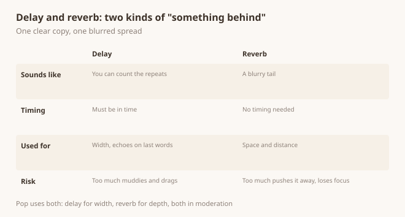

## 7. Stacking delays into a wall of sound

A wall of sound does not have to come from stacks of instruments. Several delays with different settings can swell one simple signal into a spectacular noise.

### 7.1 The three-layer delay stack

Say we have only one vocal or one synth pad. Create three aux tracks, each with a different delay:

| Layer | Delay Time | Feedback | Pan | Filter | Purpose |
|------|-----------|----------|------|------|------|
| Layer 1 | 1/8 note (250ms) | 15% | Centre | None | The main rhythmic echo |
| Layer 2 | Dotted 1/8 (375ms) | 20% | L60 | HPF 200Hz | Stereo image and movement |
| Layer 3 | 1/4 note (500ms) | 25% | R60 | LPF 4kHz | A wide sense of space |

Trim the three aux send levels (-12 dB, -18 dB, -24 dB) and a dry-sounding signal turns into a solid wall of sound.

### 7.2 Things to watch

- **Avoid frequency build-up**: stacked delays add up easily at particular frequencies and boom. EQ each layer into its own band.
- **Rhythms must not collide**: make sure the delay times do not fight. 1/8 plus dotted 1/8 is the classic safe pair.
- **Do not over-widen**: not everything needs to be hard left and hard right. Leave the centre for the main elements and let the echoes spread to the sides.

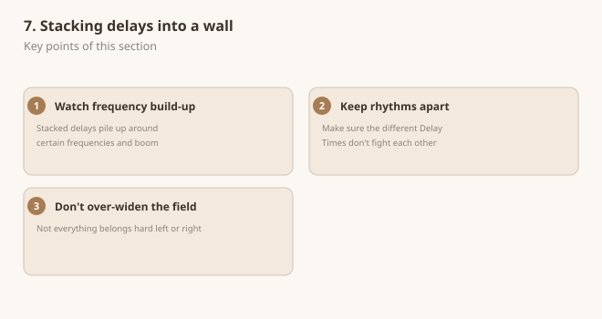

## 8. Filtered delay: shaping the echoes with EQ

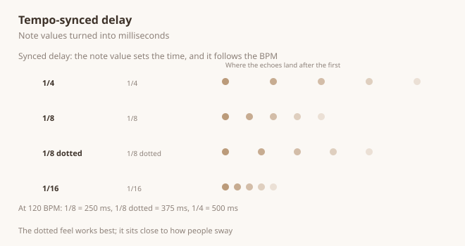

Filtered delay means turning on the delay's built-in filter (LPF/HPF) in the feedback path, or in the DAW sending the delay output through an EQ and back into the input to make an external feedback loop, so that each repeat's frequency content changes a little.

### 8.1 How to do it

1. Create a send track in the DAW and insert a delay.
2. Use the delay's built-in feedback filter (LPF/HPF), or build an external loop that puts an EQ in the feedback path so each repeat gets darker. (An analog-style EQ or filter plugin is best.)
3. Set the low-pass filter at 5-8 kHz and the high-pass at 200-400 Hz.
4. Set feedback at 30-50% so the echoes go round several times.

Result: every repeat has the same amount of top taken off, so it sounds like the sound fading away in the distance. To make each repeat darker than the last you need the delay's built-in feedback filter, or an external feedback loop you build yourself; that is far more natural than simply lowering the feedback.

### 8.2 Advanced uses

- **Low-pass delay**: good for bass, kick and other low-frequency elements; it keeps the impact without letting the echoes interfere in the mids and highs.
- **High-pass delay**: good for vocals and hi-hats; it keeps low-frequency echoes from muddying things.
- **Band-pass delay**: gives telephone or radio echoes; common in intros and bridges for contrast.

> Recommended setting: put FabFilter Pro-Q or a stock EQ in the feedback path, HPF @ 300 Hz (12 dB/oct slope) + LPF @ 7 kHz (12 dB/oct slope). That is the most general starting point for a filtered delay.

## 9. Automated delay throw: an echo exactly where you want it

A delay throw (also called a delay dump or echo throw) is a vocal technique common in modern pop. The delay only triggers at the end of a chosen lyric or phrase; the rest of the time the signal stays dry.

### 9.1 How to do it (in Ableton Live or Logic Pro, for example)

1. Send the vocal to an aux track that has only a delay on it (1/4 note or dotted 1/8, feedback 60-70%, mix 100% wet).
2. Draw automation on the aux track's input send.
3. Only at the end of the phrase you want an echo on, pull the send level up sharply (say from -inf to -6 dB).
4. Once the echo has appeared, pull the send level back to -inf.

### 9.2 Classic examples

- **Ethereal pop vocal**: trigger a long echo on the last syllable of each line (1/2 note delay, feedback 50%) for an airy feel.
- **Hip-hop ad-lib**: trigger a fast repeating short delay at the end of a punchline (1/16 note, feedback 70%) to add rhythmic force.
- **Rock verse into chorus**: trigger a delay throw on the last line of the verse so the echo carries over into the top of the chorus and the transition is seamless.

### 9.3 Practical tips

- Use smooth / ramp transitions on the automation curve to avoid clicks.
- Keep the throw's wet level below -6 dB relative to the dry vocal, so it does not steal the show.
- Put a reverb after the delay (Send → Delay → Reverb) and the echoes trail off with reverb on them, which sounds more lavish.

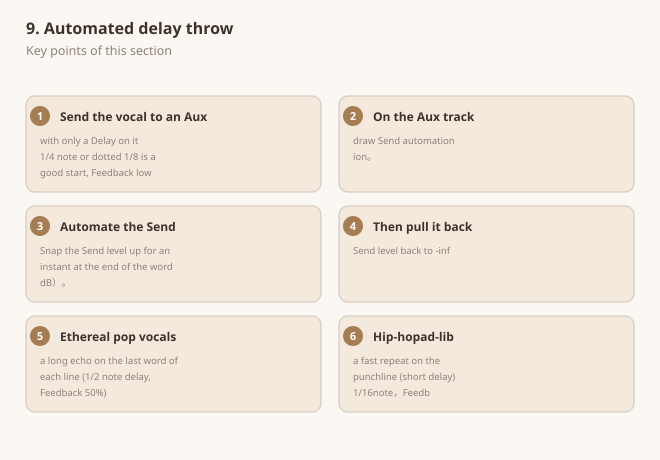

## 10. A quick reference of delay settings by instrument

These delay settings have held up in real sessions; you can use them as they are.

### 10.1 Vocal

| Style | Delay Time | Feedback | Pan | Mix | Notes |
|------|-----------|----------|------|-----|------|
| Pop verse | Dotted 1/8 | 15-20% | Centre or slightly off | 20-30% | Keep it clear |
| R&B / hip-hop | 1/4 note | 30-40% | Ping-pong | 25-35% | Strong sense of rhythm |
| Rock slapback | 80-100ms | 5-10% | Centre | 30-40% | Vintage thickness |
| Ballad long notes | 1/2 note | 40-50% | Stereo | 30-40% | Pair with reverb |

### 10.2 Electric guitar

| Style | Delay Time | Feedback | Notes |
|------|-----------|----------|------|
| Solo (U2 / The Edge) | Dotted 1/8 | 30-40% | Ping-pong, with light overdrive |
| Clean arpeggio | 1/8 note | 15-20% | Panned centre, mix 20% |
| Heavy riff | Slapback 60-80ms | 5% | Adds thickness without disturbing the rhythm |
| Ambient pad | 1/2 note + 1/4 note | 40-50% | Two delays, filtered |

### 10.3 Synths and keyboards

| Type | Delay Time | Key settings |
|------|-----------|----------|
| Lead synth | 1/8 note + ping-pong | Lets the melody move through the stereo field |
| Pad | Dotted 1/4 + filtered | HPF 200Hz + LPF 6kHz for a wide feel |
| Pluck | 1/16 note + low feedback | A short, rhythmic echo |
| Bass | Slapback 50ms (mono) | Stereo delay is not advised; the low end blurs |

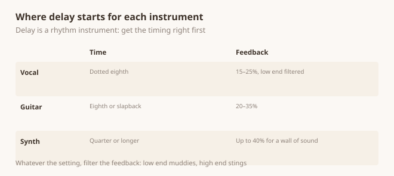

## 11. Advanced: creative uses of delay

### 11.1 Reverse delay

Play the delayed sound backwards for an inhale or rewind effect. How: process a piece of audio with the delay, record it to a new track, then reverse that track.

### 11.2 Delay panning automation

Let the delay's pan move over time. Set the delay output's pan to swing from an LFO (auto-pan) and the echoes sweep back and forth across the stereo field.

### 11.3 Sidechain delay

Sidechain-compress the echoes with the kick drum. Every time the kick hits, the echoes duck, which creates breathing and rhythmic movement. This is everywhere in EDM and house.

### 11.4 Extreme feedback

Push the feedback past 90% and the delay self-oscillates. With violent filter changes you can make sci-fi sound effects, transitional noise or experimental passages. Control the level when you do this, so you do not damage your hearing or your equipment.

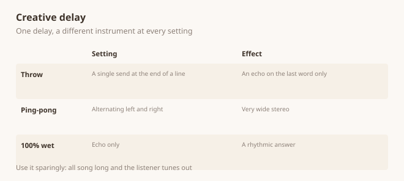

## Closing

Delay is far more than a tool for making a sound bigger and wider. Once you understand how it works across four dimensions, time, space, frequency and rhythm, it becomes one of the strongest tools in your mixing and arranging. From the subtle width of the Haas effect and the vintage charm of slapback to the vast wall of a stacked delay, every one of these uses is worth trying again and again.

Remember one rule: **the point of delay is to reinforce the original sound, not to cover it up.** After you set a delay, bypass it and switch it back on. If the sound without the delay is more attractive, the delay still needs work.

Next lesson we look at advanced reverb settings, from room and hall to plate and spring, and how to use convolution reverb.

---

**Recap**

- Delay has three basic types: simple, ping-pong and multi-tap
- A BPM-synced dotted eighth is the most generally useful delay time
- The Haas effect (5-20 ms) widens the stereo image, but produces comb filtering in mono, so check mono compatibility
- Filtered delay makes the distance of the echoes sound more natural
- A delay throw puts echoes exactly on the words you choose
- When stacking delays, keep the frequency ranges apart and the rhythms from colliding

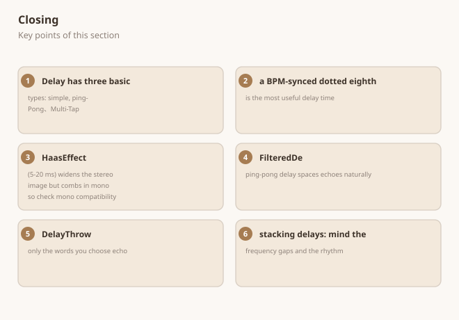
