# Lesson 22: Modulation Effects: Using Chorus, Flanger and Phaser for Movement

## 1. What are modulation effects?

Modulation effects are a family of processing techniques that produce change over time by continuously altering a signal's timing, frequency or phase. The core idea is to bring in a low-frequency oscillator (LFO) to control some parameter, such as pitch, delay time or phase offset, so the sound changes periodically and a static tone gains movement and life.

### The three basic parts of a modulation effect

Every modulation effect breaks down into three components:

**LFO (low-frequency oscillator)**: an oscillator that produces a periodic control signal, usually below 20 Hz. The LFO's waveform (sine, triangle, square) sets the shape of the modulation: a sine is smooth and flowing, a triangle is linear and even, and a square switches abruptly.

**Target parameter**: what the LFO controls, whether pitch, delay time, phase or filter cutoff. Which parameter it controls decides what kind of modulation effect you get.

**Depth / Amount**: how far the LFO moves the target parameter. More depth, more obvious the effect; less depth, more subtle.

### How modulation puts movement into a sound

A sound with no modulation is static: its spectrum and its structure in time stay the same for as long as it lasts. The ear tires of that quickly. Modulation keeps making tiny changes, so the spectrum drifts, wobbles and sweeps, and the hearing system stays alert and interested. That is why a good mix adds a moderate amount of modulation to bring a tone to life.

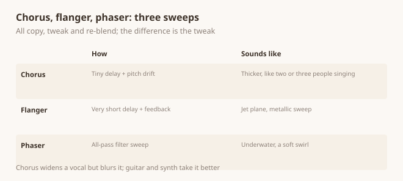

## 2. Chorus: doubling and thickening

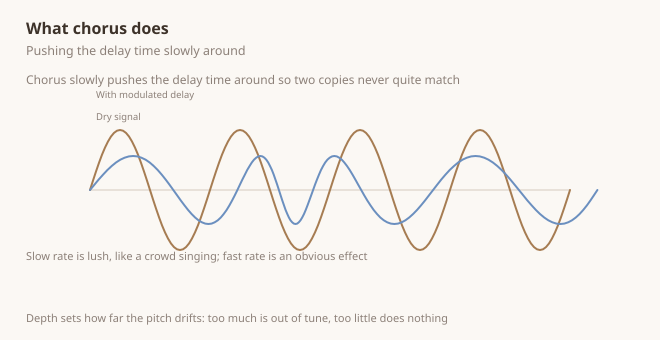

### How chorus works

Chorus models the tiny differences between several players playing the same instrument at once. When a group of people sing the same note, each one is slightly off in pitch and slightly off in time. Those differences are too small to pick out one by one, but together they make a sound fuller than one voice.

A chorus does it like this:

1. Copy the original signal once or several times (these are the voices)
2. Apply a very short delay to each copy (usually 10~30 ms)
3. Use an LFO to keep nudging the delay time of those delay lines (which produces a slight pitch wobble)
4. Mix the original signal with the processed copies

The result sounds wider, thicker and fuller, as if several sources were sounding at once.

### The typical character of a chorus

- **Width**: the stereo image opens out noticeably
- **Fullness**: a thin tone becomes full and solid
- **Naturalness**: of all the modulation effects it sounds closest to a real acoustic phenomenon
- **Warmth**: the highs do not stick out, and the whole tone is soft and rounded

### Classic chorus hardware

The 1980s were chorus's golden age. The Boss CE-1 / CE-2 (guitar pedals), the Roland Dimension D (studio rack) and the Eventide processors defined how chorus sounds. Those units are still the reference for chorus, and plenty of plugins set out to copy them.

## 3. Flanger: a moving comb filter and the jet-plane sound

### How a flanger works

The flanger's history goes back to studios of the 1950s and 60s. Engineers found that if you pressed a finger gently on the flange of one of two identical tapes playing in sync and slowed it slightly, the phase difference between them produced a hollow, rotating sound.

How a flanger processes the signal:

1. Copy the original signal
2. Apply a very short delay to the copy (usually 0.1~10 ms)
3. Modulate that delay time continuously with an LFO
4. Add the delayed signal to the original

The key is this: when a signal is mixed with a short delayed copy of itself, the spectrum gets periodic cancellation and reinforcement, a regular series of dips and peaks called a comb filter. As the LFO moves the delay time, the frequencies of those dips move too, and you get the classic "wwooosshh" sweep.

### The typical character of a flanger

- **Comb-filter sweep**: a comb-like series of dips moving through the spectrum
- **Jet-plane effect**: the very recognisable jet plane swoosh
- **Strong movement**: the effect is powerful and very easy to notice in a mix
- **Metallic edge**: as feedback (regeneration) goes up, the sound gets sharper and more metallic

### Flanger and feedback

A flanger's feedback (regeneration) sends part of the output back to the effect's input. Positive feedback reinforces the comb filter's resonant peaks, so the effect is stronger and noisier. Negative feedback flips the phase and gives a different character. Turn the feedback up and the flanger goes from a gentle sweep to an outright aggressive sound effect.

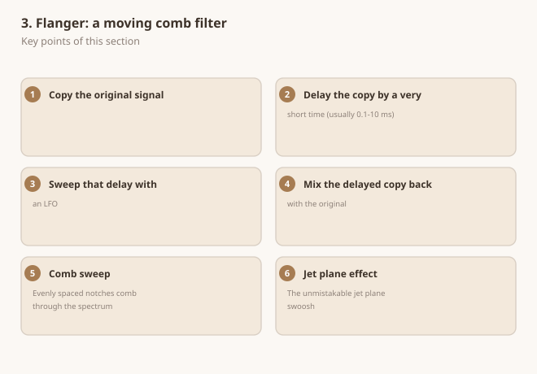

## 4. Phaser: a sweeping notch filter and a watery space

### How a phaser works

Phasers and flangers get confused with each other, but they work in completely different ways.

The core of a phaser is the all-pass filter. An all-pass filter does not change the frequency response (every frequency passes at the same level), but it introduces a different phase shift at different frequencies. When the all-pass signal is mixed with the original, at some frequencies the two are exactly out of phase, they cancel, and a dip (a notch) appears in the spectrum. Several all-pass filters in series produce several notches.

The phaser's signal path:

1. Send the original signal through a chain of all-pass filters
2. Modulate those filters' cutoff frequency with the LFO (the centre of the phase shift)
3. Mix the processed signal with the original
4. The notches sweep up and down the spectrum with the LFO's cycle

**The key point**: a flanger produces a periodic comb filter with evenly spaced teeth, while a phaser's notches are not evenly spaced; they are sparse at low frequencies and dense at high ones. That makes the phaser sound softer than a flanger, with more of a watery quality.

### The typical character of a phaser

- **Watery**: the sound seems to move under water, round and flowing
- **Rotating space**: like a rotating speaker (a Leslie), but finer
- **Softness**: gentler than a flanger, easier to sit in the background
- **Vintage texture**: the signature sound of 1970s funk and psychedelic rock

### Phaser stages (poles)

The number of stages in the all-pass chain (usually a multiple of 2: 4, 6, 8, 12) sets how many notches there are. More stages, more notches, more obvious the effect:

- **4-stage phaser**: 2 notches; fine and subtle; the classic Small Stone character
- **6-stage phaser**: 3 notches; the MXR Phase 90 has been moved to the 4-stage entry.
- **8-stage phaser**: 4 notches; fuller and richer
- **12-stage phaser**: 6 notches; a complex, intense sound

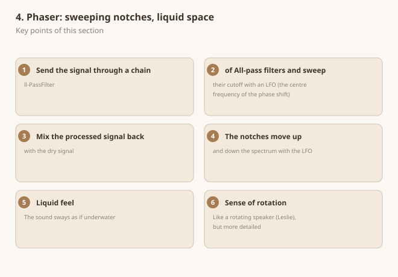

## 5. How chorus, flanger and phaser differ technically

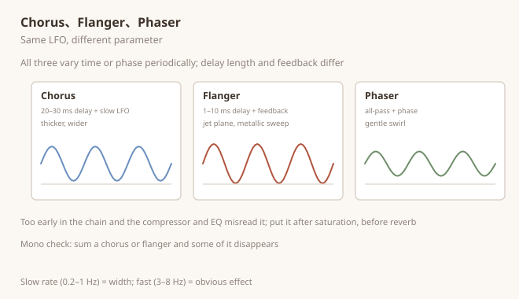

All three are modulation effects, but technically they differ in how long the delay is and how the signal is processed.

### Comparing delay times

| Effect | Typical delay time | Modulation mechanism | Spectral character |
|---|---|---|---|
| Chorus | 10~30ms | Modulating the delay time → pitch wobble | No obvious filtering; slight pitch change |
| Flanger | 0.1~10ms | Modulating a very short delay → comb filter | Evenly spaced periodic dips |
| Phaser | None (uses all-pass filters) | Modulating phase shift → notch filter | Unevenly spaced notches |

### Telling them apart by ear

- **Chorus**: the sound gets thicker and wider, like several players at once, with no obvious sweep
- **Flanger**: an obvious "wwooosh" sweep, a strong effect with a metallic edge
- **Phaser**: a soft watery rotation, like sound rippling in water, not as high and sharp as a flanger

A useful test: turn the rate to maximum. The flanger makes a fast, urgent sound like a jet engine; the phaser sounds like a fast-spinning speaker; the chorus trembles quickly but does not sweep.

### Differences in the stereo image

- **Chorus**: best at widening the stereo image; a stereo chorus can stretch a sound to the extremes
- **Flanger**: a stereo flanger's comb filters can be set to sweep in opposite directions in the two channels, for a circling effect
- **Phaser**: a stereo phaser's rotation is the strongest, and it does a very good impression of a Leslie

## 6. Chorus in practice

### Chorus on vocals

Chorus is a general-purpose vocal tool. On a lead vocal, light chorus (rate 0.3~0.6 Hz, depth 25~40%) helps the voice stand out in the mix; you get the fullness of a double-tracked take without actually recording twice. On background harmonies you can use more (rate 0.5~1.0 Hz, depth 40~60%), so the harmonies sound like more people and wider.

A classic move: automate the chorus on for the chorus section, so the lead vocal sounds bigger and fuller there and contrasts with the verse.

### Chorus on electric guitar

The signature sound of 1980s rock: a clean electric guitar with chorus. From The Police to Nirvana ("Come As You Are"), chorus makes a clean guitar tone glassy and spacious.

- **Clean rhythm guitar**: rate 0.4~0.8 Hz, depth 30~50%; add light reverb for a dreamy feel
- **Clean arpeggios**: rate 0.3~0.5 Hz, depth 25~40%, so the arpeggios slide by like running water
- **Distorted guitar**: chorus before the distortion sounds softer; after the distortion it is stronger but tends to add noise

### Chorus on synths

Synths are chorus's natural partner. Many classic synths (Roland Juno-106, JX-3P, Korg Polysix) had chorus circuits built in, and their sound is inseparable from it.

- **Pads**: chorus turns a thin synth pad into a vast wall of sound
- **Leads**: a little chorus makes the main melodic line smoother and more sustained
- **Bass**: use it carefully; too much chorus blurs the low end. Add chorus above 200 Hz only.

### Suggested chorus settings

| Parameter | Subtle thickening | Obvious width | Fullest |
|---|---|---|---|
| Rate | 0.3~0.5Hz | 0.6~1.2Hz | 1.5~3.0Hz |
| Depth | 15~30% | 35~55% | 60~80% |
| Voices | 1~2 | 2~3 | 3~4 |
| Mix | 20~35% | 40~55% | 60~75% |

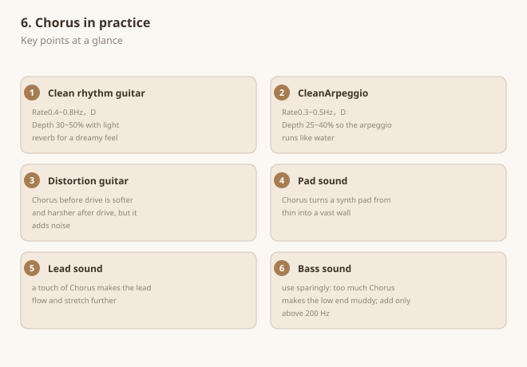

## 7. Flanger in practice

### Flanger on drums

A flanger can be very striking on drums. The classic use is on the cymbals or on the whole drum bus, for the kind of dramatic drum sound Van Halen got on "Unchained". (The drums on "In The Air Tonight" are gated reverb, not flanger.)

- **Snare with flanger**: a slow sweep at rate 0.2~0.4 Hz, feedback 20~30%, so the tail changes as the snare rings
- **Hi-hat / cymbals**: rate 0.6~1.0 Hz, depth 30~50%, for a rhythmic shimmer
- **Drum bus**: a very slow sweep at rate 0.1~0.3 Hz, mix 10~20%, to give the whole kit a subtle breath of movement

### Flanger on guitar

Flanger plus distorted guitar is one of the classic pairings in rock history. Distortion already has dense overtones; the flanger sweeps through them and shoves them around, so the sound gets wider and more aggressive.

- **Distorted rhythm guitar**: rate 0.3~0.6 Hz, depth 30~50%, feedback 10~25%, so chords gain a moving roar
- **Clean guitar**: a slow flanger (rate 0.2~0.4 Hz) gives a sound like chorus but richer
- **Solo guitar**: a fast flanger (rate 1.0~2.0 Hz) with high feedback makes a retro sci-fi effect

### Creative flanger effects

- **Rising sweep**: set the LFO to single shot, or control the frequency by hand with automation, to imitate a jet taking off
- **Transition effect**: drop a short automated flanger sweep at a section change (a verse into a chorus, say) as an audible signal that something is changing
- **Extreme settings**: rate, feedback and depth all at maximum produce experimental resonant noise, useful in industrial or experimental music

### Suggested flanger settings

| Parameter | Subtle movement | Classic rock | Extreme |
|---|---|---|---|
| Rate | 0.1~0.3Hz | 0.4~0.8Hz | 1.0~4.0Hz |
| Depth | 15~30% | 35~55% | 60~100% |
| Feedback | 0~15% | 15~35% | 40~80% |
| Mix | 15~30% | 35~50% | 50~80% |

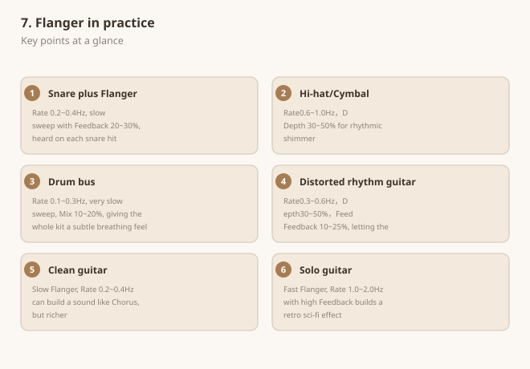

## 8. Phaser in practice

### Phaser on keys and piano

Phaser and keyboard instruments are a 1970s signature. From Herbie Hancock to Stevie Wonder, phaser filled electric pianos (Rhodes and Wurlitzer especially) with movement and life.

- **Rhodes**: 4-stage phaser, rate 0.4~0.8 Hz, depth 30~50%. This is essential jazz-funk tone
- **Acoustic piano**: gentle phaser (rate 0.2~0.4 Hz, depth 15~25%) to make the piano stand out and flow within the mix
- **Clavinet**: phaser plus wah-wah is the classic funk combination

### Phaser on rhythm guitar

Phaser on rhythm guitar is most famous from 1970s rock and funk. Pink Floyd used phaser heavily on rhythm guitar for a psychedelic sense of space.

- **Funk rhythm guitar**: 4-stage phaser, rate 0.6~1.2 Hz, depth 30~50%, so every strum has movement in it
- **Psychedelic rock rhythm**: rate 0.2~0.5 Hz, depth 40~60%; the slow sweep makes it float as if in a dream
- **Arpeggios**: rate 0.3~0.6 Hz, 6-stage phaser, so each note passes through a different phase notch in turn

### Phaser on pads and synths

Phaser suits sustained tones very well. Add it to synth pads, strings or background ambience and a static background becomes a breathing canvas of sound.

- **Synth pads**: 6~8-stage phaser, rate 0.1~0.3 Hz (very slow), depth 40~70%, for a vast moving soundscape
- **String sections**: 4-stage phaser, rate 0.2~0.4 Hz, depth 25~40%, to add movement without losing realism
- **Ambient effects**: multi-stage phasing with long reverb and delay, good for cinematic backgrounds

### Suggested phaser settings

| Parameter | Subtle water | Classic vintage | Strong rotation |
|---|---|---|---|
| Rate | 0.2~0.4Hz | 0.5~1.0Hz | 1.2~4.0Hz |
| Depth | 15~30% | 35~55% | 60~80% |
| Feedback | 0~10% | 10~30% | 30~60% |
| Stages | 4 | 4~6 | 6~12 |
| Mix | 20~35% | 40~60% | 60~80% |

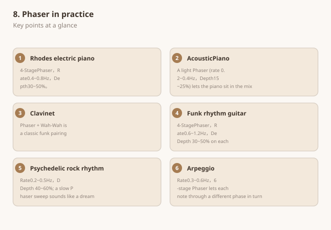

## 9. The four parameters: rate, depth, feedback and mix

### Rate

Rate sets how fast the LFO sweeps. It is given in Hz (cycles per second) or as a tempo-synced value (1/4 note, 1/8 note).

- **Slow (0.1~0.5 Hz)**: the effect is not obvious; good for a subtle breathing
- **Medium (0.5~1.5 Hz)**: obvious; suits most situations
- **Fast (1.5~5.0 Hz)**: strong; produces a tremble or a rotation

Many modern plugins support tempo sync, so the rate locks to the song's BPM. Set chorus and phaser to a 1/4 note or 1/2 note rate so the effect's cycle lines up with the rhythm of the music. With a flanger, try shorter note values (1/8, 1/16) to make it rhythmic.

### Depth

Depth sets how far the LFO moves the target parameter.

- **Shallow (10~25%)**: a subtle change, barely noticeable, but it adds life
- **Medium (30~50%)**: an obvious change; suits most instruments
- **Deep (55~80%)**: strong modulation; the sound's dynamic range gets big
- **Very deep (85~100%)**: exaggerated, and the sound can become unstable; for special effects

A useful tip: when you set the rate, turn it to maximum first so you can hear the shape of the effect. Set the depth where you want it, then bring the rate back to normal.

### Feedback (regeneration)

Feedback exists only in flangers and some phasers (a chorus usually has none, or very little).

- **Positive feedback**: reinforces the resonant peaks, so the effect is stronger and more metallic
- **Negative feedback**: flips the phase for a different tone
- **Low feedback (0~20%)**: a gentle effect; good in the background
- **Medium feedback (20~50%)**: obvious resonance; the classic flanger sound
- **High feedback (above 50%)**: extreme resonance, close to self-oscillation

Note: past a certain point (usually above 90%) the effect self-oscillates and puts out a continuous, piercing whistle. Some experimental music uses this deliberately.

### Mix

Mix sets the balance between the dry original and the processed wet signal.

- **Low mix (10~25%)**: the effect is hard to notice; it only adds a little movement
- **Medium mix (25~50%)**: obvious but not excessive; suits most situations
- **High mix (50~75%)**: the effect leads; the original sound is changed a lot
- **100% wet**: only the effect is output (useful for sound design)

**A key recommendation**: in a mix, start modulation effects at a low mix (20~30%) and raise it slowly until the effect is just noticeable, then back off a little. That point is the best mix setting: the sound gains movement without the listener becoming aware of the effect.

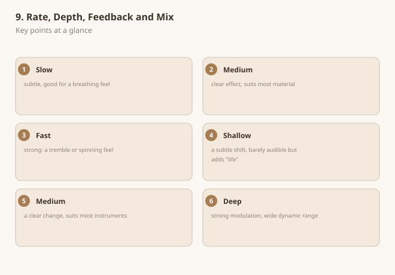

## 10. Combining several modulation effects

Be careful when you use several modulation effects together, so you do not over-modulate and blur the sound out of focus.

### Basic rules for stacking

1. **Watch the total**: keep the combined mix of several modulation effects within reason; do not run them all above 50%
2. **Stagger the rates**: if you use chorus and phaser together, set the rates differently (chorus 0.5 Hz, phaser 0.3 Hz) so the two do not lock into a periodic stutter
3. **Divide the spectrum**: let each modulation effect work in a different frequency range, for example phaser only on the highs and chorus on the low mids
4. **Layer, do not stack**: it is better to use one modulation effect on each of several instruments than to stack several on one track

### Classic combinations

**Pink Floyd-style psychedelic guitar**: on a clean guitar, a light compressor first, then phaser → chorus → delay → reverb in that order. The phaser supplies the sweep, the chorus adds width, and the delay and reverb make the space.

**1980s pop drums**: on the drum bus, a light compressor to control the dynamics, then chorus (mix 15~25%), then a little hall reverb. The chorus makes the kit wider and fuller.

**A super pad for electronic music**: split the synth pad into two paths. One is processed normally; the other goes through a flanger (rate 0.2 Hz, depth 60%) with the highs cut by an LPF. Mix the two paths and you get thickness plus moving texture.

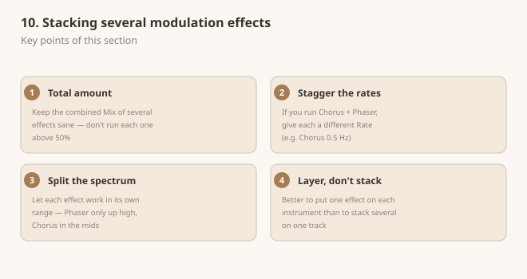

## 11. Creative modulation: parameter automation and moving texture

In modern production a static modulation setting is not enough. The interesting results come from parameters that move.

### Automating the rate

Changing the rate between sections gives the sound a narrative:

- **Verse**: rate 0.3 Hz (slow breathing)
- **Pre-chorus**: rate rising to 0.8 Hz (tightening)
- **Chorus**: rate 1.2 Hz (strong rhythm)
- **Bridge**: rate back to 0.2 Hz (relaxed and open)

### Automating the depth

Depth changes directly how strong the effect is, which makes it good for underlining the emotional shape of a song:

- **Verse into chorus**: depth climbing from 20% to 50%, so the chorus feels wider than the verse
- **Final long note**: depth rising as the note fades out, for a psychedelic dissolving effect
- **Drum fill**: push the depth up 20~30% for the length of the fill, for a sudden change

### Automating the feedback

On flangers and phasers, automating feedback can be very dramatic:

- **Section change**: on the last beat before the chorus, push the feedback up to 60~80% briefly for a screaming transition
- **End of a song**: feedback rising until it self-oscillates, then a reverb stretching that oscillation out into the ending

### Sidechained modulation

An advanced trick: use a sidechain signal to trigger changes in the modulation parameters. For example, make the flanger's rate jump with the kick, or make the chorus's depth change the moment the hi-hat hits. This kind of rhythmic modulation is very common in electronic and modern pop music.

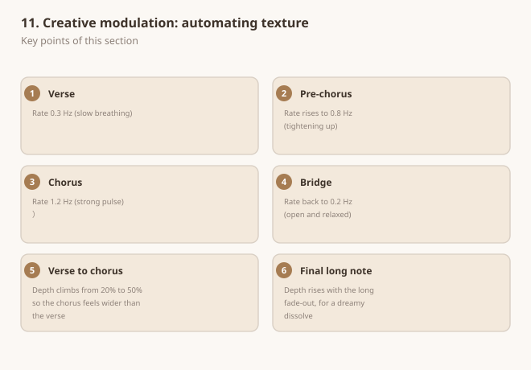

## 12. Where modulation goes in the signal chain

Where a modulation effect sits in the chain has a big effect on the final sound.

### Before distortion / overdrive

With the modulation before the distortion, the LFO modulates the signal going into the distortion, and the distortion's nonlinearity amplifies that modulation, giving richer overtones and a wilder sound. Flanger before distortion is the most common rock guitar setup.

### After distortion / overdrive

With the modulation after the distortion, it modulates a signal that is already distorted. That is smoother and more controllable, but also cleaner. This is the more common place for flangers and phasers, because the result is more predictable and easier to control.

### Before delay / reverb

With modulation before the time effects, the reverb and delay process a signal that is already moving, which makes more complex textures in the space.

### After delay / reverb

Less common, but useful for a strange wobbling-space effect: the space itself keeps changing, which feels like weightlessness.

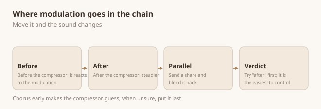

## Closing

Chorus, flanger and phaser are among the most creative effects in music production. They turn a static tone into something alive, and give a mix movement and layers. Understanding how the three differ, that chorus modulates pitch, that a flanger is a comb filter from a very short delay, and that a phaser is a notch sweep from all-pass filters, is the basis for choosing and using them.

In practice, remember that less is more. A good modulation effect adds charm without taking over. Start with subtle settings, listen carefully to what each adjustment does, and use parameter automation so the effect evolves with the music. When you can control the movement of the rate, the amount of depth, the strength of the feedback and the balance of the mix precisely, your mix goes from a static two-dimensional picture to a moving three-dimensional experience.
