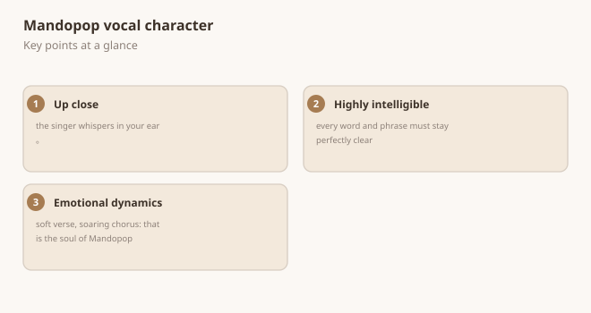
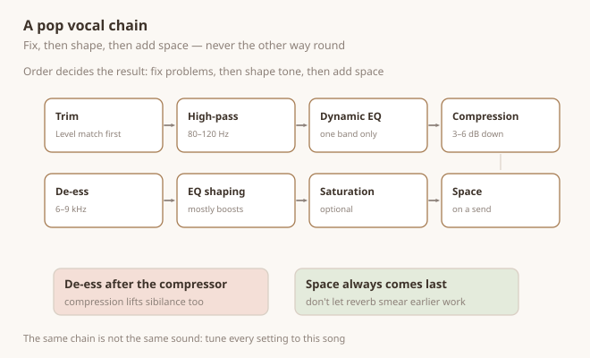
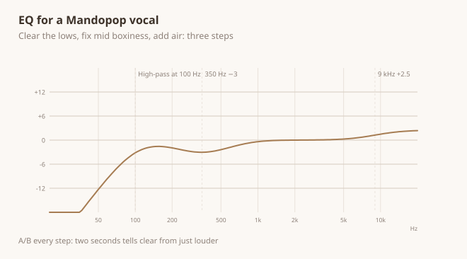
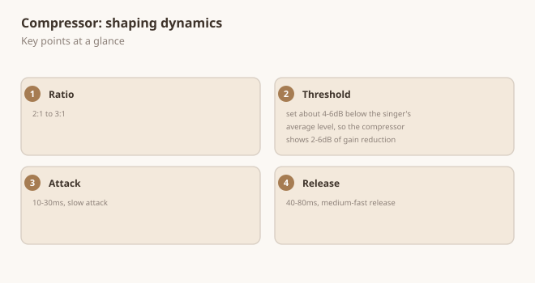
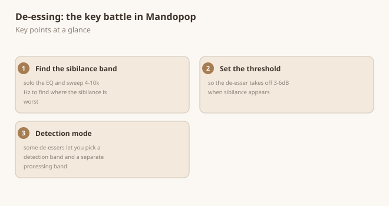
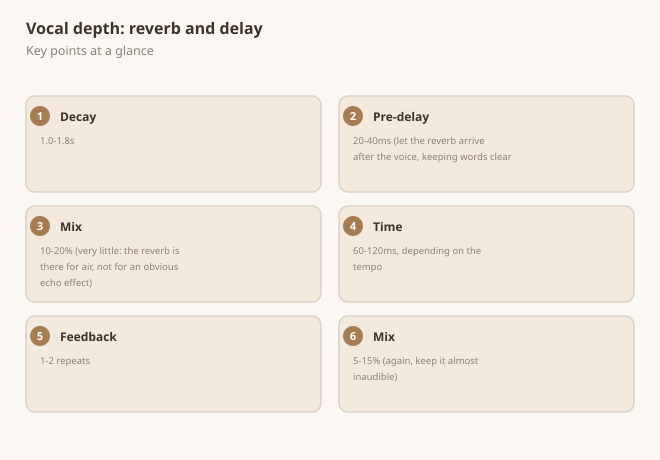
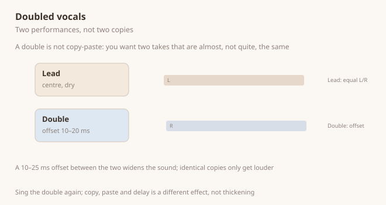
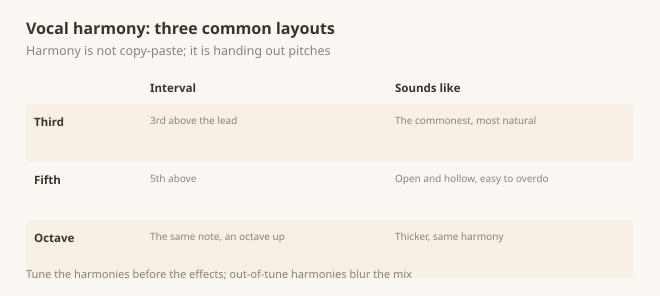
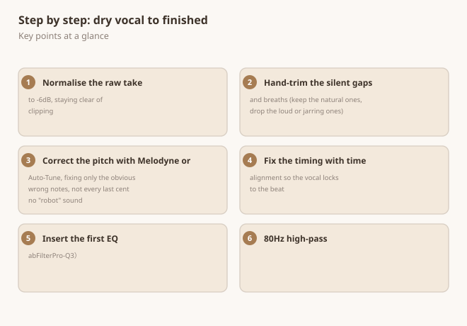

# Lesson 23: Mandopop in Practice: Vocal Processing and De-essing

Mandopop (Mandarin-language pop) has enormous reach across the Chinese-speaking world. From Teresa Teng's tender era through Jay Chou's R&B reinvention to the mixed styles of today, vocal production has always been the core of the craft. Compared with Western pop, Mandopop vocals tend to emphasise intimacy, clarity and emotional delivery more. This lesson walks you through a complete Mandopop vocal chain from scratch, from the raw recording to the finished record, taking apart every stage.

---

## The character of a Mandopop vocal

Before you touch anything, you need to know what a Mandopop vocal is aiming at. Western pop often blends the vocal into the arrangement. The Mandopop tradition tends to put the singer right at the front: the voice is not just one of the instruments, it is the emotional centre of the song.

**The three core qualities of a Mandopop vocal:**

1. **Close / intimate**: the voice sounds like the singer is talking right next to your ear. That needs close miking (about 10-15 cm), a good pop filter, and keeping some low-mid warmth in the processing.
2. **Crystal clear**: every word, every phrase of diction has to be clear. That means enough presence in the high mids (2-5 kHz) while avoiding harsh sibilance.
3. **Emotional dynamic**: the contrast between a soft verse and an intense chorus is the soul of Mandopop. The compressor must not kill the dynamics; it has to sculpt them so the emotional layers stay distinct.

In practice, a typical Mandopop vocal session has a lead vocal, harmonies (harmony / BV), a double track for width, and ad-libs or improvised touches. Each layer is treated differently, but together they have to blend into one three-dimensional, cohesive picture.

---

## Building the vocal chain

The vocal chain is the order the signal passes through the processors. There is no single correct order, but Mandopop practice has a very established standard chain:

**EQ → compressor → de-esser → reverb → delay**

The logic is: clean up unwanted frequencies with EQ first, then control the dynamic range with the compressor, then de-ess because compression may have made the sibilance louder, and finally add space (reverb and delay) to a signal that is already clean. In practice you may use several EQs and compressors in series, but this basic order is a good starting point.

In a DAW these processors usually go on the lead vocal track as inserts, while reverb and delay usually go on send/return (aux) tracks so that several tracks can share the same space.

---

## EQ: setting the tone of a Mandopop vocal

EQ is the first step and the most important one. Here is a standard EQ strategy for a Mandopop lead vocal:

**High-pass filter**: start rolling off around 80 Hz (12-24 dB/oct slope). This removes the low-frequency boom that close miking produces (the proximity effect), floor rumble and low-frequency breath noise. Do not cut too high or the voice loses its warm foundation. Male singers can be conservative and set 60-80 Hz; female singers 80-100 Hz.

**Low end (100-300 Hz)**: this region decides the warmth and body of the voice. If the singer is thin, a broad-Q boost of 2-3 dB at 150-200 Hz; if it sounds muddy or too nasal, a cut of 2-4 dB in the same range.

**Low mids (300-800 Hz)**: this is where boxiness and dullness live. Mandopop wants clarity, so a gentle cut of 1-3 dB here, somewhere between 400 and 600 Hz depending on the singer's tone.

**Presence (3-5 kHz)**: the magic band for a Mandopop vocal. A 2-4 dB boost here makes the voice stand out and cut through, and it is especially obvious on phone speakers and earbuds. Use a bell filter with a broad Q (0.5-0.7) and solo it repeatedly to make sure it sounds bright but not harsh.

**Air (8-12 kHz)**: a gentle 1-3 dB lift here (with a shelf filter) adds air and high-frequency extension and makes the voice sound more modern and more polished. If sibilance is a problem, use this band carefully or rely on the de-esser later.

In practice: do not make EQ moves bigger than ±6 dB on a single song. A large EQ move usually means the recording went wrong somewhere; go back and improve the recording rather than forcing a fix with EQ.

---

## The compressor: sculpting dynamics

The compressor's job on a Mandopop vocal is not to squash the sound flat. It is to make the singer's dynamic range more manageable, so the gap between a whispered low phrase and a shouted high one is not too wide, while the natural rise and fall of the emotion stays.

**Suggested starting settings:**

- **Ratio**: 2:1 to 3:1. Mandopop does not need the heavy compression of rock; a gentle ratio keeps the emotional detail.
- **Threshold**: about 4-6 dB below the singer's average level, so the compressor works with 2-6 dB of gain reduction most of the time.
- **Attack**: 10-30 ms (slow attack). A slow attack lets the initial transient through, the punch at the start of a syllable, and keeps the diction clear.
- **Release**: 40-80 ms (medium-fast release). It lets the compressor recover before the next syllable, avoiding pumping.

**Make-up gain**: the compressor lowers the overall level, so make-up gain is needed to keep the level before and after the same. Usually 3-6 dB.

Many Mandopop mixers use serial compression: one compressor doing 2-3 dB of gentle work (an optical compressor in the LA-2A style, say), then a second doing more dynamic control (a VCA compressor in the SSL style). The advantage is that each compressor works less and the result sounds more natural.

**An advanced approach**: in the chorus use a faster attack (5-10 ms) and a lower threshold, so the chorus vocal is compressed harder and sits right in the listener's face; in the verse, loosen the settings to keep more dynamics and breathing room. You can do this with automation, or with a sidechain on the dynamics processor.

---

## De-essing: the key battle in Mandopop

### What is sibilance?

Sibilance is the high-frequency energy in a voice's "s", "sh", "ch", "z" and "ts" sounds, usually between 5 and 10 kHz. The microphone's high-frequency response tends to exaggerate it in the recording, and the compressor makes it worse, because raising the overall level raises the sibilance with it.

### Why does Mandopop need special care over de-essing?

The features of a Mandopop vocal, close miking, high clarity and frequent compression, are exactly what makes sibilance worse. Add the tonal nature of Chinese and its many sibilant consonants, and Mandopop needs more precise de-essing than many Western languages. Sibilance that has not been handled makes listeners wince on headphones and tires them out, especially over a long listen.

### Wideband vs split-band de-essing

**Wideband de-essing**: the most traditional method. When too much energy is detected in the sibilance band, the whole signal's level is pulled down briefly. It is simple and immediate; the downside is that the whole vocal ducks briefly every time a sibilant arrives, which is not smooth.

**Split-band de-essing**: the modern mainstream. Only the sibilance band (usually 5-10 kHz) is compressed; the other bands are untouched. The advantage is that while the sibilance is handled, the body of the voice (the low mids) is completely unaffected, so it sounds very natural.

### How to do it

1. **Find the sibilance band**: sweep 4-10 kHz with a soloed EQ and find where the singer's sibilance is strongest. It differs from singer to singer and song to song; a female singer's sibilance usually sits 1-2 kHz above a male singer's.
2. **Set the threshold**: aim for 3-6 dB of reduction when a sibilant occurs. Too much de-essing makes the voice sound dull or loses high-frequency detail. A good rule: listen to the whole song on headphones; you should only be aware of the de-esser working when you listen for it, and you should not notice it at all in normal listening.
3. **Detection mode**: some de-essers let you set the detection band and the processing band separately. Usually the detection band goes at 7-9 kHz and the processing band covers 4-10 kHz, so it attacks only the sibilance and leaves the rest of the voice alone.

**An advanced approach**: at the end of the mix, listen to the whole song on a good pair of headphones at a higher volume and note down with a pencil which second has harsh sibilance, then insert automation there for a manual fix. It takes time, but it is the most precise and most natural de-essing there is.

---

## Creating vocal depth: reverb and delay

A Mandopop vocal needs to feel close, but it also needs some space so it is not bone dry. The key is to use aux sends heavily rather than inserts, keeping the dry signal exactly in the centre and adding the wet signal from the aux tracks.

### Short plate reverb

Plate reverb is standard equipment on a Mandopop vocal. It is tighter and more focused than a hall reverb, so it does not eat the vocal's clarity.

- **Decay**: 1.0 - 1.8 s
- **Pre-delay**: 20-40 ms (so the reverb comes in after the voice, keeping the diction clear)
- **Mix**: 10-20% (very little! the reverb is only there to give the sound air, not to make an obvious echo)

### Slap delay

Slap delay is another Mandopop secret weapon. It is a short delay placed before the reverb, modelling the early reflections, so the vocal sounds more three-dimensional without adding much reverb.

- **Time**: 60-120 ms (depending on the song's tempo)
- **Feedback**: 1-2 repeats
- **Mix**: 5-15% (again, it has to stay almost unnoticeable)

In practice, put the plate reverb and the slap delay on separate aux tracks and send about -10 to -15 dB of each to the lead vocal track. If the vocal sounds dry when you bypass the effects, the amount is right; if you can clearly hear the reverb or delay, there is too much.

---

## Double tracking and widening the vocal

### Double tracking

Many Mandopop songs double the vocal in the chorus or in key sections. The singer sings the same line twice (or even three times) and the takes are placed left and right, which produces a very natural widening. In practice:

- The lead vocal stays in the centre
- Double 1 sits 30-40% to the left
- Double 2 sits 30-40% to the right
- The doubles sit 6-10 dB below the lead vocal

If you cannot get the singer back in, a doubler plugin or a slight detune (±5-8 cents) with a small delay (10-20 ms) can imitate a double, but it is nowhere near as good as a real take.

### Stereo widening tools

For mono material outside the doubles (the lead vocal in the verse, say) you can use a stereo widener (iZotope Ozone Imager, Waves S1) to add width. The key is to **widen only the high mids (above 3 kHz)** and keep the low end centred; otherwise the vocal loses its cohesion.

---

## Background vocal arrangement

Mandopop harmony writing follows a few common patterns:

**Thirds**: the most traditional Mandarin pop harmony, a harmony track stacked a third below (or a third above) the main melody. Watch how the Chinese tones sit against the chord and avoid clashes that sound out of key.

**Stack**: record the same melody 3-5 times and spread the takes evenly left and right (L100, R100, L80, R80, Centre), for a choir effect. Common in the second half of a chorus, to push towards the climax.

**Octave doubling**: a male singer's harmony an octave below sits under the lead and adds weight to the chorus. Conversely, a female singer's octave above adds brightness and cut.

**EQ and compression on harmonies**: harmonies usually need more cutting than the lead. A high-pass filter up to 200-300 Hz removes unwanted low end, and the highs can come down a little so the harmony does not compete with the lead. The ratio can be higher than on the lead (3:1 to 4:1) so the harmony stays at a steady level.

**Panning the harmonies**: spread the harmonies evenly left and right and leave the exact centre to the lead vocal. For example: harmony 1 at L40, harmony 2 at R40, harmony 3 at L80, harmony 4 at R80. That gives a wide stereo background while the lead stays in the middle.

---

## A step-by-step workflow: from dry take to finished vocal

| Order | Processing | Typical setting |
|---|---|---|
| 1 | High-pass | 80–100 Hz |
| 2 | Dynamic EQ | Cut only the boxiness at 200–400 Hz |
| 3 | Compression | 3–5 dB of reduction, ratio around 3:1 |
| 4 | De-ess | 6–9 kHz, compressing only the sibilance |
| 5 | EQ shaping | 1–2 dB of clarity around 3 kHz |
| 6 | Space | Short plate reverb + 1/4-note delay |

Here is a complete Mandopop vocal workflow that works in any DAW:

**Step one: preparation**

1. Normalise the raw recording to -6 dB (to avoid clipping)
2. Manually cut unwanted silence and breaths (keep natural breathing, remove anything too loud or abrupt)
3. Tune the pitch with Melodyne or Auto-Tune, correcting only the obvious wrong notes; it does not need to sound like a machine
4. Time-align the vocal so it sits on the beat

**Step two: initial EQ**

1. Insert the first EQ (FabFilter Pro-Q 3, say)
2. Set an 80 Hz high-pass filter
3. Sweep 200-500 Hz and cut any dull or muddy frequency by 2-3 dB
4. Boost 2-3 dB around 4 kHz (broad Q)

**Step three: the compressor**

1. Insert the compressor (CLA-2A or RCompressor)
2. Set ratio 2.5:1, attack 20 ms, release 50 ms
3. Set the threshold until gain reduction is 4-6 dB
4. Add make-up gain so the level matches

**Step four: de-essing**

1. Put the de-esser after the compressor (FabFilter Pro-DS)
2. Choose split-band mode
3. Set the detection frequency at 7 kHz and the threshold until it reduces by about 4 dB
4. Solo it to check the de-essing and make sure it only touches the sibilance

**Step five: space**

1. Create the plate reverb aux: decay 1.5 s, pre-delay 30 ms, send about -12 dB
2. Create the slap delay aux: time 80 ms, feedback 1, send about -15 dB
3. Adjust the sends by section (a little more in the chorus, a little less in the verse)

**Step six: harmonies and doubles**

1. If you have real doubles, pan them to L30 and R30 and set them 8 dB below the lead
2. Pan the harmony tracks to the sides, cut the low end with EQ (below 300 Hz) and compress moderately
3. Give the harmony group its own hall reverb (decay 2.0 s) so they sit in the space behind the lead

**Step seven: detailed automation**

1. Automate the lead vocal's level: 1-2 dB up in the chorus, level or slightly down in the verse
2. Automate the reverb send: more in the chorus
3. Automate small moves on particular high sustained notes or emphasised words

**Step eight: reference check**

1. Pick a reference song (something by JJ Lin, G.E.M. or Jay Chou)
2. Compare your vocal by ear and listen especially for: is it bright enough? is the sibilance harsh? does the vocal sit inside the arrangement or float on top of it?
3. Go back to the earlier steps and adjust if you need to

---

## Closing

Mandopop vocal production is a craft that joins technique and art. The EQ, compression, de-essing and space covered in this lesson are the core tools every Mandopop mixer needs. But the most important thing is always your ears: settings are only a starting point, and the final test is whether it sounds right. Work with these tools and you will build your own mixing instinct, and every adjustment will get more precise and more efficient.

Next lesson we go into K-pop, and the Korean pop approach to vocals: extremely clean and full of energy. Stay tuned.
