# Lesson 24: Post-rock in Practice: Handling Wide Dynamics and Stacking a Wall of Sound

## 1. The core aesthetic of post-rock

Post-rock was founded in the mid-1990s by pioneers like Talk Talk and Slint, and carried further by Explosions in the Sky, Sigur Rós, Mogwai and Godspeed You! Black Emperor. Unlike traditional rock, post-rock deliberately breaks the verse-chorus pop structure and goes after **emotional narrative** and **soundscape** instead. Its most obvious signature is extreme **quiet-loud dynamics**: a passage of several minutes of whispered softness can explode into an overwhelming wall of sound within seconds. The mixer's job is to keep every layer clear and emotionally forceful across that huge dynamic span.

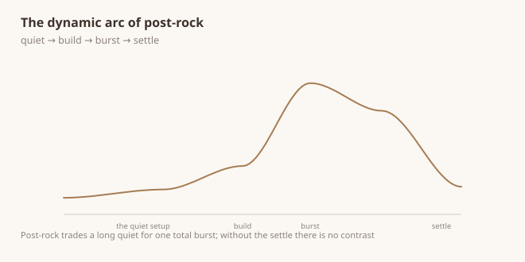

## 2. Managing extreme dynamics: from whisper to explosion

Post-rock's dynamic range often exceeds 20 dB, far more than the 6–10 dB of ordinary pop. That makes dynamic control a particular challenge.

### 2.1 Volume automation is the core tool

Classical-style volume automation is the most important tool in a post-rock mix. In a quiet passage the lead instrument may need to sit as low as -24 LUFS, while in the climax it goes up to -8 LUFS or higher. Do not rely on the compressor for this job: a compressor can only shrink dynamics, it cannot **shape an emotional arc**. Draw the volume automation by hand so every crescendo is as organic as a real live performance.

### 2.2 Keeping the dynamic range

Post-rock's appeal comes from its breathing. Deliberately keep 12–15 dB of real dynamics in the mix; do not flatten the whole song with heavy compression or limiting. Let the final master limiter catch only 2–3 dB of peaks, rather than using the loudness-war approach of mainstream pop. Listeners turn the volume up during the quiet passages without noticing, and then get hit by the explosion. That is part of the post-rock experience.

### 2.3 Layered dynamic control

Do not apply the same compression to every track. Use a layered approach:

- **Individual tracks**: only very light compression (ratio 1.5:1–2:1), mainly to catch accidental peaks rather than to change the dynamics.
- **Group buses**: 3:1–4:1 medium compression here, to glue the whole guitar group or drum group together.
- **Master bus**: only light glue compression (ratio 1.5:1, threshold catching just 2–3 dB).

This layered approach keeps the micro-dynamics intact while controlling the macro structure.

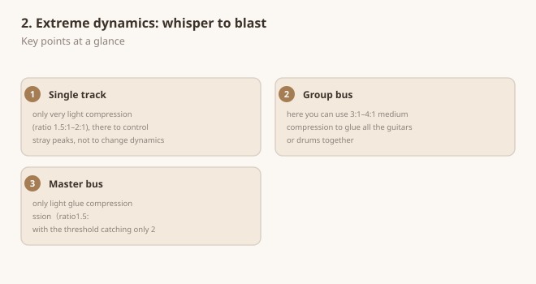

## 3. Building a guitar wall of sound

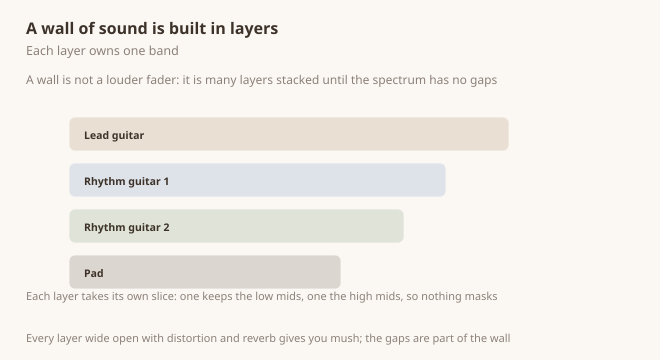

Post-rock's signature sound is a thick, unbroken guitar wall of sound. But it is not a matter of turning the volume up; it takes careful layering and frequency management.

### 3.1 Multitrack guitar strategy

The foundation of a wall of sound is **stacked takes**. A post-rock piece usually has 4–6 guitar tracks or more. Each track has a job:

- **Clean layer (clean arpeggios)**: single-coil pickups, a bright Fender-style tone. Usually one take each left and right, carrying the rhythmic skeleton. Keep more high mids in the EQ (2–5 kHz) so the arpeggios cut through without being harsh.
- **Drive layer (overdriven chords)**: medium-gain distortion playing open chords or power chords. Pan the two takes to L30/R30 to build the midrange weight of the wall. This layer is the flesh of the wall.
- **Fuzz layer (sustained wall)**: a big fuzz pedal (Big Muff) playing long notes or slow strums at high gain. Usually mono, in the centre or slightly off, for sustained level support. Roll off the low end (high-pass at 100–120 Hz) so it does not fight the bass.
- **Feedback / harmonic layer**: feedback from holding the guitar near the amp, or natural harmonics, to make the hiss and uncertainty inside the wall. This is where the emotional tension comes from.
- **Slide / special technique layer**: slide or Ebow for sustained notes, so there is one melodic line that never drops out of the wall.

### 3.2 Distributing frequencies in the wall

When several guitar tracks are stacked, the most common problem is frequencies fighting. Build a clear frequency plan:

- **40–100 Hz**: leave it to the bass and the kick.
- **100–250 Hz**: the low waist of the guitar wall. Too much makes it muddy, so handle it carefully. High-pass the fuzz and drive layers at 80–100 Hz, and the clean layer as high as 120–150 Hz.
- **250–800 Hz**: the body of the wall. It needs enough energy to sound full, but do not pile up too much. The drive layer carries most of this band.
- **800 Hz–2 kHz**: the presence of the wall. A moderate cut (-2 to -4 dB) keeps the stacked takes from crowding.
- **2–5 kHz**: the clean layer's territory. This is where the arpeggios and note detail live; the fuzz layer should be cut heavily here.
- **5–10 kHz**: feedback and air. You can lift it slightly overall, but watch for harshness.

### 3.3 Designing the stereo field

Post-rock's stereo field is usually wider and more dramatic than ordinary rock:

- **Clean layer**: L80/R80, very wide panning, for a broad sense of space.
- **Drive layer**: L30/R30, building solid midrange near the centre.
- **Fuzz layer**: centre or L15/R15, for a focused impact.
- **Effects layer**: auto-pan or random pan, so the sound drifts slowly through the space.

Keep checking mono compatibility as you mix. Post-rock loves wide stereo, but plenty of listeners are on phones and Bluetooth speakers. Make sure the wall still has enough thickness and clarity in mono.

## 4. Space: the art of reverb and delay

Post-rock's soundscapes lean heavily on space effects. The key is **quality, not quantity**: not adding a lot, but adding it in the right places.

### 4.1 Layering the reverbs

Use 3–4 different reverb sends:

1. **Short room reverb** (decay 0.5–1.2 s): for drums and rhythm guitar, modelling the natural space of a small studio. It adds cohesion without blurring the attack.
2. **Medium hall reverb** (decay 1.5–2.5 s): for lead instruments and lead guitar, for the feeling of being in a medium concert hall. Set the pre-delay to 30–50 ms to keep the notes clear.
3. **Long cathedral / shimmer reverb** (decay 4–8 s): the signature post-rock space. For emotional peaks and background textures. A small amount of pitch-shifting (a very small amount of +1 octave mixed in) gives the Sigur Rós-style shimmer.
4. **Reverse reverb**: almost a post-rock signature. Use the reverb tail reversed and placed before the note for an inhaling sensation. The most classic use is a reverse reverb one beat before the crescendo breaks, for that suffocating moment before the explosion.

### 4.2 Using delay

- **Stereo delay**: send one clean delay to the left channel at an eighth note and to the right at a dotted eighth. That creates a wide effect, like echoing in a canyon.
- **Analog delay**: use a tape delay emulation (EchoBoy, Replika) with a moderate amount of wow & flutter, so the repeats are not perfect and sound more organic.
- **Filtered delay**: put a low-pass filter on the delay send (cutoff 6–8 kHz) so the repeats get darker each time, modelling how sound fades away in the distance.

### 4.3 Automating the space

In post-rock the reverb and delay send levels should move. In quiet passages, raise the reverb send (let the instruments dissolve into the space); in the explosion, lower the reverb slightly (so the instruments hit more directly). That automation makes the space part of the arrangement.

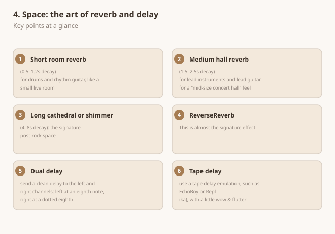

## 5. Drum production: huge, spacious, powerful

Post-rock drum production is not after natural; it is after **epic**. The drums should sound like they are playing in a huge cathedral or an abandoned warehouse.

### 5.1 Designing the kick and snare

- **Kick**: needs a solid low end (a boost around 50–60 Hz for weight) and a clear click (3–5 kHz). Compression ratio 4:1–6:1, slow attack (20–30 ms), fast release, so the kick feels pushed out. In the climax you can automate the kick 2–3 dB louder, so every hit lands like a heartbeat.
- **Snare**: post-rock snares usually have a long tail and a lot of room sound. Record the overheads and room mics properly in the first place, and lean on the room track in the mix. Use parallel compression on the snare: copy the snare to an aux track compressed very hard (ratio 10:1, higher threshold, fast attack) and blend it with the original. That New York compression trick gives the snare both its natural attack and a thick body.

### 5.2 Making the room mics explode

The secret weapon of post-rock drums is the room microphone. Treat the room signal like this:

- Compress it hard (ratio 10:1 or even infinite), slow attack (10–20 ms), medium-fast release.
- Add saturation or tape emulation so the room sound seems pushed to its limit.
- Add a long reverb (decay 2–3 s) so the room sound becomes an instrument in itself.
- In the climax, push the room track's fader up hard and let the space explode out.

### 5.3 Cymbals and crashes

Post-rock cymbals usually sound more widescreen than ordinary rock. A crash can take a lot of reverb, so every crash arrives like a wave. But watch out: too many cymbals in the climax causes listening fatigue. You can automate the overhead tracks down 1–2 dB at the top of the crescendo.

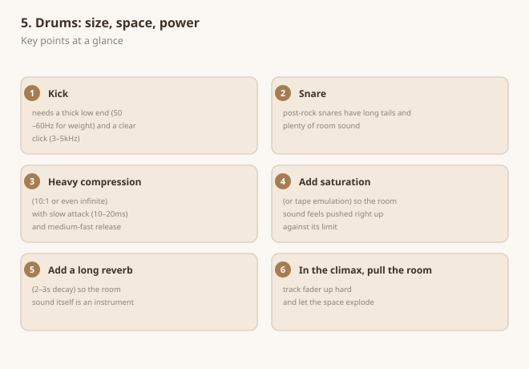

## 6. Building a crescendo: from whisper to roar

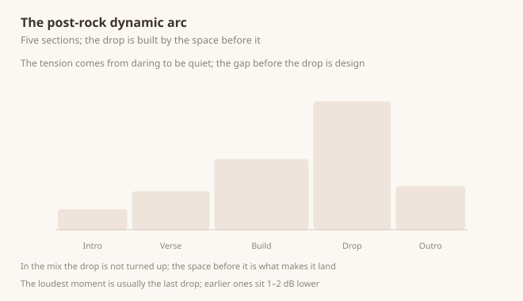

Post-rock's core skill is building a crescendo: a journey from very quiet to very loud.

### 6.1 Crescendo technique at the arrangement level

- **Adding elements**: start with one instrument (a clean guitar playing the motif), then add the second guitar, the bass, the hi-hat, the snare, the kick, the crash, layer by layer. Each addition raises the tension one step.
- **Compressing the rhythm**: as the crescendo develops, the rhythmic pattern goes from loose eighths to denser values. Quarter notes → eighths → sixteenths → triplets. Rhythmic density is itself a measure of tension.
- **Expanding the range**: start in the midrange, and as the crescendo develops bring in the low end (bass, kick) and the top (crash, feedback) at the same time, for an impact across the whole spectrum.

### 6.2 How the mix helps the crescendo

- **Filter automation**: as the crescendo starts, use a high-pass filter to take the low end away gradually (rising from 20 Hz up to 150–200 Hz, say), then snap the filter open at the moment of the explosion so the low end floods out.
- **Width automation**: use a narrower stereo image in the quiet passages, widen it as the crescendo builds, and reach the widest point at the climax. A stereo imager can automate the width parameter.
- **Volume automation**: the most direct and the most effective. Do not be afraid of drawing big volume curves; that is exactly the dynamic post-rock listeners want.
- **Reverb automation**: in the last few beats before the crescendo, push the reverb send up hard (for a huge sense of space), then drop the reverb at the moment of the explosion so the instruments hit the listener directly.

### 6.3 The release after the explosion

A good crescendo is not only about getting louder; it is also about **what happens after the explosion**. Common moves:

- **Complete silence**: cut everything dead at the peak, leaving a huge sense of expectation.
- **Sudden deceleration**: the drums drop from dense sixteenths to quarter notes or slower, releasing the rhythmic pressure.
- **Timbre collapse**: heavy feedback, distortion or pitch-bend, so pitch and tone shatter after the explosion.

## 7. Compression strategy: gentle vs aggressive

| Section | Dynamics | Mix focus |
|---|---|---|
| Intro | Very small | Keep the room sound and the noise |
| Verse | Small to medium | Vocal clear, drums given space |
| Build | Medium | Add layer by layer; do not open everything at once |
| Climax | Maximum | Low end and distortion come in together |
| Outro | Receding | Let the reverb tail carry the ending |

Post-rock's compression philosophy is the opposite of pop's. Pop wants steady and loud; post-rock wants dynamic and emotional.

### 7.1 Track compression: a light touch

Use gentle settings on most instruments:

- **Ratio**: 1.5:1–2.5:1
- **Threshold**: catching only the top 6–8 dB of peaks
- **Attack**: 10–30 ms (let the attack through)
- **Release**: 40–80 ms (recovering naturally)
- **Makeup gain**: only replacing what the compression took away; do not push it louder on purpose

### 7.2 Bus compression: the glue

Use more active compression on the guitar group, the drum group and the master bus:

- **Ratio**: 3:1–4:1
- **Threshold**: 4–6 dB of compression
- **Attack**: 10–15 ms
- **Release**: automatic or medium (around 100 ms)
- The point of this layer is to glue the tracks into one sound, not to control dynamics.

### 7.3 Parallel compression: the secret to keeping dynamics

This is one of the most important compression techniques in post-rock. Copy the signal to an aux track, compress it very hard (ratio 10:1, fast attack, slow release), then blend it with the dry original. The benefits:

- The original signal keeps its full dynamics.
- You also get the thickness and sustain that compression brings.
- You can automate more of the parallel layer in the climax only.

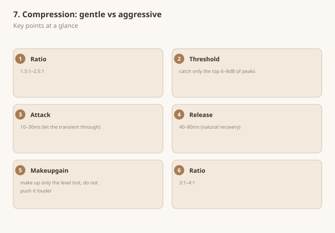

## 8. Reverse reverb, swells and sound design

### 8.1 How to make reverse reverb

1. Copy a piece of audio (a guitar note or a snare hit) to a new track.
2. Add a long reverb (decay 3–5 s) and render the reverb to audio.
3. Reverse that reverb audio.
4. Place the reversed reverb before the original note.
5. In the mix, the reversed reverb should sit 6–10 dB below the original note.

It sounds as if a sound is drawing breath and gathering energy before the note. The trick works very well on guitar lines and crash cymbals.

### 8.2 Guitar swells

A swell is a post-rock signature technique: a guitar note rising smoothly out of nothing. There are several ways to do it:

- **Volume pedal**: use a volume pedal to control the fade-in when recording live.
- **Automation**: draw the volume curve by hand in the DAW.
- **Sidechain compressor**: trigger the compressor's release with an auxiliary signal to imitate a swell.

In the mix, swell tracks usually need more reverb than the other guitar tracks, and in the climax you can automate the swell's level up slowly, like a storm arriving from far away.

### 8.3 Field recordings and texture

Many post-rock records use field recordings: rain, wind, distant traffic, tape hiss, radio static. In the mix, put these texture tracks at the extreme edges of the stereo field (L80–100/R80–100) at only -20 to -30 dB. They should not be heard; they should be felt. In the quiet passages they come forward and add a layer of unconscious space to the music.

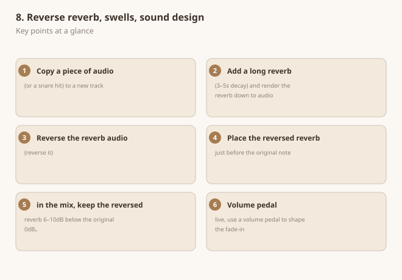

## 9. The role of silence and empty space

The most important lesson post-rock teaches a mixer: **silence is the most powerful instrument**. When you mix:

- Do not use a fade-out between sections to hide an edit; empty space should be sudden and complete.
- An explosion after a very quiet passage has a physical impact no compressor can imitate.
- In the verse, remove every unnecessary element: one guitar and sparse drums, so the listener feels the space in the gaps.
- Using a noise gate to remove the noise floor is **not always right**. Post-rock allows, even encourages, the natural noise of a recording (amp hiss, fingers sliding on strings) to become part of the texture.

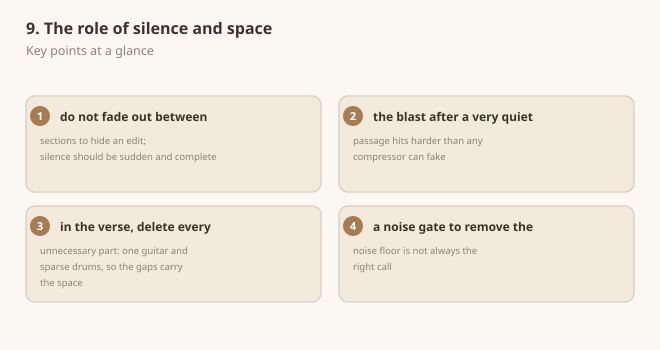

## 10. A practical mix: quiet verse to explosive climax

Let's work through a typical post-rock mix step by step. Say the structure is Intro (quiet) → Verse (medium-low) → Build-up (crescendo) → Climax (explosion) → Outro (dissolving).

### Step 1: the intro (0:00–0:30)

- Just two clean guitar tracks (L75/R75) and one field recording.
- **EQ**: high-pass the clean guitars below 150 Hz and keep the high mids clear.
- **Reverb**: a long hall reverb send (decay 5 s) at a high send level (-10 dB).
- **Dynamics**: almost no compression. Let the guitar arpeggios breathe.
- **Level**: about -24 LUFS overall; quiet on purpose.

### Step 2: the verse (0:30–1:30)

- Add bass (mono, centre) and drums (hi-hat plus light snare).
- **EQ**: bass +3 dB at 60 Hz, high-pass at 40 Hz. Snare -3 dB at 200 Hz to reduce boxiness.
- **Compression**: light bus compression on the drums (ratio 2:1), gentle compression on the bass (ratio 2.5:1).
- **Space**: a reverb send for the bass (a short room, send level -15 dB) so the bass is not bone dry.
- **Level**: about -20 LUFS, 4 dB up from the intro.

### Step 3: the build-up (1:30–2:30)

- Add the second, drive guitar layer (L30/R30); the hi-hat moves to eighths; the snare adds ghost notes.
- **Automation**: start drawing filter automation. Between 1:30 and 2:30 the low-pass filter on the master bus falls slowly from 20 kHz to 12 kHz, so the sound gets darker and more pressing.
- **Reverb automation**: raise the long reverb send on each track gradually (from -15 dB to -8 dB) for the illusion that the space is growing.
- **Compression**: take the guitar bus from 2:1 to 3:1 (threshold down 2 dB) and start applying more control.
- **Level**: up slowly to -16 LUFS.

### Step 4: the climax (2:30–3:00)

- **The moment of explosion**: at 2:30 everyone comes in. Fuzz guitars, sixteenth-note kick, crash cymbals, every instrument at full power.
- **Filter snaps open**: the low-pass filter jumps to 20 kHz and the low end floods in.
- **Level**: a jump to -9 LUFS. That 7 dB jump is deliberate: the listener's body reacts with a faster heartbeat.
- **Room sound**: the drum room track at full level, the crash reverb send at -5 dB.
- **Compression**: the bus compressor may be working 5–6 dB here, and that is right; it provides the squeeze of the climax. Make sure the attack is slow enough (20 ms or more) that the attacks are not eaten.
- **Stereo width**: use a stereo imager to take the width from 100% to 130–140% (watch mono compatibility).

### Step 5: the outro (3:00–3:30+)

- Pull out of the climax abruptly, leaving only the fuzz guitar's feedback and a long reverb tail.
- **Automation**: raise the reverb send hard to -3 dB and let the reverb keep dissolving. Automate the main level from -9 LUFS down to -30 LUFS over 5–10 s.
- **Texture**: in the end only the field recording and a faint guitar feedback remain, fading out after 15–20 s.

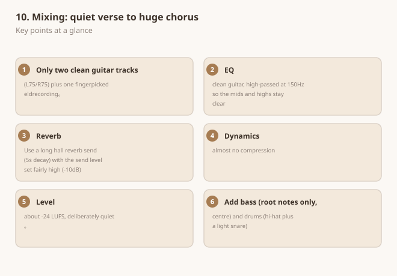

## 11. Reference bands and what their mixes sound like

These are the mixing signatures of the three best-known post-rock bands, useful as targets while you tune your own:

### Explosions in the Sky

- **Signature**: dense walls built from two guitars (sometimes three). The guitar tone sits around mid gain, clean and drive alternating.
- **Mixing points**: the guitar midrange (800 Hz–2 kHz) is slightly scooped so the layered guitars do not fight. The drum room sound is enormous and one of the most prominent elements in the mix. The dynamics are preserved extremely well; quiet passages go as low as -26 LUFS and the climax reaches -10 LUFS.
- **Reference tracks**: "Your Hand in Mine", "First Breath After Coma"

### Sigur Rós

- **Signature**: overwhelming space, Jónsi's falsetto vocal, a lot of shimmer reverb, bowed guitar.
- **Mixing points**: the amount of reverb is nearly twice what other genres use. The vocal usually goes into an extremely long reverb (decay 6–10 s), with a pitch-shift of +1 octave added to the reverb. The low end goes very deep (sub-bass passages), but the bass notes last a long time, so the mix has to leave enough room down there.
- **Reference tracks**: "Hoppípolla", "Sæglópur"

### Mogwai

- **Signature**: heavier and dirtier than the other two. A lot of fuzz and distortion. The dynamic contrast is extreme, from almost silent to deafening.
- **Mixing points**: fuzz guitars usually keep more low end than in a conventional mix (down to 80–100 Hz) and share the low-frequency area with the bass. That takes careful sidechaining: sidechain the guitar bus compressor from the bass, so the guitars duck 2–3 dB in the low end whenever the bass plays a note. The kick and snare sit very far forward and hit hard.
- **Reference tracks**: "Mogwai Fear Satan", "Like Herod"

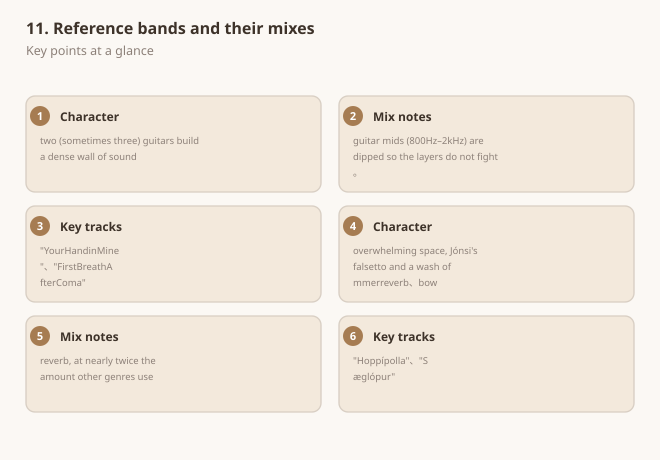

## 12. A post-rock mix checklist

Once the mix is done, run through this list to see whether it is at a professional standard:

- [ ] Does the dynamic range stay at 12–15 dB (in LUFS difference)?
- [ ] Are the quiet passages actually quiet (below -20 LUFS)?
- [ ] Does the climax hit hard enough (around -10 LUFS)?
- [ ] Is the guitar wall still thick in mono?
- [ ] Do the layered guitars have a clear frequency division, with no fighting?
- [ ] Is the reverb set up in layers, and does it move under automation?
- [ ] Is the drum room sound used to the full?
- [ ] Is the crescendo automation smooth, with an emotional curve?
- [ ] Is silence used as part of the arrangement?
- [ ] Are the field recordings or texture layers at the right level (just audible, never obvious)?
- [ ] A/B against a reference track (something by Explosions in the Sky, say): does it hold up?

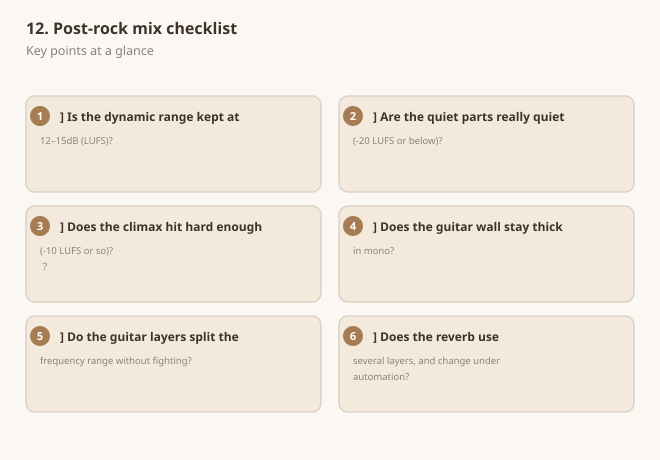

## Closing

Post-rock mixing is less a technique than a narrative. You are no longer just setting EQ and compression; you are shaping an emotional arc, from silence to roar and back to silence. Every automation curve is a turn in the story, every reverb tail a trace of a memory. When you manage to make a listener wait ten seconds in the silence after the last note has gone, still unsure whether the music has ended, that is the highest achievement in post-rock mixing.
