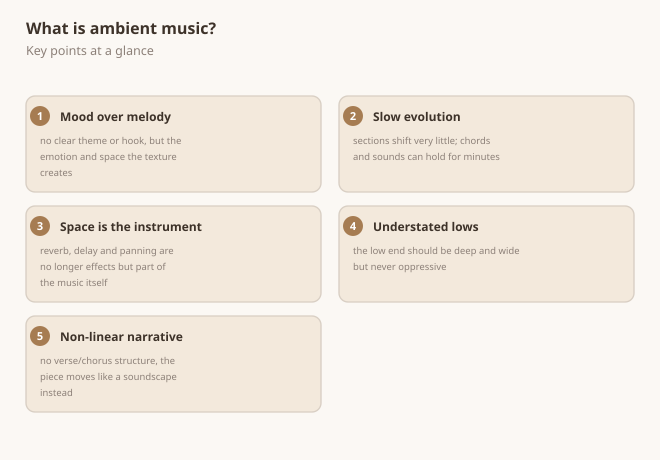
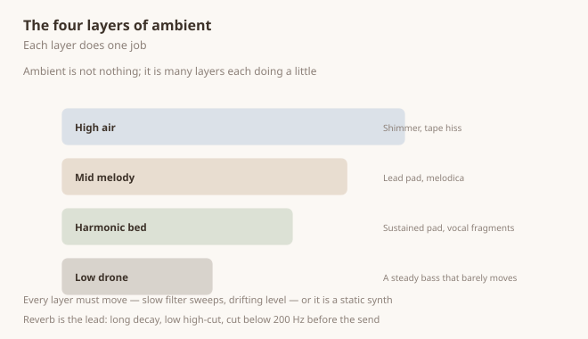
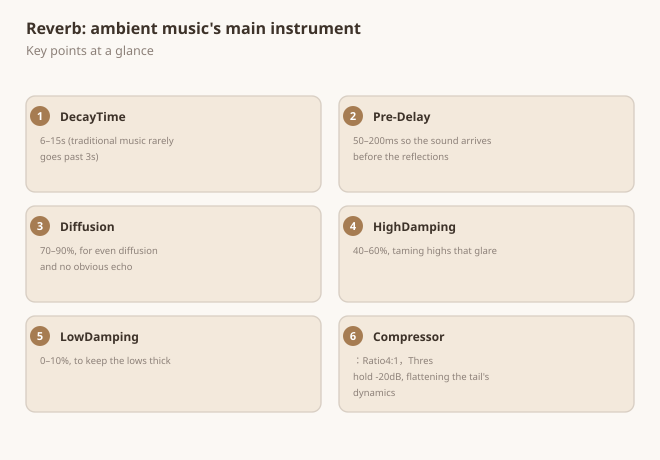
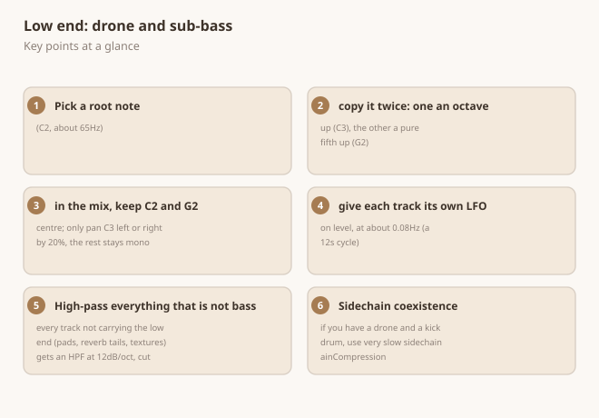
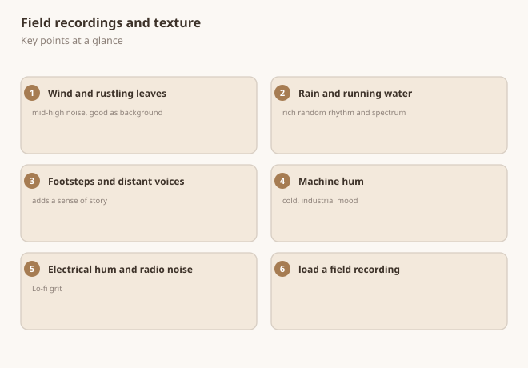
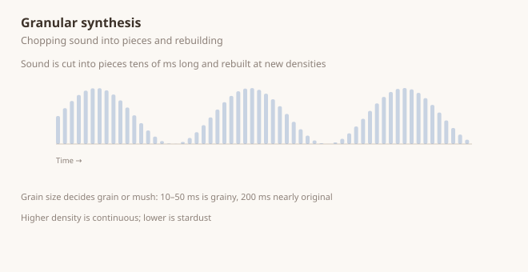
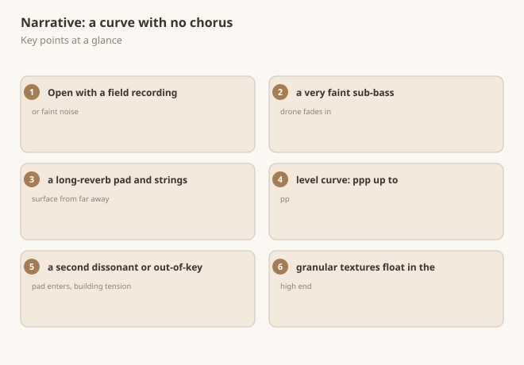
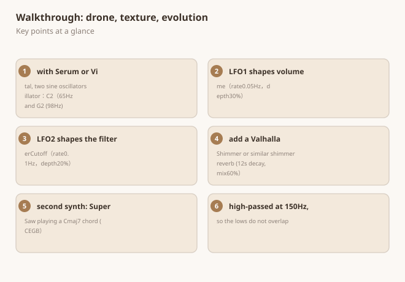
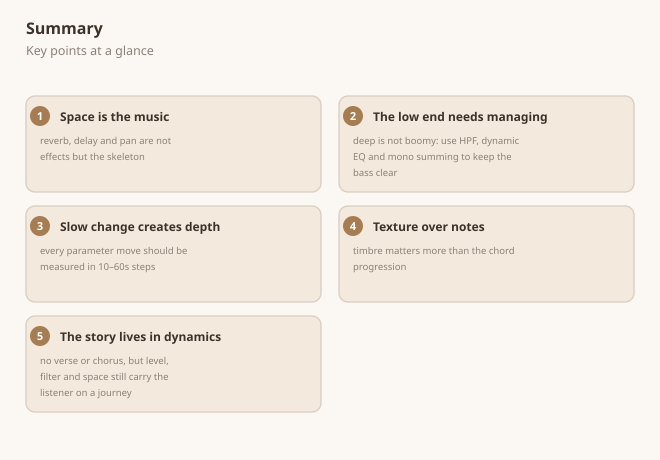

# Lesson 25: Ambient in Practice: Deep Space and Low-End Control

Ambient music is a genre built around atmosphere, texture and a sense of space, and Brian Eno defined it formally in the 1970s. Eno described ambient music as something that should be "as ignorable as it is interesting": it does not force the listener's attention, yet it can shape the mood and perception of a room. This lesson takes the practical angle and looks at how to build ambient work with depth, layering and control over the low end.

---

## What is ambient music?

The core traits of ambient music:

- **Atmosphere over melody**: the point is not a clear theme or hook but the mood and the sense of space that the sound fabric creates.
- **Slow evolution**: sections change very slightly, and a chord or a sound may stay put for minutes before it moves.
- **Space as an instrument**: reverb, delay and panning are no longer "effects" but the main structure of the music.
- **A restrained low end**: the low frequencies have to be deep and wide, but they must never press on the ear or rumble.
- **Non-linear narrative**: there is no traditional verse/chorus form; the music flows as a soundscape.

Ambient covers a very wide range of styles, from the pure atmospheric soundscapes of Brian Eno's *Music for Airports* to the drone direction of Stars of the Lid, the noise-and-ambient fusion of Tim Hecker, and the Ambient Techno and Ambient House that have grown out of electronic music in recent years. Whichever branch you take, space and low-end control are always the technical core.

---

## Building a pad sound: layering, filtering and slow modulation

The pad is the foundation of ambient music. Unlike other genres, an ambient pad cannot just be a static chord: it has to breathe and change.

### The layering principle

Use three or four layers stacked together, each one responsible for a different frequency range:

1. **Bottom layer**: a clean sine or saw wave, an octave down, carrying the low end. Use a low-pass filter (LPF) with the cutoff at 200-400 Hz.
2. **Middle layer**: rich harmonic content, using a SuperSaw or a wavetable synth, filtered between 800 Hz and 2 kHz. Add a little chorus to widen the stereo image.
3. **Top layer**: a soft string sample or an FM bell, filtered above 4 kHz, providing air.
4. **Texture layer**: irregular noise or grains, heavily compressed and mixed into a lot of reverb, as background weave.

Give each layer its own LFO (low frequency oscillator) modulating filter cutoff or volume, set to a speed of 0.05-0.2 Hz (a period of 5-20 seconds), which creates a slow drift that is almost impossible to notice.

### Filter automation in practice

In the DAW, draw a filter cutoff automation curve running 8-16 bars:

- Start: cutoff 500 Hz, low resonance
- Middle: cutoff rises slowly to 2 kHz, resonance increasing
- End: cutoff back to 800 Hz, volume fading

That simple piece of automation is enough to give a static chord a rich set of movement inside two minutes.

---

## Reverb: the lead instrument of ambient music

| Layer | Content | Treatment |
|---|---|---|
| Low drone | Sustained bass note | Almost still, only fine filter trims |
| Harmonic bed | Long pad notes | Slow chorus, low high-cut |
| Melody | Lead sound | A little delay, kept recognisable |
| Air | Shimmer, noise | High-pass, widened image |

In ambient, reverb is not "adding a bit of space"; it is the instrument itself. Using reverb correctly is what separates "amateur atmosphere" from "professional ambient".

### Hall reverb and infinite decay

Set up a Plate or Hall type reverb:

- **Decay time**: 6-15 seconds (traditional music rarely goes past 3 seconds)
- **Pre-delay**: 50-200 ms, so the sound reaches the listener before the reflections
- **Diffusion**: 70-90%, so the sound spreads evenly and avoids an obvious echo
- **High damping**: 40-60%, cutting the top end so it does not get too bright
- **Low damping**: 0-10%, keeping the weight of the low end

Open the send on the pad or the texture sound to 70-100%, so the dry signal is almost drowned by the reverb and the sound seems to ring around a huge cave.

### The infinite decay trick

To get a reverb tail that never stops, push the reverb decay to maximum, then chain a compressor and a limiter after the reverb:

- Compressor: ratio 4:1, threshold -20 dB, flattening the dynamics of the reverb tail
- Limiter: ceiling -1 dB, making sure the reverb never clips

The combination keeps the reverb tail going at an almost constant level, forming an endless halo of sound.

### Convolution reverb

Convolution reverb uses the impulse response (IR) of a real space, and it can create a sense of real space that synthesised reverb cannot match.

Common IR types:

- **Churches and cathedrals**: very long decay times (10-20 seconds) and rich early reflections
- **Underground car parks and tunnels**: a distinctive low resonance and metallic reflections
- **Empty warehouses**: an even spread through the mid-range, good under a pad
- **Natural spaces**: IRs recorded in canyons and caves, giving an irregular reverb full of life

A practical trick: send the same sound into a plate reverb and a convolution reverb, then pan the wet signal of each one hard left and hard right. That creates a space with a strong stereo image.

---

## Low-end design: drone and sub-bass

The low end of ambient is not like dance music: it does not chase impact, it chases a continuous sense of envelopment and physical resonance.

### Sub-bass drone

Use a pure sine wave, or very few overtones:

1. Pick a root note (C2, around 65 Hz, for example)
2. Copy it to two more tracks, one an octave above the original (C3) and one a perfect fifth above (G2)
3. When mixing the three tracks, keep C2 and G2 in the centre and pan only C3 20% left or right; leave the rest in mono
4. Add an independent LFO to each track modulating volume, at around 0.08 Hz (a period of 12 seconds)

A drone built this way hums like the ground itself: steady, but with a subtle movement.

### The key to avoiding a muddy low end

The commonest low-end problem is muddiness. Here are practical fixes:

1. **High-pass everything that is not a bass instrument**: put an HPF on every track that is not carrying the low end (pads, reverb tails, textures), slope 12 dB/oct, cutoff at 80-150 Hz.
2. **Sidechain coexistence**: if you have a drone and a kick drum at the same time, use a very slow sidechain compression (release 500 ms-1 s) so the drone steps back slightly when the kick hits, then recovers at a speed the ear cannot detect.
3. **Frequency carving**: use a dynamic EQ (FabFilter Pro-Q 3 or TDR Nova, say) to place a narrow (Q=4) dynamic cut of 1-2 dB at the drone's fundamental (65 Hz, for example), so the band is pushed down automatically when other low-end energy gets too high.
4. **Mono low end**: fold everything below 120 Hz to mono, so low-frequency phase cancellation does not wipe out the bass entirely at some listening positions.

### Low-end micro-movement

The low end of ambient should not be completely still. Try these:

- Put a very slow vibrato on the sub-bass, rate 0.1 Hz, depth 5-10 cents, for a slight swaying feel.
- Automate the frequency of the sine wave oscillator, sliding slowly within a semitone (up a little, then back), over a period of 30-60 seconds, so the drone breathes like something alive.

---

## Field recording and sound texture

Field recording is the strongest source of texture material in ambient production.

### Types of recording material

- **Wind and rustling leaves**: mid-to-high frequency noise, usable as background weave
- **Rain and running water**: rich random rhythm and frequency spread
- **Footsteps and distant voices**: adding a sense of narrative
- **Machinery**: a cold industrial atmosphere
- **Electromagnetic interference and radio noise**: a lo-fi texture

### Practical treatment

1. Load a piece of field recording material
2. Use a band-pass filter, sweeping the cutoff slowly between 500 Hz and 3 kHz
3. Add shimmer reverb (reverb with pitch shifting) for a dreamy high-frequency sheen
4. Use a gate or tremolo so the sound appears and disappears at irregular intervals
5. Then use a long-decay reverb to melt the processed sound into the background

Field recordings should not stand out: they should be "noticed just enough, but felt most of the time".

---

## Granular synthesis: texture that never repeats

Granular synthesis is ambient music's secret weapon. It can break any sound into tiny fragments (grains) and reassemble them in a new order, at a new speed and density, creating a sound fabric that is never exactly the same twice.

### Useful tools

- **Granulator II** (Max for Live): the granular synth that ships with Ableton Live Suite
- **Quanta** (Audio Damage): a standalone granular VST
- **Borderlands Granular** (app): a granular app for iOS

### Practical steps

1. Load a piece of sustained material (a long string note, a sung line, or a drone)
2. Set the grain size to 50-200 ms
3. Density: 10-30 grains per second
4. Pitch randomisation: ±20 cents (slight)
5. Position randomisation: 20-50% (sampling from different points in the material)
6. Playback speed: 0.2-0.8x (slowed down)
7. Run the output through a long reverb

The result is a sound that shifts like cloud: it audibly comes from some source material, but it never repeats itself.

---

## Narrative: a dynamic curve with no verse and chorus

Ambient has no traditional structure, but that does not mean it has no dynamics. Professional ambient work has a clear "hidden dynamic curve":

### A three-stage structure example

**Stage one (0:00-2:00): establishing the space**

- Open with a field recording or light noise
- A very faint sub-bass drone fades in gradually
- A long-reverb pad chord surfaces from a distance
- Volume curve: from ppp to pp

**Stage two (2:00-5:00): textures interweaving**

- A second pad, dissonant or outside the mode, joins and creates tension
- Granular textures float in the high frequencies
- Reverb tails stack up and the sense of space reaches its maximum
- The low drone's filter opens slowly
- Volume curve: from pp to mf

**Stage three (5:00-8:00): dissolving**

- The high-frequency textures fade out
- The low drone returns to its lowest point
- A new consonant pad replaces the original chord, bringing release
- Finally it returns to the field recording, so the end answers the beginning
- Volume curve: from mf back to ppp

This structure offers an emotional journey, even though not one bar of it could be called a chorus.

### The automation list

Build an automation list to control the macro dynamics of the whole piece:

- **Master volume**: the overall level follows the three-stage curve
- **Reverb send**: pushed up in stage two, lowered slowly in stage three
- **Filter cutoff**: the overall cutoff of every track opens as the emotion rises
- **Stereo width**: control width with an imager plug-in; widest in stage two, back to mono in stage three
- **Noise floor**: bring in a little tape hiss or vinyl noise at section changes, for continuity

---

## Walkthrough: drone + texture + evolution

Let's actually assemble a short ambient piece:

### Step 1: build the drone base

- In Serum or Vital, two sine oscillators: C2 (65 Hz) and G2 (98 Hz)
- LFO 1 modulating volume (rate 0.05 Hz, depth 30%)
- LFO 2 modulating filter cutoff (rate 0.1 Hz, depth 20%)
- Add ValhallaShimmer or a similar shimmer reverb (decay 12 s, mix 60%)

### Step 2: add the pad layer

- A second synth: SuperSaw playing a Cmaj7 chord (C E G B)
- High-pass at 150 Hz, so the low end does not overlap
- Chorus amount 40%
- Send it to a plate reverb as well (decay 8 s, mix 70%)

### Step 3: granular texture

- Load a long string note into Granulator II
- Grain size 120 ms, density 20/s
- Output through a band-pass filter (800 Hz-4 kHz, cutoff swept by an LFO at 0.15 Hz)
- Volume extremely low, only as background weave

### Step 4: spatial elements

- A rain field recording, HPF 200 Hz
- Add a stereo delay (400 ms and 500 ms left and right, feedback 30%)
- Then send it to a convolution reverb (church IR, mix 50%)

### Step 5: tidying up and mixing

- HPF 100 Hz on every non-bass track
- The spectrum of the low drone concentrated at 60-120 Hz
- Use SPAN (a free spectrum analyser) to check whether the low end is even
- Overall mix at -14 LUFS (suitable for streaming platforms)
- A very gentle compressor on the master bus (ratio 1.5:1, threshold -18 dB)

### Step 6: automation curves

Draw six minutes of automation along the timeline:

- 0:00-1:00: drone and field recording fade in
- 1:00-3:00: pad enters, reverb amount pushed up, stereo width opens
- 3:00-4:30: granular texture joins, filter cutoff rises
- 4:30-6:00: each element fades out one by one, the reverb tail decays naturally

---

## Recap

Making ambient music is completely different from making traditional music: it asks you to shift from thinking about "writing a song" to thinking about "designing a sound space". The key points:

1. **Space is the music**: reverb, delay and panning are not extra effects, they are the skeleton of the piece.
2. **The low end needs deliberate management**: deep is not the same as rumbling. Use HPF, dynamic EQ and mono folding to keep the low end clear.
3. **Slow evolution creates depth**: any parameter change should be thought about in units of 10-60 seconds.
4. **Texture over notes**: the quality of the sound matters more than the chord progression or the melody.
5. **Narrative hides in the dynamics**: even with no verse and chorus, changes in level, filtering and space can still take the listener on an emotional journey.

A practice suggestion: find a ten-minute field recording and make a complete ambient piece from it, using no traditional instruments and relying entirely on reverb, filtering and automation to create the structure. It is the best exercise there is for training "sound-space thinking".

