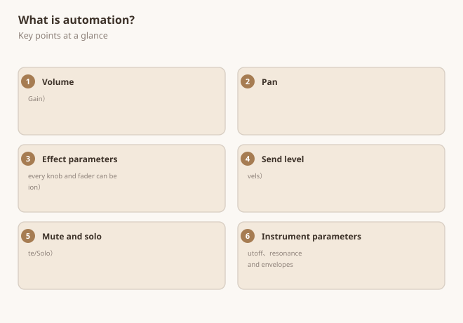
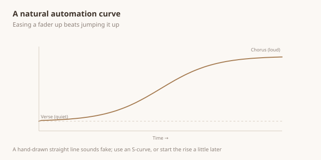
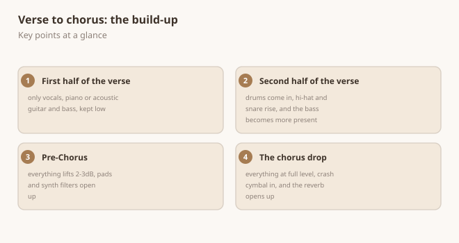
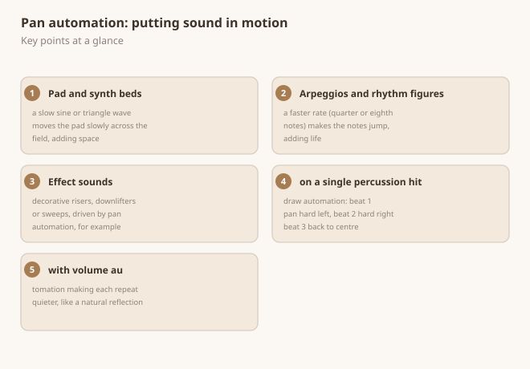
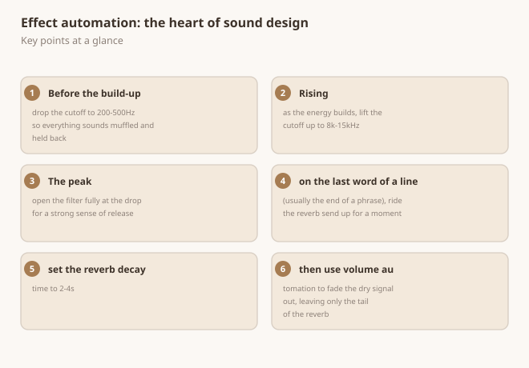
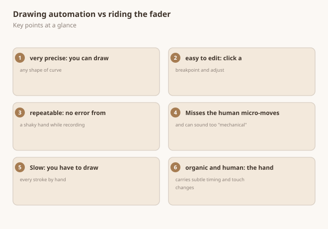
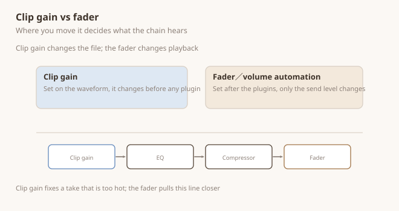
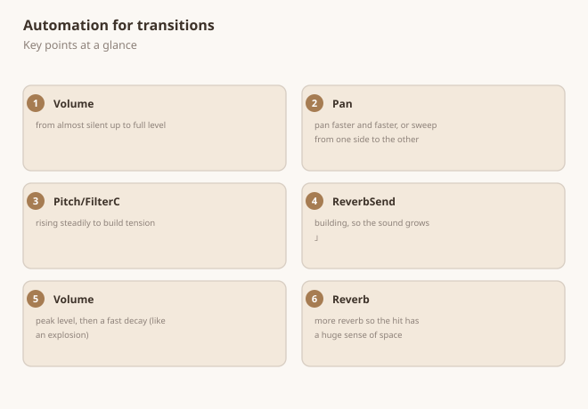
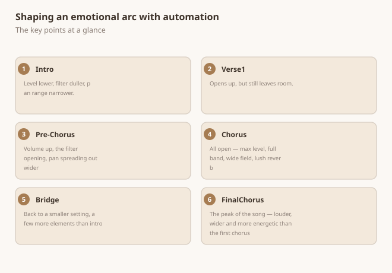
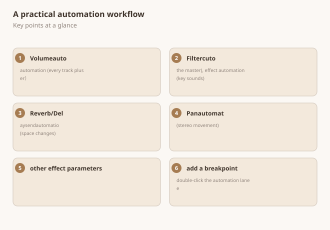

# Lesson 26: Automation: Drawing a Song's Dynamics and Emotion

## What is automation?

In digital music production, automation means the ability to have the DAW change any controllable parameter automatically along the timeline. Imagine a pair of invisible hands that, as the song plays, push volume faders, turn effect knobs and adjust filters with precision. That is what automation does.

Why does automation matter so much? Because music is dynamic by nature. A song whose volume is identical from start to finish feels dull. Automation lets us "draw" the rise and fall of the music on the timeline, from a slight crescendo to a dramatic burst, from a quiet passage to a full-energy climax. Without automation your mix is like a black-and-white photograph with no light and shade; with it, you finally have colour and depth.

Modern DAWs (Ableton Live, Logic Pro, FL Studio, Cubase, Pro Tools and the rest) all provide a complete automation system. The parameters you can automate include, but are not limited to:

- Volume / gain
- Pan
- Effect parameters (every knob and slider on an effect can be automated)
- Send levels
- Mute / solo state
- Instrument parameters (a synth's cutoff, resonance, envelope and so on)

## Volume automation: the most critical tool in a mix

If there is one core automation skill you have to get good at, it is volume automation. It is the most direct and most effective way to shape a song's dynamics.

### Why not just use a compressor?

A compressor does control volume, but it is passive, reactive processing based on a threshold. Automation is an active, deliberate artistic decision. The two work together:

- **Compressor**: controls the momentary dynamic range and makes the performance steadier
- **Automation**: shapes the volume contour on a larger time scale (bars, sections)

The crescendo from verse to chorus, for example, is something a compressor cannot do: it does not know which part is the verse and which is the chorus. You have to do that with manual automation.

### Typical uses of volume automation

**Balancing the lead vocal**: in a song, some words a singer sings may be quieter and some louder. Use clip gain or volume automation so every word is clearly audible without losing the natural sense of dynamics.

**Dynamic contrast between sections**: keep the verse at a lower level (say -8 dB to -6 dB), then lift the chorus to -3 dB or even close to 0 dB. That 3-5 dB difference is enough to create an obvious change in intensity.

**The fade-out at the end**: the fade at the end of a song is the most classic use of volume automation. Draw a smooth downward curve and let the song disappear naturally.

**Leaving room to breathe**: between sections, drop the level slightly (around 1-2 dB) so the listener's ear gets a short rest, then go into the next section, and the effect will be stronger.

## Build-up from verse to chorus

This is one of the most practical and most common automation techniques. Let's break down a typical build-up strategy from verse to chorus:

### Overall volume automation

In the 2-4 bars before the chorus starts, draw a slow rising curve on the master fader or on the group track of all the instruments. That curve should not be a straight line but a slightly bowed "S curve" (slow first, then fast, then slow again), because that is what sounds most natural.

### Layered automation per track

A genuinely advanced build-up comes from different instruments entering at different moments:

1. **First half of the verse**: only vocal, piano or acoustic guitar, and bass, all kept at a lower level
2. **Second half of the verse**: the drums come in gradually, hi-hat and snare start to rise, the bass gains presence
3. **Pre-chorus**: every instrument rises 2-3 dB, the pad or synth filter opens slowly
4. **The chorus drop**: every instrument reaches maximum level, the crash cymbal comes in, the reverb grows

### Build-up on the rhythm instruments

Use automation to control the compressor mix amount on the drum kit, or the send level of the parallel compression. In the verse, compress less so the drums sound more natural; as you approach the chorus, increase the amount of compression so the drums get stickier and more forceful.

## Pan automation: injecting movement into the sound

| Type | What it controls | Common use |
|---|---|---|
| Volume | Track output | Pushing and pulling from verse to chorus |
| Pan | Left-right position | Letting an element drift slowly |
| Effect parameters | Reverb send, filtering | Section transitions |
| Plug-in bypass | On/off | Switching between sections |

Pan automation can create the effect of a sound moving through the stereo field, adding life to a mix.

### Auto-pan

This simulates a sound moving back and forth between the left and right channels. Common uses:

- **Pad or synth background**: control pan with a slow sine or triangle wave, so the background drifts slowly through the stereo field and the sense of space grows
- **Arpeggio or rhythm figures**: use a faster rate (quarter notes or eighth notes) so the notes jump left and right, creating energy
- **Effects (FX)**: ornamental risers, downlifters or sweeps, paired with pan automation so they travel from one side to the other

### The ping-pong effect

Traditionally a ping-pong delay makes the echoes alternate between the left and right channels, but you can also do something similar by hand with pan automation:

1. Draw automation on a percussion hit: pan hard left on beat 1, hard right on beat 2, back to the centre on beat 3
2. Pair it with volume automation so each repeat is quieter, imitating natural room reflections

### Panning across a section change

At a section change (the bridge ending and returning to the final chorus, say), pan a rising sound (a riser, for example) from the left channel to the right, creating a sense of sweeping across the space and giving the transition a stereo shape.

## Effect parameter automation: the core of sound design

This is the most interesting and most creative area of automation. By automating effect parameters you can let a timbre evolve over time.

### Filter sweeps

The most classic effect parameter automation. Draw automation on the cutoff frequency of a low-pass filter:

- **Before the build-up**: drop the cutoff to 200-500 Hz, so the sound feels closed-in and held back
- **Rising gradually**: as the energy accumulates, lift the cutoff slowly to 8k-15k Hz
- **The peak**: open the filter completely at the moment of the drop or the chorus, for a strong sense of release

Automating a high-pass filter is just as useful: in the verse, use a higher HPF cutoff on the low-frequency instruments (pad, guitar), leaving the low-end space to the kick and bass; then in the chorus, lower the cutoff again so those instruments get their low end back and the sound gains weight.

### Reverb throws

Suddenly raising the reverb wet mix on a particular word or sound effect makes the sound seem to be "thrown into an abyss":

1. On the last word of a lyric (usually the end of a phrase), draw a momentary rise in the reverb send
2. Set the reverb decay time to 2-4 seconds
3. Pair it with volume automation so the original dry signal fades out, leaving only the reverb tail

This technique is very common in EDM, pop and film scores, and it can add drama to a vocal.

### Delay feedback automation

The delay feedback is another powerful target for automation:

- In the normal sections of a song, set feedback at 10-20%, for a light echo
- At the end of a section or in a transition, raise feedback suddenly to 60-80%, creating a wild, repeating effect
- Finally drop the feedback to 0% and let the delay disappear naturally

If you pair it with the delay's ping-pong mode and add pan automation, the effect is even more striking.

### Other common effect automations

- **Distortion / saturation**: clean in the verse, more saturation in the chorus, so the sound is fuller
- **Compressor ratio / threshold**: changing the amount of compression, which affects the punch of the sound
- **EQ frequency / gain**: lift the mid-range in the bridge for intimacy, lift the top end in the chorus for air
- **Chorus / flanger rate**: the rate of the modulation follows the emotion of the music

## Drawing automation by hand vs recording fader moves

The two main ways of creating automation each have advantages and disadvantages.

### Drawing automation

You draw curves directly with the mouse in an automation lane.

**Advantages**:

- Extremely precise: you can draw a curve of any shape
- Easy to edit: click a breakpoint to adjust it
- Repeatable: no error from a shaky hand during recording

**Disadvantages**:

- Lacks human micro-variation: it can sound too mechanical
- Slower: you have to draw it stroke by stroke

**Where it fits**: precise parameter changes, such as a filter sweep curve, fades and fade-ins, fine volume balancing.

### Recording fader moves

With the DAW in automation record mode, you play the song and push faders or turn knobs, and the DAW records everything you do in real time.

**Advantages**:

- Organic and natural: a human gesture carries subtle changes in timing and force
- Intuitive: you listen with your ears and work with your hands, with no need for visual help
- Fast: one pass gives you a complete automation

**Disadvantages**:

- Not precise enough: it is hard to hit exactly the right value at exactly the right moment
- Takes practice: a good "touch" takes time to develop
- Harder to edit: you may need to clean up unnecessary breakpoints

**Where it fits**: volume automation, real-time control of effect parameters, performative parameter changes.

### The best approach: use both

Record a natural automation by hand first, then go into the automation lane and refine it by hand: remove the extra breakpoints, smooth the jagged curves, adjust the timing. That keeps the human feel and reaches professional precision at the same time.

## Clip gain vs track automation

Both adjust volume, but they are used for different things.

### Clip gain

Adjusting the gain directly on an audio clip rather than in the track's automation lane.

**Good for**:

- Balancing levels before mixing, so every clip sits at a consistent level
- Removing uneven levels in a recording (a singer whose some words are much louder than others)
- Volume adjustments finished at the editing stage, managed separately from mixing-stage automation

**Advantage**: clip gain adjustments happen before the fader, so they do not affect later track automation adjustments. That gives you two levels of volume control.

### Track automation

Automation on the track's volume fader.

**Good for**:

- Volume changes across whole sections (the crescendo from verse to chorus)
- Working together with other automation (pan, effects)
- The final polish at the mixing stage

**The golden rule**: use clip gain for "fine trims" and track automation for "the big contour". Adjust clip gain first so every clip sits at a consistent level, then draw track automation to shape the dynamic contour of the song.

## Automation for transitions

A transition is the bridge between sections of a song, and a good transition lets the music move smoothly from one emotion to another.

### Automating a riser

A riser is usually a sound that keeps rising, paired with the following automation:

- **Volume**: from almost silent up to full level
- **Pan**: moving back and forth faster and faster, or travelling from one side to the other
- **Pitch / filter cutoff**: rising continuously, creating tension
- **Reverb send**: increasing gradually, so the sound gets more and more "big room"

### Automating an impact or downlifter

At the moment of a transition (the first beat of the chorus, say), an impact sound is usually paired with:

- **Volume**: maximum level instantly, then a fast decay (like an explosion)
- **Reverb**: a high reverb amount, giving the impact a huge sense of space
- **Filter**: dropping quickly from high-pass to full range, or rising quickly from low-pass

### The combined build-up

A complete four-bar build-up can be set up like this:

1. **Bar 1**: a snare or clap on every beat, and volume automation starts to rise slowly
2. **Bar 2**: add a white-noise riser, with the filter cutoff starting at 200 Hz and rising
3. **Bar 3**: increase the sense of speed: make the riser's pan faster and add delay feedback automation
4. **Bar 4**: every automation rushes towards its maximum: volume, pan speed, filter cutoff, reverb, delay, all reaching their peak on the last beat of bar 4
5. **The first beat of the chorus**: every automation resets instantly and you drop into the chorus

## Creating an emotional arc with automation

Behind every memorable song there is a carefully designed emotional arc. Automation is the tool that realises it.

### Common emotional-arc automation designs

**Calm → rise → burst → fall back**

This is the most classic structure. Expressed with automation:

- **Intro**: lower level, a duller filter, a narrower pan range. Building mystery
- **Verse 1**: opening up gradually, but still leaving space. Vocal in the centre, instruments at the sides
- **Pre-chorus**: volume keeps rising, the filter opens slowly, pan starts to widen
- **Chorus**: everything open: maximum level, full frequency range, wide stereo field, rich reverb
- **Bridge**: back to a smaller setup, but with more elements than the intro, creating a reflective feel
- **Final chorus**: the peak of the whole song: louder, wider and with more energy than the first chorus
- **Outro**: fading out gradually, the filter closing slowly, the level back to its lowest

### The "breathing" of automation

A good automation curve is not a geometric straight line; it rises and falls like breathing:

- **Attack stage**: the curve should have a slight "S" shape, slow at first, faster in the middle, slower again at the end
- **Release stage**: decay naturally; do not cut it off abruptly
- **Smooth curves**: use the DAW's curve tool (not the line tool) to draw automation

In Ableton Live you can hold Ctrl (on a Mac, Cmd) and drag a breakpoint to draw a curve; in Logic Pro, choose the "Curve" mode to smooth it automatically; in FL Studio, right-click the automation clip and choose "Smooth". Learn your DAW's curve editing tools and get fluent with them.

## A practical automation workflow

Here is a professional automation workflow:

### Step 1: have a mix before you draw automation

Do not start drawing automation while the mix is still unsettled. Finish the basic mix first (level balance, EQ, compression), then start adding automation. Otherwise you may redraw everything again and again as the mix keeps changing.

### Step 2: start with volume

Always do volume automation first. It matters most and it has the biggest effect. Draw the dynamic contour of the song first, then think about other automation.

### Step 3: one parameter at a time

Do not try to automate everything at once. Focus on one parameter, get it right, then move to the next. A common order of priority:

1. Volume automation (each track plus the master)
2. Filter cutoff automation (the key timbres)
3. Reverb / delay send automation (changes in space)
4. Pan automation (stereo movement)
5. Other effect parameters

### Step 4: use the automation lane editor

Most DAWs have a dedicated automation editing interface. Get familiar with these shortcuts:

- **Add a breakpoint**: double-click the automation lane
- **Delete a breakpoint**: select it and press Delete
- **Smooth a curve**: select several breakpoints and apply the curve tool
- **Copy automation**: select the automation clip, then copy and paste

### Step 5: cleaning up and refining the automation

After drawing the automation, spend time cleaning it up:

- Remove unnecessary breakpoints (too many breakpoints make the curve uneven)
- Check for unnecessary jumps in the automation (especially at section boundaries)
- Confirm whether the automation timing is in sync with the music (zoom in to the scale of a bar to check)

## Techniques for a natural-sounding automation curve

### 1. Avoid straight lines

The human ear is very sensitive to sudden changes. Rather than automation with right-angled turns, use rounded curves. In volume automation especially, straight lines sound mechanical.

### 2. Use S curves

For a ramp up, use an S curve: slow at the start, fast in the middle, slow at the end. This imitates the natural envelope of a sound, and it sounds very natural.

### 3. Small imperfections

If the automation came from recorded fader moves, you do not have to fix every small wobble. Small imperfections make automation sound more human. But breakpoints that are clearly off still need correcting.

### 4. Parameters moving together

Several parameters changing together have a multiplying effect. In a build-up, for example, raise the volume, open the filter and add reverb at the same time: the combination has a far greater effect than each one used on its own.

### 5. Leaving room in the automation

Do not let automation fill every moment of the song. Sometimes not automating is the best automation: keeping some sections steady makes the parts that do change stand out more.

## Closing

Automation is one of the most powerful creative tools of the DAW era. It lets us "perform" every parameter along the timeline, breathing life, movement and emotion into the music.

Start by practising the most basic volume automation, then work outward to filter, pan, reverb and delay. Every piece of automation you add brings your music closer to the shape you have in your head.

Remember: the best automation is automation the listener never notices. It lets the music rise, fall, breathe and flow naturally, instead of making the listener think, "Wow, that automation is impressive." Film scores work the same way: the moment you notice the score, it has failed; when the score disappears into the picture, that is real success.

The same goes for automation: let it serve the music silently, and let the music speak for itself.

