# Lesson 27: Mastering Concepts: The Logic of Master Bus Processing

## Course overview

Mastering is the last step in the music production chain, and the most important gate between "a finished mix" and "a release format". If mixing is adjusting the balance and texture of each instrument at the micro level, mastering is making sure, at the macro level, that the whole song sounds consistent and professional on every playback system. This lesson looks closely at the core concepts of mastering, the processing logic of the master bus, and how to build your own mastering workflow step by step.

---

## What is mastering?

The English word "mastering" comes from "master", the master copy. Historically it meant transferring a finished mix on tape to the final "master" carrier in the analogue era, so records could be pressed in quantity. In the digital era mastering has grown into a complete process of sound optimisation, with these goals:

- **Balance the frequency response**: make sure the proportions of low, mid and high across the song are right, so it never sounds dull or harsh on some system.
- **Control the dynamic range**: bring the song's loudness to the industry standard for its genre, while keeping the dynamic movement the music should have.
- **Ensure translation**: make the song sound "like the same song" on headphones, a car stereo, a Bluetooth speaker and a phone speaker.
- **Establish continuity across tracks**: for an album or an EP, the mastering engineer also has to match the level and tone of each track, so the listening experience flows without jolts.
- **Deliver final files that meet the release spec**: sample rate, bit depth, file format (WAV, FLAC, MP3 and so on) and loudness standards (the LUFS conventions, for example).

### Mixing vs mastering: the fundamental difference

Many beginners treat "mixing" and "mastering" as the same thing, but they operate on completely different levels:

| Aspect | Mixing | Mastering |
|------|--------------|------------------|
| What is processed | The multitrack session (each instrument on its own) | The stereo mix file (two channels already merged) |
| Core task | Balance the level, frequency and space of each instrument | Optimise the overall tone, loudness and dynamics |
| Scope | All the elements inside one song, made to work together | One song optimised, or all the tracks of an album made consistent |
| Tools | A multitrack mixer, separate effects on each track | Master bus processors, high-quality EQ/comp/limiter |
| Listening goal | Clear, balanced, with a sense of space | Professional, loud, consistent, ready to release |

Put simply: **mixing prepares the ingredients; mastering is the final seasoning and plating.**

---


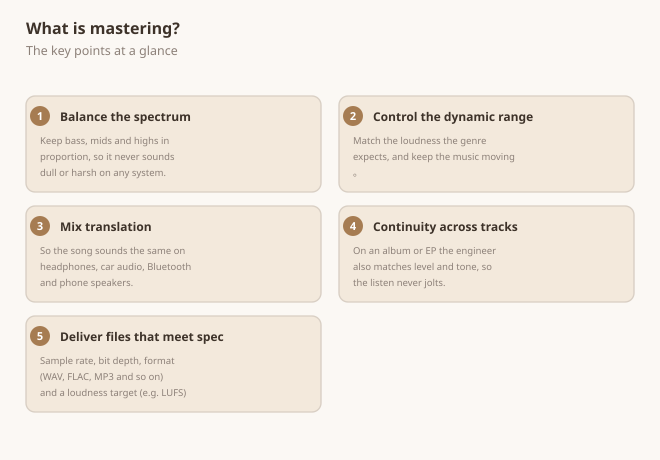

## What does a mastering engineer do?

A professional mastering engineer is not just a technician operating equipment; they are the last quality gate for a piece of music. The work has four main sides:

### 1. Level and loudness

The mastering engineer sets a target loudness according to the genre and the release platform. Streaming platforms, for example (Spotify around -14 LUFS, Apple Music around -16 LUFS integrated), while a CD or a dance track may need to be louder, at -8 to -10 LUFS. The mastering engineer uses limiters and compressors to raise the average loudness while avoiding the distortion caused by excessive clipping.

### 2. Tonal balance

The ear's sensitivity to different frequencies depends on level (the Fletcher-Munson curves). The mastering engineer uses a high-quality linear phase EQ or an analogue-style EQ to fine-trim the overall spectrum, making sure the low end is not excessive and the top end is not harsh, while keeping the original character of the music.

### 3. Translation

This is one of the core values of mastering. The mastering engineer listens repeatedly in an acoustically treated monitoring room, using several reference systems (main monitors, nearfields, headphones, a phone speaker and so on), to make sure the mixing decisions come through correctly on every device.

### 4. Format delivery

The final files have to meet the requirements of the release end. For example:

- **Streaming**: 48kHz / 24-bit WAV or FLAC, and true peak must not exceed -1 dBTP
- **CD**: 44.1kHz / 16-bit WAV
- **Vinyl**: needs special treatment for mono low end, phase problems and so on

---


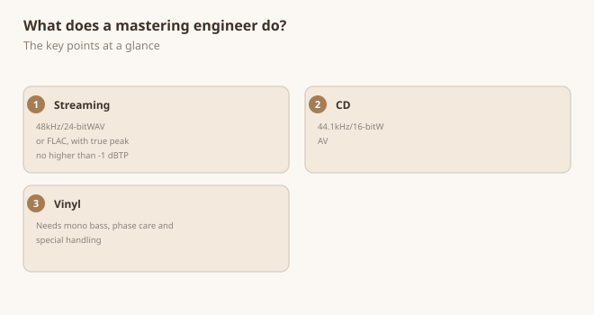

## The master bus chain: the standard order

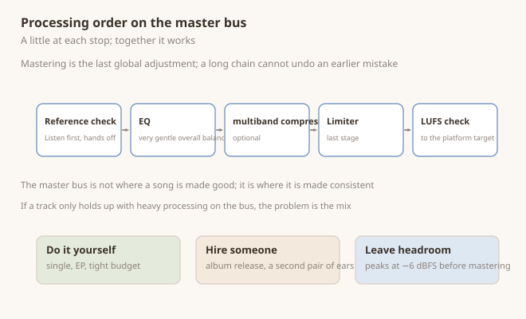

Mastering is not a matter of hanging a few random effects on the bus; there is a proven logical order. Here is the most common master bus chain in the industry:

```
Input (stereo mix file) → EQ → Compressor → Limiter → Dither → Output
```

### Step one: subtle EQ

The amount of EQ adjustment at the mastering stage is usually very small: an increase or decrease of 1 dB to 2 dB already counts as "a lot". The purpose of mastering EQ is not to fix mistakes in the mix but to add a final polish.

Common mastering EQ moves:

- **Low-end roll-off (high-pass filter)**: filter out the subsonic rumble at 20-30 Hz, leaving more dynamic headroom for the low end. Take care not to cut into the fundamentals (the kick's 50-60 Hz, for example).
- **Air boost**: a gentle shelf lift at 10-16 kHz (about +1 to +2 dB), so the top end extends further and sounds more open.
- **Trimming the low mids**: if the mix feels cloudy in the 200-400 Hz region, use a wide-Q bell curve to cut 1-2 dB and clean up the sound.
- **Sibilance control**: if you find too much hiss around 6-8 kHz, apply a narrow-Q cut.

### Step two: master bus compression

The job of a mastering compressor is not to control dynamics hard the way it does in a mix. It works like "glue", binding the frequency ranges of the sound together, so the whole thing sounds more consistent and more cohesive.

Common settings for reference:

| Parameter | Suggested value |
|------|--------|
| Ratio | 1.5:1 to 2:1 (very gentle) |
| Threshold | Only let peaks go 2-4 dB over the threshold |
| Attack | 10-30 ms (preserving transients) |
| Release | Auto, or 50-100 ms |
| Gain reduction | 0.5 to 2 dB (extremely light) |
| Knee | Soft knee |

**Key point**: mastering compression should be "almost inaudible as compression". If the difference is obvious when you bypass the compressor, you are compressing too much.

Common emulations of classic hardware compressors include the SSL G-Master Bus Comp, the API 2500, the Manley Variable Mu and the Shadow Hills Mastering Compressor. All of them are classic designs known for their colouration and their gluing effect.

### Step three: limiting

The limiter is the key tool for raising the level in mastering. It works like a compressor with an extremely high ratio (usually 10:1 or more), making sure the signal never goes past the set threshold.

Things to watch when using a limiter:

- **Gain reduction**: keep it to no more than 2-3 dB. If you keep the limiter compressing by more than 4-5 dB in order to raise loudness, the sound becomes noticeably flat and lifeless and loses its dynamics.
- **True peak limiting**: streaming platforms require true peak to stay under -1 dBTP, so after the limiter you should add a true peak limiter or set the output to -1.0 dBTP.
- **Intersample peaks (ISP)**: when digital is converted to analogue, some points between samples can reach a higher peak than the samples themselves. A true peak limiter prevents the distortion these "hidden peaks" cause.
- **Lookahead**: a lookahead of 1-5 ms lets the limiter handle transients more smoothly.

### Step four: dither

Use dither only when you need to reduce the bit depth, for example from 24-bit down to 16-bit (the CD spec). Dither works by adding a very low level of noise during quantisation, turning the quantisation error into random noise rather than audible distortion.

**Practical advice**:

- If the final output is a 24-bit WAV (for streaming), you **do not** need dither.
- If the final output is a 16-bit WAV (for CD), add dither as the last step.
- Dither has to be the **last link** in the chain; after it you cannot add any effect or change the level.

---


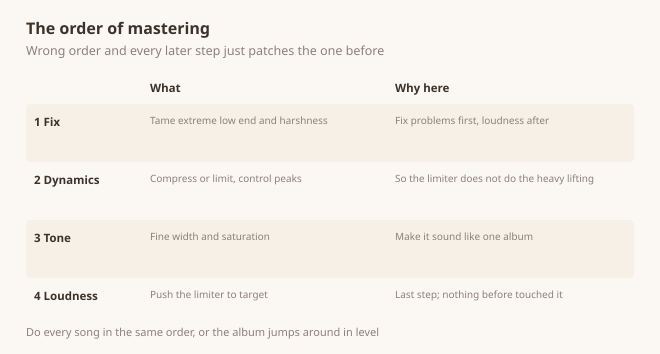

## Advanced master bus processing

### Stereo enhancement

Widening the stereo image moderately at the mastering stage makes the sound feel more open. Common methods:

- **Mid-side (M/S) processing**: split the stereo signal into mid (the centre, the part both channels share) and side (the part where the channels differ), then process each. For example:
  - Compress the mid channel slightly, so the vocal and kick in the centre are steadier
  - Apply a high-frequency lift to the side channel, adding a sense of space
  - Use an M/S EQ to adjust the frequency balance of the centre and the sides separately
- **Stereo expanders**: use something like Waves S1 or the Imager module in iZotope Ozone to widen the side signal moderately. **Note**: over-expanding causes phase problems, and the sound disappears or distorts when played in mono.
- **Haas effect delay**: rarely used at the mastering stage, but some plug-ins use a very short delay (5-20 ms) to create a sense of width. Use it with great care.

### Multiband processing

In mastering, a multiband compressor or limiter can be used to treat a specific frequency range. For example:

- **Low-end compression**: compress only the 20-120 Hz band, making the bass steadier and stopping the kick and bass fighting.
- **Mid-range dynamic control**: if the vocal suddenly becomes too prominent in the chorus, apply light multiband compression at 1-4 kHz.
- **High-frequency limiting**: preventing a very bright hi-hat or crash from causing listening fatigue.

Representative plug-ins: the Dynamic EQ and Multiband Compressor in iZotope Ozone, FabFilter Pro-MB, Waves C6 and so on.

---


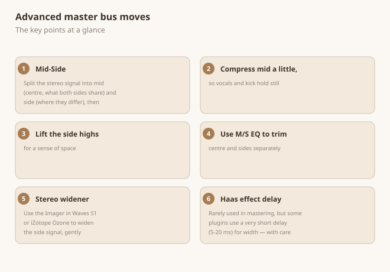

## How to use reference tracks

Reference tracks are an indispensable tool in mastering. They give you an objective baseline for comparison and help you judge whether your own work reaches a professional standard in tone, loudness and sense of space.

### Principles for choosing reference tracks

1. **Choose songs in the same genre**: do not use heavy metal as a reference for a folk singer-songwriter; the dynamics and frequency spread of the two are completely different.
2. **Choose mixes you trust**: pick songs whose sound you think is excellent, ideally award-winning or widely recognised classics.
3. **Prepare 2-3 references**: a single song may carry the engineer's personal taste; several references give you a more objective standard.
4. **Make sure the audio quality is consistent**: references should come from a high-quality source (44.1/16 WAV or FLAC, say, not a compressed YouTube stream).

### Ways to compare

- **LUFS comparison**: use YouLean Loudness Meter or iZotope Insight to measure the integrated loudness of the reference and use it as your target.
- **Spectrum comparison**: use SPAN (free) or Ozone's Tonal Balance Control to look at the reference's spectrum, overlaid on your mix.
- **A/B switching**: import the reference into your DAW, match the levels, and switch back and forth repeatedly. Make sure you match levels, because the ear thinks the louder version "sounds better".
- **A listening list**: with a plug-in like Reference 2 from Mastering The Mix you can switch between references right inside the mastering chain.

---


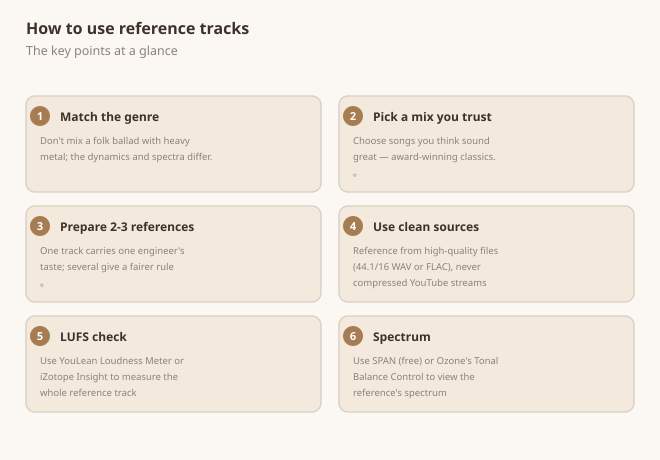

## The importance of the monitoring environment

Mastering demands far more of the monitoring environment than mixing does. The reason is simple: **if you cannot hear the problem, you cannot fix it.**

### Room acoustics

- **Bass traps**: standing waves in the corners of a room make you misjudge how much bass there is. If the room has a 60 Hz standing wave, you may unconsciously cut the bass, and the result sounds thin on other systems.
- **Absorption at the first reflection points**: the first reflection points on the side walls and the ceiling need appropriate absorption or diffusion, so early reflections do not confuse your judgement of the stereo image.
- **Listening position**: sit at about 38% of the room's length from the front wall, at an equal distance from both side walls, with the speakers and your head forming an equilateral triangle.

### Monitors

Mastering engineers usually use full-range monitors (Genelec, ATC, Barefoot Sound and so on) with a subwoofer, so they can hear the very low end in full. For you, learning at home, what matters more is **knowing your monitoring system**. Whatever the quality of your speakers or headphones, if you know their sound well you can still produce a good master.

### Things to watch with headphone monitoring

Headphones cannot reproduce stereo crossfeed realistically, which easily leads to:

- The centre channel (vocal, kick) sounding too prominent
- The stereo width being exaggerated
- The low end being perceived differently from speakers

It is worth using a headphone simulation plug-in (Sonarworks Reference, Waves Nx, dSoniq Realphones) to imitate a speaker listening environment.

---


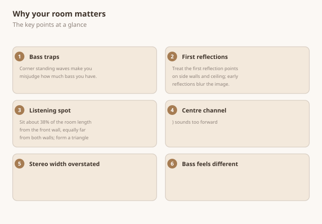

## Common mastering mistakes

### Mistake one: over-limiting

This is the commonest beginner mistake. To make the song "loud", the limiter threshold is pulled down very low, which leads to:

- The music losing its dynamics and sounding flat and tiring
- Transients being flattened, so the percussion loses its impact
- An obvious pumping effect (the level jumping back up when the limiter releases)

**The fix**: keep the limiter's gain reduction within 2 dB. If you need it louder, go back and adjust the mix.

### Mistake two: too much low end

Low end is added at the mixing stage to make the bass "feel like something", and at the mastering stage the whole thing turns out muddy. Ways to improve it:

- Apply a moderate cut at 50-150 Hz in the mastering EQ
- Use a multiband compressor to control the low-end dynamics
- Or clear the unnecessary low end with a high-pass filter at the mixing stage

### Mistake three: fixing mix problems at the mastering stage

Mastering is not magic. If the mix itself has a serious frequency conflict (the vocal buried under a guitar, say), phase problems or runaway dynamics, there is very little a mastering engineer can do to rescue it. **Mastering cannot replace mixing.**

### Mistake four: not checking mono compatibility

A lot of mastering processing (M/S processing or stereo enhancement especially) causes the signal to cancel in mono. Always check your master in mono once it is finished, making sure core elements such as the vocal, kick and bass do not disappear.

### Mistake five: ignoring streaming loudness standards

Different platforms have different loudness rules. Uploading a song at CD loudness (around -9 LUFS) straight to Spotify triggers loudness normalization, and the result may end up quieter than your reference. The best approach:

- Make a master for streaming: target -14 LUFS integrated, true peak -1 dBTP
- Keep an unlimited dynamic version as well

---


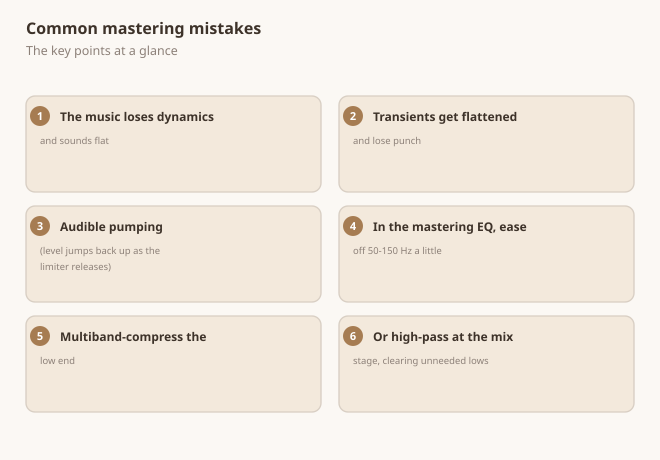

## When should you hand it to a professional mastering engineer?

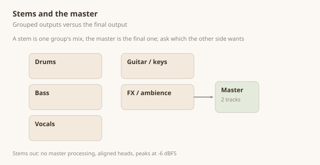

You have learned the basic mastering workflow, but in some situations handing it to a professional is still the better choice:

1. **Your work is about to be released commercially**: on streaming, CD or vinyl, a professional mastering engineer's experience and monitoring room are beyond what a home setup can offer.
2. **You do not trust your monitoring environment**: if your room has no acoustic treatment, what you hear may be far from what is really there, and the mastering decisions you make are likely wrong.
3. **You want a second pair of ears**: listening to the same song for a long time causes auditory fatigue, and a mastering engineer can hear the problems from a fresh angle.
4. **Your budget allows it**: professional mastering usually costs from a few thousand to tens of thousands per song (depending on the engineer's experience and reputation). For an official release it is well worth the investment.

Even if you decide to hand it over, **learning the concepts of mastering is still valuable**, because:

- You know more clearly what space to leave for mastering while you mix
- You can communicate with the mastering engineer in more precise language
- If you do end up mastering it yourself, you already have the right direction and method

---

## Practice suggestions

1. **Take a song you have mixed** and export the stereo mix file. Follow the chain from this lesson, EQ → Compressor → Limiter, and try a complete master. Keep every adjustment extremely small.
2. **Use reference tracks**: pick two commercial releases in the same genre and measure their loudness with a LUFS meter. Try to bring your master close to the same loudness value.
3. **Listen on five different devices**: headphones, laptop speakers, phone speaker, car stereo, Bluetooth speaker. Write down how it sounds different on each one. Adjust your next master according to those notes.
4. **Do a blind A/B test**: ask a friend to play your master and the reference, and guess with your eyes closed which is which. If you cannot tell them apart clearly, congratulations: your master is close to professional standard.

---


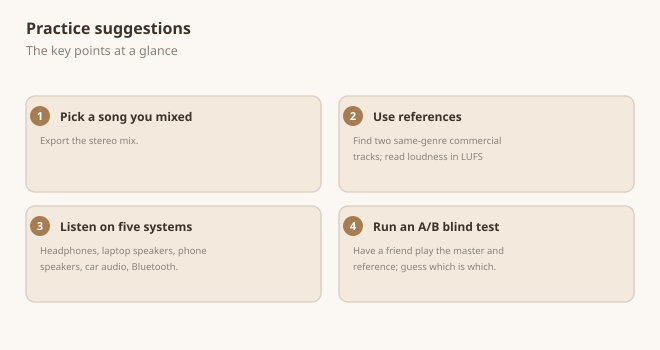

## Recap

Mastering is the last mile of the music production journey, and the part that needs experience and ears more than anything else. The core idea can be summed up in a few words: **adjust at the macro level, add a final polish.**

- The standard order of the master bus chain is **EQ → Compression → Limiting → Dither**
- Every adjustment should be extremely small: 1-2 dB of EQ, 0.5-2 dB of compression, 1-2 dB of limiting
- The best way to learn mastering is to compare your own work against professional references again and again
- The monitoring environment matters more than the gear; knowing your monitoring system is far more effective than upgrading equipment
- Avoid over-limiting and too much low end; those two mistakes are the easiest to hear
- When a work is going to be released officially, consider handing it to a professional mastering engineer: it is one of the best-value investments you can make

Get mastering right and your music is genuinely ready to leave your studio and go out into the world.

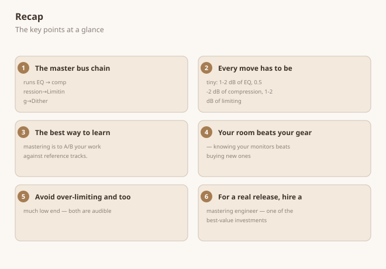

