# Lesson 28: Loudness Standards: LUFS and Using a Limiter

## What is LUFS?

LUFS (loudness units relative to full scale) is the loudness standard set by the International Telecommunication Union in ITU-R BS.1770. Its core purpose is to provide an objective loudness measurement that matches what the human ear perceives.

In the past we used RMS (root mean square) to measure the average energy of audio, but RMS cannot reflect how the ear's sensitivity varies with frequency. The ear is particularly sensitive in the mid-range (around 2-4 kHz) and relatively insensitive to low and very high frequencies. LUFS adds **K-weighting** on top of RMS, imitating the ear's frequency response so the measurement comes closer to what the ear actually experiences.

Another common unit is dBFS (decibels relative to full scale), which measures the momentary amplitude of digital audio rather than perceived loudness. A signal can look large in dBFS (close to 0 dBFS) and still not sound loud. That is exactly the problem LUFS was created to solve.

> **Key idea: LUFS measures how loud the ear perceives the sound, not how tall the waveform is.**

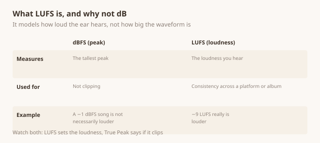

## Why do loudness standards matter so much?

In an age when streaming platforms dominate music listening, a loudness standard is no longer an option but a requirement. Here is why:

### How streaming platforms normalise

The mainstream platforms all apply **loudness normalization**: the system measures a song's LUFS value and then adjusts the playback level to its target loudness. That means:

- If a song is loud, the platform turns it down (attenuates the gain).
- If a song is quiet, the platform turns it up, but may compress the dynamic range on the way.

### What loudness normalization actually does

Suppose you make two pieces of music:

1. **A dynamically rich classical recording**: integrated LUFS = -20, with very high peaks (say -1 dBTP)
2. **A heavily compressed electronic track**: integrated LUFS = -8, right at the edge of clipping (say -0.5 dBTP)

Upload both to YouTube (target -14 LUFS):

- Classical: the platform boosts it by +6 dB, bringing it to -14 LUFS. Because the classical recording is dynamic by nature, it still sounds natural.
- Electronic: the platform attenuates it by -6 dB, bringing it down to -14 LUFS. But because it was already compressed flat, the dynamic contrast disappears after the attenuation, and it sounds short of impact and depth.

**Conclusion: chasing a "loud" mix no longer means anything.** The platform will bring everything to the same loudness, and the work that kept its dynamics ends up sounding stronger.

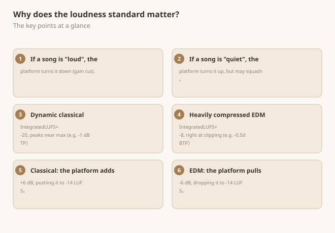

## The three LUFS measurements

ITU-R BS.1770 defines three LUFS measurement modes, each used in a different situation:

### 1. Integrated LUFS

This measures the average loudness of a whole track from start to finish. It is the most important number, because it is the integrated LUFS that streaming platforms use for loudness normalization.

- **Suggested range**: most platforms treat -14 LUFS as the ideal target, but for more dynamic music (classical or film scores) -16 to -18 LUFS is also common.
- **How to measure**: play from beginning to end, without repeats and without interruption.

### 2. Short-term LUFS

This measures the average loudness over the last 3 seconds, which is useful for watching the loudness change across a section or a phrase.

- **Where it is used**: checking whether the loudness contrast between verse and chorus is appropriate. If the verse sits at -18 LUFS and the chorus jumps to -9 LUFS, that 9 LU gap may be a deliberate dynamic effect, or it may feel abrupt to the listener.
- **Use in mixing**: make sure the chorus's short-term LUFS sits consistently inside the target range, without extreme swings.

### 3. Momentary LUFS

This measures the instantaneous loudness over the last 400 milliseconds, and it responds fastest and most sensitively.

- **Where it is used**: checking whether percussion (kick, snare) is overshooting in its momentary loudness.
- **Use in mixing**: find the loudest 400 milliseconds in the whole track and use it as the basis for your adjustments.

### Visualising LUFS

When you use a LUFS meter in a DAW (Ableton Live, Logic Pro, Studio One), all three readings are usually displayed at once. It is worth making a habit of:

- **During the mix**: watch the short-term and momentary LUFS and make sure the sections are balanced in loudness.
- **After the mix**: play the song from start to finish and note the integrated LUFS as the basis for export.

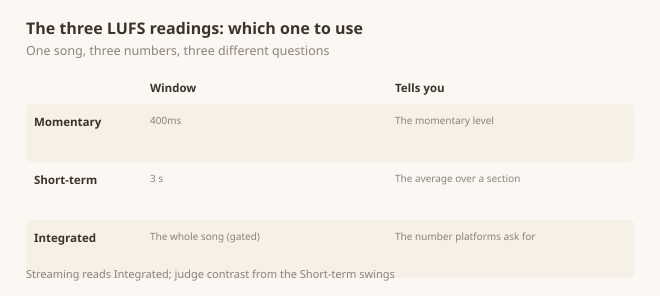

## True peak: why real peaks matter

True peak is different from an ordinary peak (sample peak). In digital audio, the waveform between sample points is actually a smooth curve, and the amplitude of the sample points themselves can be lower than the real highest point of that curve.

- **Sample peak**: checks only the amplitude of the sample points. If all the sample points are below 0 dBFS, it is assumed there is no clipping.
- **True peak**: reconstructs the analogue waveform through oversampling and finds the "real" highest point. The actual analogue waveform may go past 0 dBFS between two sample points.

### Why true peak matters

1. **Encoder distortion**: when compressing to a lossy format such as AAC, MP3 or OGG, the encoder resamples and recalculates, and it may expose a hidden true peak as an audible crackle.
2. **Streaming platform rules**: Apple Music requires true peak not to exceed -1 dBTP, and Spotify recommends staying below -1 dBTP.
3. **Protecting analogue equipment**: if the signal is eventually converted to analogue (vinyl, broadcast), a true peak over the limit will overload the power amplifier directly.

**Practical advice**: use a limiter that supports true peak detection as the last stage of the master bus, and set the ceiling to -1.0 to -0.5 dBTP to keep a safety margin.

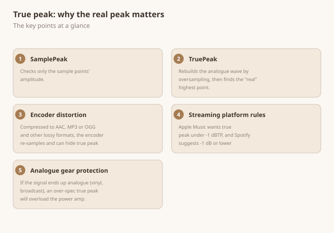

## Loudness targets by platform

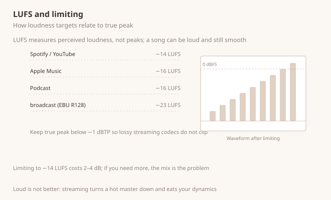

Different platforms prefer different loudness standards. Here are the mainstream conventions in 2025:

| Platform | Integrated LUFS target | True peak ceiling | Notes |
|------|---------------------|----------------|------|
| **YouTube** | -14 LUFS | -1 dBTP | The largest video platform worldwide |
| **Spotify** | -14 LUFS (default) | -1 dBTP | "No normalization" can be selected |
| **Apple Music** | -16 LUFS | -1 dBTP | Uses Sound Check |
| **Tidal** | -14 LUFS | -1 dBTP | Master quality recommends -1 dBTP |
| **Amazon Music** | -14 LUFS | -1 dBTP | In line with most platforms |
| **Podcast** | -16 to -19 LUFS | -1 dBTP | Mostly speech, so consistency is required |
| **Broadcast (TV)** | -23 LUFS (EBU R128, measured per ITU-R BS.1770) | -2 dBTP | Slightly different by country (Japan uses -24) |

### A practical strategy: which platform do you aim at?

The most practical approach is to make the track **-14 LUFS integrated**, which is the golden line that suits most platforms:

- **YouTube and Spotify**: almost no adjustment needed; it plays as it is.
- **Apple Music**: -16 LUFS and -14 LUFS are only 2 LU apart, so Apple Music attenuates it slightly and the sound quality is unaffected.
- **If -14 LUFS feels too pressing** (classical or jazz, say), do not force it; keeping the natural dynamics sounds better.

## What is a limiter?

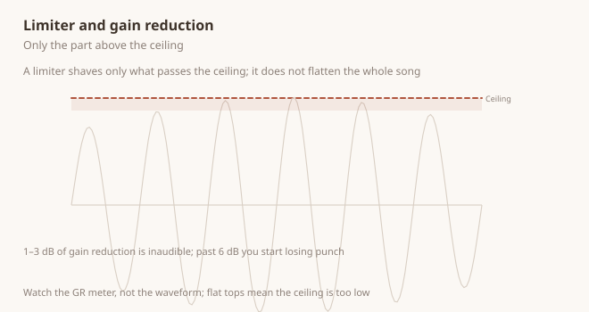

A limiter is a dynamics processor whose job is to make sure **the signal never goes above a set threshold**. You can think of it as a very firm security guard:

- When the signal is below the threshold: let it through, no processing.
- When the signal is above the threshold: pull the gain down instantly so the signal does not exceed it.

### The difference between a limiter and a compressor

- **Compressor**: when the signal goes over the threshold, it attenuates it by the set ratio. A ratio of 4:1, for example, means that for every 4 dB over the threshold, the output rises only 1 dB. Compression is gradual.
- **Limiter**: you can think of it as a compressor with an infinite ratio (∞:1). Once the signal goes over the threshold it is stopped outright, with no overshoot allowed.

The biggest difference between the two is the slope: a limiter responds extremely fast, with an attack time usually under 1 ms, so it can catch the sharpest momentary peaks.

## The core limiter settings

A standard limiter usually has the following parameters:

### 1. Ceiling

This is the output ceiling of the limiter, in dBFS. After the limiter, the signal will never go above this value.

- **Suggested value**: -1.0 to -0.5 dBFS. Keep some headroom below 0 dBFS so the DA/AD converter or the encoder does not clip.
- **Common misunderstanding**: the ceiling is not the threshold. The ceiling controls the output range; the threshold controls when processing starts.

### 2. Threshold

This decides the level at which the limiter starts working. Signals below the threshold are untouched; signals above it are held down.

- **The lower the value**: the harder the limiter works, the more the overall loudness rises, but the more severe the dynamic compression.
- **The higher the value**: the limiter acts only on the highest peaks and keeps more dynamics.

### 3. Attack

How quickly the limiter starts suppressing once it detects an over-limit signal.

- **The smaller the value (< 0.1 ms)**: it catches transients completely, with almost no overshoot, but the timbre is easily flattened.
- **The larger the value (1-5 ms)**: it lets some of the transient through and keeps the sense of impact, but there is a risk of brief overshoot.

### 4. Release

How quickly the limiter returns to normal gain after the signal drops back below the threshold.

- **The smaller the value (< 10 ms)**: recovery is fast, but it easily causes audible pumping, especially on material with a sustained low end.
- **The larger the value (50-200 ms)**: recovery is slower and smoother, but later quiet signals may be over-suppressed (gain pumping).

### 5. Look-ahead

This is the most important design step forward for the limiter: it lets the limiter "see" the signal that is about to arrive.

- **How it works**: the DAW can delay the audio by a few milliseconds, so the limiter analyses the amplitude before the signal reaches the output and gets ready to suppress it in advance.
- **The effect**: look-ahead reduces overshoot effectively and makes the limiter more transparent and harder to notice.
- **Suggested range**: 1-5 ms. Larger values are safer but add overall latency.

### 6. Knee

This defines the transition curve between no processing and full processing.

- **Hard knee (0 dB)**: as soon as the signal crosses the threshold, limiting begins, with the sharpest response.
- **Soft knee (1-6 dB)**: there is a smooth transition zone around the threshold, which sounds less abrupt and suits musical material.

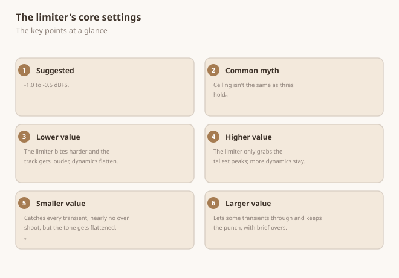

## Transparent limiting vs aggressive limiting

### Transparent limiting

The goal is **for the listener not to notice the limiter at all**. It suits music with rich dynamics that has to stay natural (classical, jazz, acoustic scores).

- A high ceiling (-0.5 dBFS or above)
- A moderate threshold (suppressing only the top 1-3 dB)
- A fast attack (< 0.1 ms) with look-ahead
- A medium release (50-100 ms), smooth and natural
- Total gain reduction no more than 2-4 dB

### Aggressive limiting

The goal is **to maximise overall loudness**, even at the cost of some dynamics and naturalness. It suits electronic dance music, pop rock, EDM and trap.

- A low threshold (suppressing 6-10 dB or more)
- A slow attack (0.5-3 ms), keeping some of the transient impact
- A fast release (10-30 ms), recovering gain quickly and holding the loudness up
- Pairing it with a pre-compressor to spread the processing load
- Total gain reduction may reach 6-12 dB

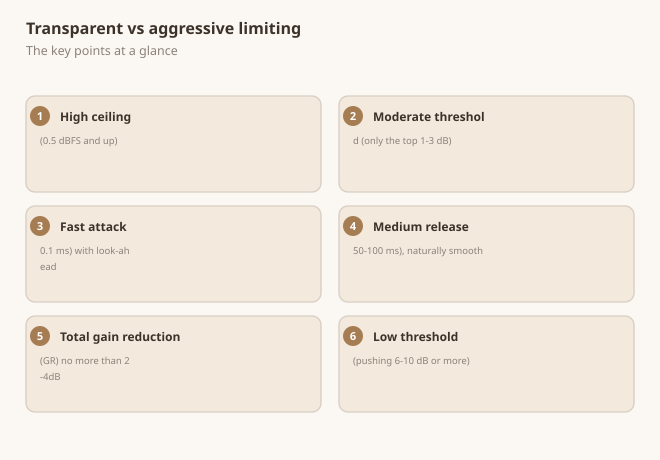

## The loudness war: is louder really better?

From the 1990s to the early 2010s the music industry fell into what is called the "loudness war". Producers made albums louder and louder, compressing and compressing until the waveform was almost a solid block, at the cost of listening fatigue and lost dynamics.

### Moving out of the loudness war

Today the industry consensus is to return to a balance between dynamics and loudness. Here are a few principles:

- **Do not sacrifice the music for -14 LUFS**. If your music sounds perfect at -16 LUFS, keep it at -16 LUFS.
- **Use several stages of processing rather than a single limiter**. Control the dynamics with a compressor and a saturator first, then use the limiter as the final gate.
- **A/B test**: always compare the signal before and after processing. If it sounds worse after, process less.

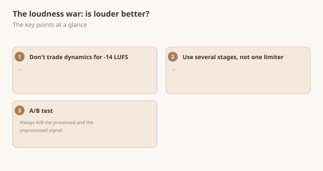

## A practical limiting chain: from compressor to limiter

An efficient master bus chain looks roughly like this:

### Step one: pre-compression

Before the limiter, use a compressor to control the overall dynamic range and take the load off the limiter.

- **Ratio**: 2:1 to 4:1
- **Attack**: 10-30 ms (preserving transients)
- **Release**: 50-100 ms (smooth and natural)
- **Gain reduction**: 1-3 dB

### Step two: saturator or multiband compression (optional)

If you need more warmth or more precise frequency control, add one of these after the compressor:

- **Saturator**: imitates the non-linear distortion of tape or valves and adds harmonic richness.
- **Multiband compressor**: compresses the parts with too much low end (kick, bass) on their own, so the low end does not trigger the limiter into over-suppressing the mid and high frequencies.

### Step three: the actual limiter

Set the limiter to:

- **Ceiling**: -1.0 dBFS (or -0.5 dBTP)
- **Threshold**: adjusted as needed, aiming for no more than 3-6 dB of gain reduction
- **Look-ahead**: 1-3 ms
- **Attack**: < 0.1 ms, or auto
- **Release**: 50-150 ms, or auto (depending on the style of music)

### Step four: true peak limiter (optional)

Some DAWs or mastering plug-ins provide a dedicated true peak limiter (FabFilter Pro-L 2, iZotope Ozone Maximizer), which uses a higher oversampling rate to guarantee the true peak stays under the limit.

- After the main limiter you can add a light true peak limiter with the ceiling set to -1.0 dBTP.
- Note: do not let the two limiters suppress more than 6 dB in total, or the dynamics will be badly damaged.

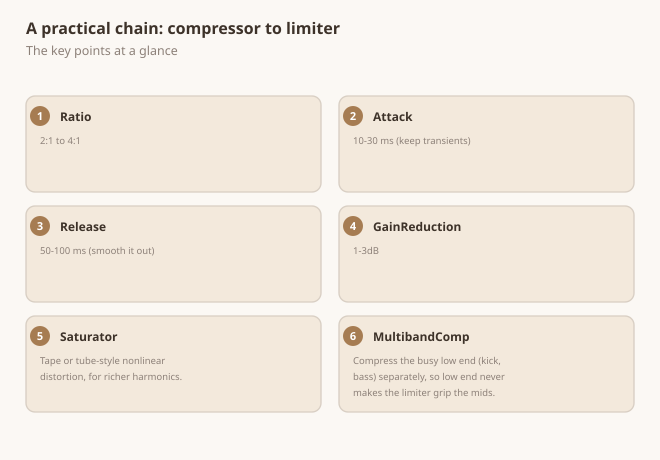

## The final LUFS check

Do a final LUFS check before exporting, to make sure you meet the target platform's rules. Here is the final checklist:

### What to check

1. **Integrated LUFS**: the average loudness of the whole track. Confirm it is inside the target range (generally -14 to -16 LUFS is suggested, but your ears come first).
2. **Short-term LUFS range**: the gap between verse and chorus. If the gap is too large (more than 6 LU), you may need to adjust the automation or the compression settings.
3. **Momentary LUFS max**: the loudest point in the track. Make sure there is no sudden extreme loudness (an accidental kick hit, say).
4. **True peak max**: the highest true peak in the track, which must never exceed the ceiling setting.
5. **LRA (loudness range)**: this describes the dynamic range of the whole track. Classical music can reach an LRA of 10-20 LU, while electronic music may be only 3-8 LU. The LRA itself is neither good nor bad, but it should match the genre.

### Useful LUFS metering tools

- **Youlean Loudness Meter 2** (the free version is already very usable)
- **FabFilter Pro-L 2** (both a limiter and a LUFS meter)
- **iZotope Insight 2** (a full analysis tool)
- **TBProAudio dpMeter 5** (a free, fully featured LUFS meter)

### The checking process

1. Play the whole track from start to finish while watching the LUFS meter.
2. Note the integrated LUFS and the true peak.
3. If the integrated LUFS is too low (say -20 LUFS): check whether the track is not full enough, and add light processing on the master bus to raise the energy.
4. If the integrated LUFS is too high (say -7 LUFS): reduce the amount of limiting or lower the threshold.
5. Play it again and make sure the true peak does not exceed the standard.

### A final reminder

LUFS is a scientific tool, but music is finally an art. **Do not let the numbers take your ears hostage.** If your track already sounds excellent at -16 LUFS, there is no reason to force it to -14 LUFS. The platform's normalization will deal with the remaining difference, and your music keeps its most real, living dynamics.

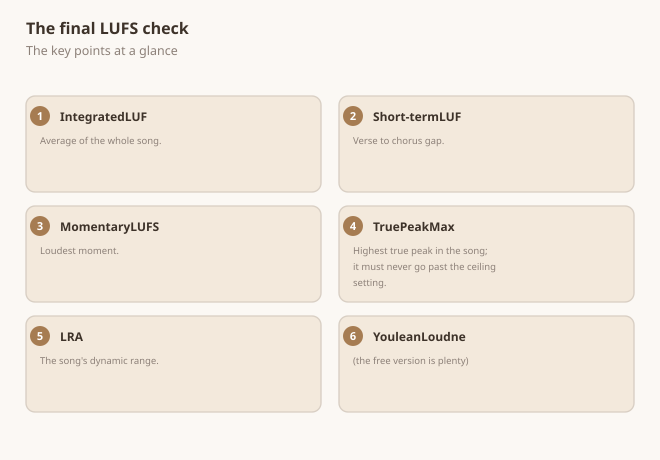

## Recap

| Idea | Key point |
|------|------|
| **Definition of LUFS** | A loudness unit matching human perception, using K-weighting to imitate hearing |
| **Three measurements** | Integrated (whole track), short-term (3 s), momentary (400 ms) |
| **True peak** | The real analogue peak, which affects encoding quality |
| **Platform targets** | YouTube/Spotify -14 LUFS, Apple Music -16 LUFS |
| **Limiter** | The final peak controller; the ceiling sets the output limit |
| **The loudness war** | Over-compression costs dynamics, and platform normalization makes it pointless |
| **Best practice** | Keep the dynamics, use several stages of processing rather than one limiter pushed hard |
| **Final check** | Confirm integrated LUFS, true peak and LRA meet the spec |

Get LUFS and the limiter right and you have the last mile of music production in your hands. In the streaming era, using loudness tools intelligently is how you keep the emotion in your music while meeting the technical requirements of every playback system.

