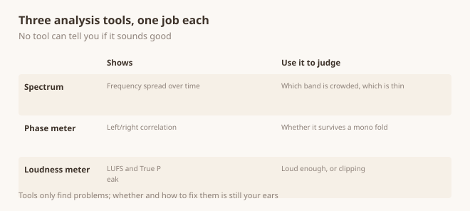
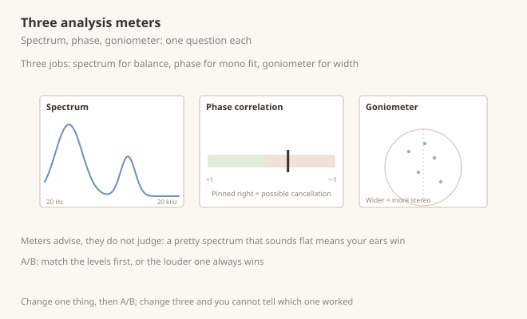
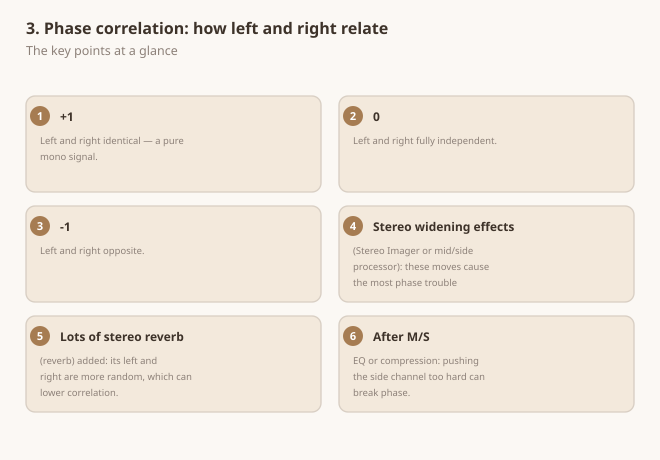
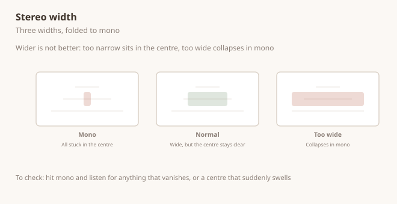
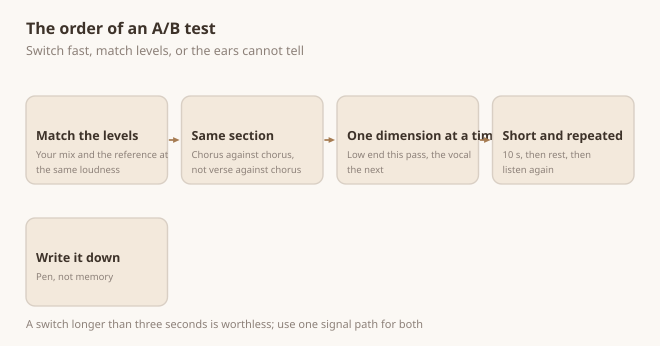
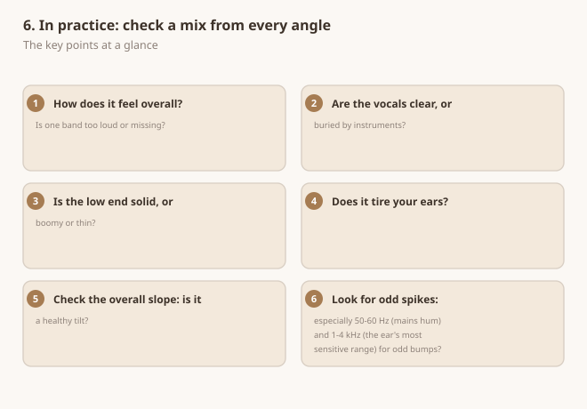
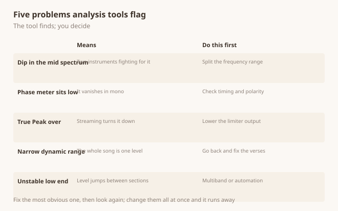

# Lesson 29: Professional Analysis: Spectrum Analyser, Phase Meter and A/B Testing

## The goal of this lesson: learn to inspect and improve your mix with professional analysis tools

Once you have finished mixing a song, the most important question is: "Is this really a good mix?" The ear is a highly deceptive sense: listening to the same music for a long time causes auditory fatigue, which leads you to wrong judgements. Professional analysis tools are not there to replace your ears but to cover the ear's blind spots. This lesson explains the spectrum analyser, the phase correlation meter and A/B testing in depth, to help you inspect your mix fully from two sides: objective data and subjective listening.

---

## 1. An overview of analysis tools in mixing

Analysis tools play three core roles in the mixing process:

**The diagnostic role**: finding the problems in a mix. Is some frequency too strong? Is phase cancelling something out? Is the stereo width reasonable? Your ears may vaguely feel that something is "off", but the analysis tools let you pinpoint the trouble.

**The verification role**: after you make an adjustment, confirming whether the problem is really solved. The ear can be misled by the illusion of "it got louder", but a meter does not lie.

**The learning role**: setting the sound characteristics you hear subjectively against objective charts. Over time this trains your ears to identify frequency, phase and dynamics more precisely.

Professional mixers usually use analysis tools at these points:

- At the start of a mix: looking at the frequency spread of each track and planning the EQ strategy
- During the mix: switching frequently to check stereo and mono compatibility
- Before finishing the mix: an A/B comparison against reference tracks to confirm the final quality
- Before mastering: a full check of spectral balance, peak headroom and phase correlation

Common professional analysis tools include iZotope Insight, FabFilter Pro-Q 3 (with a built-in spectrum analyser), Waves PAZ Analyzer, Voxengo SPAN (free and powerful), Youlean Loudness Meter (free) and so on. The analysis tools built into a DAW (the Spectrum device in Ableton Live, the channel EQ analysis mode in Logic Pro) are also enough for most jobs.

---

## 2. The spectrum analyser: reading frequency content with your eyes

A spectrum analyser presents the frequency content of audio as a visual chart: the horizontal axis is frequency (20 Hz to 20 kHz) and the vertical axis is level (usually in dB). It is like an X-ray of the music, letting you see the energy distribution of each band at a glance.

**The basics of reading a spectrum analyser**:

The shape of the spectrum tells you about the overall balance of the mix. A healthy mix usually has a spectrum that falls gradually from low to high: more low end, less high end. It looks like a line sloping gently downward from left to right, which the industry often calls a "tilted curve".

In concrete terms:

- 20-60 Hz (sub-bass): there should be some energy, but not too much. Too much makes the mix sound unclear, and on a system without a subwoofer you cannot hear it at all.
- 60-250 Hz (bass): usually the area with the most energy. The main energy of the kick and bass sits here. The curve usually reaches its highest point around here.
- 250 Hz-2 kHz (low mids): the curve starts to fall steadily. Too much energy here makes the mix sound boomy or nasal.
- 2 kHz-8 kHz (high mids): the fall continues steadily. This is the area the ear is most sensitive to, and the clarity and attack of the instruments are decided here.
- 8 kHz-20 kHz (highs): the far end of the curve. The right amount of high-frequency energy brings a sense of air and openness.

**What does a "healthy" spectrum look like?**

A healthy mix has a smooth spectrum, with no abnormal spikes or dips. Every band's songs may have their own characteristic curve, but three things are common to all:

1. **No abnormal spikes**: a frequency sitting more than about 6 dB above its neighbours usually means a resonance or a feedback problem.
2. **A natural high-frequency extension**: the top end should not cut off abruptly (which means an insufficient sample rate or too much low-pass filtering), and it should not bulge abnormally (which means harshness).
3. **No low-end spill**: if the very lowest frequencies (below 20-40 Hz) still carry a lot of energy, that is usually useless low-frequency noise and should be cut with a high-pass filter.

**Using spectrum analysis to find problem frequencies**:

When you feel the mix has some kind of uncomfortable quality, the spectrum analyser can help you locate it precisely:

- **The mix sounds boomy or muddy**: check whether there is too much energy piled up in the 200-400 Hz region. This is the usual mud zone, and too much of the fundamental range of guitars, pianos and vocals makes the mix unclear.
- **It sounds harsh or tiring**: check the 3-6 kHz region. Too much energy here makes the listener tired within a few minutes.
- **It sounds narrow or dull**: check whether there is too little energy above 10 kHz. Compare with the reference: if the reference clearly has more top end, your mix needs more air.
- **The low end is not solid enough**: check whether 50-100 Hz is too weak, or whether 100-250 Hz is too strong and making the low end muddy.

A practical trick: set a reference curve as an overlay on the spectrum analyser (if the tool supports it), then switch to your mix, and the difference between the two is obvious at a glance.

---

## 3. The phase correlation meter: checking the phase relationship between channels

The phase correlation meter is the core tool for checking the phase relationship of a stereo signal. It usually displays a value or a meter running from -1 to +1:

- **+1 (fully in phase)**: the left and right channels are identical, which means a pure mono signal. Any mono track (a centred vocal, kick or bass) will read +1.
- **0 (no correlation)**: the left and right channels are completely independent and uncorrelated. Wide stereo effects (decorrelated ambience reverb, artificial width effects) will read close to 0.
- **-1 (fully out of phase)**: the left and right channels are exact opposites. This is a very dangerous state: in mono these signals cancel completely and the sound disappears.

**The ideal phase correlation range**:

For a complete mix, the phase correlation meter should stay between **+0.3 and +0.8**. That means the mix has enough stereo width while still being mono-compatible.

If the value sits below +0.3 for a long time, there is too much stereo content, and switching to mono will cause serious level loss and frequency cancellation. If it sits above +0.8 for a long time, the mix leans too far to the centre and lacks stereo width and a sense of space.

**When to watch phase especially carefully**:

- After using a stereo widening effect (a stereo imager or a mid/side processor): this kind of processing is the most likely to cause phase problems.
- After adding a lot of stereo reverb: the left and right channels of a reverb have more random content, which can reduce phase correlation.
- After EQ or compression in MS (mid-side) encoding: over-processing the side channel easily causes phase anomalies.
- After using a wide unison or detune effect on a synth.

**The mono compatibility check**:

This step is compulsory in every professional mixing workflow. Why? Because a lot of real-world playback is actually mono:

- A phone's single speaker
- Bluetooth speakers (mostly mono or virtual stereo)
- PA systems in clubs and shops
- Social platforms (the audio in an Instagram story)
- Some car audio systems

The check is simple: switch the master output to mono in your DAW, then listen to your mix. Watch for the following:

1. **Does the level drop noticeably?** If so, there is too much stereo content and phase cancellation is happening.
2. **Do particular instruments (the vocal, the kick) get smaller or disappear?** That means the instrument may have a phase problem from stereo processing.
3. **Does the low end get weaker or disappear?** Low-frequency phase problems are the commonest, because low frequencies have long wavelengths and are the most affected by phase.
4. **Does the overall frequency balance change?** The mids suddenly getting stronger or weaker, for example.

A good mix should still sound complete in mono: the stereo width is gone, but every instrument is still in place and the frequency balance has not changed dramatically.

---

## 4. The goniometer: visualising stereo width

The goniometer (or vectorscope) is a tool for visualising stereo width. It shows the stereo signal on XY coordinates: the X axis is side (L−R, the difference between channels) and the Y axis is mid (L+R, the centre content).

**How to read a goniometer**:

- **A vertical line** (concentrated in the centre): this means a mono signal, that is, the mid content. Centred elements such as the vocal, kick and bass show up as a vertical line or a point.
- **Horizontal spread** (a cloud opening left and right): this means stereo content, that is, the side content. Reverb, stereo instruments and ambience show up as a shape spreading sideways.
- **Diagonals**: if the shape runs along the 135° diagonal (top left to bottom right), the channels are out of phase and will cancel completely in mono; along the 45° diagonal (bottom left to top right) it is pure mono (L=R).
- **Circles and ellipses**: ideal stereo material should look like a horizontal ellipse. Too narrow (close to a vertical line) means not enough stereo; too wide (close to a horizontal line or spilling past the edges) means there may be a phase problem.

**A healthy goniometer shape**:

For a complete mix, the goniometer should show a shape based on the central vertical axis, with a moderate horizontal spread around it. The central vertical line should be clearly visible (the vocal and rhythm section centred), with symmetrical cloud-like spread on both sides (the stereo information).

If the shape spills past the edges horizontally (touching the edges on the left and right), that material will have problems in mono. If the shape has no vertical content at all (all horizontal spread), the mix lacks a centre anchor and will sound scattered.

---

## 5. A/B testing: comparing against reference tracks

| Tool | What it shows | Limit |
|---|---|---|
| Spectrum analyser | Frequency distribution | Time and frequency resolution trade off |
| Phase correlation meter | Mono compatibility | Gives you a single number |
| Goniometer | Stereo width | Looking good is not the same as sounding good |
| Loudness meter | LUFS, true peak | Does not reflect tone |

A/B testing (also called reference comparison) is the most important quality check at the end of a mix. The method: switch back and forth between your mix and one or more reference tracks, and compare the differences objectively.

**Why A/B testing matters so much**:

You have heard the same mix hundreds of times, so your ears have become used to it and you have lost your objectivity. This is called auditory adaptation. A reference track breaks the cycle and gives you an objective standard.

On top of that, the ear is extremely sensitive to absolute level changes but poor at judging relative frequency balance. A/B testing forces you to compare directly instead of judging from memory.

**Level-matched A/B: level differences deceive your ears**:

This is the most important idea here. Human hearing has a built-in bias that louder sounds better: when a song is louder we automatically hear more low end, a brighter top and a fuller sound overall. This is the effect of the Fletcher-Munson equal-loudness curves.

So A/B testing has to **match levels strictly**, or the test means nothing. Here is how:

1. Measure the **average loudness** of your mix and the reference with a LUFS or RMS meter (integrated LUFS or RMS).
2. Use the DAW's output fader or your monitor controller to bring both to exactly the same level.
3. Or use an A/B tool with automatic level matching (ADPTR Metric AB, Magic AB, Reference 2).
4. When you switch, the listener should not feel a level change, only that "the sound changed".

**Setting up a reliable A/B workflow**:

**Method one: A/B inside the DAW**

Import the reference onto a track in the DAW and route its output so it bypasses the master effects chain (making sure the reference does not pass through your mix processing). Use the DAW's output attenuation to match levels. Then switch between your mix and the reference with mute and unmute.

**Method two: a dedicated A/B plug-in**

Use a professional A/B comparison plug-in such as:

- **ADPTR Metric AB**: can load up to 8 reference tracks, matches LUFS levels automatically (both short-term and integrated), and shows spectrum, stereo image and loudness history comparisons. It is the industry benchmark.
- **Mastering The Mix Reference 2**: simple and easy to use, and it can load several reference tracks.
- **Magic AB**: supports several reference tracks and remembers your level-matching settings.

**Method three: an external monitor controller**

If you have a hardware monitor controller (Dangerous Music D-Box, SPL MTC and so on), you can send your mix to one channel and the reference to another and switch with a hardware switch. This is the lowest-latency, cleanest way to compare.

**Comparing across systems with several references**:

Do not compare against a single reference. Choose 3-5 commercially released tracks that are close to your work in style, tone and loudness, and listen to the comparison on these systems:

- Monitors (your main listening system)
- Headphones (one closed-back pair and one open-back pair)
- Laptop speakers (to test how much low-end detail is lost)
- Car stereo (if convenient)
- Phone speaker (to test mid-range clarity)

When you A/B on each system, ask yourself three questions:

1. Is the frequency balance of my mix similar to the reference?
2. Is the stereo width and sense of space of my mix appropriate?
3. Is the overall loudness of my mix within a reasonable range?

---

## 6. Analysis in practice: checking a mix from every side

Let's walk through a complete mix analysis. Suppose you have just finished mixing a pop rock song and now it is time for the final check.

**Step 1: first listen (no eyes, only ears)**

Without opening any analysis tool, listen to the whole song from start to finish. Take notes:

- How does it feel overall? Is one band particularly prominent or lacking?
- Is the vocal clear? Is it buried under the instruments?
- Is the low end solid enough, or is it too boomy or too weak?
- Is there a sense of listening fatigue?

**Step 2: spectrum analysis**

Open the spectrum analyser (Voxengo SPAN with its default "Mix Check" curve is a good choice):

- Look at the overall slope: is it a healthy tilted curve?
- Check for abnormal spikes: is there anything odd bulging around 50-60 Hz (mains hum) or 1-4 kHz (the ear's sensitive region)?
- Overlay the reference's spectrum on yours: if there is an obvious difference, note it down ready to adjust.

**Step 3: phase and stereo check**

Open the phase correlation meter and the goniometer:

- Watch the phase correlation value: does it stay between +0.3 and +0.8?
- Switch to mono: does the overall level drop noticeably? Do particular instruments disappear?
- Watch the goniometer: is the horizontal spread spilling past the edges? Is the central vertical content clear?

**Step 4: A/B comparison**

Load 3 reference tracks (commercially released songs in a similar style, say):

- Match the level of every reference to your mix (using integrated LUFS)
- Close your eyes and switch at random: can you tell which one is your mix?
- If you can, what exactly is the difference? (Less low end? Brighter top? Wider stereo?)
- Based on the comparison, go back to the mix for a final adjustment.

**Step 5: cross-system verification**

Export a section of your mix and of each reference (30 seconds of chorus each) and put them on your phone:

- Listen on the phone speaker: is the vocal still clear? Has the low end disappeared, or is it about right?
- Listen on a Bluetooth speaker: is there too much low end? Is the overall balance even?
- Listen in the car (if possible): engine noise may mask the low mids, so check whether that band is strong enough.

**Step 6: final confirmation**

After all the checks above, do one more level-matched A/B test. If everything is in order, your mix is ready for the mastering stage.

---

## 7. Common questions and solutions

**Q1: My mix looks beautiful on the spectrum, but it just sounds wrong?**

The spectrum analyser can only show the quantity of each frequency, not its quality. A mix with a perfect spectrum can still sound bad, because its harmonic distortion, transient handling or compression timing may all be wrong. Analysis tools are a support, not the standard of judgement. In the end your ears decide.

**Q2: The phase correlation meter stays below +0.3. What should I do?**

That means you have too much stereo content. Check which stereo widening effects or reverbs you are using and reduce their stereo width. You can also apply a mid/side EQ to the stereo material and cut the side channel's mid-range energy a little.

**Q3: In an A/B test my mix sounds "different", but I don't know where?**

That is normal. Start by looking for clues in the spectrum: compare the two curves and find the biggest point of difference. Then make an EQ adjustment in that band, around 1-3 dB is enough, and A/B again to see whether it is closer.

**Q4: The reference sounds clearly louder, even though I matched the peak level?**

That is exactly why you match with LUFS or RMS rather than peak level. Commercially released tracks usually have an integrated loudness between -9 and -7 LUFS, while your raw mix may be only -14 LUFS. Use a loudness meter to match the average level, not the peak level.

**Q5: In the mono check the low end disappears. What now?**

A disappearing low end is almost always a phase problem. Check whether any of the low-frequency instruments (kick, bass) have stereo processing in the recording or in the MIDI source. If they do, make them mono (fold the stereo to mono with a Utility or Gain plug-in). Low-frequency instruments should always stay in the mono region.

**Q6: My goniometer shows an asymmetrical shape?**

An asymmetric shape means the stereo information is not balanced between the channels. This may be a stereo effect set up wrongly, or a problem in the recording itself. Check whether your stereo material (a stereo piano, a stereo reverb) is balanced left and right.

---

## Recap

Professional analysis tools are the mixer's X-ray vision: the spectrum analyser lets you see through to the frequency spread, the phase meter lets you see through to the stereo structure, and A/B testing parts the fog of listening fatigue. And yet these tools always play a supporting role. What finally judges whether a mix is good is still your ears and your musical instinct.

Make it a habit: before you finish any mix, spend 20-30 minutes on a complete analysis check, including a spectrum sweep, a mono compatibility check and a level-matched A/B comparison. As your experience accumulates you will spot problems faster and faster, and fix them precisely.

**Homework for this lesson**: pick a mix you are working on and run a complete analysis following the six steps in this lesson (first listen, spectrum analysis, phase check, A/B comparison, cross-system verification, final confirmation). Note what you find at each stage and the adjustment you make in response. Then pick three commercially released reference tracks, match the levels and do an A/B comparison, writing down the specific differences between your mix and the references.

