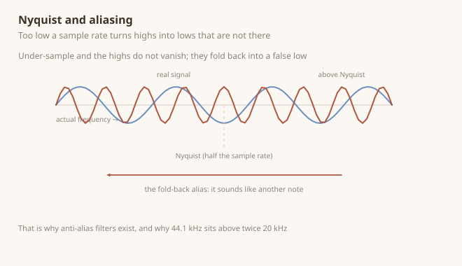
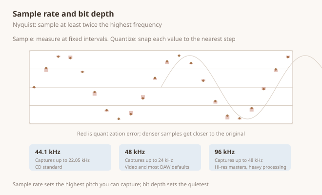
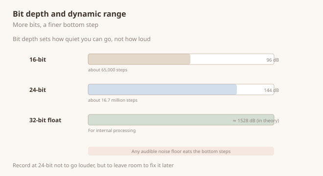
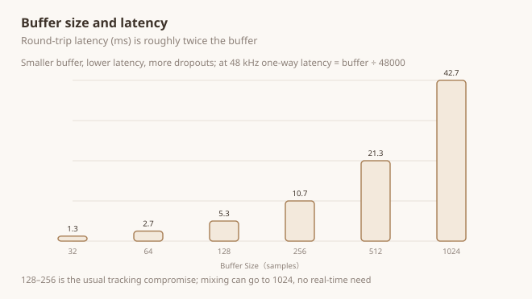
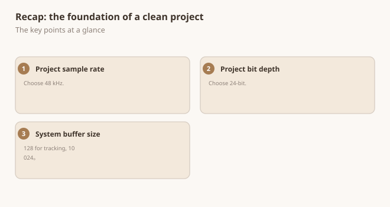

# Lesson 3: How Any DAW Works: Sample Rate, Bit Depth and Buffer Size

Welcome to lesson three. In the last two lessons we were building a real kitchen: we bought good pots and pans (the audio interface and the microphone) and dealt with the ventilation and the layout (the room's acoustic treatment and absorption). Now we finally step into the digital world and open the software that will sit with you through countless late nights of writing: the **DAW (digital audio workstation)**.

Whether you use Logic Pro, Pro Tools, Cubase, Studio One, or the affordable Reaper, the first time you open it and click New Project you usually don't see a beautiful mixer or tracks. A dry settings window appears instead, full of dizzying English words and numbers: **Sample Rate, Bit Depth, Buffer Size**.

Many beginners are scared at this stage. They hit OK and start recording, and only when the project has grown huge and the computer's fans sound like a helicopter taking off, or the recording is full of a horrible "p-p-p" noise, do they find that the foundation was crooked from the start.

This lesson doesn't ask you to memorise engineering definitions. We'll use the most everyday analogies to get the three cornerstones of the DAW world clear in one pass. Understand them and you'll be at home in any software, getting the most out of your computer while keeping the sound as good as it can be.

## 1. How does sound get "stuffed" into a computer? (analogue to digital)

Before the three mysterious parameters, we have to grasp one basic but very important fact: **a computer is deaf.**

A computer cannot hear the beautiful melody you sing into the mic, or the romance of a vibrating guitar string. In the real world, sound is a continuous vibration of air, which we call an **analogue signal**; it is a smooth, continuous curve with no breaks.

But the computer's world contains only 0 and 1. To let the computer understand sound, the audio interface contains a very hard-working employee called the **A/D converter (analogue to digital converter)**. Their job is to take a very fast camera and "photograph" the continuous sound wave over and over.

They record the height of the wave (the level) at every instant, then turn those countless photographs into 0s and 1s stored on the hard drive. When you press play, another employee, the **D/A converter**, flips through those photographs fast like a film reel and reconstructs continuous sound for your headphones.

Once you understand this "frantic photography", the next two settings follow naturally: **sample rate (how fast the photographs are taken)** and **bit depth (how many pixels, how much colour, in each photograph)**.

## 2. Sample rate (Sample Rate): the frame rate of sound

The first thing to set when you open a DAW is the sample rate. The usual options are 44.1 kHz, 48 kHz, 96 kHz, even 192 kHz.

### 1. What is sample rate?

In the plainest terms, the sample rate is **how many photographs the interface takes of your voice per second**. "Hz" is the unit of frequency, meaning "times per second". "k" means a thousand. So when you set 44.1 kHz, the interface is taking **44,100 photographs** of your voice every second.

Think of a flipbook you had as a child. Flip five pages a second and the animation stutters and looks disconnected; flip sixty a second and it becomes smooth — that's frame rate in the video world. In the world of sound, sample rate is the frame rate. 44,100 photographs a second already sounds astronomical. Why do we need to go that fast?

### 2. Why 44.1 kHz? (the Nyquist theorem in plain words)

The human ear is very sharp. The range of frequencies we can hear is roughly **20 Hz (a very low bass) to 20,000 Hz (a very high treble)**. Digital audio has a famous rule called the **Nyquist theorem**, which tells us: **to record and reconstruct a frequency perfectly, your sample rate must be more than twice that frequency.**

Since the highest we can hear is 20,000 Hz, taking 40,000 photographs a second (40 kHz) would perfectly capture everything we can hear. To leave some margin for the anti-aliasing filter to work, engineers set the standard at **44,100 Hz (44.1 kHz)**. That is why CD quality has been 44.1 kHz for decades.

### 3. Which one should I choose? 48 kHz or 192 kHz?

Many beginners believe bigger numbers mean better sound, so the moment they buy an interface they drag the DAW's sample rate up to 192 kHz. That is a disaster.

- **Why not 192 kHz?** If 44.1 kHz already covers the limit of human hearing, then 192 kHz is capturing bats and dolphins chatting — frequencies no one can hear. Setting 192 kHz gives no audible benefit and brings two fatal drawbacks. First, files become enormous and your drive fills up fast. Second, CPU load jumps fourfold; add a few plug-ins while mixing and the computer may simply crash.
- **The modern golden standard: 48 kHz.** In music and video today, 48 kHz has become the most common standard. Why? Because 48 kHz is the standard audio format for all video (YouTube, Netflix, film). If the music you make might later be released with image on YouTube, or you are scoring a short video, using 48 kHz avoids quality loss and sync problems when the video editor converts formats.

**Home-recording survival rule 1:** the first thing you do when you open a DAW is set the project sample rate to **48 kHz**, no thinking required. It is the best balance between sound quality and computer performance.

## 3. Bit depth (Bit Depth): colour and dynamic range in sound

| Setting | Common value | What it buys | The cost |
|---|---|---|---|
| Sample rate | 44.1 kHz / 48 kHz | Compatibility, file size | The higher it goes, the bigger the files |
| Bit depth | 24-bit for recording | About 144 dB of dynamic range | Bigger files than 16-bit |
| Buffer size | 64–128 to record, 1024–2048 to mix | Latency and stability | The two compete with each other |

With the photography speed set, the next option is bit depth: 16-bit, 24-bit, and the newer 32-bit float.

### 1. What is bit depth?

If sample rate is how many photographs per second, then bit depth is **how many pixels and how much colour each photograph has**. In the world of sound we don't look at colour; we look at how finely the **level (amplitude)** is measured. The technical term is **dynamic range**.

Imagine a ruler for measuring loudness.

- Choose **16-bit** and the ruler has **65,536** marks. That is already very fine; it is the traditional CD standard.
- Choose **24-bit** and the ruler jumps to **16,777,216** marks.

### 2. Why do we need so many marks?

The more marks, the more accurately we can capture the tiny changes between "the quietest breath" and "the loudest shout", without producing odd digital staircase noise.

More importantly, bit depth decides how low your **noise floor** sits. In the 16-bit era, if you set the mic gain too low while recording, and then raised the level in the DAW afterwards, you raised the digital hiss hiding at the bottom along with it and the whole song turned dirty. In the **24-bit** world, with sixteen million marks, the noise floor is pushed far down into the abyss (theoretically 144 dB of dynamic range). What does that mean?

It means tolerance for error. At 24-bit, **record a little quiet rather than ever clipping**. Even if the waveform looks small, you can raise it later in the mix with a compressor or a fader and it stays pristine, with no noise-floor blow-up. That gives you a great deal of **headroom**.

### 3. What is 32-bit float?

In recent years many higher-end interfaces and field recorders have started advertising 32-bit float. It is a spec that works like a physics cheat. At 24-bit, if the sound is too loud and goes past the DAW's 0 dBFS limit, the top of the wave is "shaved off", producing extremely ugly digital distortion; that take is ruined and you have to record it again. At 32-bit float, because it uses the mathematics of floating-point arithmetic, the dynamic range is vaster than any sound-making object on earth (over 1,500 dB). Which means **a 32-bit float recording never clips**. Even if the waveform looks like a solid red brick on screen, pull the level down and the sound is miraculously intact.

Still, for the great majority of home recordists, our microphones and rooms rarely produce explosive, unpredictable level changes.

**Home-recording survival rule 2:** when you create a project, set bit depth to **24-bit**. This is the absolute standard for recording in the industry. At 16-bit your hands are tied; at 32-bit float nothing clips, but files grow by about 33%. 24-bit gives you plenty of cleanliness and room for error, without question.

## 4. Buffer size (Buffer Size): the seesaw between latency and performance

The next setting is where every beginner gets stuck, and the one you have to change by hand every time you switch between recording and mixing: **buffer size**.

It is usually not on the New Project screen; it hides in the DAW's Preferences → Audio. You'll see a row of numbers to choose from: 32, 64, 128, 256, 512, 1024, 2048 (the unit is samples).

### 1. What is a buffer? (the café waiter analogy)

Imagine your CPU is the cook in a café, the interface is the customer, and the buffer is the tray in the waiter's hands.

When you sing into the mic, the audio data goes onto the waiter's tray (the buffer). When the tray is full, the waiter carries it into the kitchen for the CPU, then carries the result back out for you to hear.

- **If the tray is small (64 or 128 samples):** the waiter runs into the kitchen the moment there's a little data, then runs straight back out. **Advantage:** very fast. You sing into the mic and hear yourself in the headphones almost at once — that is low latency. **Drawback:** the waiter (the CPU) is left gasping. If the project has a lot of resource-hungry plug-ins, the CPU cannot keep up, the audio starts crackling and popping, and the DAW may stop playback and throw a "CPU Overload" warning.
- **If the tray is large (1024 or 2048 samples):** the waiter can wait calmly until the tray is full before walking into the kitchen. **Advantage:** the cook and the waiter (the CPU) are relaxed. The computer can host a hundred plug-ins and dozens of heavy virtual orchestra tracks without stuttering. **Drawback:** very slow. You may finish a line of a song and tens of milliseconds pass (about 0.04–0.08 s) before your voice arrives in the headphones. That high latency throws your brain off completely; you cannot record any instrument or vocal in time.

### 2. The golden switching rule: recording and mixing are two different states

Once you understand the seesaw, you understand that there is no permanently perfect buffer size. You switch it according to what you are doing at that moment.

**[Scenario A: I'm about to record.]** When the singer stands in front of the mic, or you are about to play a MIDI keyboard, what you need most is immediate feedback. **Turn the buffer size down (to 64 or 128 samples).** At this point, to ease the CPU load, you should temporarily switch off the unnecessary, resource-hungry plug-ins in the project — especially the mastering plug-ins on the master bus, or a reverb that eats a lot of processing. Let the computer concentrate on low-latency input and output.

**[Scenario B: recording is done, time to mix.]** All the tracks are recorded and you no longer need to make sound at the mic. What you are doing now is adding EQ, compression and reverb to those dozens of tracks and refining them. **Turn the buffer size up (to 1024 or 2048 samples).** Mixing, a playback that starts a fraction of a second late makes no difference to you at all. But a bigger tray frees up a huge amount of computing power, so you can load whatever plug-ins you dream of without hearing annoying crackles.

**Home-recording survival rule 3:** **small for recording (128), large for mixing (1024).** Print that saying in your head, or tape it next to your screen. Any time the headphones lag while recording, or the computer crackles and stutters while mixing, the first thing to check is your buffer size.

## Summary: the foundation of your first proper project

Let's review the core of this lesson. The next time you open your digital audio workstation (DAW), do these three rituals with confidence:

1. **Set the project sample rate:** choose **48 kHz**. Make sure your audio has uncompromising resolution and lines up with the video world of the future.
2. **Set the project bit depth:** choose **24-bit**. Enjoy that bottomless noise floor and give yourself generous headroom when recording; never record into the red.
3. **Set the system buffer size:** **128** to record, **1024** to mix. Move your CPU's energy around as needed and take charge of both performance and latency.

These three parameters are the foundation of the digital music world. With the foundation solid, however tall a building of music you put on top, it won't easily collapse. You'll never again be frightened by the mysterious numbers in the computer; you'll be able to make the computer your best assistant in making music.

Ready to make a sound? In the next lesson we leave the screen and go back to the real world. I'll show you how to find the perfect position for your microphone like a professional engineer. See you in "Lesson 4: Microphone Placement: Recording Vocals, Plosives and the Proximity Effect".

