# Lesson 30: The Final Product: Dither and Export Formats, with Archiving

## Course goals

After the long journey of the previous twenty-nine lessons, from recording and editing to mixing and mastering, you are finally standing at the final output gate. This last step looks simple: press Export and you are done. But if you do not understand how dither (noise shaping) works, or you are not familiar with the characteristics of the various audio formats, your work may be rejected by the release platform or lose sound quality because of a wrong format, a mismatched bit depth or double dithering. This lesson lays out the digital audio theory behind dither, when to use it and when not to, and the file export and archiving workflow a professional release needs.

---

## 1. What is dither?

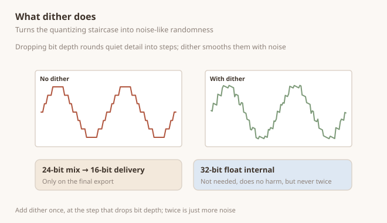

### 1.1 The root of the problem: quantisation distortion

In digital audio, an analogue signal is sampled and quantised into discrete values with a limited number of bits. When you reduce from a high bit depth (24-bit) to a low bit depth (16-bit), the range of values available to each sample shrinks: a signal that could be described by 16,777,216 steps is forced into 65,536 steps. This process produces **quantisation error**, which shows up in very quiet passages as audible distortion or a grainy quality.

Imagine a photograph with extremely high resolution, forced down to 256 colours: the smooth gradients turn into bands of colour. The difference between 16-bit and 24-bit works the same way, except that it happens in very quiet tails and reverb endings.

### 1.2 Dither as the solution

Dither is a very low level of noise (usually below -90 dBFS) deliberately added before the bit depth is reduced. That tiny amount of noise **breaks the regularity of the quantisation error**, turning distortion concentrated at particular frequencies into random background noise. The ear is far less sensitive to random noise than to regular distortion, so the overall result sounds more natural and smoother.

The key principle: dither turns the quantisation error from "distortion related to the signal" into "noise unrelated to the signal". The first damages the music; the second is a background the ear can ignore.

### 1.3 A simple analogy

If a needle drops onto the carpet in a dark room, you have almost no chance of finding it. But if you scatter many small beads over the carpet and then drop a needle, you can spot the needle's odd position against the pattern of beads more easily. Dither is those beads: it trades a little noise floor for a finer ability to resolve the signal.

---

## 2. When should you use dither?

### 2.1 Only when reducing the bit depth

This is the most important golden rule:

- **24-bit down to 16-bit** → dither is needed
- **32-bit float down to 24-bit** → dither is not needed (the mantissa of a 32-bit float is large enough)
- **A 24-bit project exported straight to 24-bit** (no bit depth conversion) → dither is not needed
- **Export to MP3** → dither is not needed (the MP3 encoder has its own quantisation internally)

### 2.2 Used at the mastering stage, usually not while mixing

At the mixing stage you should work at a high enough bit depth (24-bit or 32-bit float) for all processing. Only when you make the final master and prepare a 16-bit WAV or CD-spec file for release do you add dither to that export.

So the usual workflow is:

1. Finish the mix → export a 24-bit/48kHz mix file (no dither)
2. The mastering engineer processes it → exports the final master, saved at 24-bit (no dither)
3. **The last step**: convert down to the 16-bit/44.1kHz release format → add dither at this step

### 2.3 A real case: what streaming platforms require

Spotify, Apple Music, Tidal and the rest usually accept 24-bit 44.1kHz or 48kHz FLAC/WAV. If you supply a 24-bit file, the platform does the conversion down itself and its encoder decides whether to add dither, which means you have no control over the dither algorithm or its quality. Most professional mastering engineers choose to export a 16-bit version themselves, so the dither quality stays under their control.

---


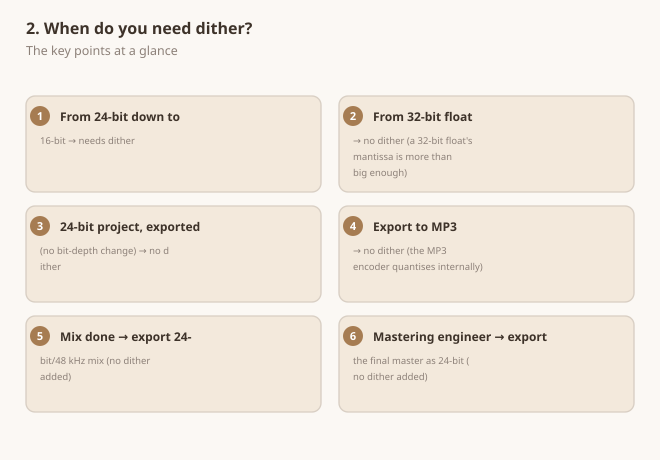

## 3. Types of dither

### 3.1 TPDF (triangular probability density function)

The most basic and safest type of dither. It uses noise with a triangular probability distribution, spread evenly across all frequencies (white noise). The advantage is that it is compatible with any later processing; the disadvantage is that the noise floor is the same at every frequency, with no optimisation for the ear's sensitivity.

**Where it fits**: when you are not sure what processing will follow, or you need an absolutely safe general-purpose option.

### 3.2 Noise shaping

Building on TPDF, noise shaping moves the energy of the noise out of the upper mid-range where the ear is most sensitive (around 2kHz-4kHz) and into the high frequencies (>15kHz) and the very low frequencies (<100Hz) where the ear is less sensitive. That lowers the noise energy inside the audible range substantially, and the effective dynamic range can improve by around 10-15 dB.

**Noise shaping algorithms from different manufacturers**:

- **POW-r (Psychoacoustically Optimized Wordlength Reduction)**: three modes. POW-r #1 is the lightest, POW-r #3 shapes the noise most strongly but may interact with later encoding.
- **iZotope MBIT+** (built into Ozone and RX): TPDF or noise shaping, with adjustable noise amount and shaping curve.
- **UV22HR (Apogee)**: Apogee's patented technology, good at preserving very low frequency detail.
- **The dither built into iZotope Ozone and RX**: TPDF or noise shaping, with adjustable noise amount and shaping curve.

**Note**: a file that has been through noise shaping should not go through any further EQ, dynamics processing or format conversion, because those operations destroy the carefully designed noise curve.

### 3.3 Shallow dither

Some modern encoders (the Advanced series from iZotope, for example) offer adjustable dither strength. For music that already has plenty of dynamic range (classical or jazz especially) you can use a lighter noise amount than standard, which in some cases sounds cleaner.

---


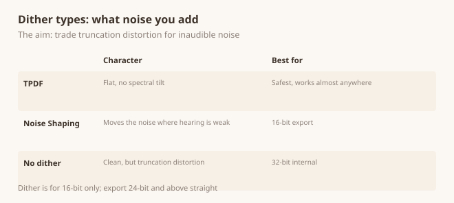

## 4. When should you not use dither?

### 4.1 The double dither trap

This is the commonest mistake. The scenario:

1. You export the mix from the DAW, with a dither plug-in on the master bus
2. You import that file into mastering software and add dither again when you output 16-bit

Two rounds of dither add up to a noise floor around 3dB higher, and the two noise shaping curves interfere with each other, producing audible artifacts. **The fix**: add dither once, at the final export step only, and keep every conversion in between at a high bit depth.

### 4.2 Situations that do not need dither, summarised

| Situation | Dither needed? | Why |
|------|-------------|------|
| 24-bit → 24-bit | No | The bit depth does not change |
| 32-bit float → 24-bit | No | The mantissa is precise enough |
| 24-bit → 16-bit WAV | Yes | A clear reduction in bit depth |
| 24-bit → MP3 | No | The MP3 encoder quantises internally, so external dither means nothing |
| CD burning (16-bit PCM) | Yes | The Red Book CD spec forces 16-bit |
| Exporting 24-bit FLAC | No | The native bit depth is kept |

### 4.3 A special case: bit truncation

If you add no dither at all and simply truncate the bits (bit truncation), quiet signals produce harmonic distortion, which sounds like a rough, grainy quality. That is why "no dither" often sounds worse than "with dither", even though the measurements of a file without dither (THD+N) may look better.

---


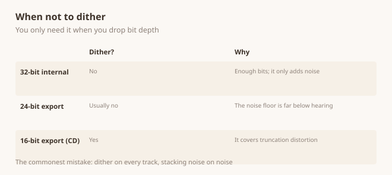

## 5. Export formats in full

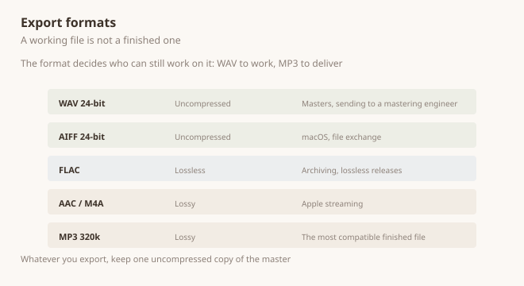

### 5.1 Lossless formats

#### WAV (Waveform Audio File Format)

- **Advantages**: the industry standard, supported by every DAW and every piece of hardware, no file size limit, no compression artifacts
- **Disadvantages**: huge files (around 10 MB per minute at 16-bit/44.1kHz), no native metadata support (you need the BWF extension)
- **Where it is used**: CD masters, scratch exchange, archive backups

#### AIFF (Audio Interchange File Format)

- **Essentially the same as WAV**: uses LPCM encoding and is equally lossless
- **The one main difference**: AIFF supports native metadata, which is friendlier in the macOS ecosystem
- **Where it is used**: exchange between Mac users, the native format for Logic Pro

#### FLAC (Free Lossless Audio Codec)

- **Advantages**: a compression ratio of around 50-60% (saving a lot of space), completely lossless (bit-identical to the original WAV after decoding), rich metadata and album art support, open source
- **Disadvantages**: some older hardware does not support it, and encoding and decoding take a little CPU
- **Where it is used**: streaming platforms (Tidal, Qobuz), personal collections, transfers over the internet

### 5.2 Lossy formats

#### MP3 (MPEG-1 Audio Layer 3)

- **Bitrate choices**: 128 kbps (broadcast quality), 192 kbps (good), 256 kbps (very good), 320 kbps (the best MP3 quality)
- **Advantages**: the best compatibility, plays on any device, extremely small files
- **Disadvantages**: lossy compression, high-frequency detail permanently lost, not suitable as an archive format
- **Where it is used**: sending demos, podcasts, devices with limited phone storage

#### AAC (Advanced Audio Coding)

- **Bitrate choices**: 256 kbps usually reaches excellent quality
- **Advantages**: at the same bitrate the sound quality is better than MP3 (especially the accuracy of the low and high ends), and it is the standard in the Apple ecosystem
- **Disadvantages**: some older devices and Linux do not support it by default
- **Where it is used**: Apple Music, YouTube, the iTunes Store

### 5.3 Which one, when?

| Purpose | Suggested format | Spec |
|------|---------|------|
| CD pressing | WAV 16-bit/44.1kHz | Red Book spec |
| Streaming (high quality) | FLAC 24-bit/48kHz | 96kHz+ means nothing to most people |
| Streaming (standard) | AAC 256 kbps or MP3 320 kbps | Depends on the platform's requirements |
| Archive backup | WAV or FLAC 24-bit/48kHz | The spec of the original recording |
| Scratch exchange | WAV 24-bit/48kHz | Passing files between DAWs |
| Demo listening | MP3 192-256 kbps | A balance of quality and file size |

---

## 6. Export settings in practice

### 6.1 Choosing the sample rate

- **44.1kHz**: the CD standard, the streaming platform standard, supported by almost every consumer device
- **48kHz**: the film and television standard, common in video post-production
- **96kHz / 192kHz**: in theory these preserve more ultrasonic frequencies, but within the ear's range (20Hz-20kHz) they mean nothing substantial. If a lot of time stretching or pitch shifting follows, a higher sample rate helps

**Practical advice**: unless there is a special need, use 48kHz as the standard sample rate for mixing and mastering. Then decide whether to convert down to 44.1kHz according to what the release platform requires.

### 6.2 Choosing the bit depth

- **32-bit float**: used at the mixing stage, with an extremely large internal dynamic range and no fear of clipping
- **24-bit**: the mastering and archive standard, with a dynamic range of around 144 dB, enough for any music
- **16-bit**: the CD and general release format, with a dynamic range of around 96 dB

### 6.3 A DAW export settings checklist

Using Ableton Live, Logic Pro, Pro Tools and Cubase as examples, the steps are broadly the same:

1. **Set the sample rate**: make sure the session and the export settings agree (if they differ you trigger SRC, sample rate conversion)
2. **Set the bit depth**: choose the target depth
3. **Turn on dither**: if there is a reduction, confirm the dither option is correctly enabled
4. **Normalize**: usually off. You should already have settled the overall level at the mastering stage
5. **Insert silence**: decide the length of the fade at the end as needed
6. **Conversion quality**: choose the highest quality (Best / High Quality); higher SRC quality takes longer but gives a better result

---

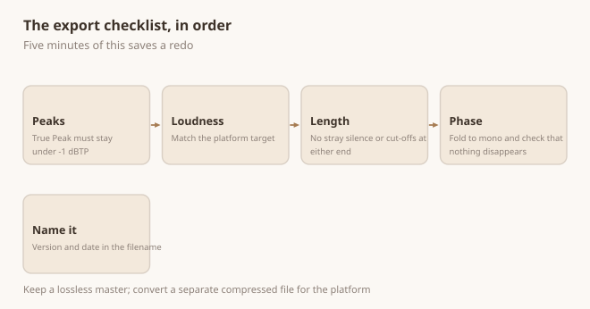

## 7. Professional file naming and metadata

### 7.1 File naming conventions

A consistent naming rule lets the distributor, the streaming platform and the listener identify a file quickly. Here is a recommended structure:

```
ArtistName_TrackTitle_MixVersion_Format_SampleRate-BitDepth.wav
```

Examples:

- `周杰倫_告白氣球_AlbumMaster_44k16b.wav`
- `五月天_派對動物_Instrumental_48k24b.wav`
- `Adele_Hello_RadioEdit_44k16b.wav`

**Suggested version tags**:

- `AlbumMaster`: the album master
- `RadioEdit`: the radio edit
- `Instrumental`: the backing track version
- `TVTrack`: the TV length
- `Clean` / `Explicit`: the clean or explicit lyric version

### 7.2 Metadata fields

Metadata in an audio file is not just for tidy filing; it is what lets a streaming platform display the information correctly.

**Required fields**:

1. **Title**: the song title (watch the capitalisation and punctuation)
2. **Artist**: the performer's name
3. **Album**: the album name
4. **Track number**: the track's position
5. **Year**: the year of release

**Recommended fields**:

6. **Genre**: the musical genre
7. **ISRC (International Standard Recording Code)**: a unique code for each track, issued by the national ISRC agency designated by IFPI
8. **Label / publisher**: the record label or distributor
9. **Composer**: the songwriter
10. **Lyricist**: the lyric writer
11. **Album art**: an embedded cover image (3000×3000 px is suggested, JPEG or PNG)

### 7.3 Why the ISRC matters

The ISRC is the core identifier for tracking royalties. Its format is: **CC-XXX-YY-NNNNNN**

- CC: the country code (TW for Taiwan, US for the United States)
- XXX: the registrant code
- YY: the last two digits of the release year
- NNNNNN: the track number (six digits)

A track without an ISRC cannot be tracked correctly on streaming platforms, and the royalties will not arrive.

---


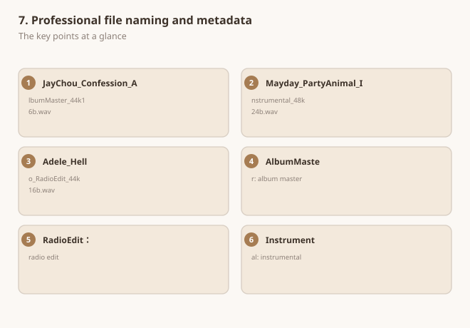

## 8. Archiving and a production backup strategy

### 8.1 An example project folder structure

A professional project folder should be structured so that anyone can take it over if you leave or your computer dies:

```
Project_TrackName/
├── Audio Files/              # Original recordings
│   ├── Recorded_Takes/       # Recorded takes
│   └── Raw_DI/               # Raw DI signals
├── Sessions/                 # DAW project files
│   ├── Mixing/
│   └── Mastering/
├── Stems/                    # Stem exports
│   ├── Full_Mix/             # The complete mix
│   ├── Instrumental/         # Backing track version
│   ├── Vocals/               # Vocal tracks
│   └── Individual_Tracks/    # Each instrument on its own
├── Deliverables/             # Final output
│   ├── WAV_24bit_48kHz/
│   ├── WAV_16bit_44k1kHz/
│   ├── FLAC_24bit_48kHz/
│   ├── MP3_320kbps/
│   └── AAC_256kbps/
├── Documents/                # Documents and licences
│   ├── Notes/                # Production notes
│   ├── Contracts/            # Scanned contracts
│   └── ISRC_List.txt         # ISRC list
└── Project_Summary.txt       # Project summary
```

### 8.2 The rules for stems

If you need to supply stems to a mixer, a mastering engineer or a live team, follow these rules:

- **Format**: 24-bit WAV at the same sample rate as the project
- **Naming**: `Artist_Track_Stem_InstrumentName.wav`
- **Starting point**: all stems aligned from 0:00 (do not let each one start at a different point)
- **Silence between tracks**: keep the natural gaps; do not cut them hard
- **Processing state**: state whether the stem is raw (no effects), wet (with effects) or a mid/side split

### 8.3 Cloud backup and version control

- Use the 3-2-1 backup principle: **3 copies, on 2 different kinds of media, with 1 off site**
- SD card or external drive → local NAS → cloud (Backblaze, Google Drive, Dropbox)
- Keep a separate file for every major version (Mix v2, Master v3); do not overwrite the old one
- Use Git LFS or Syncthing to manage large audio files

---


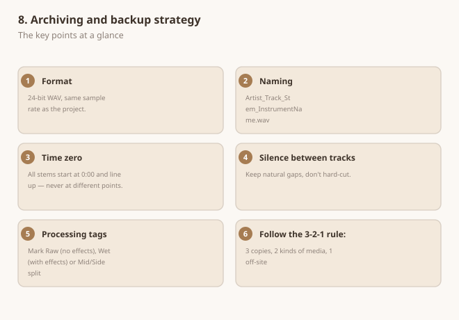

## 9. The final checklist before release

### 9.1 Audio quality check

- [ ] No clipping anywhere in the track; maximum true peak < -1 dBTP (-1.5 dBTP is a suggested safety value)
- [ ] No unexpected noises, pops, clicks or crackles
- [ ] The silence at the start and end is the right length (start ≤ 0.5 seconds, end with a 1-2 second fade suggested)
- [ ] The channels are in correct phase, with no polarity problems
- [ ] The spectrum shows nothing abnormal (DC offset, ultrasonic noise, a sudden dip in a band)
- [ ] Dither was added once only, and only when reducing the bit depth

### 9.2 File quality check

- [ ] The file names follow the distributor's rules
- [ ] All metadata is filled in correctly (the ISRC and the track order especially)
- [ ] The album art is embedded, at a size and format that meet the platform's requirements
- [ ] An MD5 or SHA256 checksum has been verified (compared after a long transfer)

### 9.3 Format and platform checks

- [ ] For a CD release: a DDP (Disc Description Protocol) file or an ISO is prepared
- [ ] For a digital release: confirm it is FLAC 16-bit/44.1kHz or WAV (according to the platform's requirements)
- [ ] For streaming: confirm the loudness normalization meets the LUFS target (usually -14 LUFS to -16 LUFS integrated)
- [ ] For a physical USB stick or SD card: confirm the file system (FAT32 or exFAT) and that the file names contain no special characters

---


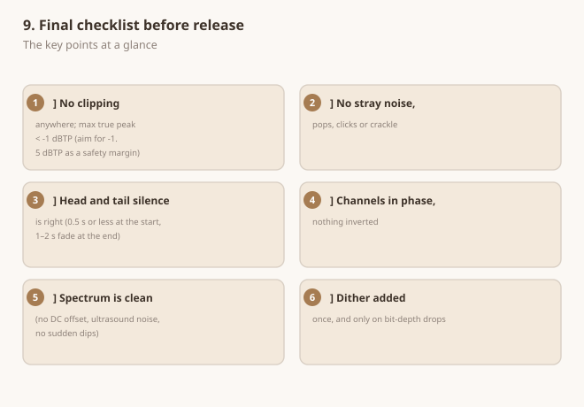

## 10. How the final output is released

### 10.1 CD burning and DDP

Although physical CDs lose market share every year, they still matter in the independent music scene, in classical music and in jazz.

- **CD-R burning**: use dedicated audio CD burning software (Nero, Toast, CDBurnerXP) and never drag WAV files onto a disc as data files. The disc must be in "Red Book Audio CD" format
- **DDP files**: DDP (Disc Description Protocol) is the standard format the pressing plants require. It contains:
  - `DDPMS` (the main data)
  - `DDPID` (the identification file)
  - The `PQ` table (track spacing and indices)
  - A complete 16-bit/44.1kHz WAV image
- Use software such as Sonoris DDP Creator or HOFA DDP Player Maker, or a professional mastering DAW (Sequoia, Pyramix), to generate the DDP

### 10.2 Digital distribution platforms

- **DistroKid**: a low annual fee, simple and fast, good for independent musicians
- **TuneCore**: an annual fee, unlimited releases, and you keep 100% of the royalties
- **CD Baby**: a traditional major, which also handles physical distribution
- **Apple Music for Artists / Spotify for Artists**: going live directly still requires a distributor

Each platform's requirements differ slightly, but the common spec is:

- Audio: FLAC or WAV, 16-bit or 24-bit, 44.1kHz or 48kHz
- Cover: at least 3000×3000 pixels, RGB, JPEG or PNG
- File size: no more than 100 MB per track (on some platforms)

### 10.3 High-resolution release

If the goal is a high-resolution audio release, note:

- Format: FLAC 24-bit/96kHz, or DSD (Direct Stream Digital)
- Platforms: Tidal Masters, Qobuz Sublime+, HDtracks
- MQA (Master Quality Authenticated) was once mainstream, but it is gradually being replaced by FLAC 24-bit
- Watch the transfer bandwidth: a 24-bit/96kHz FLAC file is about three times the size of 16-bit/44.1kHz

---


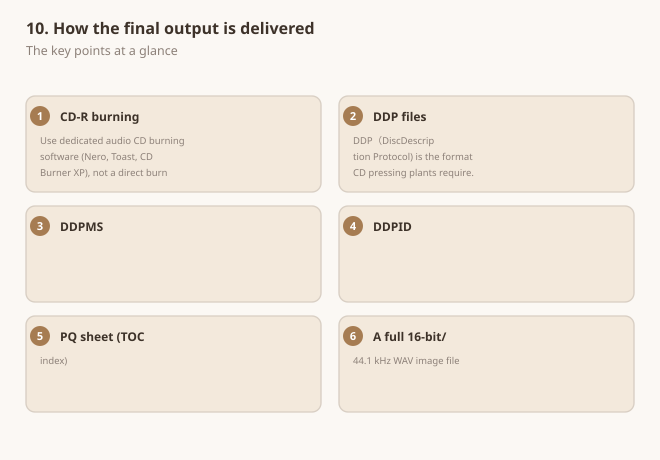

## 11. Common questions and pitfalls

### Q1: I am exporting a 16-bit WAV in Ableton Live. Do I need dither on?

- Yes. Ableton's export options include "Dither Options", and you should enable them when you choose 16-bit. Triangular or POW-r #3 is suggested.

### Q2: If my client wants a 24-bit WAV, do I need to add dither?

- No. 24-bit to 24-bit is not a reduction, so dither is not needed.

### Q3: Do I need to add dither before exporting an MP3?

- No. The MP3 encoder uses its own psychoacoustic model and quantisation internally, and external dither may interfere with it. Let the MP3 encoder handle it.

### Q4: I am converting from 96kHz down to 44.1kHz. Does the sample rate conversion itself introduce distortion?

- Yes. Sample rate conversion introduces aliasing and filter artifacts. Always use a high-quality SRC algorithm (the SRC in iZotope RX, r8brain, SoX's very high quality mode) and never the DAW's default low-quality mode.

### Q5: Why does my 16-bit file sound rougher than the 24-bit one?

- There are probably two reasons: 1) no dither was used (bit truncation causes quantisation distortion); 2) a low-quality SRC was used. Check both.

### Q6: The streaming platforms ask for -14 LUFS. Should I squash my export to -14 LUFS?

- That is not recommended. You should keep the master's dynamic range (the pop standard of -9 to -11 LUFS, for example) and let the platform's loudness normalization bring the level down to -14 LUFS. Deliberately compressing to -14 LUFS will make your music sound too quiet on other platforms.

---


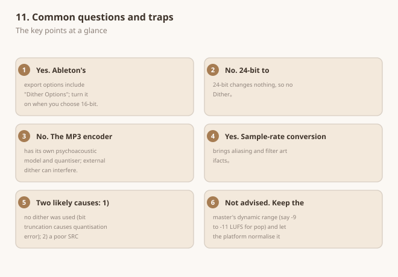

## 12. Recap: the strategy of the last step

From mixing to release, the final link in the whole digital music production chain looks simple but is the easiest place to go wrong. Here are the key points to remember always:

1. **Dither is used once, only when the bit depth is reduced** — no more, no less
2. **A high bit depth (24-bit or 32-bit float) is the safe zone for mixing and mastering** — all processing happens inside it
3. **The release format depends on the target platform** — CD uses 16-bit/44.1kHz WAV, streaming uses FLAC 24-bit or AAC 256 kbps, high resolution uses FLAC 24-bit/96kHz
4. **Metadata is the lifeblood of royalties** — the ISRC, the title and the artist name are all essential
5. **The archive structure decides how efficiently you work in future** — good naming and folder planning let you find the original files easily years later
6. **No amount of backup is too much** — the 3-2-1 backup strategy is the baseline of professional production

The moment you press the Export button, you are not ending a project; you are preparing your music's passport to meet the world. With the right format, dither in place and complete metadata, your music reaches every listener's ears without obstruction.

Congratulations on finishing all thirty lessons of the digital music production course. From the basic physics of sound waves and recording technique through MIDI editing and mixing to the final dither and output archiving, you now have the whole body of knowledge from zero to release. Now open your DAW and start making your own sound.

---

**Further reading and resources**

- The dither chapter in the iZotope RX manuals
- Bob Katz, *Mastering Audio: The Art and the Science*
- The official iZotope dither white paper (izotope.com/resources)
- The Red Book CD standard (IEC 60908)
- The AES17 digital audio measurement standard

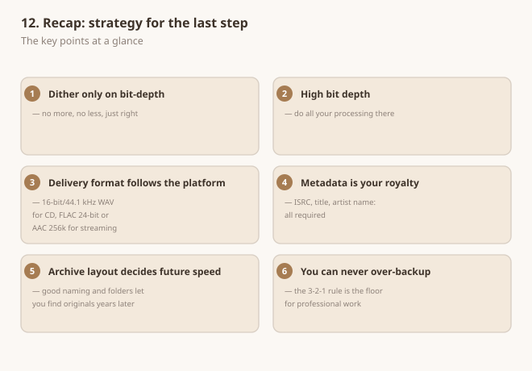

