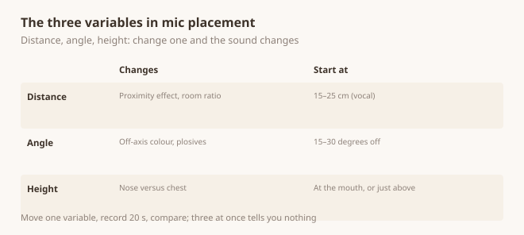
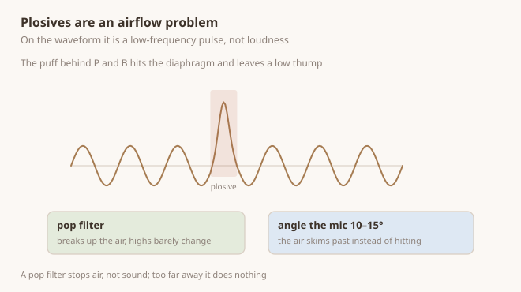
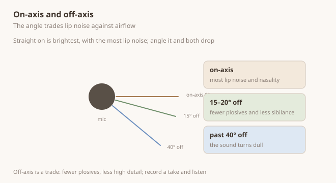
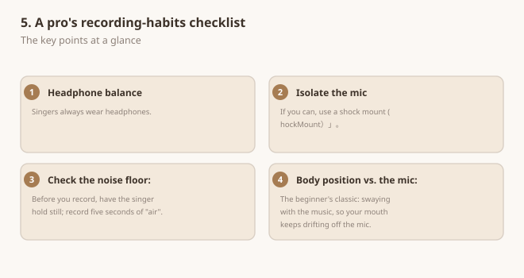
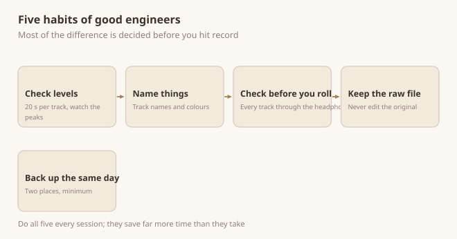
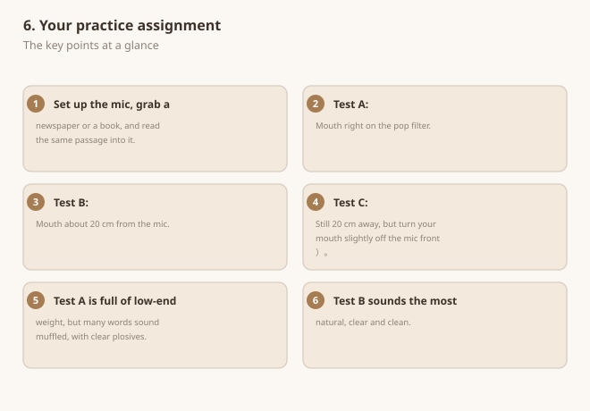

# Lesson 4: Microphone Placement: Recording Vocals, Plosives and the Proximity Effect

Welcome to lesson four. In the first three lessons we bought the hardware, fixed the room's acoustic problems, and learned to set up the DAW's basic settings correctly. Now we come to the most critical and the most magical step of recording: **recording vocals and placing the microphone**.

Many beginners think recording is putting the mic on a stand, singing a couple of lines, and leaving the problems to be solved later in the mix. But as a producer you have to remember one sentence: **the quality of the recording sets the ceiling of the mix.** If the sound coming in is already full of plosive bangs, or the low end is muddy as clay, no amount of expensive plug-ins will save it.

This lesson drops the deep acoustic formulas and learns from watching the mouth and the microphone interact. Ready? Let's start carving the sound into the microphone.

## 1. The microphone is your second mouth: the logic of placement

Think of the microphone not as a machine, but as your best friend sitting a metre away, listening carefully to your story. If you shout in their ear, they flinch; if you retreat to the other end of the room and whisper, they can't hear you.

Microphone placement comes down to two things: distance and angle.

### 1. On-axis and off-axis

Most microphones (large-diaphragm condensers especially) have a "front". Like a torch beam, the mic is most sensitive to sound directly in front, captures the richest detail there, and the high end is brightest. That is **on-axis**.

If you turn your mouth to the side of the mic, the sound goes dull and loses detail. That is **off-axis**. Sometimes we deliberately go a little off-axis to reduce the sibilance coming from the mouth, but beginners must remember: **point the front of the microphone at your mouth first**. That is step one of a good recording.

## 2. The destructive blow of plosives

Before you start recording, test your plosives. What is a plosive? When you sing a consonant like **"P", "B", "T", "K"**, the mouth shoots out a very strong puff of air.

### 1. The energy field of the puff

How strong is the puff? Put your hand in front of your mouth and say "Pop" — you feel your palm being pushed. When that puff hits the microphone's fragile diaphragm head-on, it makes a low "boom, boom" bang. In digital recording that sound is terrifying, because it slams the level to the top instantly and produces ugly digital distortion (clipping), and once that distortion is recorded it can hardly be repaired.

### 2. How to beat plosives

- **Pop filter:** this is your best shield. Put the pop filter about 5 to 10 cm in front of the mic. Its mesh breaks up the puff while the sound still passes through.
- **The angled approach:** a technique professional singers often use. Don't sing straight at the mic; tilt the mic to an angle (about 30 degrees) so the puff slips past the diaphragm while the voice is still captured.
- **Keep your distance:** distance is the best buffer. Many people press their mouth against the mic chasing an "in your ear" feel, which is a breeding ground for plosives. Keep "a fist to a palm's width" away: that gives you enough sense of space without sacrificing the detail of the sound.

## 3. The proximity effect: a filter on the sound

Next we meet a phenomenon that is very appealing in the recording world and can also turn into a killer: the **proximity effect**.

### 1. What is the proximity effect?

The proximity effect is a physical rule: **the closer your mouth is to the microphone (especially a cardioid microphone), the thicker and more exaggerated the low end of the recording becomes.**

That is why radio hosts, or singers performing a heartfelt love song, sound particularly deep, sexy and rich. They are very, very close.

### 2. The double edge of the proximity effect

- **The good side:** if the person you're recording has a thin voice that lacks body, close miking can turn them into a bass cannon full of appeal in an instant.
- **The bad side:** if the person already has a full, rich voice, then that close the sound turns to mush, with low end like a puddle of mud. That is what people call **muddy**.

### 3. Using the proximity effect to tune the sound

You don't need an EQ plug-in to change the body of the sound. You only need to **adjust the distance between the mouth and the microphone**.

- Sound too thin? Move in a little (the proximity effect adds low end for you automatically).
- Sound too muddy, words unclear? Move back a little (the proximity effect fades, the sound gets crisper and the words clearer).

Remember: **moving your body matters more than turning an EQ knob.** That is real recording technique.

## 4. In practice: microphone settings for different styles

| Distance | Low end | Lip and teeth detail | Risk |
|---|---|---|---|
| 5–10 cm | Plenty | Clear | Plosives and the proximity effect are strongest here |
| 15–25 cm | Medium | Medium | Room reflections start coming in |
| 40 cm and beyond | Little | Little | The room is as loud as the voice |

With the physics understood, how do we place the mic in real, everyday recording situations?

### Scenario 1: a gentle Mandopop ballad

This music is all about being close and emotional.

- **Placement:** the microphone level with the mouth, about 15 cm away.
- **Technique:** add the pop filter, and ask the singer to sing with a light but steady force. It's a love song, so you want a little of the quiet breathing in the take; that breath carries the emotional tension. Make sure the stand is solid, so the singer doesn't shake it with the emotion and put rumble into the recording.

### Scenario 2: the whisper and the explosion of post-rock

Post-rock vocals are usually unusual: a tiny whisper can switch to a scream in an instant.

- **Placement:** pull the mic further away, about 20 to 25 cm, and use a stronger pop filter.
- **Technique:** the dynamics are huge, so make sure gain staging leaves enough headroom. If the singer gets too loud when screaming, ask them to lean back a little rather than grabbing the interface knob. That natural distance control keeps the dynamics of the take more natural.

### Scenario 3: podcast and voice-over

What you need is a clear, well-articulated, professional-sounding voice.

- **Placement:** with a dynamic microphone you can come in to about 8–10 cm. The character of a dynamic mic cancels out part of the low-frequency boom.
- **Technique:** make sure there is no comb filtering (remember the desk reflection from the last lesson?). If you record sitting down, rest your elbows on the desk so your distance from it doesn't keep changing. That keeps the sound consistent.

## 5. A professional engineer's recording checklist

To keep your recording work professional and efficient, check these four things before you press the record button:

1. **Cue mix:** while recording, the singer must wear headphones. Build a monitor balance the singer is comfortable with. If the singer cannot hear themselves, they unconsciously sing louder and louder, and the take ends up clipping.
2. **Shock mount:** if the budget allows, use a shock mount. A microphone is very sensitive: accidentally kick the stand, or let the singer hold it while singing, and those low-frequency "thump, thump" vibrations are recorded in full. A shock mount uses elastic to isolate those vibrations.
3. **Check the room's noise floor:** before recording, ask the singer to stand still and silent while you record five seconds of "air". Those five seconds are your room's noise floor. If you hear an air conditioner, a computer fan, or traffic outside, deal with it first, because that noise is very hard to remove later with plug-ins.
4. **Posture and a consistent distance:** the mistake beginners make most often is swaying with the music so the distance between mouth and microphone keeps changing. Remind the singer (or yourself) to stay anchored while recording and keep to the same distance, so the level and timbre stay consistent across the whole song.

## 6. Your homework

Listening to theory is worth less than trying it once. After class today, do a simple experiment:

1. Set the microphone up. Take a newspaper or a book and read the same passage into the mic.
2. **Experiment A:** mouth against the pop filter.
3. **Experiment B:** mouth about 20 cm from the microphone.
4. **Experiment C:** still 20 cm away, but deliberately turn your mouth a little off the front of the mic (off-axis).

Back at the computer, play the three takes. You'll be surprised to find:

- Experiment A is full of low-end body, but many words sound dull, and the plosives are obvious.
- Experiment B sounds the most natural and clear, with the best diction.
- Experiment C is noticeably darker, and has lost a lot of detail.

When you hear the difference with your own ears, you have taken the first step towards being a professional engineer. You start designing the sound with placement, instead of leaning on fixing it afterwards.

## Conclusion: there are no standards in the studio, only choices

Remember: in recording there is **no absolutely "correct" placement**. If a strange angle gets you the unique, dreamlike sound you had in your head, then it is correct.

The microphone is your brush, and your mouth, your distance, and your choice of placement are how you paint. Control the low end by adjusting distance, control sibilance with angle, protect the quality of the take with a pop filter. Once you have these details, recording stops being a dull procedure and becomes a sensory expedition full of invention.

In the next lesson we look at the microphone's "brothers and sisters": recording acoustic instruments. If vocals already felt like a challenge, get ready for the airy, three-dimensional space of a recorded acoustic guitar. See you in Lesson 5.
