# Lesson 5: Microphone Placement: Recording Acoustic Instruments

In the studio, a good microphone is only the starting point. What really decides the quality of the sound is **placement**: where you put the mic, how far away, aimed at what angle. This lesson focuses on recording **acoustic instruments**, going through the best placement strategy for each — acoustic guitar, piano, drum kit, strings, winds and percussion — and looking closely at the central idea of **phase relationships** between multiple microphones.

---

## A core idea: polar pattern and distance

Before the individual instruments, remember two general principles:

1. **Distance sets the timbre:** the closer the mic, the stronger the low end (the proximity effect) and the clearer the high-frequency detail, but the instrument's sense of a whole is weakened; the further away, the more room reflections, and the more natural but the blurrier the sound.
2. **Angle sets the sheen:** aimed at the instrument's resonant point (the top, for instance) you get a full timbre; aimed at an edge or a side you get a brighter one. A few degrees can change the sound completely.

The typical starting distance for recording acoustic instruments is about **15–60 cm**, depending on the instrument.

---

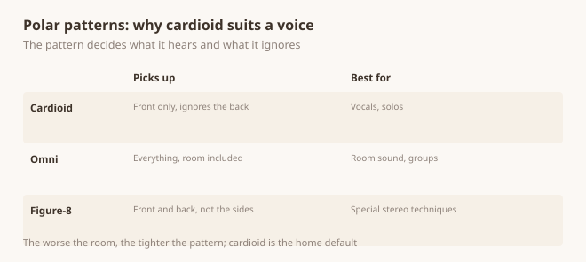

## 1. Recording the acoustic guitar (Acoustic Guitar)

The acoustic guitar is one of the most recorded acoustic instruments, and one of the easiest to record badly.

### 1.1 One microphone: 12th fret vs soundhole

| Position | Advantage | Drawback |
|-----------|------|------|
| **At the 12th fret (above the 12th fret)** | Balanced, bright, less low-frequency boom | Lacks low-end body |
| **Directly in front of the soundhole** | Full, warm low end | Prone to boominess, finger detail unclear |

**In practice:** start at the **12th fret**, about **20–30 cm** from the body, with the mic aimed between the 12th fret and the soundhole. Picture it this way: the 12th fret is the window for the highs, the soundhole is the warehouse for the lows, and the point between them is the best balance for the ear.

### 1.2 Two-mic stereo

If you want a wider, more spacious acoustic guitar, use two microphones.

#### (A) XY (coincident)

Two cardioid microphones crossed at an angle of **90 degrees**, with the diaphragms as close to each other as possible (one above the other), each offset 45 degrees from centre (at a 120-degree angle, each is offset 60 degrees).

- **Advantage:** almost no phase problem, because the diaphragms are at the same point; mono compatibility is excellent.
- **Good for:** rhythm guitar, recordings that need clear positioning.

#### (B) Spaced pair

Two microphones placed apart: one at the 12th fret (brighter), one near the bridge (fuller), about 30–50 cm apart.

- **Advantage:** a richer, more three-dimensional timbre.
- **Drawback:** more phase trouble; it has to be controlled with the 3:1 rule (see below).
- **Technique:** the two mics' distances from the body should differ by no more than a factor of two, or the left, centre and right of the image will sound hollow.

**In practice:** XY is like shooting with one wide-angle camera — a stable, single image. Spaced pair is like two cameras filming the same scene and combining them — more three-dimensional, but it has to line up more precisely.

---

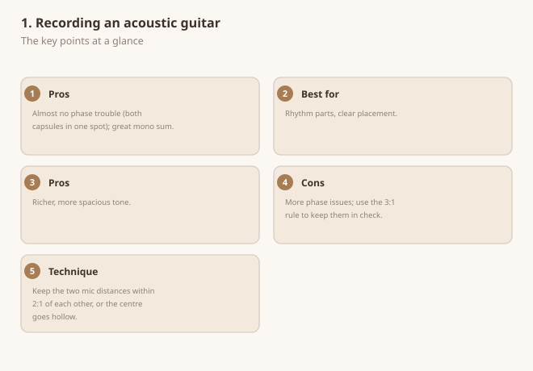

## 2. Recording the piano (Piano)

The piano is a very wide instrument: bass strings on the left, treble strings on the right, a range spanning more than seven octaves. The goal is to capture that width and that dynamic range.

### 2.1 Grand piano (Grand Piano)

**Basic placement — inside the lid, close to the strings**

Open the grand piano's lid fully (on the long prop, raised as high as it goes) and point the microphones down at the strings from above:

- **Bass register:** microphone on the left, about 15–20 cm from the strings, aimed at the middle of the bass strings.
- **Treble register:** microphone on the right, about 10–15 cm from the strings, aimed at the middle of the treble strings.

**Stereo placement options:**

- **AB spaced pair:** two omni (or cardioid) microphones placed 20–30 cm above the bass register and the treble register, with the spacing adjusted to the width of the instrument; a grand usually needs 60–120 cm to cover both ends. This is the most natural, fullest piano stereo.
- **ORTF:** two cardioid microphones 17 cm apart at an angle of 110 degrees, placed above the middle of the strings. Tighter than AB, with clearer positioning.

### 2.2 Upright piano (Upright Piano)

In an upright piano the strings are vertical; the sound radiates backwards through the back and comes out through the front panel.

**Best placement:** point the microphone into the instrument from **above the top**, or open the front of the piano to the room and place the microphone 30–60 cm behind the back.

If space is limited, you can also open the top lid and reach the microphone in from above, aimed at the centre of the strings, about 20 cm away.

**A small reminder:** an upright sounds more focused and has fewer overtones than a grand. Two microphones (one for the bass, one for the treble) can make up some of the width.

---

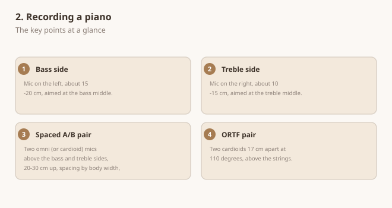

## 3. Recording the drum kit (Drum Kit)

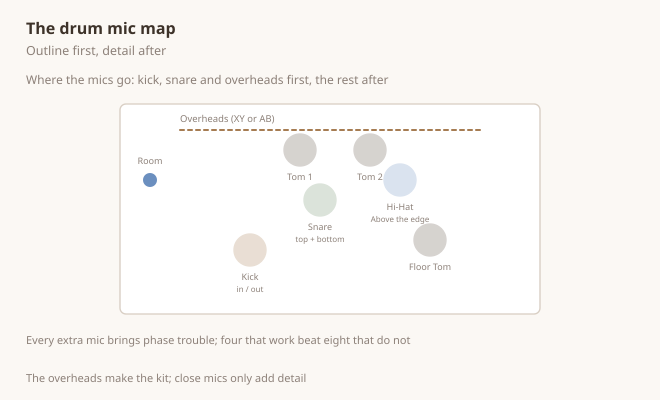

The drum kit is one of the most challenging instruments to record, because so many sound sources are sounding at once. A standard kit is usually miked in three layers.

### 3.1 Close miking

Each drum gets its own dynamic microphone (a Shure SM57, for example), placed about **5–10 cm** from the edge of the drumhead, aimed diagonally at the centre of the head (at an angle of about 30–45 degrees).

- **Kick drum:** microphone directly in front of the drumhead, 5–15 cm from it, or placed inside the drum with the front head removed. Slightly off centre gives more attack; dead centre gives more low end.
- **Snare:** microphone about 5 cm above the rim, aimed between the centre and the edge of the head. If the snare has two heads, the top head is the main sound and the bottom head a supplement (watch for polarity inversion).
- **Toms:** one microphone per tom, 5–10 cm above the drumhead, at an angle of about 45 degrees.

### 3.2 Overheads

The overheads capture the cymbals and the kit's sense of stereo space. Usually a pair of condenser microphones, in an **XY**, **AB** or **ORTF** arrangement, about 90–120 cm above the kit.

- **XY:** precise positioning, high mono compatibility.
- **Spaced pair:** a wider, more three-dimensional sound, but watch for the cymbals drifting in the image.

A saying to remember: "The overheads are the frame of the kit; the close mics fill in the detail."

### 3.3 Room mics

In a studio, a pair of microphones **1.5–3 m** from the kit (or further) captures the room's reflections and the overall sense of impact. Usually omni microphones, sometimes condensers or ribbons, for a warm, natural room sound.

**In practice:** while mixing, compress the room mics by 5–10 dB to make the kit sound bigger and give it more of a room.

---

## 4. Recording strings (violin, viola, cello)

String sound radiates outwards from the instrument's top plate (the f-hole area) and is strongly directional.

### 4.1 Basic placement

- **Distance:** 30–60 cm. Too close and you hear too much bow noise; too far and you lose detail.
- **Direction:** aim the microphone **between the f-holes**, or slightly above, and avoid pointing straight at the point where the bow crosses the string (roughly between bridge and fingerboard), to reduce bow-hair noise.
- **Height:** level with the instrument's top plate, or about 15 degrees above it.

### 4.2 Violin and viola

The violin's sound is focused and bright, and easily turns piercing. One **cardioid condenser microphone**, 40–50 cm away with the angle slightly above the instrument (about 30 degrees), softens the high end effectively.

**In practice:** think of the violin as a torch — the strongest (brightest) part of the beam points at the audience, but at the microphone we want the ambient light, not the direct glare.

### 4.3 Cello

The cello has a rich low end, so you can come closer (30–40 cm). Aim the microphone above the f-holes, behind the bridge, and avoid pointing at the bowing surface. A second microphone placed behind the body can capture the resonant low end; blend the two in the mix.

---

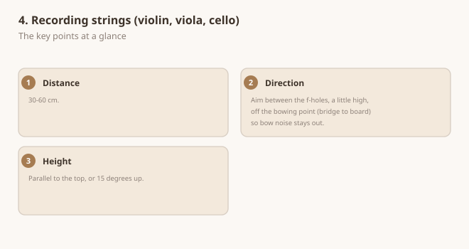

## 5. Recording wind instruments (flute, saxophone, trumpet)

The biggest difficulty with wind instruments is **airflow and level**.

### 5.1 Flute

The flute's sound comes from the embouchure and the keys at the same time; it has a double source.

- **Position:** microphone between the embouchure and the keys, about **30–60 cm** away.
- **Angle:** about **45 degrees** off the direct airstream from the embouchure, so the breath noise doesn't strike the microphone diaphragm head-on.
- **Layering:** if the player has a wide dynamic range, add a room mic to fill in the sense of space.

**A small technique:** a windscreen reduces breath noise, but don't put it too close — distance is the key.

### 5.2 Saxophone

The saxophone's sound comes from the bell and the keys at the same time. Point the mic only at the bell and the sound turns thin and sharp.

- **Best position:** microphone **45–90 cm** from the bell, about 30 degrees above it, so you capture the sound from the bell and the mechanical noise of the keys together and keep the full timbre.
- **Close option:** for a more direct timbre (pop or funk, say), a dynamic microphone 10–20 cm in front of the bell.
- **Avoid:** don't stuff a dynamic microphone into the bell — it makes the timbre extremely compressed and unnatural (unless that particular vintage effect is what you want).

### 5.3 Trumpet and brass (Trumpet / Brass)

Brass instruments produce very high sound pressure levels; you can use a dynamic microphone, or a condenser with an attenuator pad.

- **Distance:** **30–90 cm**, with the microphone about 15–45 degrees off the bell's centre line. Straight at the bell you pick up too much airflow and glare.
- **Room mic:** brass sounds best in the room's reflections, so keep at least 50% of the sound from the room.

---

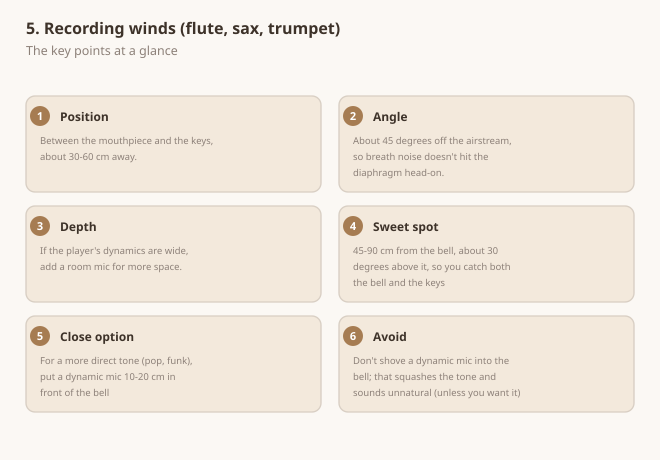

## 6. Recording percussion (Percussion)

Percussion covers an enormous range, from hand drums (conga, bongo) to metallophones (xylophone, glockenspiel) and small percussion instruments.

### 6.1 Hand drums (Conga / Bongo)

- **Distance:** 15–30 cm, with the microphone aimed between the centre and the edge of the head — the centre has more low end, the edge a clear slap.
- **Optional stereo:** use two microphones, one for the low end (the centre of the head), one for the slap (the edge), balanced in the mix.
- **Too much low end:** if the low end is boomy, move the microphone back 10 cm, or engage a high-pass filter.

### 6.2 Xylophone and marimba (Xylophone / Marimba)

These instruments have a very wide high-frequency extension, so condenser microphones suit them. Suspend the microphone about **30–50 cm** above the bars, covering the full width of the range.

For a solo, use one microphone; as part of an ensemble, use a stereo AB pair above the instrument.

### 6.3 Small percussion (Shaker, Tambourine, Triangle)

- **Shaker:** 20–40 cm away, cardioid, taking care not to capture the friction of the hands. A mesh windscreen can help.
- **Tambourine:** 15–30 cm away, aimed at the jingle area. Too close and it overloads; too far and it loses its brightness.
- **Triangle:** one small-diaphragm cardioid condenser microphone, 20–30 cm away, aimed at the triangle's open end.

---

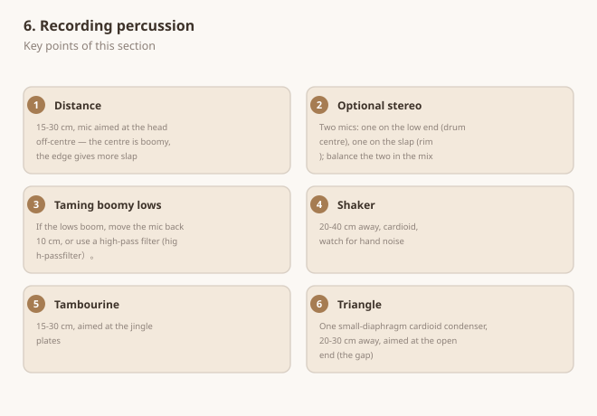

## 7. Phase relationships with multiple microphones: the 3:1 rule

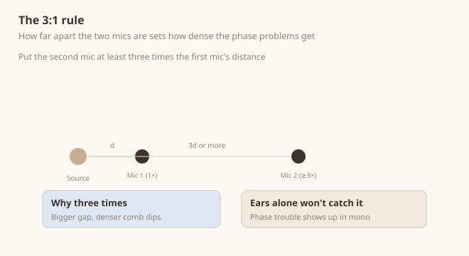

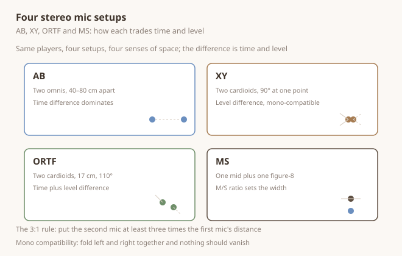

When you use two or more microphones to record the same source, **phase** becomes the most important subject.

### 7.1 What is a phase problem?

When two microphones are at different distances from the source, the same sound reaches them at different times. That time difference makes some frequencies cancel each other out (out of phase), and the sound turns thin, hollow and short of low end.

**The simplest test:** if it's a stereo recording, press the mono button. If the sound suddenly gets smaller or thinner, there is a phase problem.

### 7.2 The 3:1 rule

This is a widely circulated rule of thumb:

> **When two microphones record the same source, the distance between the second microphone and the first must be at least three times the distance from the first microphone to the source.**

For example:

- If Mic A is 30 cm from the guitar's top, then the distance between Mic B and Mic A must be at least **90 cm**.

The rule greatly reduces audible phase cancellation between two microphones. Note that it is a rough guide, not absolute truth — in practice you still have to verify it by listening.

### 7.3 How to check phase

1. **Polarity flip test:** invert the polarity of one of the tracks (press the phase invert or polarity flip button in the DAW). If the sound gets bigger after the flip (frequencies that were cancelling are restored), the original recording had a phase problem.
2. **Visual check:** in the DAW's waveform display, the peaks and troughs of the two tracks should roughly line up; if one track's peak meets the other's trough, they are out of phase.
3. **Move the microphone:** if you find a phase problem, the simplest fix is not a plug-in but **actually moving one of the microphones**, until the change from mono to stereo sounds as natural as it can.

### 7.4 In practice

- **With multiple microphones, always deal with phase before EQ.**
- If time is short or fine adjustment impossible, **use XY or ORTF first** — they have the fewest phase problems.
- For drum kit recording, **the microphone under the snare** almost always needs its polarity inverted, because the top and bottom heads vibrate in opposite directions.

---

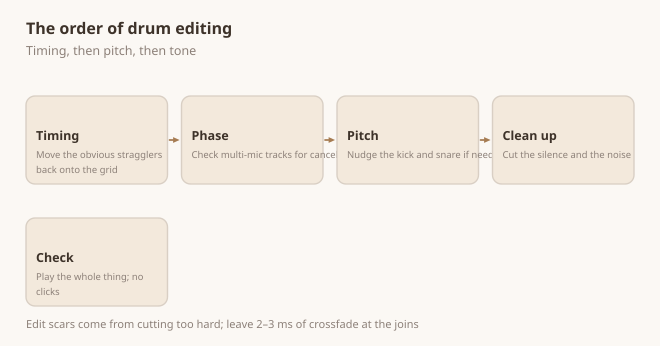

## 8. Summary and practical rules

A quick-reference table for solo instrument placement:

| Instrument | Suggested distance | Microphone type | Notes |
|------|----------|-------------|------|
| Acoustic guitar | 20-30 cm | Small-diaphragm condenser | Aim between the 12th fret and the soundhole |
| Grand piano | 15-30 cm | Large-diaphragm condenser | Two mics in stereo is better |
| Drum kit | 5-15 cm (close) | Dynamic + condenser overheads | Three layers: close, overhead, room |
| Violin | 40-50 cm | Cardioid condenser | Avoid pointing straight at the bowing point |
| Flute | 30-60 cm | Small-diaphragm condenser | 45 degrees off the airstream from the embouchure |
| Saxophone | 45-90 cm | Dynamic or condenser | Slightly above the bell |
| Trumpet | 30-90 cm | Dynamic + pad | 30 degrees off the centre line |
| Percussion | 15-50 cm | Depends on the type | Too much low end: move back |

**Five golden rules:**

1. **Listen first, adjust second** — don't guess; use monitor headphones to hear what the microphone really sounds like.
2. **Being further away is not necessarily bad** — if the sound is harsh or boomy, moving back 10–15 cm works better than adding EQ.
3. **Check phase in mono** — sounding good in stereo doesn't mean it sounds good in mono, and plenty of playback devices are mono.
4. **The room is an instrument too** — if the room's acoustics are poor, a distant microphone records the bad sound; improving the room is better value than buying an expensive microphone.
5. **Trust your ears** — theory is a guide, not a rule. If a placement sounds good, it is correct.

Next lesson we move into mixing, starting with EQ and frequency balance: how to help every track find its own place in the mix.

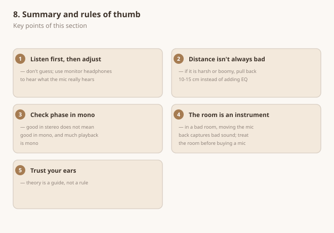
