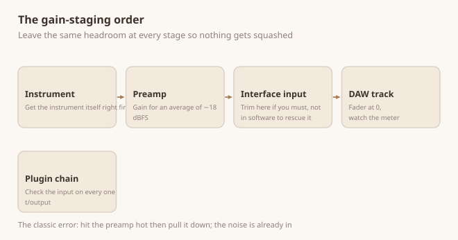
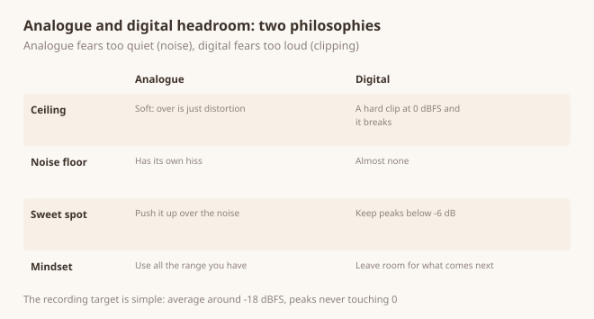
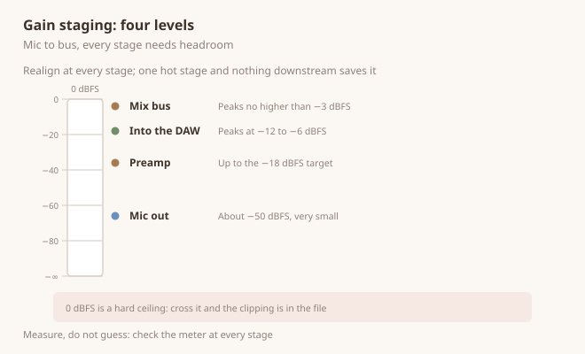
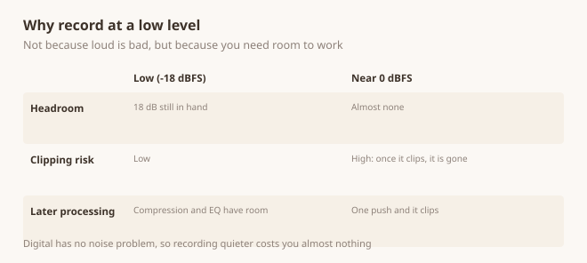
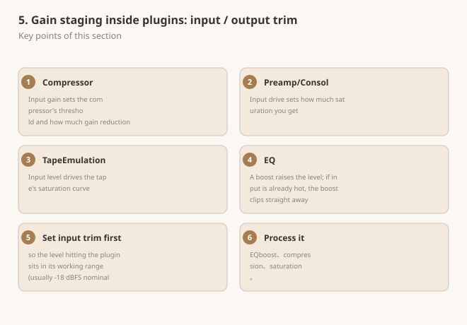
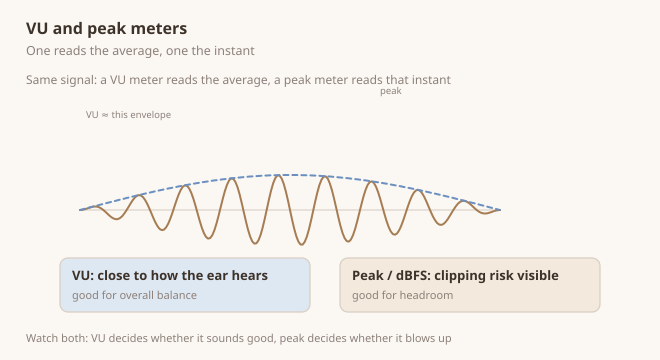
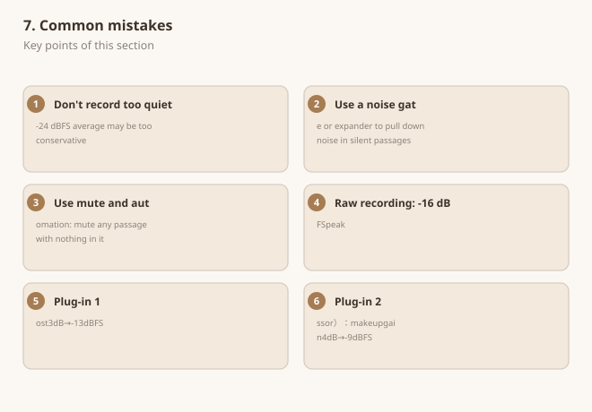
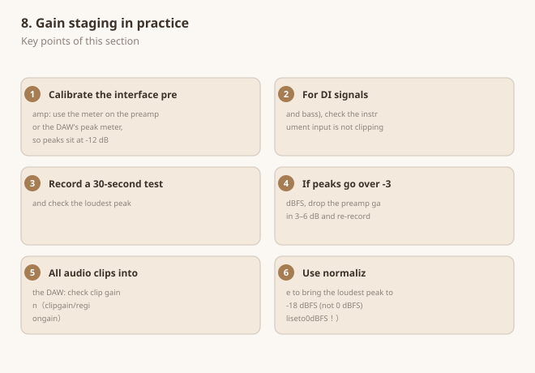
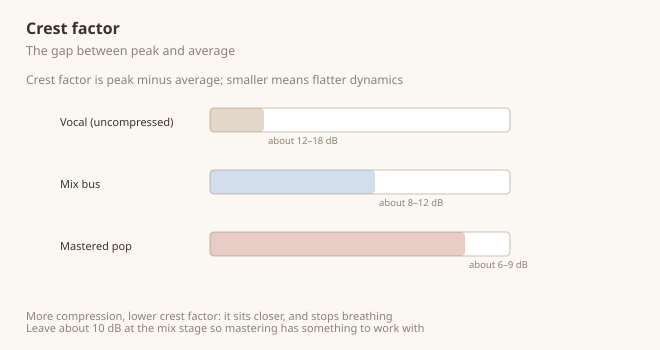

# Lesson 6: Gain Staging: Signal Gain Stages and Headroom Management

## 1. What is gain staging?

Gain staging is the most basic and the most often ignored core idea in recording and mixing. It means controlling the level at **every stage** as the signal travels from the source (microphone, instrument DI) through the preamp, the analogue-to-digital converter, every track in the DAW, every plug-in inserted, the aux sends and returns, and finally to the master bus — so the signal neither clips nor drops so low that it is buried in noise.

Picture a plumbing system: the water pressure at the source (the instrument's output) passes a first valve (mic preamp gain), then a second valve (the DAW track fader), a third valve (gain inside a plug-in), a fourth valve (aux send level)… If any valve is opened too far, water sprays out (clipping); if it is opened too little, you have to boost hard later on, which amplifies the grit that was already in the pipes (noise) even more. The purpose of gain staging is to have every valve at its best setting, so the water (the signal) flows smoothly and cleanly to the end.

In the digital world, gain staging is a subtler matter than in the analogue era. Analogue equipment overloaded produces harmonic distortion, sometimes pleasing saturation; a digital system above 0 dBFS is hard clipping with no compromise — square waves, pops, information permanently lost. So the first principle of digital gain staging is: **never let the signal exceed 0 dBFS, in the analogue-to-digital converter or anywhere inside the DAW.**



## 2. Analogue vs digital: two philosophies of headroom

### The analogue-era view

In the days of tape and mixing consoles, engineers aligned 0 VU on the meter to a nominal level of +4 dBu, and the equipment could take peaks of +18 dBu to +24 dBu. That 14–20 dB of room was the headroom. Past the nominal level, analogue equipment saturates gradually, compressing and adding harmonics, but never collapses suddenly. Engineers often pushed the preamp or the console channel deliberately to get that warm saturation.

### The digital view

In a digital recording system, 0 dBFS is the ceiling; you cannot cross it by the smallest amount. 24-bit has 144 dB of dynamic range, far wider than any analogue medium, so a digital system does not need the analogue habit of "pushing the signal up near 0 VU to stay clear of noise". Instead, we should keep generous digital headroom while recording, so that the mixing that follows has room to work.

The analogue "push it until it sounds good" has to become, in the digital era, "keep it clean until you deliberately want colour". If you want saturation or distortion, add it with a dedicated plug-in (Decapitator, Saturn, a tape emulation). Don't hard-clip a real preamp or A/D converter to get it.



## 3. The ideal recording level: -18 dBFS to -12 dBFS



### Why not record at 0 dBFS?

Many beginners push the preamp gain for all they're worth while recording and only relax when the waveform fills the screen, as if it would be wasted otherwise. That is a completely wrong idea. The noise floor of a 24-bit recording is around -120 dBFS, and the noise from your mic preamp and your room is usually between -60 dBFS and -50 dBFS. Even if you record peaks at only -18 dBFS, the gap between signal and noise (the signal-to-noise ratio) is still more than 30 dB. That is plenty.

More importantly, keeping headroom has these benefits:

- **Avoiding accidental clipping:** a player leaning in, a singer shouting, a percussion transient — any of these can be 10–20 dB above the average level. If the average level is already at -6 dBFS, one transient goes straight past 0 dBFS.
- **Leaving room for later processing:** an EQ boost, compressor makeup gain or saturation plug-in will raise the level. If the original recording is already near the ceiling, that processing clips immediately.
- **Preserving transients intact:** digital clipping shaves off the top of the waveform and destroys the punch and detail of percussion.

### In practice

| Recording type | Suggested peak level (dBFS) | Suggested average level (dBFS) |
|---------|---------------------|---------------------|
| Vocal | -12 to -6 | -18 to -12 |
| Acoustic guitar (fingerstyle) | -10 to -6 | -18 to -14 |
| Electric guitar (clean DI) | -12 to -6 | -20 to -14 |
| Drum overheads | -12 to -6 | -20 to -16 |
| Kick / snare | -10 to -6 | -18 to -12 |
| Bass (DI) | -12 to -6 | -18 to -14 |
| Piano | -10 to -6 | -18 to -12 |

**The rule:** peaks no higher than -6 dBFS, average sitting around -18 dBFS. That gives you more than 6 dB of instant headroom for transients, and 18 dB of headroom for processing.

### Step by step

1. Ask the player to perform the loudest passage of the song.
2. Adjust the preamp gain so the DAW's peak meter tops out between -12 dBFS and -6 dBFS.
3. Check whether any moment in the take goes above -3 dBFS (if it does, drop 3–6 dB and record again).
4. Confirm that the clip LED on the preamp never lit up.

## 4. Why keeping the recording level low preserves headroom

Headroom literally means "the space above your head": the buffer between the nominal level and clipping. In a digital system the nominal level is usually set at -18 dBFS, matching analogue 0 VU / +4 dBu.

Keep the average level at -18 dBFS while recording and you have 18 dB of headroom for the transient peaks to pass through safely without clipping. By comparison, push the average level to -6 dBFS and only 6 dB of headroom is left — one slightly harder drum hit or shout breaks through the ceiling without effort.

The more headroom you keep, the more freedom you have while mixing. You can add saturation, compression and EQ boost freely without worrying that running out of margin will distort. When the mix is close to finished, raise the overall level at the last stage with makeup gain or a limiter on the master bus, up to release standard (usually around -14 LUFS or -12 LUFS). **Record the audio well and clean first, turn it up loud last** — that is the clearest dividing line between a professional engineer and an amateur.



## 5. Gain staging inside plug-ins: input / output trim

### The problem

Many modern plug-ins (analogue emulations especially) model internal circuitry and are very sensitive to input level. For example:

- **Compressor (1176, LA-2A, Distressor):** input gain decides how the compressor works against its threshold and how much gain reduction happens. Too weak an input and the compressor barely does anything; too strong an input and it compresses hard, and the output stage may saturate too much.
- **Preamp / console emulation (Neve 1073, API 512, SSL G-Bus):** input drive controls how much saturation there is. Very high input may produce pleasing distortion, but it also takes the processing that follows out of your control.
- **Tape emulation (Studer A800, Ampex ATR-102):** input level traces the tape's saturation curve. Too low and there's no tape character; too high and it turns muddy and distorted.
- **EQ (Pultec, API 550, SSL E-Channel):** a boost raises the level; if the input is already high, the boost clips straight away.

### The right approach

Make this a habit every time you add a plug-in:

1. **Set the input trim first:** make sure the level entering the plug-in lands in its best working range (usually the -18 dBFS nominal level).
2. **Do the processing:** EQ boost, compression, saturation.
3. **Check the output level:** is the level after processing roughly the same as it was on the way in? If it is clearly bigger or smaller, trim it back with output trim or makeup gain.

This is what people call **unity gain staging** — after every plug-in the overall loudness hasn't changed much, but the timbre has been processed. The benefits:

- Avoiding accumulated gain staging error across the channel (every plug-in +3 dB, ten of them +30 dB)
- Letting you concentrate on the change in timbre instead of being misled by the change in loudness (the human ear naturally prefers the louder sound)
- Preserving headroom for the aux sends and the master bus

### Useful tools

- **Voxengo SPAN:** a free spectrum analyser with peak / RMS / K-system meters built in, so you can calibrate plug-in input and output precisely.
- **Gain tools built into the DAW:** Trim in Pro Tools, Gain in Logic, Utility in Ableton Live — the most direct tools for adjusting gain staging.
- **LUFS meters:** Youlean Loudness Meter, or the loudness meter built into the DAW, to confirm whether the mix's overall loudness meets the target.



## 6. VU meters and dBFS meters: two different views



### dBFS meters (digital peak meters)

This is the default meter type in a DAW. It shows **the instantaneous peak at sample resolution**. Its characteristic is extremely fast response; it catches a transient as short as one sample. That is essential for avoiding clipping — if any single sample goes above 0 dBFS, clipping has happened and cannot be undone.

The shortcomings of the dBFS meter are obvious, though: it cannot reflect the loudness the human ear perceives. A short hi-hat transient may read -3 dBFS on a dBFS meter and still sound much quieter than a sustained bass note at -12 dBFS. Calibrate gain staging with the dBFS meter alone and the average level easily ends up too low, and the listener finds the mix weak.

### VU meters (volume unit meters)

The VU meter is the analogue-era standard. It models **the ear's integrated response to sound intensity**. The VU meter's ballistics (the inertia of the needle) are designed as a 300ms attack and a 300ms release, so it doesn't show instantaneous peaks but an average level over a period of time.

In a digital DAW, VU meter plug-ins (Klanghelm VUMT, PSP VintageMeter, or the DAW's built-in VU mode) usually map -18 dBFS to 0 VU. That means:

- 0 VU = -18 dBFS (nominal level)
- The signal occasionally jumping to +3 VU (about -15 dBFS) is acceptable
- Staying well above 0 VU means the level is too high

### Using the two together

1. **Watch the dBFS peak meter mainly while recording:** make sure no sample comes near 0 dBFS, and keep the headroom.
2. **Use the VU meter as a check while mixing:** when adjusting the level balance between tracks, the VU meter is closer to the ear's perception of loudness than the dBFS meter.
3. **Use VU to calibrate plug-in input:** put a VU meter before the plug-in and adjust the input trim until the VU meter reads 0 VU (that is, -18 dBFS). That means the signal has entered the plug-in's best nominal range.

### K-system metering (proposed by Bob Katz)

This is a metering system that combines peak and average, with three scales — K-20, K-14 and K-12 — for mixes with different dynamic range targets. K-20 is used for high-dynamic-range classical and jazz recording, K-12 for louder pop music. The K-system's 0 dB corresponds to the target loudness; above it is peak headroom, below it is dynamic range.

## 7. Common mistakes

### Mistake 1: recording every track at -3 dBFS

As said above, that leaves no headroom at all. One small EQ boost or compressor makeup gain and the track clips immediately. And once all the tracks are summed, the master bus level explodes.

### Mistake 2: ignoring accumulated noise floor

Every track's preamp, interface and plug-ins introduce a little noise. Stack thirty tracks, fifty tracks, and that noise accumulates into audible hiss. If every track's original level is too low and you boost hard in the mix, the noise is amplified even more noticeably. So:

- Don't record too low (an average below -24 dBFS may be over-cautious)
- Use a noise gate or expander to lower the noise in silent passages
- Use mute and automation: mute a track completely in passages where it has nothing to play

### Mistake 3: "the limiter will hold it together at the end anyway"

This is the most dangerous myth. A limiter does stop the master bus going above 0 dBFS, but it cannot repair clipping that has already happened on a track or inside a plug-in. And the limiter is itself a processor — leaning on it produces pumping, distortion, flattened dynamics. **Gain staging is preventive medicine; a limiter is first aid. Don't use first aid as daily health care.**

### Mistake 4: gain accumulating through the plug-in chain

Say one guitar track has four plug-ins on it:

- Original recording: -16 dBFS peak
- Plug-in one (EQ): boost 3 dB → -13 dBFS
- Plug-in two (compressor): makeup gain 4 dB → -9 dBFS
- Plug-in three (saturation): output up 2 dB → -7 dBFS
- Plug-in four (tape emulation): output up 3 dB → -4 dBFS

By this point, though it doesn't clip on its own, if the track is part of the master bus the accumulated level on the bus soon passes 0 dBFS. Worse, the internal headroom of every stage of the plug-in chain has been eaten as well.

**The fix:** after setting each plug-in, use output trim to put the level back to what it was. Use the unity gain staging principle described above.

### Mistake 5: not checking the aux / send levels

If a reverb or delay aux send is too high, it can also clip when it returns to the bus. And several tracks sending to the same reverb aux add up to an even higher level. Remember:

- Keep every track's send level in a sensible range (usually adjusted somewhere between -12 dB and -inf)
- The aux return track itself needs enough headroom
- Reduce the wet mix inside the reverb / delay plug-in rather than crushing it hard on the return track

### Mistake 6: ignoring the level of the summing bus

You solo one track and it sounds normal, but play everything and the master bus blows up. That is because the frequency and phase relationships between tracks make the sum far higher than the power sum of uncorrelated signals (only +3 dB per doubling) and closer to the arithmetic sum (+6 dB per doubling, constructive interference). So even if every track is below -18 dBFS, thirty tracks summed can still put the master bus at -3 dBFS or higher. Check the master bus's peak and RMS level regularly through the mix.



## 8. A practical gain staging workflow

Here is a step-by-step workflow you can apply in any DAW:

### Step 1: recording stage

1. Calibrate the interface's preamp: use the meter on the preamp or the DAW's peak meter, and make sure the highest peak falls between -12 dBFS and -6 dBFS
2. For DI signals (electric guitar, bass), confirm that the interface's instrument input isn't overloading
3. Record a 30-second test passage and check the maximum peak across the whole thing
4. If the peak goes above -3 dBFS, drop the preamp gain 3–6 dB and record again

### Step 2: import and tidy

1. Once all the audio clips are in the DAW, check the clip gain (clip gain / region gain)
2. Use the normalize function to bring the maximum peak to -18 dBFS (not normalize to 0 dBFS!)
3. Adjust clip gain so that each region's average level sits around -18 dBFS

### Step 3: mixing stage — the plug-in chain on each track

For each track's plug-in chain, follow GRET (Gain-Reduce-Equalize-Trim):

```
Input → Trim plug-in (calibrate to -18 dBFS / 0 VU)
      → EQ (shape the frequency, watch the gain of any boost)
      → Compressor (set threshold, ratio, attack, release)
      → Trim / makeup gain (make up the level the compressor took off)
      → Saturation / effect (add tonal colour last)
      → Output trim (make sure the output level is close to the input)
```

After adding each plug-in, bypass it and compare the loudness before and after processing. If bypassing makes it louder or quieter, adjust the output trim until the two loudness levels are close (the key habit of **critical listening**).

### Step 4: bus / group stage

1. Sum instruments of the same kind to a subgroup bus (Drums Bus, Guitar Bus, Vocal Bus)
2. Put the necessary processing on the bus as well (bus compression, EQ), following the same unity gain principle
3. Confirm that the bus output peak stays below -6 dBFS
4. Send each bus on to the master bus

### Step 5: master bus (2-bus)

1. Put a metering plug-in on the master bus (SPAN or Youlean Loudness Meter)
2. Confirm that the master bus peak stays below -3 dBFS (ideally below -6 dBFS)
3. Check the mix's crest factor (the peak - RMS difference): typically between 8–14 dB
4. Do the final loudness maximisation at the mastering stage; don't push to the limit while mixing

### Step 6: check before export

- No track's peak is above -6 dBFS (check each one in solo)
- Master bus peak between -6 dBFS and -3 dBFS
- Master bus RMS around -24 dBFS to -18 dBFS (depending on the genre)
- No insert plug-in's clip indicator is showing red
- No aux return is showing an abnormal peak



## 9. An advanced idea: crest factor and dynamic range



Crest factor = peak level - RMS level (in dB). It describes how dynamic a piece of audio is.

- Classical music: crest factor about 14–20 dB, wide dynamics, plenty of transients
- Pop music: crest factor about 6–10 dB, more compression, higher loudness
- EDM: crest factor about 4–8 dB, heavy compression and limiting

Good gain staging preserves the original crest factor. Many beginners squash the crest factor very low without noticing during the mix, because constant boosting raises the RMS, and by the time they want to make the mix loud they find the dynamics have already been flattened.

**Core principle:** first keep healthy levels and dynamic range through gain staging, then control dynamics deliberately with compressor and limiter — rather than being dragged along passively by whatever the plug-ins do to the level.

## 10. Summary

| Idea | Key point |
|------|------|
| Recording level | Peak -12 to -6 dBFS, average around -18 dBFS |
| Unity gain | After each plug-in, output level ≈ input level |
| Headroom | Keep 12–18 dB of headroom as a buffer |
| Metering | dBFS to watch peaks against clipping, VU to judge average balance |
| Noise management | Record at the right level (not too low), use gate and mute |
| Bus management | Keep each bus peak ≤ -6 dBFS, master bus ≤ -3 dBFS |
| Crest factor | Check the peak-to-RMS difference, preserve the original dynamics |

Gain staging is not a glamorous technique — it will not make your mix suddenly sound better. But it is the foundation of everything. Without correct gain staging, the best EQ curve, the most expensive compressor plug-in, the most refined reverb all lose their effect to clipping, accumulated noise or unnecessary compression. Just as a house needs its foundation first: **get gain staging right and half the road to a good mix is behind you.**

Next time you open your DAW, try looking again at every track's level and plug-in chain with this lesson's method. You'll find that when you are no longer startled by clip lights and no longer chasing loudness blindly, mixing becomes clearer and more controllable than ever before.
