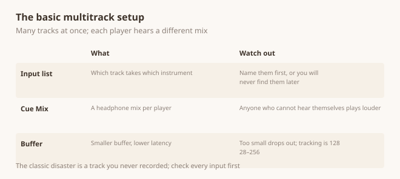
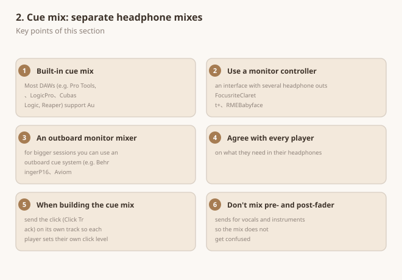
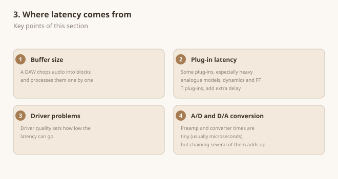
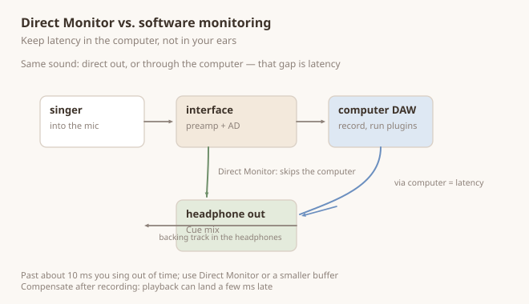
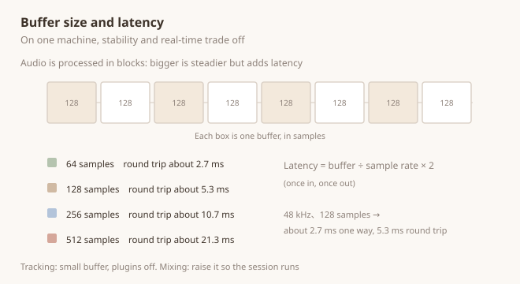
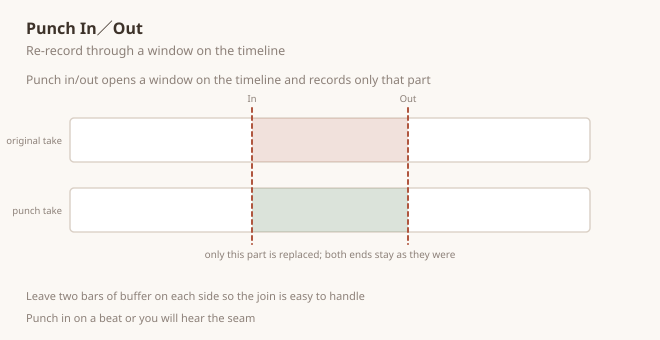
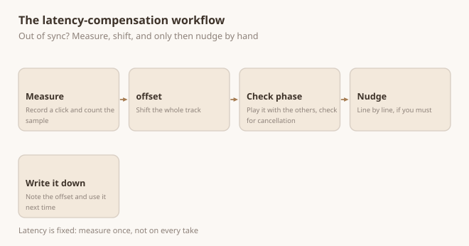
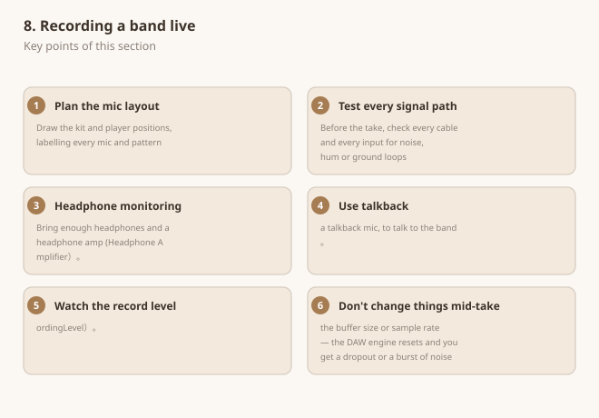
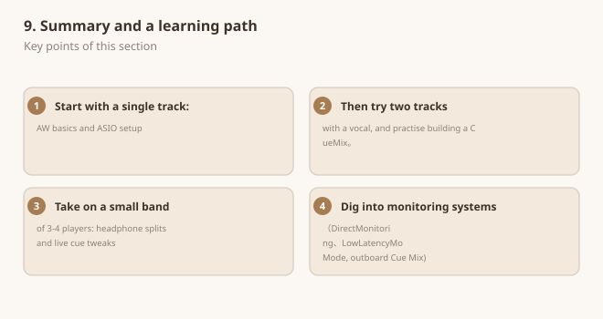

# Lesson 7: Multitrack Recording: Monitoring Setup and Latency Elimination

## 1. The basics of multitrack recording

Multitrack recording is the foundation of modern music production. Early analog recording could capture only a single track or a stereo pair. Multitrack recording lets you put every instrument and every voice on its own track, then mix and edit afterwards. That gives you enormous creative freedom, and it makes fine control of sound quality possible.

Setting up a multitrack session in a digital audio workstation (DAW) starts with planning the track layout from the number of instruments and the way you record. A typical layout has a rhythm group (drums, bass), a harmony group (guitar, keyboards) and a melody group (lead vocal, backing vocals, solo instruments). Each group splits further into mono or stereo tracks. A drum kit usually takes 4 to 12 microphones, one track per microphone. In the DAW you set the correct input source for each track in advance, so the signal path stays clear.

Sample rate and bit depth matter when the session is created. For ordinary recording, 48 kHz / 24-bit or 96 kHz / 24-bit is the recommendation. A higher sample rate makes bigger files, but it gives wider frequency response and lower latency. Set the tempo and time signature at the very start of the project too, so edits can snap to the grid later.

## 2. Cue mix: a separate headphone mix for each player

| Monitoring mode | Latency | What you hear | When to use it |
|---|---|---|---|
| Direct monitor | Almost zero | Only the dry signal at the interface input | Recording to the click |
| Software monitoring | One buffer round trip | The sound after plugin processing | When you need to hear the effects |
| Mixer / cue mix | Almost zero | A mix at levels you choose | Recording several people at once |

While recording, every player needs a headphone mix that suits what they are playing. A drummer may want a strong click and a steady rhythmic reference. A lead singer needs to hear their own voice clearly, balanced against the backing. That is what a cue mix is for.

### How to build a cue mix

1. **The DAW's built-in cue mix.** Most DAWs (Pro Tools, Logic Pro, Cubase, Reaper) support aux sends and bus routing. Create several aux tracks, one for each player's headphone output. The send on each track controls how much of it reaches each aux, so every player gets a mix made for them.

2. **A monitor controller.** Audio interfaces with several headphone outputs (Focusrite Clarett+, RME Babyface Pro, Antelope Audio Zen Go) come with their own mixing software, so you can build cue mixes outside the DAW. Direct monitoring on this hardware keeps latency low and avoids the delay that software routing adds.

3. **An external monitor mixer.** Larger sessions can use a dedicated monitoring system (Behringer P16, Aviom, Roland M-48) that sends several independent mixes over a digital network (Ultranet, AES50, Dante) to each player's personal monitor controller.

### Practical advice

- Before recording, ask every player what they need in their headphones. A lead singer usually wants a lot of their own voice, a little backing and a suitable amount of reverb. Rhythm players want a clear click and each other's rhythmic parts.
- Send the click track on its own channel so each player can set the click level themselves.
- Don't confuse pre-fader and post-fader routing for vocals and instruments. During recording, use pre-fader sends so that moving the main fader does not change a player's monitor balance.

## 3. Where latency comes from and what it does

Latency is one of the most stubborn problems in multitrack recording. It is the time difference between the input (the microphone picking up sound) and the output (the headphone). Even a few milliseconds is enough to make a player feel something is wrong, and that affects their sense of time and their performance.

### The main sources of latency

1. **Buffer size.** The DAW processes audio in blocks. A larger block (1024 samples) is more stable, but the latency is larger. A smaller block (32 or 64 samples) lowers latency, but it loads the CPU and pops, clicks and dropouts appear.

2. **Plugin latency.** Some plugins, especially analog models, dynamics processors and FFT-based tools, add latency of their own. The DAW normally compensates for it automatically, but during recording and monitoring those plugins still make the delay obvious.

3. **Driver problems.** The quality of the audio driver decides latency. On Windows, the WDM and DirectSound drivers are usually very high (20–50 ms) and unfit for live monitoring. Professional recording uses ASIO (Audio Stream Input/Output) to get low latency.

4. **Analog-to-digital conversion.** The conversion time in a microphone preamp or an AD/DA converter is extremely short, usually on the order of microseconds. But once several external devices sit in the signal chain, the accumulated latency is no longer negligible.

## 4. Direct monitoring vs software monitoring

The choice between these two monitoring modes shapes both the recording quality and what the player experiences.

### Software monitoring

The sound enters the audio interface from the microphone, is converted from analog to digital and sent to the DAW, passes through the plugins on the track (compression, EQ, reverb) and is converted back to analog and sent to the headphones. The advantage is that the player hears the sound with the effects applied. The disadvantage is higher latency, set by buffer size and plugin latency, which becomes clearly audible when the buffer is not low enough.

### Direct monitoring

The sound is routed from input to output inside the audio interface and never passes through the DAW. The advantage is zero or extremely low latency, only the microseconds of the AD/DA conversion, so the player hears the most immediate, most accurate sound. The disadvantage is that you cannot monitor the plugins in the DAW, and you cannot hear the playback of tracks already recorded, unless the interface's mixer blends them for you.

### A hybrid monitoring strategy

Modern recording mostly uses a hybrid approach:

- Use the interface's direct monitoring, or the zero-latency monitoring mode in its control software, so the player hears the clean input signal.
- At the same time, send the playback of already recorded tracks out of the DAW and blend it with the direct signal inside the interface.
- That gives you the low latency of direct monitoring and still lets the player hear the backing tracks recorded earlier.

Cubase's "Low Latency Monitoring" mode, Logic Pro's "Low Latency Mode" and Reaper's "Disable anticipative FX processing" are features that bypass high-latency plugins at the DAW level to bring monitoring latency down.

## 5. ASIO setup and buffer configuration

### Installing and choosing an ASIO driver

On Windows, ASIO is the driver you need for low-latency recording. The common options:

1. **The manufacturer's own ASIO driver.** With a professional interface (RME, Focusrite, Universal Audio, MOTU), always install the official ASIO driver. These are optimised and give the best latency.

2. **ASIO4ALL.** A generic ASIO driver for built-in sound cards and devices without native ASIO support. Its latency is not as good as a native driver, but it is far better than WDM. Note that ASIO4ALL takes exclusive control of the audio device, so you cannot play other audio at the same time.

3. **WASAPI Exclusive Mode.** On Windows 10/11, exclusive-mode WASAPI can reach latency close to ASIO in some situations, but it is still less stable than native ASIO.

### Buffer size guide

Choosing a buffer size is a balancing act:

- **Recording** (live monitoring needed): set the buffer to 32, 64 or 128 samples. At 44.1 kHz, 64 samples gives about 1.45 ms of latency, which most players find acceptable. If the CPU is not strong enough, try 128 samples (about 2.9 ms).
- **Mixing and editing** (no live monitoring): set the buffer to 512 or 1024 samples. A larger buffer gives the CPU more time to handle a complex mix and many plugins, and reduces pops and instability.
- **Multitrack recording**: when you record many tracks at once (8–12 tracks for a drum kit), every track needs its own AD conversion and data stream. You have to keep the buffer small and make sure the CPU is strong enough. The practical approach is to try 64 samples first, and step up to 128 samples if pops appear.

### Advanced techniques

On RME interfaces, TotalMix FX blends the direct monitoring signal with the DAW playback signal in hardware and lets you control the latency independently. On Universal Audio's Apollo series, the Console software and the UAD DSP chips apply UAD plugins (compressor, reverb, analog models) to the input in zero latency while the unprocessed dry signal is recorded into the DAW. This is called "Unison", and it is a good compromise between direct and software monitoring.

## 6. Multitrack in practice: recording several takes

### Managing takes

Recording the same section, or the same song, several times over is called a take. A DAW gives you several ways to manage takes:

1. **Comping.** In Logic Pro, Pro Tools and Cubase you can stack several takes on one track (track comping, take folder). When recording is done you pick the best take for each section and assemble a perfect performance. For example, take 3 for the first chorus, take 5 for the second chorus, take 2 for the bridge.

2. **Punch-in / punch-out.** Re-record one section only. You set a punch-in point and a punch-out point, and the DAW switches to record mode inside that range and keeps the original performance everywhere else. This is very efficient for fixing small mistakes.

3. **Cycle / loop recording.** Set a playback range and the DAW loops it, recording a new take on each pass. Logic Pro's "Cycle Mode" and Cubase's "Cycle Record" are the usual implementations, and they are well suited to catching an idea from an improvised performance.

### Practical reminders

- Talk to the player about the strengths and weaknesses of each take before recording more. Do not record blindly and wear the player out. Sometimes the third take is already good enough, and carrying on costs you energy.
- Keep the original recording of every take; don't delete anything in a hurry. A take that looks imperfect may turn out to have unexpected appeal later, for example a vocal take with an emotional flaw in it.
- Use colour tags and naming rules to manage takes and tracks (Vox_Main_Take01, Vox_Dbl_Take02), so nothing gets confused during post-production.

## 7. Latency compensation after recording

By the time recording is finished and mixing begins, all the tracks should line up exactly. In practice, though, monitoring latency, hardware routing delay or the timing of MIDI devices can leave a small offset between a recorded track and the beat grid.

### Manual correction

Zoom the waveform in to sample level and compare the recorded waveform with the grid lines. The attack points of the drum kit (the kick transient, the snare hit) should land on the beats of the grid. If you find an offset, drag the region to move it. Bass and rhythm guitar can be shifted as a group against the drum timing.

### DAW latency compensation

- **Automatic Delay Compensation (ADC).** Most modern DAWs (Pro Tools, Cubase, Logic Pro, Studio One) have ADC. It works out the plugin latency on every track and compensates the overall timing. When you use many high-latency plugins (linear-phase EQ, look-ahead limiters), ADC is what keeps the phase correct.
- **Recording delay offset.** In the DAW preferences you can set a recording delay offset. If recorded tracks always sit a few milliseconds late (or early), this setting compensates for all of them at once. Some interface manufacturers publish a recommended value.

### Compensating for outboard hardware

If you use an external analog effect (sent back into the DAW through an insert), the latency from the AD/DA conversion has to be compensated by hand. How to measure it: send a pulse or click out of the DAW into the external device, record it back, and measure the time difference between the original and the returned signal. That difference is your compensation value.

## 8. Recording a live band in practice

### Before the session

1. **Plan the microphone setup.** Draw the layout of the kit and the players, and mark the model and polar pattern of every microphone. Use at least four microphones on the kit (kick, snare, two overheads); eight to twelve is better.

2. **Test the signal path.** Before recording, test every cable and every input one at a time, and check for noise, hum or ground loops. Use a phase scope or goniometer to confirm that each stereo pair is in phase.

3. **Set up headphone monitoring.** Prepare one set of headphones and a headphone amplifier per player. Confirm that every player's cue mix is already set, and that the drummer has a steady click. Give the players 5–10 minutes to listen and adjust their mixes before the real take.

### During the session

- Use a talkback microphone to talk to the players. Most interfaces and DAWs have a talkback function that feeds the microphone into the headphone system, so the engineer in the control room can talk to the band.
- Watch the recording level. Keep the peak level between -6 dBFS and -3 dBFS and leave enough headroom to avoid clipping. 24-bit recording has plenty of dynamic range; there is no need to push the level.
- Do not change the buffer size or the sample rate while recording. It resets the DAW's audio engine and causes a gap or a pop.
- If a player's cue mix needs adjusting, do it between sections. Don't interrupt a take that is in progress.

### After the session

- Play it back immediately and check phase consistency. Play all the tracks together and listen to whether the overall sound is natural. A hollow or thin result may mean phase cancellation between a stereo pair or among the drum microphones.
- Use a timing alignment tool (VocAlign, Melodyne, Cubase's Audio Alignment, Pro Tools' Beat Detective) on sections with unsteady timing. Use it with care: the small human variations in timing are sometimes the soul of the music.

## 9. Recap and a learning path

Multitrack recording is a required subject in digital music production. It covers signal routing, monitoring system design, latency management and recording practice. Once you have these techniques, you can get a clean, synchronised, high-quality recording in any room.

A learning path:

- Start with single-track recording to get used to the DAW's basic operation and the ASIO setup.
- Move on to recording two tracks at once (guitar and voice) and practise building a cue mix.
- Then try a small band (three or four players) and get used to headphone distribution and adjusting mixes live.
- Finally, study the actual latency figures of the various monitoring systems (direct monitoring, low latency mode, external cue mix systems).

Every session adds experience. Correct monitoring settings and good latency management are the step that takes you toward professional recording engineering.

