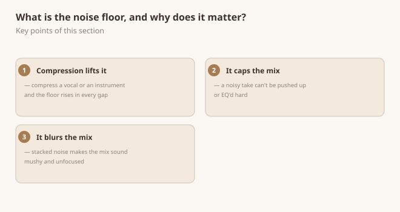
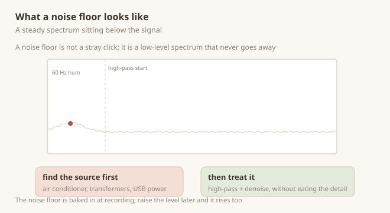
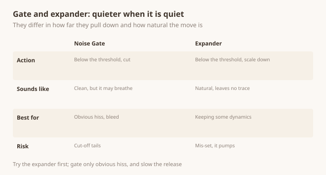
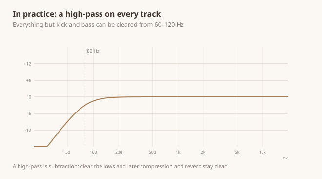
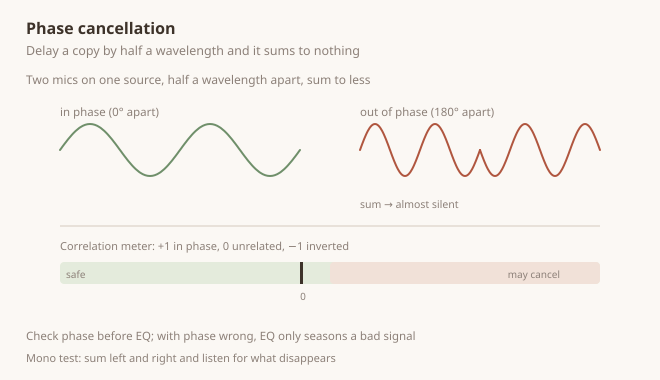
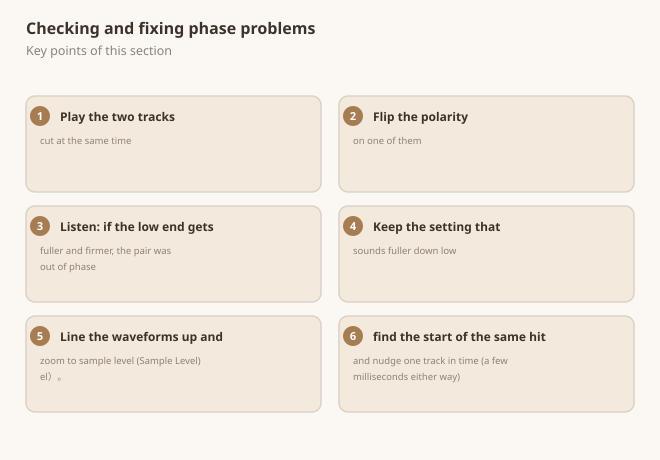
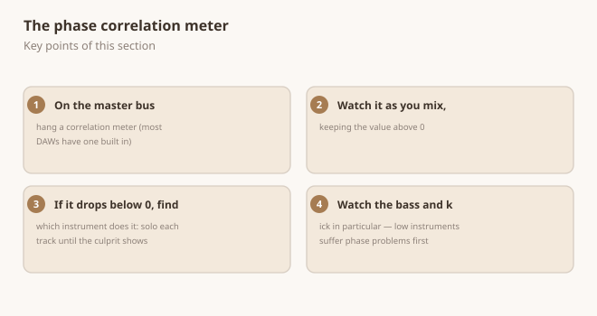
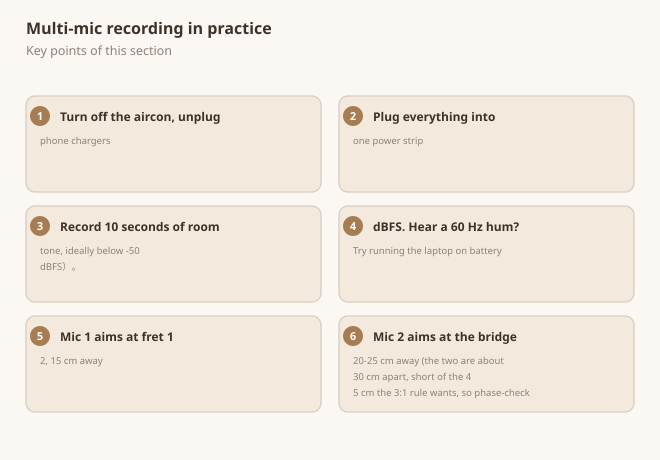

# Lesson 8: Recording in Practice: Tracking Down the Noise Floor and Checking Phase

Recording quality depends on the microphones and preamps, but two things that get overlooked just as often decide it: the **noise floor** and **phase**. However expensive the gear, if the noise floor is too high or the phase is wrong, the recording still cannot be used. This lesson covers how to identify, measure and solve these two practical problems.

## What is the noise floor, and why does it matter?

The **noise floor** is the residual noise the system makes when no signal is coming in. Picture recording in a completely silent room: the waveform display still shows a fine fringe. That fringe is the noise floor.

The noise floor is measured in dB, usually marked as **dBu** or **dBFS**. A typical audio interface is specified between -100 dBu and -120 dBu. The lower the noise floor, the wider the dynamic range, and the cleaner the recording.

The noise floor matters for three reasons:

1. **Compression makes it louder.** Put a compressor on a vocal or an instrument and the noise floor rises noticeably in the gaps.
2. **It limits what you can do later.** A recording with a high noise floor cannot be pushed much louder, and it cannot take aggressive EQ.
3. **It blurs the mix.** Accumulated noise floor makes a mix sound hazy and unfocused.

A useful rule of thumb: during recording the noise floor should sit at least 50 dB below the signal peak, so post-production leaves you some room to work.

## Common noise sources and what to do about them

### 1. Computer fans and hard drives

This is the most common noise source in a home studio. The low hum of a computer fan (roughly 200–500 Hz) travels through the air into the microphone.

**What to do:**

- Put the computer case at least 2 metres from the microphone, or in another room.
- Use a long microphone cable (an XLR cable runs 10–15 metres without losing signal).
- Consider quieter fans, or a passive cooling setup.
- When recording vocals, close unnecessary background apps to lower CPU load and stop the fans speeding up.

### 2. Air conditioning and HVAC

The low rumble and airflow noise from an air-conditioning vent is faithfully captured by the microphone.

**What to do:**

- Turn the air conditioning off 15 minutes before recording and let the room settle.
- If you cannot turn it off, change the direction of the vent so it does not blow at the microphone.
- Use a reflection filter, which also blocks noise from behind the microphone.

### 3. Power hum (50 Hz / 60 Hz)

Power hum is one of the most irritating problems in a studio. Mains frequency differs by region: Taiwan, eastern Japan, the United States and Canada use 60 Hz; western Japan, Europe and most of Asia use 50 Hz. That frequency and its harmonics (120 Hz, 180 Hz, 240 Hz and so on) leak into the audio path.

**What to do:**

- Use a **high-pass filter** to cut everything below 80–100 Hz. Most interfaces and microphone preamps have one built in.
- Check that all equipment is on the same power circuit, so nothing is grounded across circuits.
- Use a **power conditioner** or an isolation transformer.

### 4. Ground loops

When several devices are earthed along different paths, a ground loop forms, producing 50/60 Hz hum and high-frequency noise.

**How to recognise a ground loop:**

- The hum grows as you connect more devices.
- Unplugging one signal cable makes the hum disappear immediately.
- The hum contains clear 60 Hz and 120 Hz components.

**How to fix it:**

- Use a **ground loop isolator** in the audio path (a DI box or a dedicated isolation transformer).
- Plug all the equipment into the same power strip to reduce the difference in ground potential.
- If you record on a laptop, **unplug the power supply** and run on the battery. This is the quickest way to confirm a ground loop.

### 5. Electromagnetic interference (EMI)

Phones, Wi-Fi routers, fluorescent lights and dimmers all produce electromagnetic interference, which the microphone or the cable picks up.

**What to do:**

- Put every phone in airplane mode while recording.
- Use balanced XLR cable, and keep it from running parallel to power cables.
- Keep the microphone away from monitors and power supplies.

## Noise gates and expanders

### How a noise gate works

A noise gate is a processor that mutes automatically: when the input falls below a set **threshold**, it mutes the signal or attenuates it heavily. This is very useful for cleaning up tracks after recording.

**The four key parameters:**

| Parameter | What it does | Typical setting |
|------|------|----------|
| Threshold | The level at which the gate opens | 15–20 dB below the signal peak |
| Attack | How fast the gate opens | 0.1–1 ms (fast opening) |
| Release | How fast the gate closes | 50–200 ms (adjust to the material) |
| Range | How much attenuation when closed | 20–40 dB (full mute or partial attenuation) |

### Extending the idea: the expander

An **expander** works on the same principle as a noise gate but more gently. It does not mute completely; it attenuates signals below the threshold by a ratio (2:1 or 3:1, for example). An expander suits:

- Instruments whose decay tail rings too long
- Recordings with low but constant background noise
- Controlling bleed in a drum kit while keeping it sounding natural

In a DAW, ReaGate (built into Reaper), FabFilter Pro-G and Waves NS1 are all good tools.

## Using a high-pass filter

The high-pass filter is the most underrated tool in recording. It lets high frequencies through and attenuates everything below the cutoff frequency.

**Practical settings:**

| Source | Suggested cutoff | Note |
|----------|-------------|------|
| Vocal (male) | 80–100 Hz | Don't cut away chest resonance |
| Vocal (female) | 100–120 Hz | The female voice has a higher fundamental |
| Acoustic guitar | 80–110 Hz | Removes the low resonance of the body |
| Electric guitar | 100–120 Hz | Divides the work with the kick in the mix |
| Kick | 30–50 Hz | Keeps the impact |
| Snare | 80–100 Hz | Removes low-frequency bleed |
| Overhead microphones | 80–120 Hz | Removes the low rumble under the cymbals |

**An important principle:** the high-pass filter belongs in the **recording** stage, not the mixing stage. Cutting unwanted low end while you record stops low-frequency information from eating precious dynamic range, and it avoids problems you would otherwise only discover later.

## Phase problems: what is phase cancellation?

Phase describes where a sound wave sits in time. When two identical waves add together:

- **In phase (0°).** Peak on peak, trough on trough, amplitudes add: the sound gets louder.
- **Out of phase (180°).** Peak on trough: they cancel, and the sound gets quieter or disappears entirely.
- **Partly offset (45°, 90° and so on).** Partial cancellation, and the frequency response shows comb filtering.

### What phase cancellation sounds like

- The sound turns thin or hollow
- The low end clearly disappears
- The sound changes a lot as you move your head
- The level drops noticeably when you fold the two tracks to mono

### Where phase problems happen most

1. **Several microphones on one source.** Two microphones on an acoustic guitar, three on a kick.
2. **Overhead pairs.** Left and right overheads at different distances in a drum recording.
3. **DI and microphone together.** A bass recorded on a DI and on an amp microphone at the same time.
4. **Room reflections.** The direct sound and the reflected sound reach the microphone at different times.

## How to check and fix phase problems

### 1. Use the phase invert button (polarity flip)

Most interfaces and every DAW channel have a "⌀" button. This is not a true phase adjustment; it is a **polarity flip**, turning the waveform upside down by 180°.

**Steps:**

1. Play the two tracks that were recorded together.
2. Click the polarity flip on one of them.
3. Listen: if the low end becomes fuller and firmer after the flip, the two tracks were out of phase.
4. Keep whichever setting sounds better and has the firmer low end.

### 2. Time nudging

A polarity flip only handles a full 180° reversal. It cannot fix a delay caused by different distances. That needs **time nudging**.

**Steps:**

1. Line up the two waveforms and zoom in to sample level.
2. Find the start of the same attack and nudge one track earlier or later by a few milliseconds.
3. Adjust while listening until the low end sounds fullest and most focused.

In a DAW, Reaper's `Alt+left/right arrow`, Pro Tools' nudge function and Logic Pro's Flex Time (or simply dragging a region's start point) all do this.

### 3. Automatic alignment tools

Modern DAWs and plugins offer automatic options:

- **Auto-Align (Sound Radix).** The industry standard: it measures the delay and compensates.
- **Vocalign Project 5.** Aligns phase as well as timing.
- **ReaDelay, built into Reaper.** Set the delay time by hand to make up for a distance difference.

### 4. The 3:1 rule

This is a classic rule of thumb that reduces phase problems in multi-microphone recording:

> When two microphones record the same source, the second microphone should be at least three times as far from the first as the first is from the source.

For example: if the first microphone is 10 cm from the source, the second should be at least 30 cm away. That makes the level difference between the two microphones large enough that phase cancellation has very little effect.

## The phase correlation meter

A phase correlation meter is a visual tool no mix should be without. It shows the phase relationship between the left and right channels of a stereo signal, on a scale from -1 to +1:

| Value | State | Meaning |
|------|------|------|
| +1 | Fully in phase | Left and right are identical (pure mono) |
| 0 to +1 | Good stereo | Natural, suitable for broadcast |
| 0 | Uncorrelated | Left and right have no relationship (independent noise, for example) |
| 0 to -1 | Out of phase | Partly or fully reversed: dangerous |
| -1 | Fully out of phase | Left and right cancel each other |

**How to use it:**

- Put a phase correlation meter on the master bus (most DAWs have one built in).
- Watch it throughout the mix and keep the reading above 0.
- If it drops below 0, find out which instrument causes it: solo the tracks one at a time.
- Pay particular attention to low-frequency instruments such as bass and kick, which are the most sensitive to phase problems.

Built-in tools in the main DAWs: Logic Pro's MultiMeter, Pro Tools' Correlation Meter, Reaper's JS: Stereo Field or JS: Goniometer.

## A multi-microphone recording workflow

Here is the full noise floor and phase check for one **acoustic guitar** recorded with two microphones.

### Step 1: Prepare the room

1. Turn off the air conditioning and unplug the phone charger.
2. Check that all the equipment is on the same power strip.
3. Record 10 seconds of room tone and check that the noise floor is acceptable (below -50 dBFS).
4. If you hear 60 Hz hum, try unplugging the laptop and running on the battery.

### Step 2: Place the microphones

1. The first microphone points at the 12th fret, 15 cm away.
2. The second points at the bridge, 20–25 cm away. The two are about 30 cm apart, short of the 45 cm the 3:1 rule asks for, so the phase check in the next step has to make up for it.
3. Check that the two microphones are balanced in level.

### Step 3: Set the high-pass filters

1. Put an 80 Hz high-pass filter on both tracks (on the interface or in the DAW).
2. Record a simple strum on open strings.

### Step 4: Check phase

1. Switch to mono monitoring.
2. Click the polarity flip button (⌀) on the second track.
3. Compare the two settings, normal and flipped. The one with the fuller low end and the tighter strum is right.
4. If it still sounds wrong in mono, try nudging the second track in time, moving it later in 0.1–0.5 ms steps.

### Step 5: Record and log it

1. Write down the final phase setting and the microphone distances.
2. Monitor the noise floor during the take and check that no new noise source appears, such as a phone notification.
3. Check the waveform afterwards. If you see obvious asymmetrical clipping or unusual low end, go back and check phase again.

### Step 6: Clean up afterwards

1. Put a gentle noise gate on the vocal or solo instrument track (threshold 5 dB above the noise floor, range about 20 dB).
2. On tracks with heavier background noise, use an expander (ratio 2:1, slower attack so the transient survives).
3. Finally, put a phase correlation meter on the master bus so the whole mix stays phase-healthy.

## Closing

Tracking the noise floor and checking phase are what separate a rough recording from a professional one. Many of the problems that sound like "the tone is wrong" come down to these two things. Make a habit of checking the room noise before you record and checking phase the moment you stop, and you save a lot of repair time at the mix. Next lesson we go into the heart of mixing, EQ and frequency balance, and learn how to give every instrument its own place in the spectrum.
