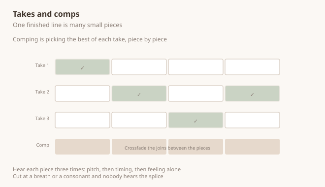
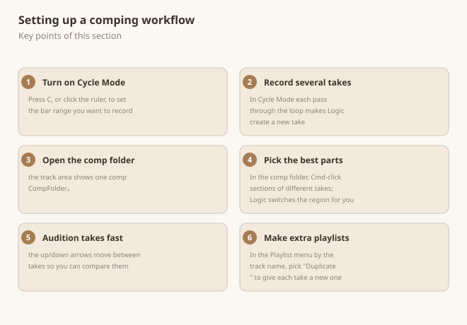
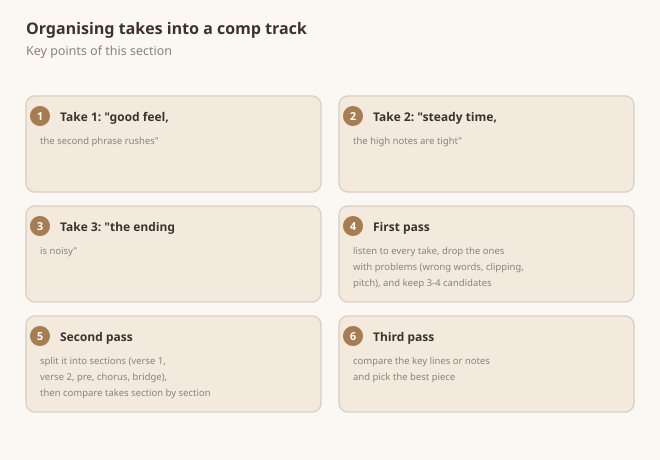
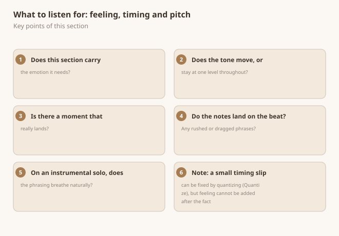
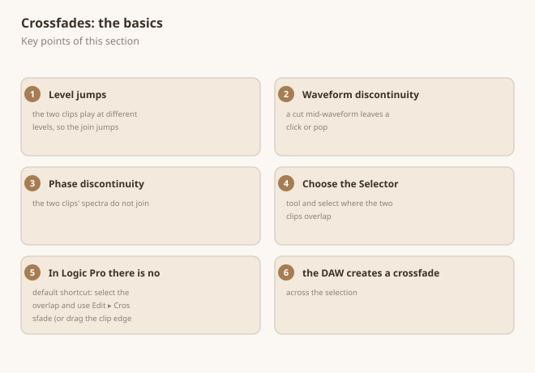
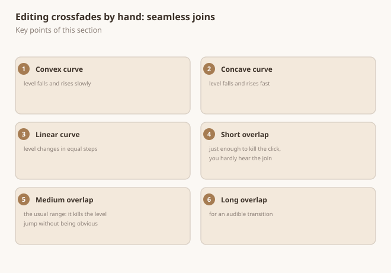
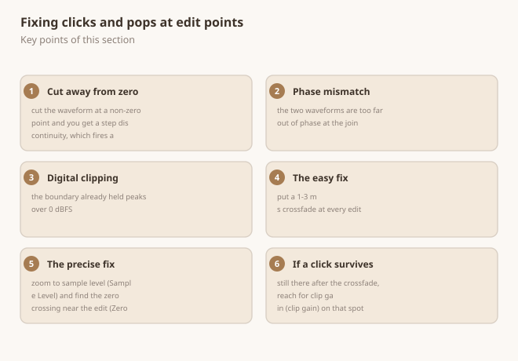
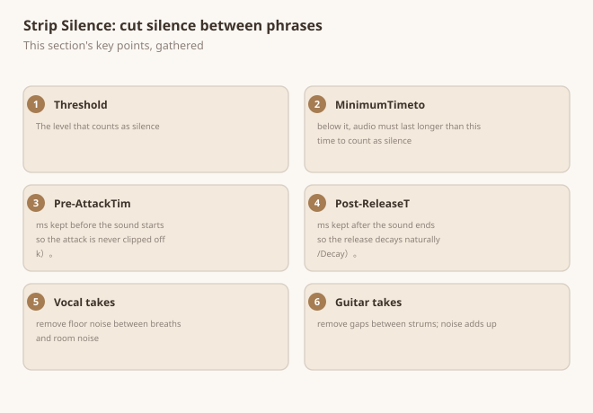
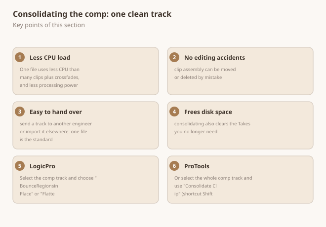
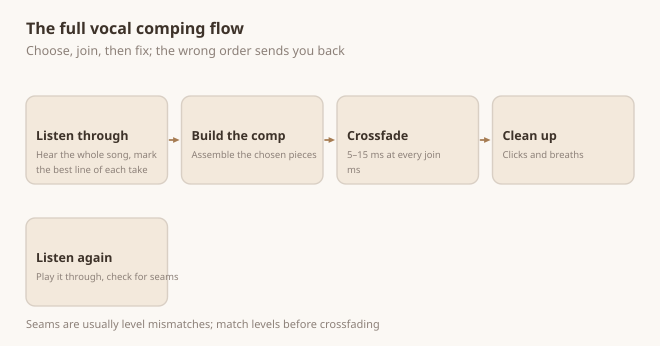

# Lesson 9: Track Editing: Comping and Crossfades

In modern digital music production you rarely get a perfect performance in one pass. A singer recording a lead melody, a guitarist recording a solo, any instrument that has to carry emotion: you usually record several takes and then choose the best parts to build one perfect track. The whole process is **comping** (from "composite"). And to make the edited pieces sound smooth and seamless, the **crossfade** is essential. This lesson covers both core editing techniques in full.

---

## What is comping? Extracting the best performance from several takes

The idea is simple. Say a singer records the chorus five times. The first has real feeling but drags a little. The second is on time but the last note is too short. The third is perfectly in tune but emotionally flat. The fourth has one wrong line. The fifth is good overall but breathes too loudly at the end. Comping means taking the best version of each line, or even each word, from those five takes and assembling a fantasy track.

The philosophy behind it: **no single take is perfect, but every take has its perfect moment.** Rather than making a performer record over and over until they are exhausted, use what the repeated passes gave you and pick the best of it.

Comping matters especially in these situations:

- **Vocal recording.** Lead lines, harmony, rap sections.
- **Instrumental solos.** Guitar, bass, keyboards, violin.
- **Speech and voice-over.** Podcasts, audiobooks, commercials.
- **Live recordings from several positions or nights.** Pick the best passage from each.

---

## Setting up a comping workflow in the DAW

Every major DAW has features built for comping. Here is how the two most common ones, Logic Pro and Pro Tools, do it.

### Logic Pro's comp folder

Logic Pro's comping workflow is one of the most direct in the industry:

1. **Turn on Cycle Mode.** Press `C` or click in the ruler to set the range you want to record.
2. **Record several takes.** With Cycle Mode on, Logic creates a new take automatically on each pass.
3. **Open the comp folder.** When you stop, the track appears as a comp folder. Click the take folder label to open all the takes.
4. **Choose the best passages.** In the comp folder, hold `Cmd` and click a passage in a different take. Logic assembles the selection into a comp track above, and the comp track updates as you click.
5. **Switch takes quickly.** The `up/down` arrow keys move between takes so you can compare them.

One strong feature of Logic Pro's comp folder: when you select a passage, Logic creates a very short fade at each boundary, about 5 ms by default, so no click appears at the edit point.

### Pro Tools playlists

Pro Tools manages takes with playlists, and the method differs a little:

1. **Create several playlists.** From the playlist menu next to the track name, choose "Duplicate" to make a new playlist for each take.
2. **Record each take.** Switch to a different playlist for each pass.
3. **Assemble the comp track from the playlists.** On a new, empty playlist (usually named "COMP"), hold `Ctrl` (Win) or `Cmd` (Mac), select a passage in one of the playlists with the Selector Tool, and paste it into the comp track.
4. **Trim and arrange.** Use the Trim Tool to set the start and end of each piece precisely.

Pro Tools' playlist system is very flexible with large numbers of takes, but it has no automatic comp folder view like Logic Pro, so you cut and paste by hand.

### Ableton Live / Cubase / Studio One

- **Ableton Live.** Record several clips with Session View's launch feature, then drag them into Arrangement View and arrange by hand. There is no dedicated comp folder, but take lanes (from Live 10) get you close.
- **Cubase.** The lane track system, similar to Pro Tools playlists, stacks several takes on display; select with the Range Selection tool and the selection fills the comp track directly.
- **Studio One.** A comping system similar to Logic Pro's, called Take Management. Takes are created automatically while recording, and you select passages on the comp track with the paint tool.

---

## How to organise takes and build a comp track

Whatever the DAW, the logic of organising takes is the same.

### 1. Name and tag every take

Annotate each take as soon as recording stops. For example:

- Take 1: "great feeling, second line rushes"
- Take 2: "steady timing, high notes a bit tight"
- Take 3: "noise near the end"

These notes are very useful when you come back to choose, especially if a few days have passed.

### 2. Decide your comping strategy

Don't listen to a whole take and judge it. A better strategy:

- **First pass (quick filter).** Listen through every take. Drop the ones with clear problems (wrong words, bad clipping, out of tune) and keep 3–4 candidates.
- **Second pass (compare by section).** Divide the song into sections (verse A, verse B, pre-chorus, chorus, bridge) and compare the candidates section by section.
- **Third pass (choose line by line).** Compare the key lines or notes closely and pick the best piece.

### 3. Build the comp track

Lay the chosen pieces out one after another on a new track (or do it inside the comp folder). A few points:

- Leave some overlap between pieces so you can crossfade later.
- Make sure the level and the timbre do not jump when the track moves from one piece to the next.
- Don't start automating the level yet. Concentrate on choosing the content first.

---

## Listening for the right take: emotion, timing and pitch

When you choose a take, don't judge technique alone. Score it on three things.

### Emotion: the first priority

What an audience feels is emotion, not tuning. A flawed performance full of feeling reaches people far more than a perfect, bland one. Ask yourself:

- Does this section carry the feeling the words ask for?
- Does the delivery rise and fall, or stay at one level throughout?
- Is there any moment that catches you?

### Timing: second priority

Timing shapes the groove of the whole song:

- Do the notes land on the beat? Is there any unnatural rushing or dragging?
- On an instrumental solo, does the phrasing breathe naturally?
- Note that a small timing error can sometimes be fixed with quantise. Emotion cannot be added in post.

### Pitch: fixable

Pitch is the easiest problem to deal with afterwards:

- Auto-Tune, Melodyne and similar tools correct pitch.
- Over-correct, though, and you get the mechanical sound known as the Auto-Tune wobble.
- If a take has perfect emotion and accurate timing with only one or two notes off, choose that take and fix those notes with a tuning tool.

**The golden rule:** always choose the take with the best emotion. Technical problems can be fixed later; emotion cannot be copied.

---

## Crossfade basics

Once the pieces are chosen and laid out on the comp track, the next job is to make the transitions between them sound smooth. That is what a crossfade does.

### Why you need a crossfade

When two audio pieces sit next to each other on the timeline, you can get:

- **Level jumps.** The two sections are at different levels, so the join jumps up or down.
- **Waveform discontinuity.** The waveform is cut off at the join, which produces a high-frequency click or pop.
- **Phase discontinuity.** The frequency content of the two pieces does not join naturally.

A crossfade works like this: at the join, the first piece fades out while the second fades in, and the overlap becomes a smooth transition.

### The basic operation

The basic operation is very similar in every DAW:

1. Use the selector tool to select the overlapping part of the two pieces.
2. Depending on the DAW: Logic Pro has no default shortcut, so select the overlap and choose Edit ▸ Crossfade (or drag the fade handle at the region boundary); in Pro Tools, select a range across both pieces and press `Cmd + F` / `Ctrl + F` to open the fade dialogue; in Cubase, select the two overlapping pieces and press `X`, or use Edit ▸ Create Crossfade.
3. The DAW creates a crossfade across the selection.

You can also do it by hand: move the cursor to the top left or top right corner of a region and a fade handle appears. Drag it to draw a fade-in or fade-out curve. Where the two curves cross, that is the crossfade.

---

## Crossfade types: equal power vs equal gain

A crossfade is not one fixed mathematical curve; the shape changes how it sounds. The two most common are equal power and equal gain.

### Equal power crossfade

**The curve:** at the centre point, each piece sits at about -3 dB, and the sum is almost the original level (0 dB).

**How it sounds:** the level stays even through the centre, with no dip. This suits material with **sustained sound**: vocals, strings, synth pads.

**Where to use it:**

- Joining vocal lines
- Boundaries between sustained or long notes
- The decay of a guitar note

### Equal gain crossfade

**The curve:** at the centre point, each piece sits at about -6 dB, so the sum is below the original level and there is a small dip in the middle.

**How it sounds:** slightly quieter at the centre, but the transition is cleaner and the cut is more defined. This suits **rhythmic** material.

**Where to use it:**

- Drum kits and percussion
- Strummed rhythm guitar
- Fast fill passages

### Typical curve lengths

- **Standard crossfade:** 10 ms – 50 ms, for most situations
- **Short crossfade:** 1 ms – 5 ms, only to remove a click or pop, with no audible fade
- **Long crossfade:** 100 ms – 500 ms, for longer transitions such as joins between sections

### Practical advice

- When you are unsure, start with equal power. It is the safe choice and sounds natural on most material.
- At equal length, compare equal power against equal gain and keep whichever sounds more natural.
- For vocal comping, a 10–30 ms equal power crossfade is usual.

---

## Editing the crossfade by hand

The DAW can create a crossfade for you, but professional results need hand adjustment.

### Adjusting the fade curve

Every DAW lets you drag the fade handle to change the curve shape:

- **Convex:** the level falls or rises more slowly. Good for material that decays naturally at the end.
- **Concave:** the level falls or rises faster. Good for rhythmic material that needs a quick switch.
- **Linear:** the level changes in equal steps. The most neutral choice, and a good starting point.

### Adjusting the overlap length

The right overlap depends on the material:

- **Short overlap (1–10 ms).** Just enough to remove a click or pop; the transition is almost inaudible. Good for tightly rhythmic sections.
- **Medium overlap (10–30 ms).** The most common range: it removes level jumps without making the transition obvious.
- **Long overlap (50 ms and up).** For deliberate transition effects. Careful: too long a crossfade lets both pieces sound at once, which blurs the sound or causes phase problems.

### Visual aids

- Watch the waveform: inside the crossfade the two waveforms should join naturally, with no sudden jump in size.
- Use a spectrum analyser: check that no unnatural frequency jump appears in the transition.
- When you listen, close your eyes and judge by ear alone. A crossfade that looks perfect can sound wrong, and the other way round.

---

## Dealing with clicks and pops at edit points

Clicks and pops are the most common problem when editing audio. They usually come from:

### Causes

1. **A cut away from a zero point.** The waveform is cut where it is not at zero, creating a step discontinuity that excites broadband energy and is heard as a click.
2. **Phase discontinuity.** The phase of the two pieces differs too much at the join.
3. **Digital clipping.** The boundary already contains a peak above 0 dBFS.

### Fixes

- **The simplest fix.** Put a 1–3 ms crossfade at every edit point. That removes almost every click caused by a cut, and the transition is too short for the ear to notice.
- **The advanced fix.** Zoom to sample level, find the zero crossings near the edit point and line the edit up exactly with one. Then no click appears even without a crossfade.
- **For a click that survives.** If there is still a click after the crossfade, use clip gain to drop that spot by 3–6 dB, or draw a very short level automation dip there (about -6 dB over about 5 ms).

### Prevention beats cure

- Avoid clipping while recording; leave 6 dB of headroom.
- Check the microphone connection before recording.
- Use a good microphone preamp and good cable to keep the noise floor down.

---

## Strip Silence: removing the silence between phrases

After comping and crossfading, you may find the track has a lot of empty space or low-level noise you don't need. Strip Silence removes it automatically.

### What Strip Silence does

Strip Silence scans the selected audio and finds the passages below a set level threshold, in other words the silent or nearly silent parts. It then cuts them out of the track or mutes them.

### The parameters

In Logic Pro, for example, Strip Silence (Functions > Strip Silence) has four main parameters:

1. **Threshold.** The level below which a passage counts as silent. Too low and all the noise stays; too high and you lose decay tails and quiet notes.
2. **Minimum Time to Accept as Silence.** A passage below the threshold has to last longer than this to count as silence. Set it between 50 ms and 200 ms so the very short gaps between notes are not cut.
3. **Pre-Attack Time.** How many milliseconds to keep before the sound starts, so the attack of a note is never cut.
4. **Post-Release Time.** How many milliseconds to keep after the sound ends, so the natural release or decay survives.

### When to use it

- **Vocal recording.** Remove the floor noise and room noise between breaths.
- **Guitar recording.** Remove the gaps between strums so noise does not pile up.
- **Speech and podcasts.** Cut out every empty passage and tighten the delivery.
- **Clean-up after multitrack recording.** Run Strip Silence on each track before mixing, so less unwanted noise reaches the mix bus.

### Cautions

- Always follow Strip Silence with crossfades, because the new boundaries it creates are themselves a source of clicks.
- Don't be too aggressive with the threshold, or you cut the natural decay of notes as well.

---

## Consolidating the comp: the final clean track

The last job is to **consolidate** (flatten, or bounce in place) the comped pieces into one continuous audio file.

### Why consolidate?

1. **Less CPU load.** One audio file costs the processor less than many pieces plus crossfades.
2. **No accidental edits.** The arrangement of many pieces can be moved or deleted by mistake.
3. **Easier to hand on.** When a track goes to another engineer or into another DAW, a single file is the standard format.
4. **Disk space.** Consolidating sometimes clears out take pieces you no longer need.

### How to consolidate

- **Logic Pro.** Select the comp track and choose "Bounce Regions in Place" or "Flatten". You can also merge first and then consolidate.
- **Pro Tools.** Select the whole comp track and use "Consolidate Clip" (`Shift + Alt + 3` on Mac, `Shift + Ctrl + 3` on Windows), or export with "Bounce to Disk".
- **Cubase.** Select the comp track and choose Bounce Selection from the Audio menu.
- **Ableton Live.** Select the comp track, right-click and choose "Consolidate" (`Ctrl/Cmd + J`).

### Checking after consolidation

Play the whole track again and check:

1. Every crossfade sounds smooth
2. No clicks or pops remain
3. The level is consistent from start to finish
4. The musical flow sounds natural

If something is wrong, go back and adjust the comping choices or the crossfade settings, then consolidate again.

---

## A full worked example: comping a lead vocal

Here is a complete vocal comping session that uses every technique in this lesson.

**Step 1: Record**
The singer records six full takes of the chorus. Record with Cycle Mode so every take starts at the same point and lines up later.

**Step 2: First filter**
Listen quickly through all six. Take 4 has an obvious pop early on, and take 6 has unsteady breath support throughout. Drop those two and keep 1, 2, 3 and 5.

**Step 3: Choose line by line**
Divide the chorus into four phrases and compare the four remaining takes phrase by phrase:

| Phrase | Take chosen | Why |
|------|-----------|------|
| First phrase | Take 2 | Full of feeling, accurate pitch |
| Second phrase | Take 5 | Slightly off pitch, but the most natural delivery (agreed to fix with Melodyne) |
| Third phrase | Take 1 | The tightest timing, locked to the other instruments |
| Fourth phrase | Take 2 | The best ending, with a suitable vibrato |

**Step 4: Build the comp track**
Click the matching take passages in the comp folder to form a complete comp track.

**Step 5: Crossfades**
Put a 15 ms equal power crossfade at each boundary. Check each transition, and make the curve at one boundary slightly convex, because the previous phrase has a long sustained ending.

**Step 6: Strip Silence**
Run Strip Silence with the threshold at -45 dB and Minimum Silence Time at 80 ms. That washes out the faint floor noise between breaths.

**Step 7: Check the crossfades again**
The new boundaries from Strip Silence need crossfades too. Go through every new boundary and add a short 5 ms crossfade.

**Step 8: Consolidate**
Run Bounce in Place (or Consolidate) to write the comp track out as one audio file named "Chorus_COMP_FINAL.wav".

**Step 9: Sign it off**
Play it from beginning to end and confirm the joins are smooth, there is no noise and the emotion is consistent. Then archive the original takes, keeping the backup in case you need to comp again later.

---

## Recap

Comping and crossfades are the two most important and most used editing techniques. Comping is how you find the precious moments in a pile of takes; the crossfade is how you join those moments smoothly, without leaving a mark.

From recording several takes, through organising and judging them, to building the comp track and finally crossfading and consolidating, every step takes practice and patience. Start with a short section, a chorus for example, and once the operation is familiar, extend it to the whole song. With experience you will get faster at judging which takes to keep and which to drop, and at reaching a natural result with the fewest crossfades.

Next lesson we move into **pitch and timing correction**, and learn to use Melodyne and elastic audio to fix the small flaws in a performance.
