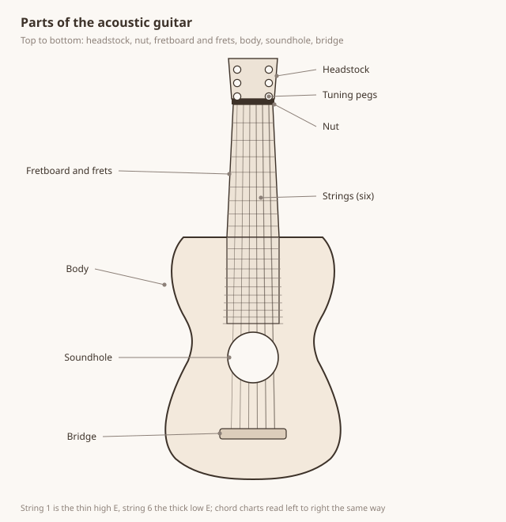
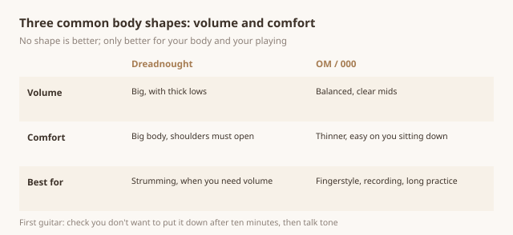
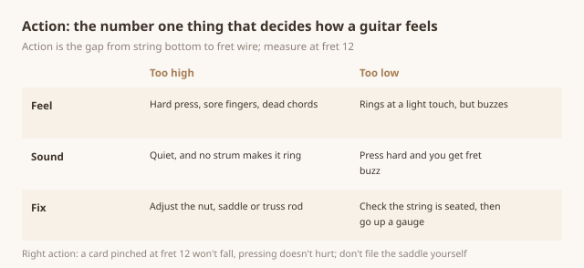
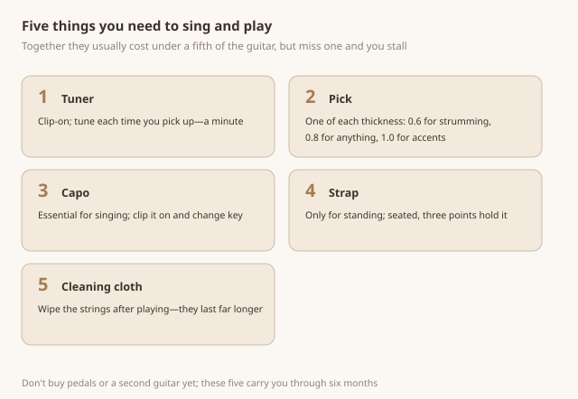

# Chapter 1: Choosing a Guitar That's Easy to Play, and the Small Gear You Need

> **What this chapter covers**
> 1. The names of the parts of an acoustic guitar (the steel-string wooden guitar) and the basic reason it makes sound.
> 2. How the common body shapes differ, so you can pick the one that suits your build and the music you play.
> 3. The two measurements that decide whether a guitar is easy to press: **the action** and the string gauge.
> 4. The five practical accessories you need to play and sing, without wasting money.

---

## 1-1 Meet your musical partner: the acoustic guitar, part by part

Walk into a music shop or open a shopping site and you'll find that "the wooden guitar" comes in several kinds. In the world of pop songs sung over a guitar, the one we use is the **acoustic guitar (also called a steel-string guitar)**: **metal strings**, a larger body, a bright timbre, and a crisp, separate attack on every note. It is not the classical guitar, which plays classical repertoire, uses nylon strings and has a wider fretboard.

Before you start playing, spend three minutes learning the names of the guitar's parts. Once you know them, you can say exactly what you need when you read a chart, tune up, or talk to a repair tech at the shop:

### Quick reference: what the main parts do

| Part | English term | What it does, and what a beginner should watch for |
| :--- | :--- | :--- |
| **Tuning pegs** | Tuning Pegs | A gear turns to fine-tune how tight the string is, which changes its pitch. Tighter and the note goes up; looser and it goes down. |
| **Nut / saddle** | Nut / Saddle | The two support points that hold the strings at either end. The distance between them is the **scale length**, and they are the parts that decide the action. |
| **Fret wire** | Fret Wire | The thin metal strips set into the fretboard. **The thing to get right**: you press the string into the wooden space between two wires, close to the wire on the right — not on top of a wire. |
| **Inlay dots** | Inlay Dots | Usually at frets **3, 5, 7, 9, 12 (two dots), 15 and 17**, so you can find a position quickly instead of counting from fret 1 every time. |
| **Top** | Top / Soundboard | The heart of the guitar's sound. The usual woods are **spruce (bright, with a crisp attack)** and **mahogany (warm, with a thick midrange)**. |

---

## 1-2 Choosing a body shape: pick the guitar that's most comfortable to hold

The usual mistake when buying a first guitar is to look only at the colour. You get it home and find the body is too big, your right arm rests on it, and your shoulder starts to ache.

The size and outline of an acoustic guitar's body is called its **body shape**. A bigger body means a bigger resonating box: fuller low end and more volume. A smaller body, or a narrower waist, sits closer to your own body and keeps the mids and highs tighter and clearer.

### The four common body shapes, compared

| Body shape | Short name | What it looks like | What it sounds like | Who it suits, and for what music |
| :--- | :--- | :--- | :--- | :--- |
| **Dreadnought** | **D** | Wide body, little waist — the traditional standard acoustic outline. | Full low end, plenty of volume, rich resonance. | Players 165 cm and taller who like to strum hard, for rock or for folk songs sung over the guitar. |
| **Grand Auditorium** | **GA** | A little smaller than a D, with a pronounced waist (an hourglass outline). | Highs, mids and lows very evenly balanced; suits both strumming and fingerpicking. | **The all-round first choice.** Works for any build; for beginners who want fine fingerpicking and hard strumming from one guitar. |
| **Orchestra Model** | **OM** | A shallower body, a slim waist, lighter overall than a GA. | Clear, sweet mids and highs, a strong attack, good sustain. | Smaller players, and anyone who prefers gentle fingerstyle accompaniment. |
| **Travel guitar** | **Travel / GS Mini** | About 3/4 or 7/8 the size of a standard guitar (36 inch is common). | Focused and bright, with a little less low-end resonance than a standard body. | Children, small players, and anyone who carries a guitar to camp or on the commute. |

> **💡 Buying note: what is a cutaway?**
> Many guitars have a curved section cut out of the upper right of the body, next to the neck. That's the **cutaway**. Its job is to keep the body out of the way when your left hand plays single notes above fret 12, **higher up the neck**. If you're a beginner playing open chords in the first five frets and singing, either a cutaway or a full body will do; the full body usually has a more complete resonating box and a lower price.

---

## 1-3 The number one thing that decides whether a guitar is easy to press: action and string gauge

If you've borrowed a friend's guitar and found the strings stiff as rebar, your fingertips hurting after one press, don't conclude your fingers are too weak. That guitar almost certainly has an **action that's too high**.

### What is the action?

The action is the vertical gap between the **underside of the string** and the **top of the fret wire at fret 12**.

- **Action too high**: your finger has to push the string a long way down before it meets the wire. It takes a lot of force, it raises blisters, and because the string is stretched further, **the note comes out sharp**.
- **Action too low**: the string sits too close to the wire. Pluck it with any force and the vibrating string hits the next wire up, making a buzz. Guitar players call that **fret buzz**.

### Target action and string gauge for an acoustic guitar

| What you measure | Standard acoustic value | A beginner-friendly setting |
| :--- | :--- | :--- |
| **Action at fret 12, 6th string (the thickest, lowest)** | `2.2 mm ~ 2.5 mm` | Around **`2.0 mm ~ 2.3 mm`** makes pressing noticeably easier. |
| **Action at fret 12, 1st string (the thinnest, highest)** | `1.5 mm ~ 2.0 mm` | Around **`1.5 mm ~ 1.8 mm`** balances feel against fret buzz. |
| **String gauge** | Factory standard is usually `.012 - .053` (Light) | For a beginner, switch to **`.011 - .052` (Custom Light)** or **`.010 - .047` (Extra Light)**: lower tension, far less pain in the fingertips. |

> **🛠️ Buying checklist: how not to get stung**
> When you buy your first guitar in a shop, ask the staff or the technician to measure the action at fret 12, and to give the guitar a **basic set-up**: sanding the saddle down and adjusting the curve of the neck to bring the action into range. A beginner guitar that has been set up properly will feel better in your hands than an expensive instrument that has never been adjusted.

---

## 1-4 The five accessories you actually need

With the guitar sorted, you still need a few small things you can't do without. Here are the five accessories a beginner needs, and what to check before you buy:

| Accessory | What it's for | What to look for | Budget (NTD) |
| :--- | :--- | :--- | :--- |
| **1. Clip-on tuner** | Clips onto the headstock and tunes by sensing the wood's vibration, so a noisy room doesn't throw it off. | A clear screen that supports **chromatic mode (`C`)**. | 200 ~ 500 |
| **2. Capo** | Clamps onto a fret and raises the pitch of the whole guitar to match your voice. It only goes up: one fret is one semitone. | A spring clamp with a thick silicone pad that applies even pressure, so it doesn't dent the neck or pull the guitar out of tune. | 250 ~ 600 |
| **3. Pick** | For strumming chords or playing single notes with the right hand. It makes the tone brighter and more focused. | Buy two each of **0.60 mm** (on the thin side: bright and springy for strumming) and **0.73 mm** (medium: works for both strumming and single notes) and see which feels right. | 15 ~ 40 each |
| **4. Spare acoustic strings** | Strings wear out. Moisture, oxidation and rust make them harder to press and duller sounding, and eventually one breaks. | Get `.011 - .052`. If the budget allows, buy **coated strings**; they last more than three times as long. | 200 ~ 550 a set |
| **5. Guitar stand / padded gig bag** | Keeps the guitar within reach so you practise more often, and protects it from knocks when you take it out. | At home, get an **A-frame stand** and leave the guitar somewhere you can see it — your practice rate triples. For a bag, look for at least 10 mm of foam padding. | 300 ~ 1,200 |

---

## 1-5 Chapter checklist and what to do next

Before chapter 2, where you hold the guitar and tune it properly, make sure you have these done:

- [ ] **Know the parts**: you can point to the headstock, tuning pegs, nut, fret wire, soundhole and saddle.
- [ ] **Check how it feels**: measure the action at fret 12 on the guitar you have, and check that the strings aren't badly rusted.
- [ ] **Have the gear**: a tuner and picks (0.60 mm ~ 0.73 mm) are within reach, and the guitar lives where it's easiest to pick up.

Ready? In the next chapter you pick the guitar up, learn the most ergonomic way to hold it, and tune all six strings yourself until the first chord rings in tune.
