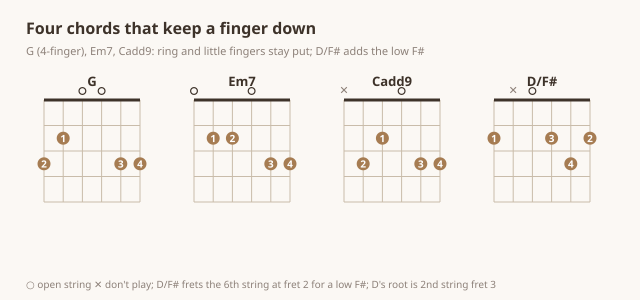
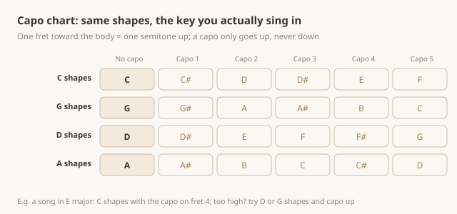
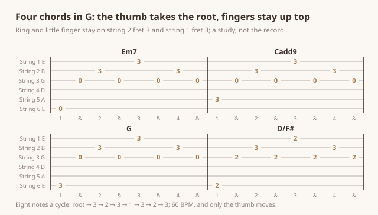

# Chapter 10: When You Can't Sing That High — the Capo and the G Major Family

> **What this chapter covers**
> 1. Learn the second set of open chords guitarists reach for most: the **G major family (`G`, `Em7`, `Cadd9`, `D/F#`)**.
> 2. Get the capo's semitone logic straight, so that `Capo: 4` or `Play: G` on a chart stops being frightening.
> 3. Learn to set the capo fret from your own vocal range, and sing in the key that is easiest and sounds best.
> 4. Take apart the intro of Jay Chou's 〈晴天〉 ("Sunny Day") and its G family chord progression.

---

## 10.1 The second set of all-purpose chords: the modern-sounding G family

In Chinese-language pop, next to C major, **G major** is the key guitar writers use most. Better still, the G family comes with a set of **anchor-finger chords** that save an enormous amount of effort — **your ring finger (3) and little finger (4) stay stuck on the 2nd string, 3rd fret and the 1st string, 3rd fret for almost the whole time**, and you only move the index and middle finger to get chords with a thoroughly modern pop sound.

*(Note: `D/F#` can also be simplified to a plain `D` chord, but adding the index finger on the 6th string, 2nd fret for the `F#` bass gives you a very characteristic descending bass line.)*

---

## 10.2 The capo's secret: change a song's key in one second

What do you do when a man singing a woman's song comes out too high, or a woman singing a man's song comes out too low? First get the direction straight: **a capo only raises the key, it never lowers it.** Too low: clamp the capo on and move it up. Too high: change to a shape set in a lower key (a chart written in C played with G shapes, for example, is 5 semitones lower) and then fine-tune with the capo. You don't clamp the capo further back.

The principle is very simple: **every fret you move toward the guitar body raises the pitch by one semitone (half a key)**. Clamp the capo on the 2nd fret and the `C` shape you already know comes out as the sound of D major; the `G` shape comes out as the sound of A major.

### Quick reference: shape set against capo fret

| Shapes the chart tells you to play (Play) | No capo (Capo 0) | Capo 1 | Capo 2 | Capo 3 | Capo 4 | Capo 5 |
| :--- | :--- | :--- | :--- | :--- | :--- | :--- |
| **Playing `C` shapes** | **C major** | C# / Db | **D major** | Eb | **E major** | **F major** |
| **Playing `G` shapes** | **G major** | Ab | **A major** | Bb | **B major** | **C major** |

> **🛠️ Where to clamp the capo, and how to keep it in tune**
> Clamp the capo **2–3 mm from the fret wire on the right side** of that fret (the same spot your fingers press, not the middle of the fret), and check that all six strings are pressed down square, none pushed out of place. Once it is on, always check the open strings against a tuner again.

---

## 10.3 Putting the chords to work: the G major loop in 〈晴天〉

〈晴天〉 ("Sunny Day") is originally in G major with no capo, and the verse runs on this one loop: `Em7 - Cadd9 - G - D/F#`. **This section does not use the record's intro** (everyone transcribes it differently, and there is no reliable score to check a version against), so instead it builds a fixed eight-note arpeggio out of these four chords. Get that smooth, then go back and listen to the original — you will hear for yourself which notes fall where.

### How to practise it

1. **Move only the thumb at first**: fret `Em7` with the left hand and leave it there; the right hand plucks only the 6th string, on beat 1, to check that the bass note is clear.
2. **Add the 3rd string**: the 3rd string is open (G) on all three of `G`, `Em7` and `Cadd9`, so it is the common tone of this progression; on `D/F#` the 3rd string has to be fretted at the 2nd fret.
3. **Change chords**: on `Cadd9` the thumb moves to the 5th string; on `D/F#` the 3rd string goes from open to the 2nd fret, and that is the only place among these four chords where the left-hand ring finger has to move.

*(Practice note: the ring finger and the little finger stay pressed on the 2nd string, 3rd fret and the 1st string, 3rd fret the whole way through, and only the thumb picking the root and the finger on the 3rd string move.)*

---

## 10.4 Chapter checklist

- [ ] **The G family anchor fingers.** When switching between `G`, `Em7`, `Cadd9` and `D/F#`, you can keep the ring finger and the little finger sitting steady on the 3rd fret.
- [ ] **Capo arithmetic.** You know that when a chart says `Play: G, Capo: 2`, what actually comes out is **A major**, and you can clamp the capo in the right spot without pulling the tuning out.
- [ ] **The classic intro.** You can play the arpeggio intro of 〈晴天〉 smoothly with a metronome at `68 BPM`.
