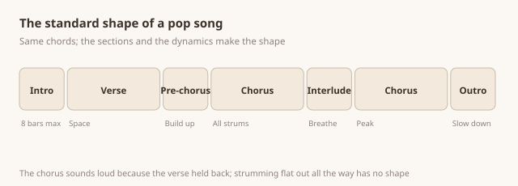
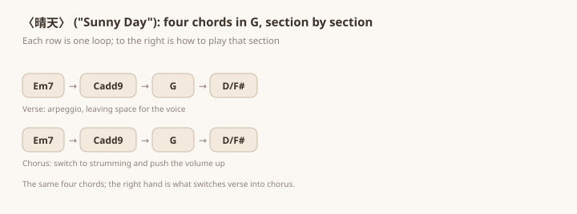

# Chapter 11: [Stage 1 in Practice] Playing and Singing a Classic Folk Ballad All the Way Through

> **What this chapter covers**
> 1. Learn to read the **standard form of a complete pop song (Intro / Verse / Pre-Chorus / Chorus / Outro)**.
> 2. Master the right-hand transition that switches smoothly from the "arpeggio (verse)" to the "soul strum (chorus)".
> 3. Pass the stage-one check: play and sing Jay Chou's 〈晴天〉 ("Sunny Day") all the way through on your own (later you can swap in an original song of the same level with no gap).

---

## 11.1 Reading the map of a whole song: standard pop song form

Everything you practised in the earlier chapters was a 4–8 bar fragment; from this chapter on you learn to drive a whole song three to four minutes long, the way a real performer does. Modern Chinese-language pop songs are usually assembled from these five standard modules:

| Section name | Role and job in the song | Accompaniment plan for a beginner's first stage |
| :--- | :--- | :--- |
| **Intro** | The song's opening statement. It establishes the sense of tempo and gives the singer the pitch of the first note. | Play the song's signature single-note melody, or run the verse chords through once. |
| **Verse** | The storytelling section. The melody is steadier and sits lower, and the job is getting the words across. | Use a gentle **arpeggio (`T1213121`)** and leave space for the voice. |
| **Pre-Chorus** | The feeling starts to build and warm up: a bridge section getting ready to push into the peak. | Change to **two strums a bar (half notes)** or light downstrokes, to build a sense of push. |
| **Chorus** | The most memorable, emotionally fullest part of the song. | Change to the full **soul strum (`↓ - ↓↑ - ↑↓↑`)** and let the energy out. |
| **Outro** | The ending, which brings the listener back to calm with something still ringing. | Slow the tempo for the last line of chords, and close with a gentle downward sweep across the last `G` chord. |

---

## 11.2 Playing and singing the whole thing: Jay Chou's 〈晴天〉 ("Sunny Day"), section by section

> **Performance setup**: key of `G major (Capo: 0)` | tempo `68 BPM` | what to have ready: a pick in the right hand (in the verse you can pluck single notes with the pick, or play fingerstyle and then pick up a pick you have already stuck to the pickguard, in time for the chorus)

### Full-song chart: chords and right-hand pattern, section by section

| Song section | Opening lyric cue | Core chord progression (2 or 4 beats per chord) | Right-hand pattern |
| :--- | :--- | :--- |
| **Intro** | `Em7` (2 beats) - `Cadd9` (2 beats) - `G` (2 beats) - `D/F#` (2 beats) × 2 | Follow the arpeggio intro chart in Chapter 10. |
| **Verse 1** | *a six-syllable opening phrase…* | `Em7` (2 beats) - `Cadd9` (2 beats) - `G` (2 beats) - `D/F#` (2 beats) × 4 | Arpeggio: `T 1 2 3` (each chord is half a bar, four notes) |
| **Pre-Chorus** | `Em7` (4 beats) - `Cadd9` (4 beats) - `G` (4 beats) - `D` (4 beats) × 2 | Setting up the feeling: four strums a bar (`↓ ↓ ↓ ↓`), crescendo |
| **Chorus** | `G` (4 beats) - `Em7` (4 beats) - `Cadd9` (4 beats) - `D` (4 beats) × 4 | **Soul strum**: `↓ - ↓↑ - ↑↓↑`, played at full force |
| **Outro** | `Em7` - `Cadd9` - `G` (on the last beat, a slow downward sweep from the 6th string through to the 1st) | The tempo eases off (ritardando), so the last `G` rings out and fades on its own |

### Practice checklist (the standard for finishing stage one)

- [ ] **Steady tempo.** From the intro to the chorus, when you change patterns, the tempo stays around `68 BPM` and doesn't suddenly bolt faster because of the strumming switch.
- [ ] **Getting through with no breaks.** Even if a note or two doesn't ring cleanly on the way, you keep the rhythm and play and sing to the end (the stage habit of "the performance never drops a beat").

