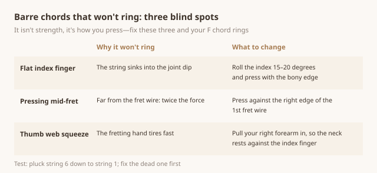
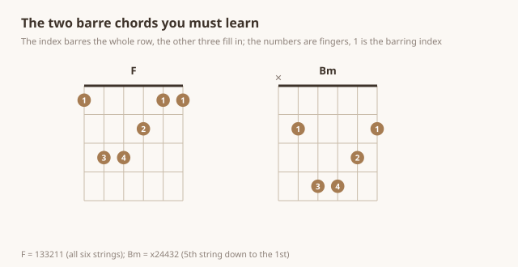
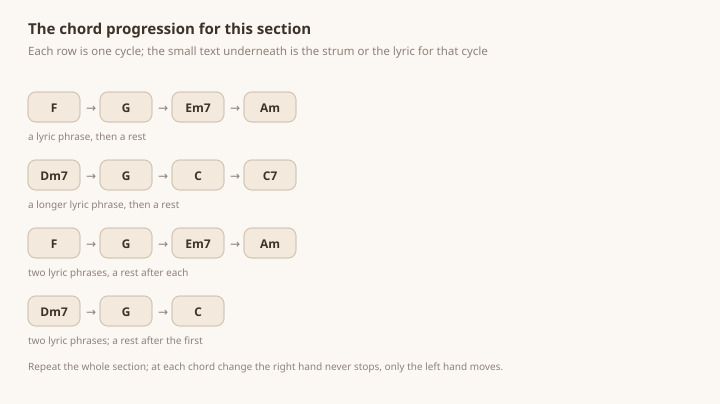

# Chapter 12: No More Substitute Chords — Getting Past the F and Bm Barre Chords Without Pain

> **What this chapter covers**
> 1. Break the three physical blind spots that stop a barre chord from ringing, and stop fighting it with brute force.
> 2. Master **"power from the side of the index finger"** and **"borrowing leverage from the right forearm"**, so that `F` and `Bm` ring without effort.
> 3. Understand the "shape-sliding logic" of barre chords, and work out chords across the whole fretboard from one shape.
> 4. Play through the barre chord changes in Hebe Tien's 〈小幸運〉 ("A Little Happiness").

---

## 12.1 Why won't your F chord ring? The three physical blind spots

**Barre chords** (also called closed chords) are the most famous dividing line in learning guitar. The idea is to use the left index finger like a human capo, pressing across all six strings at once, and then fret the other notes with the middle, ring and little fingers.

Failing to get the `F` chord to ring is mostly not because "your fingers aren't strong enough", but because you are applying force the wrong way:

| The mistake beginners make | The physical reason it won't ring | The correct, painless fix |
| :--- | :--- | :--- |
| **Blind spot 1: pressing with the soft pad on the front of the index finger** | The front of the index finger has a dip at the joint, and the string sits right in that groove, which deadens it. | **Turn the index finger about 15–20 degrees toward the headstock (to the left)**, and press with the harder bony edge along the side of the finger. |
| **Blind spot 2: pressing in the middle of the fret** | Too far from the fret wire on the right, so it takes more than twice the grip to push the string down onto the wire. | Keep the index finger right up **against the edge of the fret wire on its right side**: the least effort, and the cleanest sound. |
| **Blind spot 3: clamping for dear life with the left-hand web** | Squeezing with the left thumb and index finger, and 30 seconds later the web of the hand is cramped and sore. | **Use leverage**: the right forearm presses lightly on the lower right edge of the guitar body and pulls inward, so the neck comes back toward the left index finger and lends it force. |

---

## 12.2 The two barre shapes you have to learn: `F` (E-shape barre) and `Bm` (A-shape barre)

> **🚀 The shape-sliding trick**: once you know the `F` chord, slide the whole hand shape, unchanged, two frets toward the guitar body (index barring the 3rd fret) and it becomes **`G`**; slide it to the 5th fret and it is **`A`**. In the same way, `Bm` (2nd fret) slid one fret along to the 3rd fret is **`Cm`**, and slid to the 5th fret it is **`Dm`**.

---

## 12.3 Barre chords in practice: the chorus of Hebe Tien's 〈小幸運〉 ("A Little Happiness")

〈小幸運〉 ("A Little Happiness") is originally in **F major** (most online charts mark it "Capo 5, C shapes"). The chart below is a **C major practice version** with only one barre chord, `F`. To match the record, clamp the capo on the 5th fret; to practise the original key directly, move the whole set up 5 semitones: `B♭ – C – Am – Dm – Gm7 – C – F` (swapping in the `B♭` barre chord). Separately, if you want to get `Bm` smooth on its own, you can loop `Bm – G – D – A` four times, leaving one beat free at each chord change — that progression isn't in 〈小幸運〉, it's just for practising barres.

| Chord progression | Lyric |
| :--- | :--- |
| `F` → `G` → `Em7` → `Am` | an eleven-syllable line (empty) |
| `Dm7` → `G` → `C` → `C7` | a fourteen-syllable line (empty) |
| `F` → `G` → `Em7` → `Am` | a ten-syllable phrase (empty), then a six-syllable phrase (empty) |
| `Dm7` → `G` → `C` | a seven-syllable phrase (empty), then a seven-syllable phrase with no rest |

---

## 12.4 Chapter checklist

- [ ] **The one-string-at-a-time test.** Holding the `F` chord, pluck from the 6th string to the 1st, one string at a time; all six ring out clear.
- [ ] **Painless leverage.** After holding a barre for a minute, the web of the left hand isn't badly sore, because you are borrowing force from the right forearm pressing lightly inward.
- [ ] **Smooth changes.** You can change between `F → G` and `Bm → Em` cleanly within one beat.
