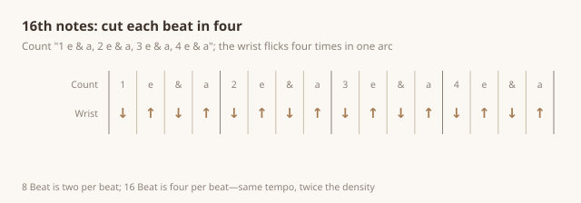
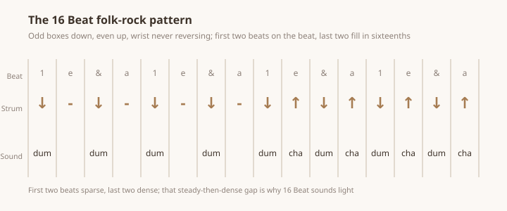
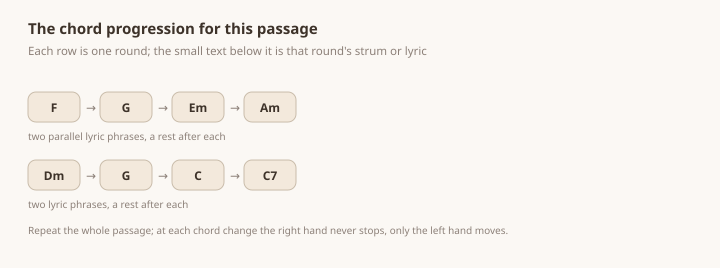

# Chapter 13: The Secret of Upbeat Songs — 16 Beat Strumming and Folk Rock

> **What this chapter covers**
> 1. Learn the **16th-note count (`1 e & a`)** that splits every beat into four equal parts.
> 2. Adjust the right wrist's swing — smaller arc, faster rate — and play a **16 Beat groove** with real grain to it.
> 3. Master **accenting**, so the strum pushes forward the way a drum kit does.
> 4. Play the 16 Beat chorus of 〈那些年〉 ("Those Years"), that coming-of-age anthem.

---

## 13-1 Getting to know the 16th note: four strokes a beat, and the fine grain that comes with it

When you hear a bright, mid-tempo pop song — the chorus of 〈那些年〉 ("Those Years"), say, or 〈小情歌〉 ("Little Love Song") — the right hand has already moved up from "one down-and-up per beat (8 Beat)" to **"two down-and-ups per beat (16 Beat)"**. In other words, every beat now holds four 16th notes.

### The standard count for 16th notes, with stroke directions

| Where in the beat | 1st note (on the beat) | 2nd note | 3rd note (off the beat) | 4th note |
| :--- | :--- | :--- | :--- | :--- |
| **The English count** | **`1`** (one) | **`e`** (ee) | **`&`** (and) | **`a`** (uh) |
| **The Chinese mouth-sound count** | **`答`** (da) | **`卡`** (ka) | **`答`** (da) | **`卡`** (ka) |
| **Right-hand stroke** | **downstroke (`↓`)** | **upstroke (`↑`)** | **downstroke (`↓`)** | **upstroke (`↑`)** |
| **Accent and force** | **strong (all six strings)** | weak (brush the high strings lightly) | medium-strong (the middle register) | weak (brush the high strings lightly) |

> **⚡ The wrist trick: shrink the swing.** The wrist is now moving twice as fast, so don't swing it as wide as you did for 8 Beat! Imagine your right wrist **shaking briskly inside the diameter of a 50-yuan coin** — brushing only the bottom **3 or 4 strings**, and widening the arc just a little on the accented beats so the pick reaches the root note on the low string.

---

## 13-2 The classic 16 Beat pop folk-rock pattern

This pattern combines the steadiness of eighth notes with the forward drive of 16th notes. It is the most-used strum in the chorus of Chinese-language pop rock:

---

## 13-3 Putting it to work: the chorus strum of Hu Xia's 〈那些年〉 ("Those Years")

The verse of 〈那些年〉 ("Those Years") is gentle as water (you can use the arpeggio fingerpicking from Chapter 6 for it). The moment the chorus arrives, it switches to an explosive 16 Beat strum. The emotional contrast is what makes the song land.

| Chord progression | Lyric |
| :--- | :--- |
| `F` → `G` → `Em` → `Am` | an eight-syllable phrase (rest), then a matching eight-syllable phrase (rest) |
| `Dm` → `G` → `C` → `C7` | a five-syllable phrase (rest), then a seven-syllable phrase (rest) |

---

## 13-4 Chapter checklist

- [ ] **The count, exact.** With a metronome at `65 BPM`, you can say `1 e & a 2 e & a 3 e & a 4 e & a` evenly and strum up and down in time with it.
- [ ] **Loud and soft layers.** Strumming 16 Beat, not every beat comes out at the same volume: the accent on the beat and the light brush across the high strings are clearly audible as the level rises and falls.
- [ ] **Emotional tension.** You can accompany the whole chorus of 〈那些年〉 ("Those Years") with a full, steady 16 Beat strum.
