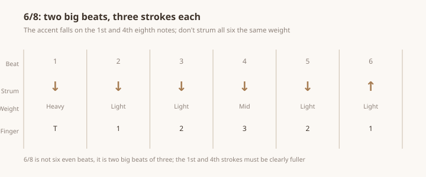
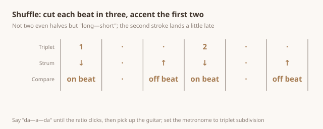
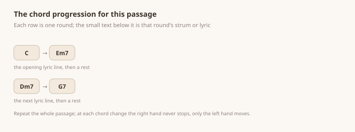

# Chapter 14: Swing and Triplets — 6/8 Time and the Shuffle Groove

> **What this chapter covers**
> 1. Step out of the 4/4 frame and get the romantic, swaying **6/8 time** groove — strong, weak, weak, medium-strong, weak, weak.
> 2. Meet the **triplet** and the long–short, long–short bounce of a **shuffle**.
> 3. Play the shuffle accompaniment for Jay Chou's romantic hit 〈告白氣球〉 ("Love Confession").

---

## 14-1 Romantic as waves on the shore: fingerpicking and strumming in 6/8

Plenty of ballad sections — a chorus with a three-beat feel, a 12/8 blues — are in **6/8 time: the eighth note gets one beat, and there are six beats to the bar**. The weight of the rhythm falls on **beat 1 (strong)** and **beat 4 (medium-strong)**, so it sways the way a waltz does, or the way waves hit the beach in a steady rhythm:

---

## 14-2 The bounce that makes you nod along: the shuffle groove

Another popular groove in light R&B and pop love songs is the **shuffle**. Its secret: cut every beat into **three equal parts (a triplet: `1 - 2 - 3`)** and then leave out the middle note, the 2nd. What's left is a **long note (2/3 of the beat)** followed by a **short one (1/3 of the beat)**, and that limping skip is the whole feel (say it `dum—ka, dum—ka`).

### Straight rhythm versus shuffle rhythm, side by side

| What's compared | Plain straight 8 Beat | Shuffle / swing |
| :--- | :--- | :--- |
| **How the beat is divided** | Two equal halves (`50%` + `50%`) | **Triplet proportions, long then short (`67%` + `33%`)** |
| **What it sounds like when you say it** | A robot walking: `答—答—答—答` (da—da—da—da) | A light jog: `答～卡、答～卡、答～卡` (da~ka, da~ka, da~ka) |
| **Where you hear it** | Campus folk, pop rock (〈擁抱〉, "Embrace") | Light R&B, jazz pop, romantic ballads (〈告白氣球〉, "Love Confession") |

---

## 14-3 Putting it to work: the verse groove of Jay Chou's 〈告白氣球〉 ("Love Confession")

〈告白氣球〉 ("Love Confession") is the textbook example of a light shuffle. We put the short note of each beat (the upstroke) on the **3rd** position of the triplet — two-thirds of the way through the beat, not on the back half — and the whole song picks up that light swing:

| Chord progression | Lyric |
| :--- | :--- |
| `C` → `Em7` | a nine-syllable phrase (rest) |
| `Dm7` → `G7` | a nine-syllable phrase (rest) |

---

## 14-4 Chapter checklist

- [ ] **Where 6/8 leans.** Playing in 6/8, you clearly mark beats 1 and 4, and it doesn't come out as six flat, even strokes.
- [ ] **The swing.** You can hear the difference between a straight strum and a shuffle, and play that skipping long~short, long~short feel.
