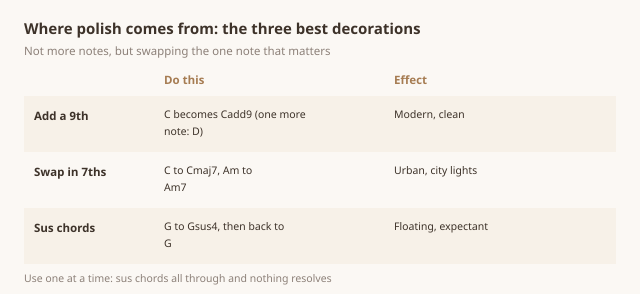
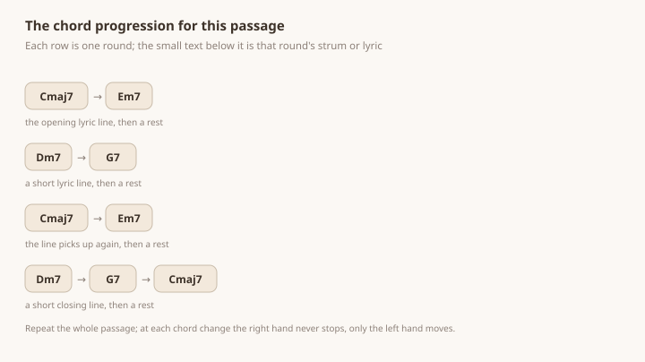

# Chapter 15: Seasoning Your Chords — Sus Chords and Seventh Chords

> **What this chapter covers**
> 1. Get to know the hovering, extended colour of **`sus2` and `sus4` chords** by ear, without memorising interval theory first.
> 2. Learn the **seventh-chord family (`Maj7`, `m7`, `7`)** shapes that modern pop and R&B can't do without.
> 3. Learn the swap that turns a plain triad into a coloured chord by **moving just one or two fingers**.
> 4. Dress 〈告白氣球〉 ("Love Confession") in coloured chords and hear the arrangement's texture lift on the spot.

---

## 15-1 Why do good players' accompaniments sound so "expensive"?

Have you ever wondered why the same `C - Am - Dm - G` sounds like a campfire singalong from one player and like an urban R&B love song off a record from another? The secret is that they add a **suspended note** and a **7th** to the plain triad.

### Common colour chords at a glance: what they sound like, and how the fingering changes

| Colour chord | The mood it paints | The one-finger change from the plain chord | When to swap it in |
| :--- | :--- | :--- | :--- |
| **`Csus2` / `Dsus2`** | Wide, clear, hovering — a story not finished yet | `Dsus2`: fret a `D` chord, then **lift the middle finger off the 1st string** (so the 1st string rings open, `0`). | Good in an intro, an outro or a ballad verse, to open up some space. |
| **`Csus4` / `Dsus4`** | Full of anticipation, a tension that wants to resolve | `Dsus4`: fret a `D` chord, then **add the little finger (4) on the 1st string, fret 3**. | Usually placed in front of the plain chord (`Dsus4 → D`) to make a melody line rise and fall. |
| **`Cmaj7` / `Fmaj7`** | Dreamy, bookish, warm and slightly tipsy | `Cmaj7`: fret a `C` chord, then **lift the index finger off the 2nd string** (you only hold the 5th string at fret 3 and the 4th at fret 2 — easier than `C`!). | Can replace the `C` and `F` major triads in most ballads as it stands. |
| **`Am7` / `Em7` / `Dm7`** | Soft, urban, and it takes the sharp edge off the sadness | `Am7`: fret `Am`, then **lift the ring finger**; `Dm7`: lay the index across the 1st and 2nd strings at fret 1, and put the middle finger on the 3rd string at fret 2. | Standard issue in R&B, Japanese pop and modern Chinese-language love songs. |
| **`G7` / `C7`** | A strong push to get back to the home chord | `G7`: finger 1 on the 1st string at fret 1, finger 2 on the 5th string at fret 2, finger 3 on the 6th string at fret 3. | Best in the last bar before the chorus, or at a bridge where the key changes. |

---

## 15-2 Putting the upgrade to work: an R&B version of 〈告白氣球〉

Swap the plain `C - Em - Dm - G` for the seventh chords `Cmaj7 - Em7 - Dm7 - G7` and listen: the harmony is suddenly full of a modern feel.

| Chord progression | Lyric |
| :--- | :--- |
| `Cmaj7` → `Em7` | an eleven-syllable phrase (rest) |
| `Dm7` → `G7` | a six-syllable phrase (rest) |
| `Cmaj7` → `Em7` | an eleven-syllable phrase (rest) |
| `Dm7` → `G7` → `Cmaj7` | a five-syllable phrase (rest) |

---

## 15-3 Chapter checklist

- [ ] **The one-finger transformation.** Without looking at a chord chart, you can go from `C` to `Cmaj7` by lifting the index finger, from `Am` to `Am7` by lifting the ring finger, and from `D` to `Dsus4` by adding the little finger.
- [ ] **Hearing the colour.** You can hear the change from `Dsus4` to `D` — from hovering back to settled.

## Practice settings

- **Slow practice**: take the tempo at which you can play it **completely right**, drop it another 20%, and only speed up after two clean runs in a row.
- **Amount**: 10–15 minutes a day, with a one-minute break in the middle. Better short and accurate than long and scattered.
- **Pass mark**: you play the whole passage with the metronome, without stopping, with no dead notes in the chords.
