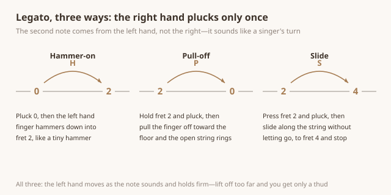
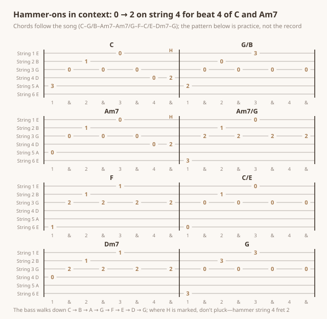

# Chapter 16: Small Expressions from the Left Hand — Hammer-Ons, Pull-Offs and Slides

> **What this chapter covers**
> 1. Learn the left hand's three big legato techniques: **hammer-on (`H`)**, **pull-off (`P`)** and **slide (`S`)**.
> 2. Learn to add these small ornaments **while you are already holding a chord**, so that a static accompaniment grows a singing melody line.
> 3. Take apart the most representative chord-ornament passage in Mayday's 〈突然好想你〉 ("Suddenly I Miss You").

---

## 16-1 Making the guitar sing like a voice: the three legato brothers

When a person sings, the notes do not jump stiffly from one to the next; they carry smooth turns and a connection of breath. On the guitar we create that same fine, voice-like expression with the left hand's **legato techniques**. **The right hand plucks only the first note; the second note is sounded entirely by a left-hand finger striking, flicking or sliding on the string.**

### The three legato techniques: notation and how the left hand produces each one

| Technique | English name and notation | What the left hand actually does | The beginner's usual mistake, and the fix |
| :--- | :--- | :--- | :--- |
| **Hammer-on** (struck note) | **Hammer-on (`H`)**, e.g. `0 H 2` | The right hand plucks the open string `0`, then a left-hand finger comes down **like a small hammer**, striking the 2nd fret fast and vertically and staying pressed—the energy of the strike itself sounds the second note. | Moving too slowly, so the finger is merely placed down gently, which kills the vibration. **The strike has to be fast, accurate and firm, and the fingertip has to stay upright.** |
| **Pull-off** | **Pull-off (`P`)**, e.g. `2 P 0` | Press the 2nd fret firmly. After the right hand plucks, the left-hand finger **hooks slightly downward, toward the floor, across the string** as it leaves, dragging the open string into sound. | Just lifting the finger straight up, which makes the second note too quiet. There has to be **a slight downward flick**. |
| **Slide** | **Slide (`S` or `/`)**, e.g. `2 S 4` | Press the 2nd fret, pluck, then **keep the pressure on without easing it** and slide the whole finger smoothly along the string, stopping at the 4th fret. | The finger relaxes its pressure mid-slide, so the sound dies halfway there. |

---

## 16-2 Putting the ornaments inside the chords: the progression of 〈突然好想你〉 ("Suddenly I Miss You")

On `C` and `Am7`, using a finger you have spare to hammer on the 4th string (**`0 H 2`, D→E**) is the most common ornamental move in pop folk. The song's progression is `C - G/B - Am7 - Am7/G - F - C/E - Dm7 - G`, and the bass walks all the way down (C→B→A→G→F→E→D→G), which happens to leave plenty of empty slots to drop hammer-ons into.

The arpeggios and hammer-on positions below are **an arrangement for practice, not a transcription of the record**. Every guitarist plays the original differently. What matters is the move itself: **strike a note into the empty space**.

### How to practise

1. **First, no hammer-ons**: pluck all eight notes with the right hand, and check that every chord's bass note is right.
2. **Add the hammer-on**: in the `C` and `Am7` bars, on the off-beat of beat 4 (the last eighth note), don't pluck with the right hand—strike the 4th string, 2nd fret with the middle finger instead. The volume has to match a plucked note, or it sounds like a dropped beat.
3. **Put it into the song**: loop the whole section four times, leaving a beat free for each chord change. Once that is solid, push the tempo to 66 BPM and check it against the record.

---

## 16-3 Chapter checklist

- [ ] **A clean hammer-on.** With no second pluck from the right hand—only the left index and middle fingers striking `0 H 2`—you get two notes at a clear, audible volume.
- [ ] **Pull-off drill.** You can make `2 P 0` and `3 P 0` flow, and the ring finger does not pull the high strings out of shape.
- [ ] **Ornaments inside the chords.** You can add the `0 H 2` hammer-on naturally while playing arpeggios on `C` and `Am`.
