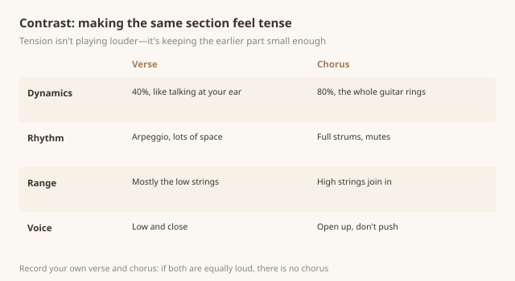

# Chapter 17: Stage Workout 2 — A Mandopop Hit Challenge

> **What this chapter covers**
> 1. Pull together every advanced technique from part three: **full barre chords (`F`, `Bm`)**, **16 Beat strumming**, **colour chords** and **left-hand ornaments**.
> 2. Learn to design a ballad-rock arrangement with an enormous emotional span—from the silence of a soliloquy all the way up to a heart-rending chorus that lets everything out.
> 3. Clear the intermediate-stage final check: perform Mayday's 〈突然好想你〉 ("Suddenly I Miss You") all the way through (you can swap in an original song of the same level later).

---

## 17-1 Controlling emotional tension: how do you play a contrast that gives people goosebumps?

Once you are past the beginner stage, the test of a good sing-and-play is no longer "did you play a wrong note". It is **"is the emotional contrast sharp enough"**. Take 〈突然好想你〉 ("Suddenly I Miss You"). The song opens like someone talking quietly to the empty air late at night, but by the chorus—the title line itself—it is a shout with the feeling breaking through the banks.

### The arrangement plan, section by section: technique and emotional dynamics

| Song section | The lyric it starts on | Core chord progression | Right-hand accompaniment and emotional treatment |
| :--- | :--- | :--- | :--- |
| **Intro** | *(piano and guitar in conversation)* | `C` - `G/B` - `Am7` - `Am7/G` - `Fmaj7` - `C/E` - `Dm7` - `G` | Add the hammer-on ornaments as in chapter 16, slow the tempo and slow your breathing, and build the feeling of looking back at a remembered scene. |
| **Verse 1** | *an eight-syllable opening phrase...* | `C` - `G/B` - `Am7` - `Am7/G` - `Fmaj7` - `C/E` - `Dm7` - `G` | **Leave enormous space**: use just the thumb brushing lightly downward once on beat 1 of each bar, so the unaccompanied feel of the voice is the absolute star. |
| **Pre-Chorus** | *two phrases, five syllables then three...* | `F` - `G` - `Em` - `Am` - `Dm` - `G` - `C` - `C7` | **The full barre chord arrives, plus a crescendo**: use the complete `F` barre and change the right hand to steady quarter-note downstrokes (`↓ ↓ ↓ ↓`, one per beat), adding weight bar by bar. |
| **Chorus** | *two five-syllable phrases, the first the title line...* | `F` - `G` - `Em` - `Am` - `Dm` - `G` - `C` - `C7` | **Full ballad-rock strumming, breaking open**: use a full 8 Beat soul strum or a 16 Beat strum, and let the barre chords and the high-register resonance release the tension. |

---

## 17-2 Stage-two graduation checklist

- [ ] **Barre-chord stamina.** When `F` comes round again and again in the pre-chorus and chorus, the wrist stays relaxed, and the web of the thumb doesn't get so sore that the later bars fall apart.
- [ ] **Extreme stillness to extreme motion.** You can pull off the violent dynamic contrast between the verse's "one light brush, almost unaccompanied" and the chorus's "full, saturated strumming".
- [ ] **Ornament stability.** When the intro adds hammer-ons (`H`), the beat stays exact and steady, and you don't drag the tempo doing the technique.

## Practice settings

- **Slow practice**: take the tempo at which you can play it "completely right" and drop it another 20%. Two clean passes in a row before you speed up.
- **Dose**: 10–15 minutes a day, with a one-minute break in the middle. Short and accurate beats long and scattered.
- **Pass mark**: play a whole section with the metronome, without stopping, without a muted chord—only then does it pass.
