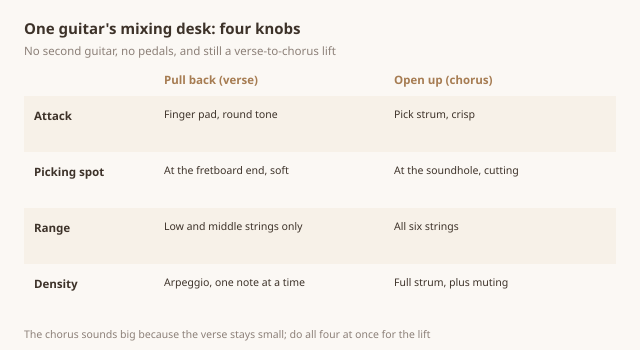
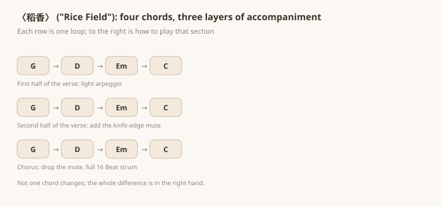

# Chapter 18: Designing a Song's Rise and Fall — Switching Dynamics Between Verse and Chorus

> **What this chapter covers**
> 1. Take on a music producer's **arranging mind**, and leave behind the stiff sing-and-play that keeps one accompaniment pattern from the first bar to the last.
> 2. Master the four physical knobs that control one guitar's volume: **what you pluck with, where you touch the string, the chord's register, and rhythmic density**.
> 3. Learn to use a **palm mute** to build a tense, expectant set-up through the pre-chorus.
> 4. Work through Jay Chou's 〈稻香〉 ("Rice Field") as an arranging demonstration: four chords running through the whole song, and still full of layers.

---

## 18-1 One guitar's mixing desk: the four knobs that control dynamic layers

In a professional studio arrangement, the producer creates a song's rise and fall by adding and removing instruments (the verse has piano only; the chorus brings in the drum kit and the electric guitar). When all you have is one acoustic guitar and your voice, you can get exactly the same arranging effect with these four **body knobs**:

| Dynamic control knob | The soft, quiet setting (for the verse) | The full, wide-open setting (for the chorus) |
| :--- | :--- | :--- |
| **1. How the right hand makes the sound** | Pluck with **the pad of the finger** (round, warm tone). | **Strum with a pick** (bright, clear tone, more volume). |
| **2. Where the right hand touches the strings** | Pluck close to **the end of the fretboard (to the left of the soundhole)**: fewer overtones, a softer sound. | Strum near **the centre of the soundhole, or slightly to the right of it**: strong grain in the midrange, more penetration. |
| **3. Rhythmic density and register** | **Arpeggios** (only one note sounding at a time), or the bass and middle strings only. | **Full strums** (all six strings ringing together), with muted strokes and 16th-note movement. |
| **4. The pre-chorus transition trick** | In the four bars before the chorus, use a **right-hand palm mute**: lay the knife edge of the hand lightly on the strings just in front of the saddle, and mute-strum the low strings downward with the pick only, for a "boom, boom, boom, boom" that sets up like a quickening heartbeat—then release on the chorus's first beat and strum everything. |

---

## 18-2 Four-chord arranging, demonstrated: Jay Chou's 〈稻香〉 ("Rice Field")

〈稻香〉 ("Rice Field") uses almost nothing but **`A - E - F#m - D`** from the first bar to the last (or capo on the 2nd fret and play it with **`G - D - Em - C`** shapes), four chords looping to the end, and it never feels monotonous for a moment. The secret is that the rhythmic layering changes in every section:

**The core loop**: `G` → `D` → `Em` → `C` (capo 2, playing it with G shapes)

| Section | The lyric it starts on | How the accompaniment is set up here |
| :--- | :--- | :--- |
| **Intro and first half of the verse** | a fourteen-syllable phrase, the line running on… | Light arpeggio fingerpicking (`T 1 2 3`), clean single notes only. |
| **Second half of the verse (the rap groove)** | a six-syllable phrase, then a twelve-syllable one… | Add the right-hand knife-edge mute (`↓ - ✕ ↑ - ↑ ✕ ↑`) and cut the groove out. |
| **The chorus, breaking open** | an eleven-syllable phrase, the line running on… | Drop the mute restriction and change to open, full 16 Beat strumming. |

All three sections use the same four chords. The thing that really makes them sound like three different songs is **the right hand**: how it produces the note, how dense the muting is, how hard it strums.

---

## 18-3 Chapter checklist

- [ ] **The palm-mute build-up.** You can produce the steady heartbeat of a knife-edge palm mute, strumming downward beside the saddle, and then snap straight back to a clean full strum on the next bar.
- [ ] **Four chords, three layers.** With the same `G - D - Em - C`, you can play three completely different kinds of emotional tension: arpeggio fingerpicking, muted strumming, and a full strum.

## Practice settings

- **Slow practice**: take the tempo at which you can play it "completely right" and drop it another 20%. Two clean passes in a row before you speed up.
- **Dose**: 10–15 minutes a day, with a one-minute break in the middle. Short and accurate beats long and scattered.
- **Pass mark**: play a whole section with the metronome, without stopping, without a muted chord—only then does it pass.
