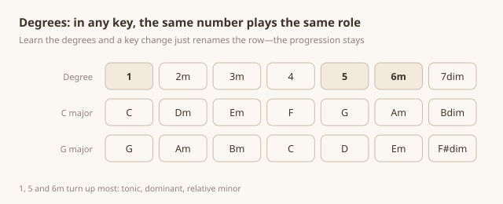
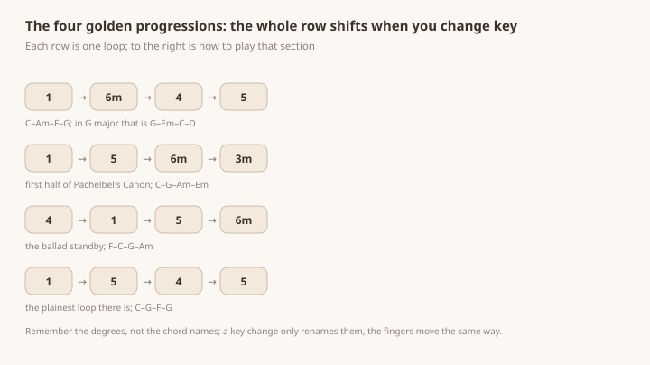
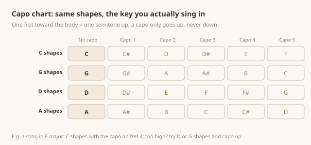

# Chapter 19: Cracking the Code of Pop Songs — Understanding Basic Chord Degrees

> **What this chapter covers**
> 1. Understand fully, in the plainest "relative position" terms, the **numeral chord degrees (degrees `1` to `7`)** that music producers talk about all day.
> 2. Memorise the **four "golden chord progression formulas"** that Chinese-language pop uses most.
> 3. Learn to read a number chart and change key straight off it (turn a song in C into one you play in G, in a second).
> 4. Start building the ear that hears a chord from the sound, and begin to get free of memorising the tab.

---

## 19.1 What is a "chord degree"? Music's relative coordinates, in one minute

You've certainly heard a band player say before rehearsal: "The chorus of this one just goes **`4 - 5 - 3 - 6`**." That string of mysterious numbers is the **chord degree (the scale degree, or the Nashville number system)**.

The principle is very simple: **number the seven notes of any major scale (`Do Re Mi Fa Sol La Si`) in order as degrees `1, 2, 3, 4, 5, 6, 7`**, and that's the whole idea. Of those, **degrees `1`, `4` and `5` are major triads** (capital Roman numerals `I`, `IV`, `V`), **degrees `2`, `3` and `6` are minor triads** (lower-case Roman numerals `ii`, `iii`, `vi`), and **degree `7` is a diminished triad** (`vii°`). Degree `5` often takes a flat seventh on top and becomes the dominant seventh `V7`.

### C major and G major side by side: the chord degrees you'll use most (guitarists, save this one!)

| Degree | **`1` (`I`)** | **`2` (`ii`)** | **`3` (`iii`)** | **`4` (`IV`)** | **`5` (`V`)** | **`6` (`vi`)** |
| :--- | :--- | :--- | :--- | :--- | :--- | :--- |
| **Chord quality** | major triad (the stable tonic) | minor triad (a soft transition) | minor triad (a delicate bridge) | major triad (opens out, lifts) | major triad (a strong pull home) | minor triad (tender, expressive) |
| **Chords in C major** | **`C`** | **`Dm`** | **`Em`** | **`F` (Fmaj7)** | **`G`** | **`Am`** |
| **Chords in G major** | **`G`** | **`Am`** | **`Bm`** | **`C` (Cadd9)** | **`D`** | **`Em`** |

---

## 19.2 The four "golden chord progression formulas" of Chinese-language pop

Learn these four degree formulas, and from then on every new song you hear will turn out—to your surprise—to be these same few codes, rearranged:

| Formula | The degree progression | The actual chords in C major | What it feels like, and the classic songs |
| :--- | :--- | :--- | :--- |
| **1. The all-purpose pop loop** | **`1 - 6 - 4 - 5`** | `C - Am - F - G` | The most classic, most stable pop progression; bright and dark alternate naturally (e.g. 〈小薇〉 "Xiao Wei"). |
| **2. The Chinese tearjerker** | **`4 - 5 - 3 - 6`** | `F - G - Em - Am` | The first choice for the chorus of a Chinese-language ballad! It pushes straight up from degree 4, full of tender tension (e.g. 〈小幸運〉 "A Little Happiness", 〈突然好想你〉 "Suddenly I Miss You"). |
| **3. The Canon progression** | **`1 - 5 - 6 - 3 - 4 - 1 - 4 - 5`** | `C - G - Am - Em - F - C - F - G` | A beautiful descending bass line, an epic, flowing feel (e.g. 〈突然好想你〉 "Suddenly I Miss You"; 〈稻香〉 "Rice Field" is the `1-5-6-4` above). |
| **4. The warm folk progression** | **`1 - 3 - 6 - 5`** | `C - Em - Am - G` | Slides straight from the bright degree 1 into the melancholy degree 3; a strong singer-songwriter, storytelling feel (e.g. 〈擁抱〉 "Embrace"). |

---

## 19.3 Putting chord degrees to work: a one-second transposition exercise

The biggest benefit of learning degrees is that **you never have to be afraid of a key change again**. Take the G major progression of 〈稻香〉 ("Rice Field") from the table above, **`G - D - Em - C`**, and convert it to degrees against the table: you'll find it is **`1 - 5 - 6 - 4`**. If you want to play and sing it with C major shapes today, look across the C major row and you get **`C - G - Am - F`** straight away.

---

## 19.4 Chapter checklist

- [ ] **Degree reflex**: hear `4 - 5 - 3 - 6` in the key of `C` and you can say the matching chords immediately: `F - G - Em - Am`.
- [ ] **Ear connection**: you can tell by ear whether a section of the song is sitting on the stable "degree 1, the tonic chord" or is hanging on "degree 5, the dominant chord" with its strong sense of floating expectation.

## Practice settings

- **Slow practice**: take the tempo at which you can play it **completely right**, drop it another 20%, and only speed up after two clean runs in a row.
- **Amount**: 10–15 minutes a day, with a one-minute break in the middle. Better short and accurate than long and scattered.
- **Pass mark**: you play the whole passage with the metronome, without stopping, with no dead notes in the chords.
