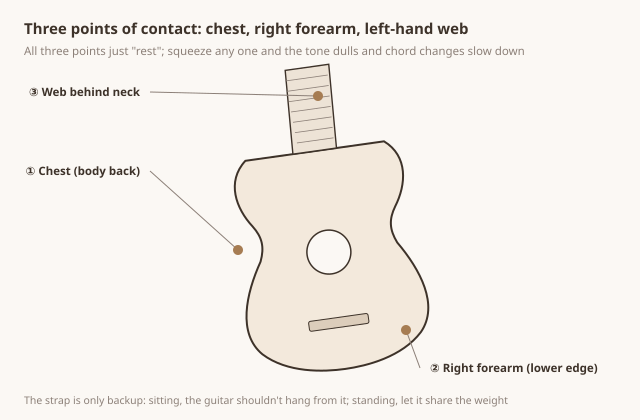
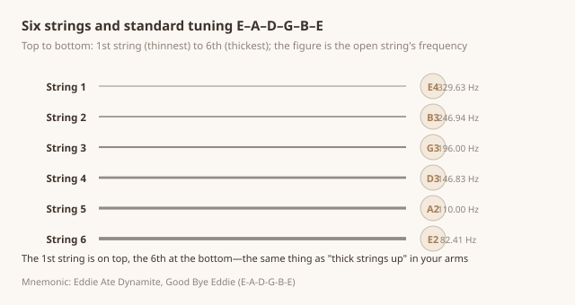
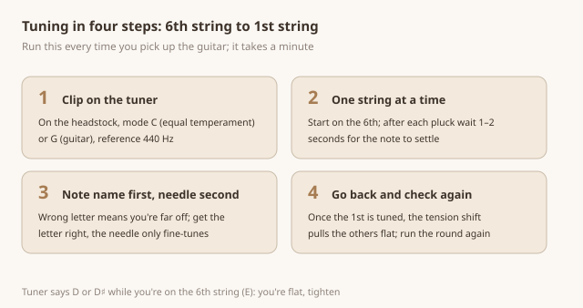
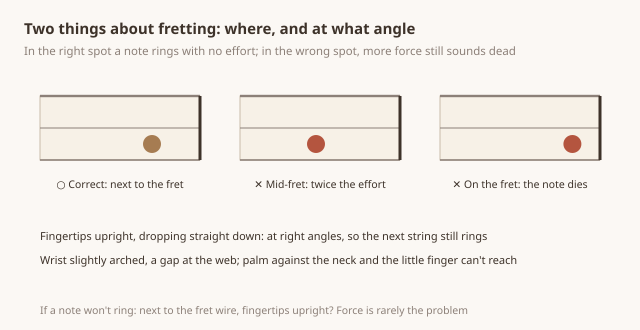

# Chapter 2: Holding the Guitar Without Strain, and Tuning It Precisely

> **What this chapter covers**
> 1. The **standard sitting position** and the **standing position with a strap** — the two most ergonomic ways to hold the guitar — so your shoulders and neck don't ache and your wrists don't get hurt.
> 2. How the six strings of an acoustic guitar are numbered, and the **note names of standard tuning (E-A-D-G-B-E)**.
> 3. How to work a clip-on tuner, and the one tuning habit that keeps a guitar in tune: **always come up to the note from below**.
> 4. The left-hand habits that save effort: **fingertips standing vertical on the string**, and **the thumb as a support point** behind the neck.

---

## 2-1 The ergonomic way to hold the guitar: let it become part of your body

In the first two weeks, the thing that aches for most beginners isn't the fingers. It's the **right shoulder, the neck and the lower back**. That's usually the posture: to see where the left hand is, you bend forward and round your back like a shrimp, or you lay the guitar flat across your thighs, the way you'd play a guzheng (a Chinese zither).

Holding the guitar correctly doesn't only let you play longer without tiring. It also keeps your chest open, so that later, when you sing, there's room for the sound to resonate.

### The standard sitting position for practice (shown right-handed; reverse it if you're left-handed)

1.  **Choose a chair with no armrests**: the right height is one where your thighs and lower legs make a 90-degree angle with both feet flat on the floor. **Don't practise on a soft sofa or the edge of a bed** — too soft a seat tilts your pelvis back and the armrest blocks your right arm.
2.  **Set the waist of the body on your right thigh**: the deepest curve of the guitar's side sits firmly on your right thigh. (More advanced players sometimes cross the right leg or use a footstool; as a beginner, both feet flat is the most stable.)
3.  **Keep the body against your chest, tilted slightly inward**: the back of the guitar rests naturally against your right ribs and belly. **The detail that matters**: the top of the guitar should be **vertical**, or tilted toward you by at most 5 ~ 10 degrees, just enough that you can glance down at the fretboard. It should never lie face up.
4.  **Raise the neck 15 ~ 30 degrees**: the headstock ends up roughly level with your **shoulder**, not drooping toward the floor. Tilting the neck up takes most of the strain out of your left wrist.
5.  **Rest the right forearm on the widest part of the body**: the place where upper arm meets forearm (about 3 ~ 5 cm below the elbow) sits lightly on the back-right edge of the guitar, and the hand hangs naturally over the **soundhole**. Note: **don't clamp the guitar with your right arm**. The guitar balances on two points — the support of your right thigh and the light weight of your forearm.

### Common mistakes, and the fix

| Body part | What beginners do | What it costs you | The fix |
| :--- | :--- | :--- | :--- |
| **Head and neck** | Tilting the head down to watch the left hand, as if reading a phone. | The neck takes the load and the throat gets squeezed, **so the high notes won't come out when you sing**. | Sit up straight and glance sideways at the white dots on the edge of the fretboard. |
| **Body angle** | Lying the guitar face-up on your thighs. | The left wrist has to fold right over to reach the strings, which easily brings on carpal tunnel trouble. | Keep the top vertical, tilted 5 ~ 10 degrees at most. |
| **Neck height** | The headstock hanging lower than your waist. | The left ring finger and little finger can't reach, and you keep catching other strings when you fret a chord. | Let the headstock come up to shoulder height (about 15 ~ 30 degrees). |
| **Right shoulder and arm** | Shoulder up by your ear, elbow propped on the top edge of the body. | The shoulder muscles lock up, and your strumming hand catches and stutters. | Take a deep breath, drop both shoulders, let the forearm rest on the back edge of the body, and keep the wrist loose. |

---

## 2-2 The six strings and standard tuning

Before you make a sound, you need the two things every guitarist in the world agrees on: **the order of the string numbers** and **the standard tuning**.

### Numbering the strings: thinnest to thickest, counted from the bottom up

Hold the guitar and look down. The string closest to your eyes is the thickest one, and it is the **6th string**. The thin string nearest the floor is the **1st string**. This is where beginners get lost, so fix it now: **the 1st string is the thinnest, the 6th is the thickest**.

### Standard tuning (A4 = 440 Hz)

Modern pop music uses the international pitch standard `A4 = 440Hz` (equal temperament). These are the standard note names of the six open strings of an acoustic guitar (open meaning the left hand presses nothing), and how each one corresponds:

| String | Thickness | Note name | Solfège (numbered notation, in C) | Pitch and frequency | Tuning peg (facing the headstock) |
| :--- | :--- | :--- | :--- | :--- | :--- |
| **6th string** | Thickest (top) | **E** | low `3` (Mi) | `E2` (82.41 Hz) | bottom left, first peg |
| **5th string** | Second thickest | **A** | low `6` (La) | `A2` (110.00 Hz) | middle left, second peg |
| **4th string** | Medium (wound) | **D** | mid `2` (Re) | `D3` (146.83 Hz) | top left, third peg |
| **3rd string** | Medium-thin (wound) | **G** | mid `5` (Sol) | `G3` (196.00 Hz) | top right, third peg |
| **2nd string** | Second thinnest (plain) | **B** | mid `7` (Si) | `B3` (246.94 Hz) | middle right, second peg |
| **1st string** | Thinnest (bottom) | **E** | high `3` (Mi) | `E4` (329.63 Hz) | bottom right, first peg |

> **🧠 A mnemonic that sticks**
> From the 6th string to the 1st, the note names are **`E - A - D - G - B - E`**. Learn it with this sentence:
> **E**ddie **A**te **D**ynamite, **G**ood **B**ye **E**ddie! (Eddie ate dynamite; goodbye, Eddie.)

---

## 2-3 Tuning, step by step: the rules that get it exact

A guitar that isn't in tune sounds like a disaster even in a master's hands. **Every time you pick the guitar up to practise, the first thing you do is tune it.** Carve that habit in.

### Four steps with the tuner

1.  **Clip the tuner on and switch it on**: the clip-on tuner goes at the very top of the headstock; hold the power button to start it. Check that the mode reads **`C` (Chromatic, equal temperament)** or **`G` (Guitar)**, and that the reference frequency reads **`440Hz`**.
2.  **Start on the 6th string, one string at a time**: pluck the 6th string with your right thumb, leaving about 1 ~ 2 seconds between plucks so the note settles. At the same time, rest your other hand lightly on the other five strings so their resonance doesn't confuse the tuner.
3.  **Read the letter on the screen and the position of the needle**:

    - **Wrong note name**: use the order `C → D → E → F → G → A → B` to work out whether you're below or above the note you want. Tuning the 6th string to `E`, for example: if the screen shows `D` or `D#`, the note is too low and you need to tighten the peg to raise it.
    - **Right note name, now watch the needle**: once the letter reads `E`, a needle to the left (usually a red or amber light) means the note is low (Flat, `b`), so tighten the peg slowly. A needle to the right means the note is high (Sharp, `#`), so loosen the peg. When **the needle stops dead centre and the screen lights green**, that string is done.

4.  **Work through 6 → 5 → 4 → 3 → 2 → 1, then check them all again**: the six strings pull on the neck and the top together, so when you tighten the later ones, the tension of the strings you already tuned shifts a little. When you've done them all, spend 15 seconds going round from the start once more. Then the tuning holds.

### ⚠️ Three rules that stop you breaking a string

- **Rule one: always tune up to the note, never down.**
    If a string is high (needle to the right), loosen the peg until it's a little **lower than** the target note (needle to the left), then slowly turn it tighter, coming up from below, until the needle centres. That takes up the slack between the gears, so the string doesn't drop out of tune the moment you strum.

- **Rule two: pluck as you turn, and turn in small amounts.**
    Never crank the peg blindly in silence. A turn of about 15 ~ 30 degrees at a time, with your eyes on the tuner screen, is enough to keep from overshooting and snapping the string (especially the thinnest 1st and 2nd strings).

- **Rule three: know which way the pegs turn on each side.**
    On a standard symmetrical headstock (three pegs left, three right): on the left side (strings 4, 5, 6) turning anticlockwise tightens the string and raises the pitch; on the right side (strings 1, 2, 3) turning clockwise tightens and raises it. If you can't remember the directions, the simplest method is: **pluck the string, turn the peg a little, and watch the tuner needle. Right means higher, left means lower.**

---

## 2-4 Basic hand positions: how to press without pain and still get a clear note

With the guitar in tune, here is what each hand is responsible for, and the positions that use the least effort.

### Four rules for the left hand (clear notes, no dead ones)

1.  **Stand the fingertip up vertically**: imagine your left-hand fingers as **a ballet dancer's toes**. The very tip of the pad (the cushion 1 ~ 2 mm below the nail) comes down on the fretboard standing straight up. Never let the flat of the finger **lie** on the string; lying flat presses the string below it and deadens it.
2.  **Press on the right-hand side of the space, near the wire**: every fret space has a wire on each side. When you fret a string, the finger should sit on the wood **about 2 ~ 3 mm from the wire on the right** (the side toward the body), not in the middle of the space or against the left-hand wire. The closer to the right-hand wire, the less force you need, and the less chance of a buzzing fret.
3.  **Put the left thumb on the centre line behind the neck**: the pad of the left thumb rests naturally on the middle of the back of the neck (roughly opposite the index and middle fingers), so that thumb and fingers squeeze like a **vice**. As a beginner, try not to hook the whole thumb over the top of the neck; that shortens the reach of the other four fingers.
4.  **Leave the space of one egg between palm and the underside of the neck**: don't press the palm of the left hand flat against the bottom of the neck. Keep a gap, let the wrist curve naturally, and the fingers can move freely.

### Left-hand finger numbers (you'll need them to read charts)

In the chord diagrams and fingering marks that follow, the left-hand fingers are shown as the numbers `1` to `4` (the thumb is usually marked `T`):

| Left-hand finger | Mark | What it mainly does |
| :--- | :--- | :--- |
| **Index** | **`1`** | Plays fret 1 in first position, and later becomes the main finger for a full barre. |
| **Middle** | **`2`** | Plays fret 2, and is often the finger that a chord change pivots on. |
| **Ring** | **`3`** | Plays fret 3 (the root of the bass in a C chord or a G chord, for example). |
| **Little** | **`4`** | Plays frets 3 ~ 4 and the high embellishments; it needs deliberate training to move on its own. |

### The right hand, ready to play: fingers or a pick

- **Fingers, ready to pluck (fingerstyle, arpeggios)**: the right thumb (marked `P` or `T`) stays straight and takes the thicker **4th, 5th and 6th strings**, plucking downward. The index (`i`) takes the **3rd string**, the middle (`m`) the **2nd**, and the ring (`a`) the **1st**, hooking from below upward. Keep the wrist slightly arched, as if you were lightly holding a tennis ball.
- **Pick, ready to strum (strumming)**: curl the right index naturally into a hook and lay the pick against the side of the index's first joint. Then cover it with the pad of the thumb, so thumb and index cross. About **3 ~ 5 mm** of the pick's tip should show. Keep the grip light enough that it's steady but won't drop — about three tenths of your strength.

---

## 2-5 Common questions, and the chapter checklist

### Q1: I fretted for ten minutes and there's already a deep crease in my left fingertips, and it hurts. Is that normal?

**Completely normal.** Every guitarist goes through this period of the fingertips growing up. An acoustic guitar has metal strings, and skin that has never fretted anything is softer, so pressing always leaves a crease and a little pain. Practise 15 ~ 20 minutes a day and then rest. After about **2 ~ 3 weeks** a thin hard callus forms on the surface of the fingertips by itself, and from then on pressing doesn't hurt at all. **Remember: if you blister or the skin breaks, take two days off until it heals. Don't push through it.**

### Q2: Why does my tuner screen show a `b`, or letters I don't understand like `C#` and `F#`?

That means the string is currently a **semitone** away (for example `F#` is a semitone below the standard `G`, and `Eb` is a semitone below `E`). Just follow the order of the letters `A - B - C - D - E - F - G` and turn the peg slowly until the letter comes back to the standard tuning in the table: `E - A - D - G - B - E`.

### Chapter checklist

- [ ] **Posture check**: without leaning on a sofa, with both feet flat on the floor, the guitar balances steadily on your right thigh and chest, headstock slightly raised.
- [ ] **String numbers**: with your eyes shut you can say "the 1st string is the thinnest, the 6th is the thickest" and recite `E-A-D-G-B-E`.
- [ ] **Tuning on your own**: in under two minutes, using a clip-on tuner, you can get all six strings to a green light by yourself.
- [ ] **Fretting test**: press the tip of your left index finger vertically onto the 1st string at fret 1 (near the right-hand wire). When the right hand plucks it, the note comes out clear, with no buzzing.

## Practice settings

- **Slow practice**: take the tempo at which you can play it **completely right**, drop it another 20%, and only speed up after two clean runs in a row.
- **Amount**: 10–15 minutes a day, with a one-minute break in the middle. Better short and accurate than long and scattered.
- **Pass mark**: you play the whole passage with the metronome, without stopping, with no dead notes in the chords.
