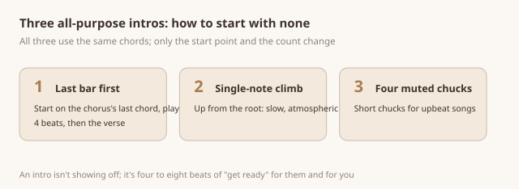
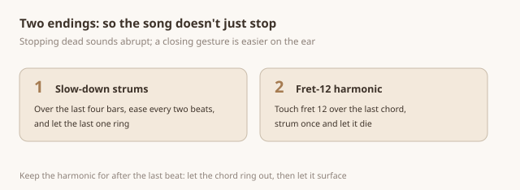

# Chapter 20: No Intro? Universal Opening and Ending Formulas for Beginners

> **What this chapter covers**
> 1. Fix the awkward moment when all you have is a lyrics-plus-chords number chart off the internet, and no idea how to open or close the song gracefully.
> 2. Learn three **universal intro formulas** you can put to work immediately with zero foundation.
> 3. Get two **universal outro formulas** that leave the sound hanging in the air, including the dreamy **"natural harmonic at the 12th fret"**.

---

## 20.1 Three universal "intro" formulas for beginners

When you want to play and sing a song at a friend's gathering, or record a cover, don't just open your mouth and sing the first word without a sound. Neither the listeners nor you will be able to find the tempo or the pitch. Apply the three producer-level opening formulas below, and any number chart has a professional intro straight away:

| Intro formula | How it's designed, and which chords it picks | What the right hand actually does | Where it suits |
| :--- | :--- | :--- | :--- |
| **Formula 1: borrow the end of the chorus** | Borrow the song's own **"chord progression from the last 2–4 bars of the chorus"** (e.g. `F - G - C`). | Play it once at the song's own tempo, then hold the last `C` chord for 4 beats, which gives you a breath to get ready for the first line of the verse. | **The most natural, hardest-to-get-wrong choice of all**; it tells the listener at once what the song's main melody feels like. |
| **Formula 2: lay a two-chord bed from the verse** | Take the first two core chords of the verse (say `C` and `Am`, or `G` and `Em7`) and repeat them twice. | Use the gentle `T1213121` arpeggio pattern, plus the **hammer-on (`0 H 2`)** you learned in Chapter 16, for a melodic feel. | Fits folk, late-night monologue songs, or slower ballads. |
| **Formula 3: tap out the beat count** | Stay on the song's first main chord (say `C`) for 2 bars. | Tap the top of the guitar twice with the right palm (like a drummer counting in with the sticks, `1, 2, 3, 4`), then go straight into the main strum groove. | Fits bright, sunny, up-tempo light rock or folk songs (e.g. 〈情非得已〉 "Against My Will"). |

---

## 20.2 Building an outro that leaves something behind: slowing down and natural harmonics

When you've sung the last line of the lyric, don't behave like someone rushing off work—strum the final stroke and immediately hug the guitar away. Give the listener 3–5 seconds of room for the sound to hang there, and the whole performance goes up a level straight away:

### Two golden outro moves

1. **Ritardando plus a slow arpeggio sweep (Ritardando & Arpeggio Sweep)**:
   Slow the tempo down on purpose across the last two bars of chords (say `Dm7 → G7 → Cmaj7`). When you reach the final `Cmaj7`, use the pad of the thumb to **sweep down from the 5th string through the 4th, 3rd, 2nd and 1st, extremely slowly and with each note separate**. Let the sound fade into the air by itself.

2. **The dreamy bell ending: the natural harmonic at the 12th fret (Natural Harmonics)**:
   This is the move every beginning guitarist learns and then exclaims over—"that sounds so good!" Here is how you do it:

    * Put the pad of the left index or ring finger **"floating, extremely lightly"** directly **over the 12th fret wire** (the metal bar of the fret). Careful: **do not press the string down onto the fretboard at all**—the skin only has to touch the surface of the string.
    * Pluck the 3rd, 2nd and 1st strings with a pick or a finger in the right hand, and **at the very instant the string sounds, lift the left-hand finger straight off it**.
    * You'll hear a clear high resonance, like a crystal wind chime or a harp, and that closes out the whole ballad.

---

## 20.3 Chapter checklist

- [ ] **Opening with confidence**: handed a number chart with no intro written on it, you can design a 4-bar intro of your own from "the last two bars of the chorus" and come into the verse smoothly.
- [ ] **The crystal harmonic**: you can pluck a clear, ringing natural harmonic right over the 12th fret wire and use it to end a song.

## Practice settings

- **Slow practice**: take the tempo at which you can play it **completely right**, drop it another 20%, and only speed up after two clean runs in a row.
- **Amount**: 10–15 minutes a day, with a one-minute break in the middle. Better short and accurate than long and scattered.
- **Pass mark**: you play the whole passage with the metronome, without stopping, with no dead notes in the chords.
