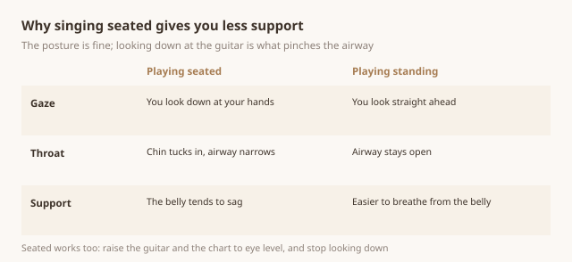
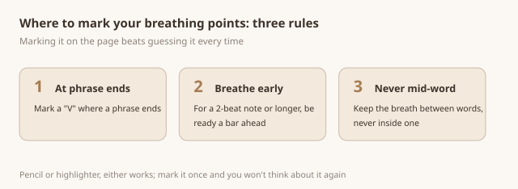

# Chapter 21: Making the Singing Sound Better — Breath, Posture and Breathing Points When You Play and Sing

> **What this chapter covers**
> 1. Fix the most damaging vocal habit beginners have when they play and sing: **"head down, eyes locked on the fretboard, which squeezes the throat so the high notes won't come"**.
> 2. Learn **"chest-and-abdomen breathing support"** (diaphragmatic support) and solve the breathlessness and the shaking final notes that come from playing while you sing.
> 3. Learn to mark **"breathing points (`V`)"** and **"emotional accent words"** on a lyric-and-chord chart, so the voice and the accompaniment become one thing.

---

## 21.1 Why is it harder to get power when you sing sitting down with a guitar?

A lot of people find that standing at a KTV with a microphone, the high notes come easily. The moment they pick up a guitar and sit down to play and sing, the voice turns flat and squeezed and the high notes won't come at all. There are three physical reasons behind this, and a small adjustment to each one fixes it straight away:

| What blocks the singing | The habit behind it | The fix that frees your voice |
| :--- | :--- | :--- |
| **1. Head down, pressing on the vocal folds** | Eyes fixed on which fret the left-hand fingers are pressing, chin pulled in tight against the collarbone. | **Make yourself look up and forward.** Put the music stand at eye level, and check the white dot markers along the side of the fretboard only out of the corner of your eye. |
| **2. The body of the guitar pressing on the diaphragm** | You hunch forward over the guitar, and its back is jammed hard against your stomach and ribs. | Sit up straight, chin slightly tucked, shoulders dropped naturally, so the sides of your ribs and your belly have room to expand outward as you breathe in. |
| **3. The mouth can't open** | Concentrating on the right-hand rhythm, the face and jaw tense up and the teeth clamp shut. | On a vowel (`a`, `o`, `e`), **open up the space between the upper and lower teeth without holding back** (imagine a small apple in your mouth) and the resonance fills out immediately. |

---

## 21.2 The secret weapon on a lyric chart: marking the breathing points

Before they record a vocal in the studio, professional singers always mark up the lyric sheet in pencil. When you practise playing and singing, one minute spent marking the three symbols below will make your singing noticeably steadier:

* **`V` (breathing mark)**: mark it **half a beat (the `and`) before** the start of each phrase. Don't wait until you've run out of air and then snatch a breath—that makes the first beat of the next line rush, or makes you miss a strum.
* **`▲` (emotional accent word)**: mark the most important word in the line (for example the stressed syllable at the start of a two-syllable word), and when you sing that word, add a touch more weight to the right-hand strum, so the voice and the guitar reach their peak together.
* **`~` (breath carried through the final note)**: mark it after a long held note, as a reminder to let the breath taper off along with the guitar's ringing, instead of cutting the word off short.

---

## 21.3 Chapter checklist

- [ ] **Playing without looking down**: without lowering your head to watch the left hand, using only peripheral vision and muscle memory, you can get through a round of `C - Am - Fmaj7 - G` and sing at the same time.
- [ ] **Breathing without panic**: the `V` breathing points are already marked on the lyric chart of your practice song, and the long lines of the chorus no longer leave you gasping for air.

## Practice settings

- **Slow practice**: take the tempo at which you can play it **completely right**, drop it another 20%, and only speed up after two clean runs in a row.
- **Amount**: 10–15 minutes a day, with a one-minute break in the middle. Better short and accurate than long and scattered.
- **Pass mark**: you play the whole passage with the metronome, without stopping, with no dead notes in the chords.
